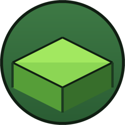

<div align="center">
    
</div>

<h1 align="center">GBL 启动器</h1>

<div align="center">

[](https://github.com/abc0384821-dot/gbl)
[](https://gitee.com/abc0384821-dot/gbl)
[](https://gbl-website.pages.dev/)
[](https://github.com/abc0384821-dot/gbl/releases)
[](LICENSE)

</div>

---

GBL 是一款 Minecraft 启动器，界面用 JavaFX 自绘，跑在 Java 21 上。装游戏、装加载器、管模组、开联机，都在一个窗口里做完。

## 功能

- **版本安装**：原版游戏、资源文件、库文件一键下载，支持镜像加速和断点续传，下完直接能进游戏。
- **加载器**：Fabric、Quilt、Legacy Fabric、Forge、NeoForge、OptiFine、Cleanroom 都能装，装完自动出现在版本列表里。
- **模组管理**：搜索、安装、更新、启停、删除，自动检查前置依赖。数据源是 Modrinth 和 CurseForge，也能导入 `.mrpack` 整合包。
- **账号**：微软正版登录，外置登录（LittleSkin、authlib-injector 服务器）。
- **皮肤**：本地皮肤库，3D 预览，随时换回默认皮肤。
- **联机**：内置房间服务，房主开房后拿到邀请码，朋友填码就进同一个世界。
- **日常使用**：深浅色主题跟随系统、自动更新、单实例（重复启动只把已有窗口拉到前面）、开机自启、托盘常驻。

## 下载

- 官网：<https://gbl-website.pages.dev/>
- Gitee Releases：<https://gitee.com/abc0384821-dot/gbl/releases>
- GitHub Releases：<https://github.com/abc0384821-dot/gbl/releases>

官网提供便携包和更新包两种。便携包自带 Java 运行时，解压就能用；更新包给已经装过旧版的人。

## 从源码构建

需要 JDK 21（含 `javac`、`jar`、`jpackage`）和 Maven 3.9 以上。

```bash
git clone https://github.com/abc0384821-dot/gbl.git
cd gbl
mvn -f pom.xml package
```

想直接看界面，跑这个：

```bash
mvn -f pom.xml javafx:run
```

要一个双击即开、自带运行时的包，用 `jpackage`：

```bash
jpackage --type app-image --name GBL \
         --input target --main-jar mc-launcher.jar \
         --main-class com.mclauncher.LauncherApp \
         --icon src/main/deploy/app.ico
```

Windows 的 cmd 里续行符是 `^`，PowerShell 和 shell 里是反斜杠，按自己用的终端换一下就行。`src/main/deploy/` 里放着窗口图标和 `authlib-injector.jar`，打包时按相对路径取。

## 项目结构

```
pom.xml                        Maven 配置，JavaFX 走 module-path
src/main/java/com/mclauncher/  主程序：启动、下载、加载器、模组、账号、更新
  multiplayer/                 联机：房间服务、邀请码、隧道、网络探测
  ui/                          界面层与自绘控件
src/main/resources/            图标、皮肤、样式表（theme.css / popup-dark.css）
src/main/deploy/               打包用图标与 authlib-injector
docs/                          架构、需求、类图与时序图
```

## CurseForge API Key

仓库里不放任何 key。要用 CurseForge 相关功能，按下面任一种方式给：

- 环境变量 `GBL_CF_API_KEY`
- 本机文件 `~/.gbl/curseforge.key`，内容就是一行 key
- 启动器「设置」页里粘贴

三种都没有时，CurseForge 相关功能不可用，其它功能照常。

## 仓库里有什么，没有什么

这里只有 GBL 自己的代码。没有第三方启动器的源码，也没有任何 API Key 或 token。

联机引擎的第三方二进制（terracotta）和 Java 运行时不在仓库里，发布打包时会下载并按 SHA256 校验。

## 参与贡献

- 报 Bug、提需求：到 [GitHub Issues](https://github.com/abc0384821-dot/gbl/issues) 或 [Gitee Issues](https://gitee.com/abc0384821-dot/gbl/issues)，写清版本号、操作系统、复现步骤。
- 改代码：Fork 之后提 Pull Request，说明改了哪儿、为什么改。
- 更多细节看 [CONTRIBUTING.md](CONTRIBUTING.md)。

## 开源协议

本项目以 [MIT](LICENSE) 协议开源。

第三方组件（JavaFX、authlib-injector、terracotta 等）各按自己原有的协议发布，详见各自的发行说明和 `pom.xml`。

## 说明

GBL 是非官方启动器，和 Mojang Studios、Microsoft 没有关系。Minecraft 是 Mojang Studios 的商标，请用正版账号登录游戏。
