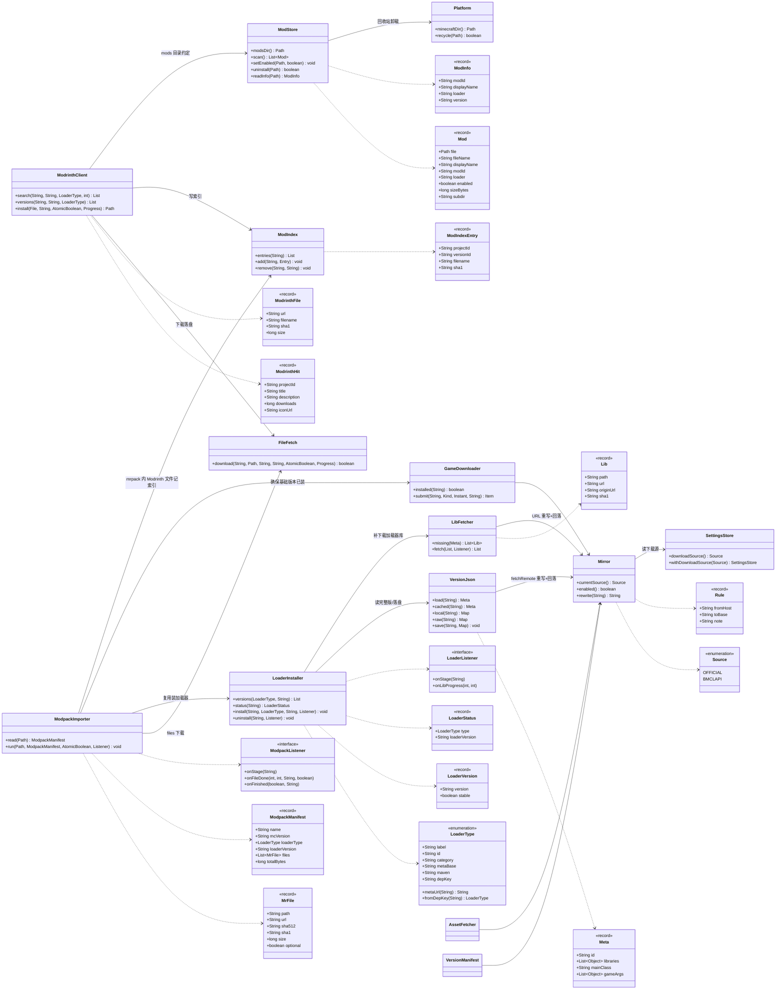
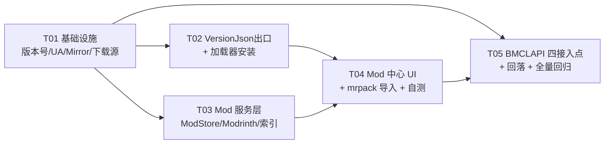

# GBL 0.7.0「Mod 三件套」增量系统架构设计 + 任务分解

| 项 | 内容 |
|---|---|
| 文档类型 | 增量架构设计（配合 `docs/PRD-0.7.0-mod.md` 使用） |
| 项目 | GBL Minecraft 启动器（包名 `com.mclauncher`） |
| 目标版本 | 0.7.0（当前 0.6.1） |
| 技术栈 | JavaFX 21 UI（`ui\ShellView.java` 一套代码）+ 纯 Java 服务层；零第三方依赖 |
| 设计蓝本 | `docs/HMCL-MOD-REFERENCE.md`（HMCL 机制提炼） |
| 范围 | P0 共 9 项（含 BMCLAPI Mojang 域名镜像）；P1（Forge processors 等）只留扩展位 |
| 撰写 | Bob（Architect） |
| 状态 | 待工程实现 |

---

## Part A：系统设计

### 1. 实现方案 + 选型

#### 1.1 技术难点分析

| # | 难点 | 结论 / 选型 |
|---|---|---|
| D1 | **加载器集成点**：GBL 无 HMCL 的 patch 系统，`LibFetcher`/`GameLauncher` 只认 version JSON 的 `libraries`/`mainClass`/`arguments` | 把加载器 libraries/mainClass/args **合并写回目标版本 JSON**（就地升级），下载与启动链路零改动。合并/备份/还原算法见 §1.4，是本版最核心的算法 |
| D2 | **完整版 JSON 出口**：本地 `<id>.json` 是精简版（无 libraries/assetIndex），合并必须基于完整版 | 给 `VersionJson` 补 `local()/raw()/save()` 三个出口，复用已有「本地→缓存→网络」三级补齐逻辑，只重构成公共方法、不改行为（§1.5） |
| D3 | **jar 内 mod 元数据**：fabric.mod.json / quilt.mod.json / mcmod.info / mods.toml / litemod.json 五种格式，其中 mods.toml 是 TOML 不是 JSON | `java.util.zip.ZipFile` + 自研 `Json.java` 解析四种 JSON；mods.toml 用极简行扫（只取 `modId`/`displayName` 两个键），不引 TOML 库 |
| D4 | **Modrinth API**：facets 过滤、sha1 校验、300 req/min 限速 | 新 HttpClient（默认 ProxySelector，与 `Net.java` 纯直连一致）；搜索串行 + UI 防抖 300ms；不做预取翻页；安装走 cdn.modrinth.com 直链 |
| D5 | **.mrpack 导入**：zip 解压 + 逐条下载校验 + 可取消清理 + 复用加载器安装 | 读 `modrinth.index.json`（`Json.java`，`fileSize` 是 Double 需 `longValue()`）；overrides 解压防 zip-slip；files 并行 ≤4（对齐 `LibFetcher.PARALLEL`）；`.part` 落盘、失败/取消删除；加载器安装直接调 `LoaderInstaller` |
| D6 | **BMCLAPI 镜像**：4 个下载接入点 + 失败回落，且不能破坏现有下载链 | 独立 `Mirror` URL 重写 helper（规则表驱动），每个接入点「先镜像、失败回落官方一次」；`SettingsStore` 加下载源字段 |
| D7 | **自测不破**：`nav-gamemgmt`/`page-title` 类名与 `Snapshot.java` 既有点击路径 | 类名全保留；页面标题文案改「Mod 中心」（PRD Q6 已拍板）；`TAB_SWITCH` 用例把 tab 查找范围收窄到下载页子树（避免 Mod 中心 3 个 tab 计入下载页的 7 个），新增 MOD 用例只做**结构断言**（不依赖网络） |

#### 1.2 新模块划分（全部放 `com.mclauncher` 包，纯服务层）

```
com.mclauncher
├── Mirror.java            【新】下载源镜像：规则表 + URL 重写 + 开关（P0-9）
├── LoaderType.java        【新】Fabric/Quilt/LegacyFabric 枚举：meta API、maven、mrpack 依赖键
├── LoaderInstaller.java   【新】元数据型加载器安装/卸载/状态（P0-2）：合并、备份、还原、补库
├── ModStore.java          【新】Mod 扫描/启停/卸载 + jar 元数据读取（P0-3）
├── ModrinthClient.java    【新】Modrinth 搜索/版本查询/安装（P0-4）
├── ModIndex.java          【新】mod 本地索引 ~/.gbl/cache/mods/<versionId>/index.json（P0-4/P1-3 前置）
├── FileFetch.java         【新】通用单文件下载：.part + sha1/sha512 校验 + 取消（Modrinth 与 mrpack 共用）
├── ModpackImporter.java   【新】.mrpack 整合包导入（P0-6）：读 index/解压 overrides/下载 files/复用加载器
└── （改动）VersionJson / SettingsStore / LibFetcher / AssetFetcher /
          GameDownloader / VersionManifest / LauncherApp / MicrosoftAuth / Platform
```

模块职责边界：

- **Mirror**：只做「URL → URL」的重写与开关判断，不发起任何请求、不知道下载语义。规则表见 §1.6。
- **LoaderInstaller**：唯一知道「加载器怎么并进版本 JSON」的类；只依赖 `VersionJson`（读写 JSON）与 `LibFetcher`（补库），不碰 UI、不碰网络细节之外的事（meta API 由它直连）。
- **ModStore**：唯一知道 `mods/` 目录形态与 jar 元数据格式的类；启用/禁用只用 `.disabled` 改名；卸载走 `Platform.recycle`。
- **ModrinthClient / ModpackImporter**：两者都通过 `FileFetch` 落盘，都不自己拼 classpath 或启动逻辑。ModpackImporter 复用 LoaderInstaller（加载器）与 GameDownloader（基础版本），**不复制**任何安装逻辑。
- **ModIndex**：只读写索引文件，不做下载、不扫盘。
- **FileFetch**：无状态静态工具，输入 url+目标+期望哈希+取消旗标，输出成败；`.part` 生命周期自己管。

#### 1.3 关键设计决策一：加载器集成点 = 版本 JSON（精确合并语义）

**就地升级**（PRD Q1 拍板）：不新建 `1.20.1-fabric` 版本目录，直接改目标版本 JSON。理由：最小变更、不污染游戏列表、`LibFetcher`/`GameLauncher`/`GameScanner` 零改动。

**磁盘布局**（以 `1.20.1` 为例）：

```
.minecraft/versions/1.20.1/
├── 1.20.1.jar            # 客户端 jar（不动）
├── 1.20.1.json           # GameDownloader 落的精简版；安装后 = 合并完整版
├── version.json          # 与 <id>.json 同内容（GameScanner/VersionJson 都认）
└── 1.20.1.vanilla.json   # 【新】安装时创建的原版备份（不存在时才创建；卸载后删除）
```

**`gblLoader` 标记结构**（写在合并后的 `version.json` 与 `<id>.json` 里）：

```json
"gblLoader": {
  "type": "fabric",                    // fabric | quilt | legacyfabric（= LoaderType.id）
  "loaderVersion": "0.15.7",
  "minecraftVersion": "1.20.1",
  "installedAt": "2026-10-13T09:30:00Z"   // ISO-8601 UTC
}
```

**安装算法**（`LoaderInstaller.install`，步骤即验收口径）：

1. **取完整版**：`full = VersionJson.raw(versionId)`
   - `null` → 抛 `IOException("「1.20.1」读不到版本元信息（version.json 没了），这个游戏可能装得不全")`
   - `VersionJson.isThin(full)` 仍为真（离线且无缓存）→ 抛 `IOException("版本元信息补不齐（连不上官方、本地也没有缓存），加载器装不了；联网后重试")`
2. **前置校验**（两条硬闸，PRD P0-2 规则③/Q5）：
   - `status(versionId) != null` → 抛 `IOException("这个版本已经装了 Fabric 0.15.7，先卸载它才能装别的加载器")`
   - `full.mainClass != "net.minecraft.client.main.Main"` → 抛 `IOException("这个版本的 mainClass 不是原版（可能已经装过 Forge 等加载器），GBL 暂不支持在它上面叠加安装")`
3. **备份**：`<id>.vanilla.json` 不存在时，把当前 `version.json`（缺则 `<id>.json`）**原样字节**拷为备份；已存在（上次安装中断的残留）则保留不动——保证备份永远是最初那份。
4. **拉加载器元数据**：`GET <metaBase>/<mcVersion>/<loaderVersion>`（`LoaderType.metaUrl`），返回 `{loader, intermediary, launcherMeta}`；非 2xx/解析失败 → `IOException("Fabric 的版本接口暂时连不上（meta.fabricmc.net），稍后重试或检查网络")`。
5. **合并**（对 `full` 深拷贝出 `merged`，逐项）：
   - **mainClass 覆盖**：`launcherMeta.mainClass` 可能是字符串或 `{client: "..."}`（对象取 `.client`）→ 直接 `merged.put("mainClass", v)`。
   - **libraries 去重追加**：以 `downloads.artifact.path` 为键（无 path 用 maven `name`），`merged.libraries` 已有的不重复收；`launcherMeta.libraries` 的 `common`+`server`（有 `client` 键也一并收，防御性并集）逐条转换：
     ```
     maven 坐标 "g:a:v"     → path = g.replace('.','/') + "/a/v/a-v.jar"
     maven 坐标 "g:a:v:c"  → path = …/a-v-c.jar（带 classifier）
     url = 条目自带 url（补齐尾 '/'）+ path；条目无 url 时用 LoaderType.maven
     sha1 = ""、size = 0（Fabric/Quilt 的 launcherMeta 不给哈希；LibFetcher 对空 sha1 走「不校验」分支，见 LibFetcher.downloadOne）
     ```
   - **游戏参数追加**（仅 `launchwrapper` 型加载器需要；Fabric/Quilt 现代版一般不触发，但逻辑保留）：
     - `merged.arguments.game` 是数组 → 末尾追加 `"--tweakClass", tweaker`
     - 否则 `merged.minecraftArguments` 是字符串 → 末尾追加 `" --tweakClass <tweaker>"`
     - 两者都没有 → 新建 `arguments: {game: ["--tweakClass", tweaker]}`
     - `GameLauncher.expandList/flatten` 对裸字符串原样展开，两种老新格式都通（VersionJson.toMeta 已分别收集）
   - **`gblLoader` 标记**：如上结构写入。
   - **元信息字段保全**：本地精简版里的 `type`/`jar`（GBL 自己的字段）以及 `time`，若 `merged` 没有就补上——官方完整版 JSON 没有 `type`，不补 `GameScanner.describe` 会把类型退化成「正式版」。
6. **落盘**：`VersionJson.save(versionId, merged)` → 同一内容写 `version.json` 与 `<id>.json`（tmp+move，不截断直写）。
7. **补下载加载器库**：`meta = VersionJson.load(versionId)`（此时本地已是完整版，直接返回）；`absent = LibFetcher.missing(meta)`；`LibFetcher.fetch(absent, 进度 → listener)`。
   - **有库失败不抛异常**：JSON 已带加载器标记，下次启动 `GameLauncher.prepare` 的 `LibFetcher.missing` 会自愈补库；listener 收到「有 N 个库没下下来，启动时会自动补」提示。
8. UI 刷新状态条。

**卸载算法**（`LoaderInstaller.uninstall`，验收③「卸载后 JSON 与备份逐字节一致」）：

1. `<id>.vanilla.json` 不存在 → 抛 `IOException("找不到原版备份 1.20.1.vanilla.json，没法卸载还原；可以手动删掉 version.json 里的 gblLoader 段")`。
2. **逐字节还原**：`Files.copy(bak → version.json, REPLACE_EXISTING)`，同样写 `<id>.json`（直接拷字节，不重新序列化，保证逐字节一致）。
3. 删除备份文件。
4. `libraries/` 目录里的加载器 jar **不删**：该目录多版本共用，留着无害，且下次安装可直接命中。
5. 还原后本地 JSON 回到精简版，`VersionJson.load` 自动回落到「缓存/网络完整版」老路径，行为与 0.6.1 完全一致。

**与精简版/完整版的关系**：安装后本地 `<id>.json` 就是完整版（含 libraries），`VersionJson.load` 的 `isThin` 判假、不再读缓存；卸载后回到精简版，重新走三级补齐。缓存 `~/.gbl/cache/versions/<id>.json` 全程只被官方完整版写入，**永不包含 gblLoader 标记**，不会污染。

**P1 扩展位（Forge/NeoForge）**：合并出口（`VersionJson.save` + `gblLoader` 标记 + 备份/还原）与加载器类型枚举（`LoaderType`）已按「安装器 jar 型」预留——P1 只需新增 `ForgeInstaller`（读 `install_profile.json`，`spec` 版跑 processors，Java 用自带 JRE，PRD Q7 已定），产出同样的 `merged Map` 后调同一个 `VersionJson.save` + `LibFetcher` 补库。版本 JSON 集成点不被堵死。

#### 1.4 关键设计决策二：VersionJson 完整版出口（T3）

现有 `load()` 内部已含「本地 → 缓存 → 网络」三级逻辑。重构为公共出口，**行为不变**：

```java
public static Map<String, Object> local(String id)   // 只读本地 <id>.json / version.json，读不到返回 null
public static Map<String, Object> raw(String id)     // 完整原始 JSON Map：本地完整→缓存(过期重拉)→网络；全失败返回本地那份（调用方自行 isThin 判断）
public static void save(String id, Map<String,Object> full)  // 写 version.json + <id>.json（tmp+move）
```

`load(id)` 改为 `Map m = raw(id); return m == null ? null : toMeta(id, m);`——原有三级、过期重拉、坏缓存重拉语义原样保留。`raw()` 是 P0-2 的前置，也是 mrpack 导入时读取目标版本现状的唯一入口。

#### 1.5 UI 集成（P0-7）

`ShellView.buildGameManagePage()` **方法名与字段名不动**（`gameManagePage`），只改内部：

- 侧边栏 `NavItem` 文案「游戏管理」→「**Mod 中心**」；`nav-gamemgmt` 类名保留（Snapshot 点击路径不变）。
- 页面结构（根容器加类名 `mod-center`，作为自测作用域锚点）：
  ```
  VBox(game-manage-page, mod-center)
  ├─ HBox header: Label「Mod 中心」(page-title) + 下载源 ComboBox(官方/BMCLAPI) + 当前游戏 ComboBox
  ├─ HBox 状态条: 「Fabric 0.15.7 · 已安装」/「原版 · 未安装加载器」/ 未选游戏时空态引导
  ├─ HBox tab-bar: 3 × tab-btn（加载器 / Mod / 整合包）
  └─ VBox body: 按 tab 切换
  ```
- 三个 tab 的构建**不发任何网络请求**（buildPages 启动时执行）：加载器版本下拉先进「加载中…」，由后台线程拉列表后 `Platform.runLater` 回填；网络不可用时显示「版本列表加载失败，稍后重试」，不卡界面。
- 未选游戏：整页显示空态引导卡（「先去游戏列表选一个游戏」），不白屏。
- 进度/反馈全部沿用 `toast()` + 下载队列风格进度行（VBox 行 + Label），**不造第二套反馈组件**。
- `showPage(Page.GAMEMGMT)` 分支触发 `refreshModCenter()`（进场懒刷新：重扫游戏列表、加载器状态、mod 列表）——游戏列表页改当前游戏后切过来即同步。
- **自测兼容处理**：`Snapshot.TAB_SWITCH` 原用 `root.lookupAll` 全局找 `tab-btn`，Mod 中心 3 个 tab 会把「tab 共 7 个」变成 10。修法：该用例先把查找范围收窄到 `.download-page` 子树再数 tab（语义不变，仍是验下载页 7 个 tab 的顺序与空态）。`GAME_MGMT_CLICK` 打印的页标题从「游戏管理」变为「Mod 中心」（PRD Q6 拍板，预期变化）。

#### 1.6 关键设计决策三：Mirror 域名→镜像映射规则表

```java
public final class Mirror {
    public enum Source { OFFICIAL("官方"), BMCLAPI("BMCLAPI 镜像"); }
    public record Rule(String fromHost, String toBase, String note) {}
    public static final List<Rule> RULES = List.of(
        new Rule("launchermeta.mojang.com",           "https://bmclapi2.bangbang93.com",            "路径原样拼接（version_manifest.json）"),
        new Rule("piston-meta.mojang.com",            "https://bmclapi2.bangbang93.com",            "路径 /v1/packages/<hash>/x.json → /version/<hash>/json（工程期 curl 复核）"),
        new Rule("libraries.minecraft.net",           "https://bmclapi2.bangbang93.com/libraries",  "路径原样拼接"),
        new Rule("resources.download.minecraft.net",  "https://bmclapi2.bangbang93.com/assets",     "路径原样拼接"),
        new Rule("piston-data.mojang.com",            "https://bmclapi2.bangbang93.com/objects",    "路径 /v1/objects/<sha1>/… → /objects/<sha1>（工程期 curl 复核）"));

    public static Source currentSource();          // 读 SettingsStore.downloadSource()
    public static boolean enabled();               // != OFFICIAL
    public static String rewrite(String url);      // 未命中规则 / 官方源 → 原样返回；命中 → 换基地址
}
```

**回落策略**（4 个接入点统一）：每个接入点先用 `Mirror.rewrite(url)` 请求，失败（IO 异常或非 2xx）后**用原始官方 URL 再试一次**。镜像路径映射即使有个别不准，最坏也是「该次请求慢一拍」，功能不瘫。Modrinth 与加载器 meta API **不走镜像**（蓝本第 5 节：国内多数可直连），PRD 已拍板。

4 个接入点（+1 个同族）：

| 接入点 | 文件 | 改动 |
|---|---|---|
| 版本清单 | `VersionManifest.download()` | URL 经 `Mirror.rewrite`，失败回落官方一次 |
| 客户端 jar | `GameDownloader.run()` | `job.jarUrl` 用重写后地址，保留官方地址；整体失败后换官方地址重跑一次 |
| 依赖库 | `LibFetcher` | `Lib` record 加 `originUrl` 字段（紧凑构造器兜底）；`missing()` 产出重写后 url，`downloadOne` 重试到头再试 `originUrl` |
| 资源 | `AssetFetcher` | `Obj.url()` 加重写，`downloadOne` 失败后回落官方地址 |
| 版本 JSON（同族） | `VersionJson.fetchRemote()` | manifest 里查到的 url 同样经 `Mirror.rewrite` + 回落 |

#### 1.7 .mrpack 导入与其它模块的复用关系

```
ModpackImporter.run(mrpack)
├─ 读 modrinth.index.json（Json.java；fileSize Double→longValue）
├─ 确认卡由 UI 渲染（read() 只读不落盘）
├─ ① 确保基础版本：GameDownloader.installed(id)?
│    否 → VersionManifest.allView() 查 id → DEFAULT.submit(...) → 轮询 item 至 DONE/FAILED（≤15 min）
├─ ② 装加载器：LoaderInstaller.install(id, type, version, listener)   ← 直接复用 P0-2
│    forge/neoforge 依赖 → 明确提示「P0 暂不支持 Forge/NeoForge 整合包」
├─ ③ 解压 overrides/ + client-overrides/ 到 .minecraft 根（zip-slip 防护）
├─ ④ files[] 逐条下载（并行≤4，FileFetch）：跳过 env.client=="optional"；已存在且哈希一致 → 跳过
├─ ⑤ 落 .minecraft/modrinth.index.json（P2 更新/导出用）
└─ 取消（AtomicBoolean）：删掉本次产生的全部 .part；不写索引；已下完的文件保留（重导入按哈希跳过，可续）
```

覆盖策略（PRD 规则②「不静默数据丢失」，架构定）：目标已存在时——内容哈希一致 → 跳过；不一致 → 旧文件移到 `.minecraft/.gbl-modpack-backup/<整合包名>/<相对路径>` 再写新文件，并记日志。既不静默覆盖，也不把用户目录塞满备份（只备份真被覆盖的）。

---

### 2. 文件列表（相对仓库根路径）

**新增（8 个，全在 `src/main/java/com/mclauncher/`）**：

| 文件 | 职责 |
|---|---|
| `Mirror.java` | 下载源镜像规则表 + URL 重写 |
| `LoaderType.java` | Fabric/Quilt/LegacyFabric 枚举（meta/maven/分类/依赖键） |
| `LoaderInstaller.java` | 加载器安装/卸载/状态、JSON 合并、备份还原 |
| `ModStore.java` | mod 扫描/启停/卸载 + jar 元数据 |
| `ModrinthClient.java` | Modrinth 搜索/版本/安装 |
| `ModIndex.java` | mod 本地索引读写 |
| `FileFetch.java` | 通用 .part 下载 + sha1/sha512 校验 + 取消 |
| `ModpackImporter.java` | .mrpack 导入 |

**修改（11 个）**：

| 文件 | 改动点 | 任务 |
|---|---|---|
| `src/main/java/com/mclauncher/LauncherApp.java` | `VERSION = "0.7.0"` | T01 |
| `src/main/java/com/mclauncher/GameDownloader.java` | `AGENT = "GBL-Minecraft-Launcher/" + VERSION`；客户端 jar URL 镜像重写+回落 | T01/T05 |
| `src/main/java/com/mclauncher/MicrosoftAuth.java` | `USER_AGENT` 改引用 `VERSION`（消灭硬编码 0.6.1） | T01 |
| `src/main/java/com/mclauncher/VersionManifest.java` | UA 改引用 `AGENT`；清单 URL 镜像重写+回落 | T01/T05 |
| `src/main/java/com/mclauncher/SettingsStore.java` | 加 `DownloadSource` 字段（默认 OFFICIAL）+ `withDownloadSource` + 存取 | T01 |
| `src/main/java/com/mclauncher/VersionJson.java` | 加 `local()/raw()/save()`；`load()` 重构复用；`fetchRemote` 镜像重写+回落 | T02/T05 |
| `src/main/java/com/mclauncher/LibFetcher.java` | `Lib` 加 `originUrl`；URL 镜像重写+回落 | T05 |
| `src/main/java/com/mclauncher/AssetFetcher.java` | `Obj.url()` 镜像重写；`downloadOne` 回落 | T05 |
| `src/main/java/com/mclauncher/Platform.java` | `recycle` 增加单文件分支（DeleteFile，让 mod 卸载真进 Windows 回收站；目录行为不变） | T03 |
| `src/main/java/com/mclauncher/ui/ShellView.java` | 游戏管理页 → Mod 中心（三 tab + 下载源选择器 + 当前游戏选择器 + 状态条 + 空态） | T04 |
| `src/main/java/com/mclauncher/ui/Snapshot.java` | `TAB_SWITCH` 作用域收窄；新增 MOD_* 用例并挂进两趟序列 | T04 |
| `src/main/resources/com/mclauncher/theme.css` | 预计零新增（复用 tab-btn/card/toast/page-blank）；确需微调时只加 `.mod-center` 少量规则 | T04 |

`tools/run_selftest.py` **不改**（它只负责起 JVM 跑 `-Dgbl.snapshot=...:all`，新用例在 Snapshot.java 里）。

---

### 3. 数据结构与接口

#### 3.1 新类公共 API（签名即实现契约）

```java
// ---------- Mirror.java ----------
public final class Mirror {
    public enum Source { OFFICIAL("官方"), BMCLAPI("BMCLAPI 镜像");
        private final String label; public String label(); }
    public record Rule(String fromHost, String toBase, String note) {}
    public static final List<Rule> RULES;                 // 规则表（见 §1.6）
    public static Source currentSource();                 // SettingsStore.downloadSource()
    public static boolean enabled();
    public static String rewrite(String url);             // 未命中/官方源 → 原样返回
}

// ---------- LoaderType.java ----------
public enum LoaderType {
    FABRIC("Fabric", "fabric", "fabric", "https://meta.fabricmc.net/v2/versions/loader/", "https://maven.fabricmc.net/", "fabric-loader"),
    QUILT("Quilt", "quilt", "quilt", "https://meta.quiltmc.org/v3/versions/loader/", "https://maven.quiltmc.org/repository/release/", "quilt-loader"),
    LEGACY_FABRIC("LegacyFabric", "legacyfabric", "legacy-fabric", "https://meta.legacyfabric.net/v2/versions/loader/", "https://maven.legacyfabric.net/", "legacy-fabric-loader");
    //         label          id(gblLoader.type)  category(Modrinth)  metaBase                 maven                          depKey(mrpack)
    public String label(); public String id(); public String category();
    public String metaBase(); public String maven(); public String depKey();
    public String metaUrl(String mcVersion);              // metaBase + mcVersion（metaBase 自带尾 '/'）
    public static LoaderType fromDepKey(String key);      // mrpack dependencies 键 → 枚举；forge/neoforge/不认识返回 null
}

// ---------- LoaderInstaller.java ----------
public final class LoaderInstaller {
    public record LoaderVersion(String version, boolean stable) {}
    public record Status(LoaderType type, String loaderVersion) {}   // 未安装返回 null
    public interface Listener {
        default void onStage(String text) {}                 // 「正在拉 Fabric 版本信息…」等
        default void onLibProgress(int done, int total) {}   // 补下载加载器库进度
    }
    /** 该 MC 版本可用的加载器版本，最新在前；stable 优先仍全量返回由 UI 决定默认选中。 */
    public static List<LoaderVersion> versions(LoaderType type, String mcVersion) throws IOException;
    /** 读本地 version.json 的 gblLoader 标记；没有返回 null。 */
    public static Status status(String versionId) throws IOException;
    /** 安装：合并写回 + 备份 + 补库。任何人话失败都抛 IOException（message 直接可显示）。 */
    public static void install(String versionId, LoaderType type, String loaderVersion, Listener listener) throws IOException;
    /** 卸载：从 <id>.vanilla.json 逐字节还原 + 删备份。 */
    public static void uninstall(String versionId, Listener listener) throws IOException;
}

// ---------- ModStore.java ----------
public final class ModStore {
    public record Mod(Path file, String fileName, String displayName, String modId,
                      String loader, boolean enabled, long sizeBytes, String subdir) {}
    // loader: "fabric" | "quilt" | "forge" | "liteLoader" | null(未知)；subdir: 一级子目录名，根目录为 null
    public record ModInfo(String modId, String displayName, String loader, String version) {}
    public static Path modsDir();                                   // Platform.minecraftDir()/mods
    public static List<Mod> scan();                                 // 根 + 一级子目录；含 .disabled；读不到元数据用文件名兜底
    public static void setEnabled(Path file, boolean enabled) throws IOException;   // .disabled 改名法
    public static boolean uninstall(Path file);                     // Platform.recycle；true=进了回收站/软回收站
    public static ModInfo readInfo(Path file);                      // jar 元数据；读不到返回全 null 记录（不抛）
    public static boolean isModFile(Path file);                     // jar/zip/litemod（可带 .disabled 后缀）
}

// ---------- ModrinthClient.java ----------
public final class ModrinthClient {
    public static final String API = "https://api.modrinth.com/v2";
    public record Hit(String projectId, String slug, String title, String description,
                      long downloads, String iconUrl) {}
    public record File(String url, String filename, String sha1, long size, boolean primary) {}
    /** 搜索：facets 固定 project_type:mod + versions:<mc>；loader 非 null 时追加 categories:<loader>。串行调用。 */
    public static List<Hit> search(String query, String mcVersion, LoaderType loader, int limit) throws IOException;
    /** 某项目的兼容版本（新→旧）：game_versions 含 mc 且 loaders 含 loader（loader 为 null 时不过滤加载器）。 */
    public static List<File> versions(String projectId, String mcVersion, LoaderType loader) throws IOException;
    /** 下载到 mods 目录 + 验 sha1 + 写 ModIndex；同名已存在跳过（返回已存在路径）；取消/失败删 .part。 */
    public static Path install(File file, String versionId, java.util.concurrent.atomic.AtomicBoolean cancelled,
                               ProgressListener listener) throws IOException;
    public interface ProgressListener { void onProgress(long doneBytes, long totalBytes); }
}

// ---------- ModIndex.java ----------
public final class ModIndex {
    public record Entry(String projectId, String versionId, String filename, String sha1, String installedAt) {}
    public static List<Entry> entries(String versionId);            // 读不到返回空列表
    public static void add(String versionId, Entry entry) throws IOException;
    public static void remove(String versionId, String filename) throws IOException;   // 卸载时按文件名摘除
    // 落盘：~/.gbl/cache/mods/<versionId>/index.json（schemaVersion:1）
}

// ---------- FileFetch.java ----------
public final class FileFetch {
    /** 下载 url → target（.part 落盘、验哈希后移动）。sha512 优先、退化 sha1、都空不校验。
     *  取消或失败：删 .part，返回 false。成功返回 true。 */
    public static boolean download(String url, Path target, String sha1, String sha512,
                                   java.util.concurrent.atomic.AtomicBoolean cancelled,
                                   ProgressListener on) throws IOException;
    public interface ProgressListener { void onProgress(long doneBytes, long totalBytes); }
    public static final int RETRY = 3;
}

// ---------- ModpackImporter.java ----------
public final class ModpackImporter {
    public record MrFile(String path, String url, String sha512, String sha1,
                         long size, boolean optional) {}            // optional = env.client=="optional"
    public record Manifest(String name, String versionId, String summary, String mcVersion,
                           LoaderType loaderType, String loaderVersion,   // forge/neoforge 时 loaderType=null
                           List<MrFile> files, long totalBytes) {}
    /** 只读 zip 里的 modrinth.index.json，不落盘（供 UI 渲染确认卡）。 */
    public static Manifest read(Path mrpack) throws IOException;
    /** 全流程导入（后台线程调用）；取消走 cancelled 旗标。任何人话失败抛 IOException。 */
    public static void run(Path mrpack, Manifest manifest, java.util.concurrent.atomic.AtomicBoolean cancelled,
                           Listener listener) throws IOException;
    public interface Listener {
        void onStage(String text);                                   // 「正在安装 Fabric…」「正在解压…」等
        void onFileDone(int done, int total, String fileName, boolean ok);
        void onFinished(boolean ok, String note);
    }
}

// ---------- VersionJson 新增出口 ----------
public static Map<String, Object> local(String id) throws IOException;      // 只读本地
public static Map<String, Object> raw(String id) throws IOException;        // 完整版 Map（三级补齐）
public static void save(String id, Map<String, Object> full) throws IOException;  // 写 version.json + <id>.json

// ---------- SettingsStore 新增 ----------
public enum DownloadSource { OFFICIAL("官方"), BMCLAPI("BMCLAPI 镜像"); public String label(); }
public DownloadSource downloadSource();
public SettingsStore withDownloadSource(DownloadSource source);
// 持久化键 "downloadSource"，缺省 OFFICIAL（老配置无此键 → 宽容读取消）
```

#### 3.2 类图

见 `docs/class-diagram.mermaid`（正文见下）。



---

### 4. 程序调用流程

见 `docs/sequence-diagram.mermaid`（四张：加载器安装/卸载、Modrinth 搜索安装、.mrpack 导入、BMCLAPI 镜像重写）。正文如下。

#### 4.1 加载器安装 / 卸载

```mermaid
sequenceDiagram
    actor U as 用户
    participant UI as ShellView Mod中心
    participant LI as LoaderInstaller
    participant VJ as VersionJson
    participant LT as LoaderType/meta API
    participant LF as LibFetcher
    participant FS as versions/&lt;id&gt;/

    U->>UI: 加载器卡片选版本 → 点「安装」
    UI->>UI: 起 daemon 线程 gbl-loader（回调 Platform.runLater）
    UI->>LI: install("1.20.1", FABRIC, "0.15.7", listener)
    LI->>VJ: raw("1.20.1")
    VJ-->>LI: full（本地完整/缓存/网络三级补齐）
    LI->>LI: 校验：未装加载器 且 mainClass=vanilla
    LI->>FS: 备份 version.json → 1.20.1.vanilla.json（已存在则保留）
    LI->>LT: GET meta.fabricmc.net/v2/versions/loader/1.20.1/0.15.7
    LT-->>LI: {loader, intermediary, launcherMeta}
    LI->>LI: 合并：libraries去重追加 / mainClass覆盖 / --tweakClass / gblLoader标记 / 元信息字段保全
    LI->>VJ: save("1.20.1", merged)
    VJ->>FS: 写 version.json 与 1.20.1.json（tmp+move）
    LI->>VJ: load("1.20.1")
    LI->>LF: missing(meta) → fetch(absent)
    LF-->>UI: onLibProgress（下载线程 → runLater）
    LI-->>UI: 返回（有库失败仅提示：启动时 GameLauncher 自愈补库）
    UI-->>U: toast「Fabric 0.15.7 安装完成」+ 状态条刷新

    Note over U,FS: 卸载：uninstall() → 拷 1.20.1.vanilla.json 逐字节还原 version.json/<id>.json → 删备份
```

#### 4.2 Modrinth 搜索 + 安装

```mermaid
sequenceDiagram
    actor U as 用户
    participant UI as ShellView Mod中心
    participant MC as ModrinthClient
    participant FF as FileFetch
    participant MI as ModIndex
    participant MS as ModStore

    U->>UI: 搜索框输入「sodium」（防抖 300ms，串行请求）
    UI->>MC: search("sodium", "1.20.1", FABRIC, 20)
    MC->>MC: GET api.modrinth.com/v2/search?facets=[[project_type:mod],[versions:1.20.1],[categories:fabric]]
    MC-->>UI: List~Hit~（标题/简介/下载量/图标URL）
    UI-->>U: 结果列表（图标 JavaFX Image 异步加载，失败占位）
    U->>UI: 点某结果「安装」
    UI->>UI: 起 daemon 线程 gbl-mod
    UI->>MC: versions(projectId, "1.20.1", FABRIC)
    MC->>MC: GET /v2/project/&lt;id&gt;/version → 按 game_versions/loaders 过滤取最新
    MC-->>UI: List~File~（url/filename/sha1/size）
    UI->>MC: install(file, versionId, cancelled, progress)
    MC->>MS: mods 目录同名已存在？→ 是：跳过并提示
    MC->>FF: download(url, mods/&lt;file&gt;, sha1, "", cancelled, on)
    FF->>FF: .part 落盘 → 验 sha1 → move（失败/取消删 .part）
    FF-->>MC: true
    MC->>MI: add(versionId, Entry{projectId, versionId, filename, sha1})
    MC-->>UI: 完成
    UI->>MS: scan() 刷新已装列表
    UI-->>U: toast + 行移入「已装 Mod」
```

#### 4.3 .mrpack 整合包导入

```mermaid
sequenceDiagram
    actor U as 用户
    participant UI as ShellView Mod中心
    participant MPI as ModpackImporter
    participant GD as GameDownloader
    participant LI as LoaderInstaller
    participant FF as FileFetch
    participant FS as .minecraft 根

    U->>UI: 「导入整合包」选 .mrpack
    UI->>MPI: read(mrpack)
    MPI->>FS: 只读 zip 内 modrinth.index.json
    MPI-->>UI: Manifest（名称/MC版本/加载器/文件数/总大小）
    UI-->>U: 确认卡
    U->>UI: 确认导入
    UI->>UI: 起 daemon 线程 gbl-mrpack（持 AtomicBoolean cancelled）
    UI->>MPI: run(mrpack, manifest, cancelled, listener)
    MPI->>GD: installed("1.20.1")? 否 → submit + 轮询至 DONE（≤15min）
    MPI->>LI: install("1.20.1", FABRIC, "0.15.7", listener)（forge/neoforge → 明确提示不支持）
    MPI->>FS: 解压 overrides/ + client-overrides/（zip-slip 防护；冲突先备份再覆盖）
    loop files[]（并行≤4）
        MPI->>FF: download(url, .minecraft/&lt;path&gt;, sha1, sha512, cancelled, on)
        FF-->>MPI: ok（env.client==optional 默认跳过；已存在且哈希一致跳过）
    end
    MPI->>FS: 落 .minecraft/modrinth.index.json
    MPI-->>UI: onFinished(ok, note)
    UI->>MS: scan() 刷新 + 游戏列表刷新
    UI-->>U: toast「整合包导入完成」

    Note over U,FS: 取消：删本次全部 .part、不写索引、已下完文件保留（重导入按哈希跳过可续）
```

#### 4.4 BMCLAPI 镜像重写（以客户端 jar 为例，四接入点同构）

```mermaid
sequenceDiagram
    participant UI as ShellView(下载页/设置)
    participant ST as SettingsStore
    participant MI as Mirror
    participant GD as GameDownloader
    participant CDN as bmclapi2.bangbang93.com
    participant OFF as piston-data.mojang.com

    UI->>ST: withDownloadSource(BMCLAPI).save()
    UI->>GD: submit("1.20.1", …)
    GD->>GD: resolveJarUrl → 官方 client.url
    GD->>MI: rewrite(官方url)
    MI->>ST: currentSource()
    MI-->>GD: https://bmclapi2.bangbang93.com/objects/&lt;sha1&gt;
    GD->>CDN: 分段下载（UA = GameDownloader.AGENT）
    alt 镜像失败（IO/非2xx，重试到头）
        GD->>MI: （回落）换官方地址整体重跑一次
        GD->>OFF: 分段下载
    end
    GD-->>UI: Item(DONE/FAILED)
    Note over GD,OFF: VersionManifest/LibFetcher/AssetFetcher/VersionJson 同构：先 rewrite，失败回落原址一次
```

---

### 5. 任务列表（按实现顺序，≤5 个，每个 ≥3 文件）

#### T01 项目基础设施：版本号 0.7.0 + UA 收口 + Mirror + 下载源设置

- **Source Files**：
  - `src/main/java/com/mclauncher/LauncherApp.java`（改：`VERSION = "0.7.0"`）
  - `src/main/java/com/mclauncher/GameDownloader.java`（改：`AGENT = "GBL-Minecraft-Launcher/" + LauncherApp.VERSION`）
  - `src/main/java/com/mclauncher/MicrosoftAuth.java`（改：`USER_AGENT` 引用 `VERSION`，消灭硬编码 0.6.1）
  - `src/main/java/com/mclauncher/VersionManifest.java`（改：UA 引用 `GameDownloader.AGENT`）
  - `src/main/java/com/mclauncher/Mirror.java`（新）
  - `src/main/java/com/mclauncher/SettingsStore.java`（改：`DownloadSource` 字段 + `withDownloadSource` + 存取，缺省 OFFICIAL）
- **Dependencies**：无
- **Priority**：P0
- **验收**：标题栏 v0.7.0；`grep 0.6.1` 无残留（官网物料除外）；UA 含 0.7.0；`Mirror.rewrite` 单测（官方源恒等、命中规则换基、未命中原样）；配置写读 `downloadSource` 不破坏老配置。

#### T02 VersionJson 完整版出口 + 元数据型加载器安装/卸载（P0-2）

- **Source Files**：
  - `src/main/java/com/mclauncher/VersionJson.java`（改：`local()/raw()/save()`，`load()` 重构复用，行为不变）
  - `src/main/java/com/mclauncher/LoaderType.java`（新）
  - `src/main/java/com/mclauncher/LoaderInstaller.java`（新）
- **Dependencies**：T01
- **Priority**：P0
- **验收**：P0-2 四条验收逐条过（合并后 JSON 含加载器库/mainClass/gblLoader；能启动；卸载逐字节还原可再装；已装 Forge 型 mainClass 阻断；下拉默认最新稳定）。备份/还原/合并算法按 §1.3。

#### T03 Mod 服务层：扫描/启停/卸载 + Modrinth + 本地索引 + 下载 helper（P0-3/4/5）

- **Source Files**：
  - `src/main/java/com/mclauncher/ModStore.java`（新）
  - `src/main/java/com/mclauncher/ModrinthClient.java`（新）
  - `src/main/java/com/mclauncher/ModIndex.java`（新）
  - `src/main/java/com/mclauncher/FileFetch.java`（新）
  - `src/main/java/com/mclauncher/Platform.java`（改：`recycle` 单文件分支，mod 卸载真进回收站）
- **Dependencies**：T01
- **Priority**：P0
- **验收**：P0-3/P0-4/P0-5 验收（jar 元数据五格式；.disabled 改名与磁盘一致；卸载进回收站；sha1 校验失败无残留；同名跳过；索引落 `~/.gbl/cache/mods/<versionId>/`）。

#### T04 Mod 中心 UI + .mrpack 整合包导入 + 自测用例扩充（P0-6/7/8）

- **Source Files**：
  - `src/main/java/com/mclauncher/ModpackImporter.java`（新）
  - `src/main/java/com/mclauncher/ui/ShellView.java`（改：`buildGameManagePage()` 内部改造为 Mod 中心；nav 文案；`showPage` GAMEMGMT 分支懒刷新）
  - `src/main/java/com/mclauncher/ui/Snapshot.java`（改：`TAB_SWITCH` 作用域收窄到 `.download-page`；新增 `MOD_CENTER_CLICK`/`MOD_TAB_SWITCH`/`MOD_LOADER_CARDS` 挂进浅色序列，`MOD_CENTER_CLICK` 进深色序列）
  - `src/main/resources/com/mclauncher/theme.css`（改：预计零新增，确需时只加 `.mod-center` 少量规则）
- **Dependencies**：T02、T03
- **Priority**：P0
- **验收**：106 项不破 + 新增项；三 tab 切换与空态/有数据态；安装/导入有进度与反馈；未选游戏空态引导；`.mrpack` 导入验收（含取消重导入、optional 跳过、overrides 备份）。

#### T05 BMCLAPI 镜像四接入点 + 回落 + 全量回归（P0-9）

- **Source Files**：
  - `src/main/java/com/mclauncher/VersionManifest.java`（改：清单 URL `Mirror.rewrite` + 回落）
  - `src/main/java/com/mclauncher/GameDownloader.java`（改：`job.jarUrl` 重写 + 整体失败回落官方重跑）
  - `src/main/java/com/mclauncher/LibFetcher.java`（改：`Lib` 加 `originUrl`；`missing()` 重写；`downloadOne` 回落）
  - `src/main/java/com/mclauncher/AssetFetcher.java`（改：`Obj.url()` 重写；`downloadOne` 回落）
  - `src/main/java/com/mclauncher/VersionJson.java`（改：`fetchRemote` URL 重写 + 回落；与 T02 顺序执行避免同文件冲突）
- **Dependencies**：T01（建议排在 T04 之后执行，回归自测作为总收口）
- **Priority**：P0
- **验收**：切 BMCLAPI 后日志中 Mojang 域名请求实际命中镜像域；切回直连；镜像挂起（改 hosts 或断网模拟）时回落且不阻断；`python tools/run_selftest.py` 浅+深两趟全绿，总数 ≥106+新增。

#### 任务依赖图



> **并行说明**：T02 / T03 / T05 三者在文件集上互不相交（VersionJson.java 归 T02 与 T05 共用，故 T05 排在 T02 之后），可并行开工；T04 必须等 T02+T03（UI 要调加载器与 mod 服务）；T05 的全量回归自测必须最后跑。

---

### 6. 共享约定（跨文件，工程必守）

1. **错误处理**：服务层对「用户可理解失败」统一抛 `IOException`，`message` 即人话（带下一步动作，不甩堆栈），UI 直接 toast；不得把 `RuntimeException` 抛给 FX 线程。参考 `GameLauncher.Blocked` 的既有风格。
2. **线程模型**：所有服务层异步操作由 UI 起 **daemon 线程**（命名 `gbl-loader` / `gbl-mod` / `gbl-mrpack` / `gbl-mirror-probe`），回调一律 `Platform.runLater` 转 FX 线程；后台线程绝不直接碰 UI 控件（JavaFX 单线程）。禁止用 `POOL.awaitTermination` 等长超时堵调用方（LibFetcher/AssetFetcher 踩过，用 CountDownLatch 数任务）。
3. **UA**：一切对外请求统一 `GameDownloader.AGENT`（T01 后 = `GBL-Minecraft-Launcher/0.7.0`）；禁止再出现硬编码版本号。
4. **网络**：`HttpClient` + 默认 `ProxySelector`（纯直连，与 `Net.java` 现状一致）；**不引任何第三方库**；JSON 只用自研 `Json.java`；数字一律 Double，取整用 `longValue()/intValue()`；时间落盘用 ISO-8601 UTC。
5. **限速自律**：Modrinth API 串行调用（搜索 UI 侧防抖 300ms，不做预取翻页）；`.mrpack` files 与补库并行度 ≤4；单个文件重试 3 次、退避 400ms×(n+1)（对齐 LibFetcher）。
6. **半成品清理**：一切下载走 `.part` 落盘 → 验哈希 → move；失败/取消**必删 .part`**，不在目标目录留半个文件。
7. **日志口径**：`System.out` 进展、`System.err` 失败，前缀统一：`[loader]`（加载器）、`[mod]`（ModStore）、`[modrinth]`、`[mrpack]`、`[modindex]`、`[mirror]`、`[versionjson]`（已有）、`[libfetch]`/`[asset]`/`[download]`/`[manifest]`（已有不动）。
8. **便携干净**：mod 索引与图标缓存只写 `~/.gbl/`，**不写进 `.minecraft`**（便携 zip 干净，PRD T7）；`.minecraft` 内新增文件仅限 `mods/`、`versions/<id>/*.vanilla.json`、`modrinth.index.json`、`.gbl-modpack-backup/`。
9. **文件写法**：JSON/配置落盘一律「tmp + move」，不截断直写（对齐 SettingsStore/VersionJson 既有做法）。
10. **自测兼容**：`nav-gamemgmt`、`page-title`、`page-blank-*`、`content-scroll`、`tab-btn`、`version-row`、`game-empty` 等既有类名与 Snapshot 既有点击路径不许破坏；新增自测用例只做结构/状态断言，不依赖外网。

---

### 7. 待明确事项（留给工程阶段或需 team-lead 确认）

| # | 事项 | 当前处理 / 建议 |
|---|---|---|
| U1 | **BMCLAPI 精确路径映射**：`piston-meta.mojang.com/v1/packages/<hash>/x.json` 与 `piston-data.mojang.com/v1/objects/<sha1>/…` 的镜像路径规则表里标了「工程期 curl 复核」 | 设计已含「失败回落官方」，映射不准最坏慢一拍、功能不瘫。请工程实现当天用 curl 实测后把确认结果回写本文档 |
| U2 | **Quilt v3 / LegacyFabric v2 meta 响应字段细节**（stable 标记、launcherMeta.libraries 键名是否含 `client`）与蓝本摘录可能有细微出入 | 按容错解析（common/server/client 并集、stable 缺省 false、mainClass 字符串或对象都认）；实现前对照 `C:\Temp\hmcl\` 下 `*RemoteVersion.java` 复核（PRD T9） |
| U3 | **Fabric/Quilt maven 库无 sha1**：launcherMeta 不给哈希，`LibFetcher` 空 sha1 走不校验分支 | 接受（HMCL 同样直信 maven）；要强校验需补拉 `.sha1` sidecar，建议 P1 |
| U4 | **Modrinth LegacyFabric 分类名**是否为 `legacy-fabric` | LoaderType.category 先按 `legacy-fabric` 写；工程期搜一次 LegacyFabric mod 实测确认，不对则改枚举值（单点） |
| U5 | **Platform.recycle 单文件是否真进 Windows 回收站**（VB `DeleteDirectory` 对文件路径的行为本机未实测） | T03 已排「recycle 单文件分支（DeleteFile）」；若实测 DeleteDirectory 对文件也有效，该分支可退化为仅记录 |
| U6 | **下载源 UI 位置**：暂设计放在 Mod 中心头部 ComboBox（不进设置页，缩小对设置页自测的影响面） | 如 team-lead 希望放设置页，请拍板；移动成本低（一个 ComboBox + 一行持久化） |
| U7 | **mrpack 基础版本未安装时的轮询超时**：暂定 15 分钟（对齐 LibFetcher 批次上限） | 可接受；如整合包含快照版 id（manifest 查不到）→ 直接报错提示「请先到下载页安装该版本」 |
| U8 | **整合包内 Modrinth 文件是否写本地索引**：设计为写（便于 P1 更新检测） | 若团队认为「整合包装的 mod 不该参与更新检测」，可在 ModpackImporter 里跳过 ModIndex.add，一行开关 |
| U9 | **Mod 中心页是否需要新增 theme.css 规则**：设计尽量复用（tab-btn/card/page-blank/toast 全 themes 都有） | 工程期若视觉不达标，只允许在 `.mod-center` 作用域加规则，不动全局类 |

---

## 附：本设计对应的 PRD 条目对照

| PRD 条目 | 落点 |
|---|---|
| P0-1 版本号 | T01 |
| P0-2 加载器安装 | T02（§1.3 合并/备份/还原算法） |
| P0-3 Mod 列表启停卸载 | T03（ModStore） |
| P0-4 Modrinth 搜索安装 | T03（ModrinthClient + ModIndex + FileFetch） |
| P0-5 本地导入 | T03/T04（ModStore 复制 + UI 按钮） |
| P0-6 .mrpack 导入 | T04（ModpackImporter，§1.7 复用关系） |
| P0-7 UI Mod 中心 | T04（§1.5，含 Snapshot 兼容处理） |
| P0-8 自测扩充回归 | T04（新增用例）+ T05（两趟全绿） |
| P0-9 BMCLAPI 镜像 | T01（Mirror+设置）+ T05（四接入点+回落，§1.6 规则表） |
| T3 完整版 JSON 出口 | T02（§1.4） |
| P1 Forge 扩展位 | §1.3 末段（LoaderType/VersionJson.save/LibFetcher 已预留） |
