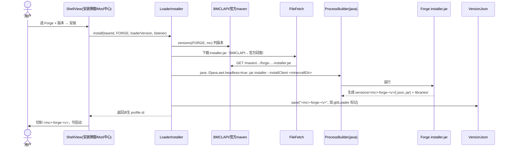

# GBL 0.8 增量架构设计：新增 Forge + NeoForge 加载器安装（对齐 HMCL）

> 作者：架构师 高见远（software-architect-2）
> 范围：在 0.7.0「Mod 三件套」（Fabric / Quilt / LegacyFabric 元数据型加载器 + Modrinth + mrpack）基础上，**最小侵入**地新增 Forge / NeoForge 安装，使 Mod 功能对齐 HMCL。
> 硬约束：增量开发、不重构现有模块、**不引第三方库**（仅 JDK：HttpClient / `java.util.zip` / `MessageDigest` / `ProcessBuilder` + 项目自研 `Json`）；游戏数据目录固定 `Platform.minecraftDir()`；UI 沿用 JavaFX 21 一套代码。

---

## 0. 核心结论（先讲人话）

1. **Forge / NeoForge 是「安装器 jar 型」加载器**，与现有 Fabric / Quilt / LegacyFabric 的「元数据型」（`metaUrl` 拉 `launcherMeta` 再合并进同版本 `version.json`）根本不同：
   - 元数据型：把 libraries / mainClass / 参数**合并进同一份** `<mc>/version.json`（GBL 0.7.0 的做法）。
   - 安装器型：Forge / NeoForge 的 installer 跑完后，**自己生成一个独立的新 profile** `<mc>-forge-<v>` / `<mc>-neoforge-<v>`（含 patched 客户端 jar 与 version JSON），原版 `<mc>` 目录保持原样。
2. **接入策略（最小侵入、复用优先）**：
   - `LoaderType` 增加 `FORGE` / `NEOFORGE` 枚举值，并加一个 `isInstaller()` / `isMeta()` 分流标记。
   - `LoaderInstaller.install()` 按类型分流：元数据型走现有合并逻辑（零改动）；安装器型走**新分支**——下载 installer jar（复用 `FileFetch` + 镜像回落）→ 用 `ProcessBuilder` **无头运行** `java -Djava.awt.headless=true -jar installer.jar --installClient <minecraftDir>` → 在生成的 profile JSON 上写 `gblLoader` 标记（复用 `VersionJson.save`）。
   - **不把 Forge 合并进 base 版本**：避免触碰 `VersionJson` 现有合并算法，也避免复刻 Forge 的 `{{...}}` / `${{...}}` token 到 base 版本（那会逼着 `GameLauncher` 在 base 版本上解析 Forge 专属占位符）。Forge 生成独立 profile 后，`GameScanner` 自动把它扫成一个可玩版本（profile 目录里有 patched `.jar`，`hasJar()` 通过）。
3. **真正的难点在「启动」不在「安装」**：Forge / NeoForge 1.17+ 的 profile 用 `--module-path` / `--add-modules` 与 `{{...}}` / `${{...}}` 占位符，`GameLauncher.expand()` 目前只认 `${...}` 经典令牌。**必须给 `GameLauncher` 扩一套 Forge/NeoForge 令牌解析**（保留 `{{{...}}}` 三花括号交给 BootstrapLauncher 运行时解析）。这是本方案风险最高、最需联调的一环（见 §8 待明确）。
4. **镜像**：官方 Forge maven（`maven.minecraftforge.net`）、NeoForge maven（`maven.neoforged.net`）与 BMCLAPI（`bmclapi2.bangbang93.com/maven/...`）一一对应。版本**列表**走 BMCLAPI 专用接口（`/forge/minecraft/<mc>`、`/neoforge/list/<mc>`）；installer jar 走 BMCLAPI 的 `/maven/...` 镜像路径，失败回落官方 maven。两者都不进现有 `Mirror.RULES`（路径结构不一致，强改易错），由 Forge/NeoForge 专属 URL 构造+回落逻辑负责（仍复用 `FileFetch` 下载）。

---

## 1. Forge 安装精确流程（含 BMCLAPI 镜像回落）

### 1.1 权威元数据 / 列表接口

| 用途 | 官方 | BMCLAPI 镜像（优先） |
|---|---|---|
| 版本列表 | （无干净 JSON；HMCL 用 BMCLAPI） | `GET https://bmclapi2.bangbang93.com/forge/minecraft/<mcVersion>` → `[{version,build,mcversion,modified,branch,files:[{category,hash...}]}]` |
| installer jar（官方 maven） | `https://maven.minecraftforge.net/net/minecraftforge/forge/<mc>-<forge>/forge-<mc>-<forge>-installer.jar` | `https://bmclapi2.bangbang93.com/maven/net/minecraftforge/forge/<mc>-<forge>/forge-<mc>-<forge>-installer.jar` |
| installer jar（BMCLAPI 下载端点，可替代上者） | — | `https://bmclapi2.bangbang93.com/forge/download?mcversion=<mc>&version=<forge>&category=installer&format=jar`（302 跳到 jar） |

> BMCLAPI 还提供 `/forge/latest`、分页 `/forge/list/:offset/:limit` 等；本方案只用到「按 MC 版本列」那一个。

### 1.2 版本号归一

BMCLAPI `/forge/minecraft/<mc>` 返回的 `version` 是 **Forge 版本号**本身（如 `47.2.0`、`14.23.5.2864`），installer 文件名需要拼成 `<mc>-<version>`。统一处理：

```
combine(mc, v):  若 v 已含 "-"（如 "1.20.1-47.2.0" 这类老格式）原样用；否则返回 mc + "-" + v。
```

### 1.3 安装步骤（落盘 + profile 注入）

1. **取完整版**：`VersionJson.raw(baseId)` 拿到原版 `<mc>` 完整 JSON（与现有 `install()` 第 1 步一致，保证 base 真实装好）。
2. **取版本列表**：`LoaderInstaller.versions(FORGE, mc)` → 调 BMCLAPI 列表，按 `build` 倒序，最新在前；UI 默认选中最新（无 stable 标记，置 `stable=true` 给最新那一个即可）。
3. **前置校验**（安装器型专属）：base `<mc>` 必须已装（安装弹窗已保证 MC 先下载完，见 §3）；派生 profile `<mc>-forge-<v>` 已存在则直接报「已装」。
4. **下载 installer jar**：构造 BMCLAPI `/maven/...installer.jar` URL 为主（仅当 `Mirror.enabled()` 时；否则直接用官方 `maven.minecraftforge.net` URL），用 `FileFetch.download(...)` 落盘到 `Platform.minecraftDir()/.gbl-tmp/forge-<mc>-<v>-installer.jar`。下载失败 → 换官方 maven URL 再试一次（**镜像回落**）。
5. **无头运行 installer**：
   ```
   java -Djava.awt.headless=true -jar <installer.jar> --installClient <minecraftDir绝对路径>
   ```
   - `java` 取自 `System.getProperty("java.home") + "/bin/java[.exe]"`（GBL 自带运行时，JRE 即可；现代 Forge 1.13+ 不再需要 javac）。
   - 在后台线程跑（与现有 `installChainAfterMc` 同口径），实时把 stdout/stderr 转发到 `Listener.onStage`（「正在运行 Forge 安装器…」）。
   - installer 会：① 在 `versions/<mc>-forge-<v>/` 生成 `<mc>-forge-<v>.json`（profile）+ patched `<mc>-forge-<v>.jar`；② 把 Forge 库装进 `libraries/`；③ 自行从官方 Forge maven 拉依赖（这一层不走 GBL 镜像，见 §8）。
   - 捕获进程退出码，**非 0 即失败**（message 带 installer 末几行输出）。
6. **校验 + 写标记**：确认 `versions/<mc>-forge-<v>/<mc>-forge-<v>.json` 存在；读它，塞入 `gblLoader = {type:"forge", loaderVersion, minecraftVersion:baseId, installedAt}`，`VersionJson.save("<mc>-forge-<v>", merged)`（**复用 `VersionJson` 落盘，tmp+move**）。
7. **清理**：删除临时 installer jar（体积大，留着无意义）。
8. **返回派生 profile id** `<mc>-forge-<v>`，UI 把「当前游戏」切到它，用户即可在游戏列表里选中 Forge 版启动。

### 1.4 流程时序（mermaid）



---

## 2. NeoForge 安装精确流程（与 Forge 的差异单列）

NeoForge 与 Forge 的**安装动作完全一致**（下载 installer jar → 无头 `--installClient`），差异只在**列表接口、jar 路径模板、派生 profile 命名、maven 坐标时代**：

| 项 | Forge | NeoForge |
|---|---|---|
| 版本列表接口 | `GET /forge/minecraft/<mc>` | `GET https://bmclapi2.bangbang93.com/neoforge/list/<mc>` → `[{version, rawVersion, mcversion, installerPath}]` |
| 列表返回形态 | `version="47.2.0"`（仅 Forge 号） | `version="1.20.1-47.1.85"`（已含 MC 前缀，用 `installerPath` 拿权威 jar 路径） |
| installer jar（官方） | `maven.minecraftforge.net/net/minecraftforge/forge/<mc>-<v>/forge-<mc>-<v>-installer.jar` | 旧时代(=1.20.1)：`maven.neoforged.net/releases/net/neoforged/forge/<mc>-<v>/forge-<mc>-<v>-installer.jar`<br>新时代(≥1.20.2)：`maven.neoforged.net/releases/net/neoforged/neoforge/<v>/neoforge-<v>-installer.jar` |
| installer jar（BMCLAPI） | `/maven/net/minecraftforge/forge/...` | 直接取列表里的 `installerPath`（形如 `/maven/net/neoforged/forge/<mc>-<v>/forge-<mc>-<v>-installer.jar`，新时代为 `/maven/net/neoforged/neoforge/<v>/neoforge-<v>-installer.jar`），前缀拼 `https://bmclapi2.bangbang93.com` |
| 派生 profile id | `<mc>-forge-<v>` | `<mc>-neoforge-<v>` |
| maven 坐标时代 | `net.minecraftforge:forge` | 1.20.1：`net.neoforged:forge`；≥1.20.2：`net.neoforged:neoforge` |
| 启动 mainClass | `cpw.mods.bootstraplauncher.BootstrapLauncher`（1.17+） | 同左（`cpw.mods.bootstraplauncher.BootstrapLauncher`） |

> 实现上：`LoaderInstaller` 用一个统一的 `installInstaller(baseId, type, loaderVersion, listener)` 方法，按 `type == FORGE / NEOFORGE` 选择不同的 **URL 模板 + profile 后缀 + 列表解析**；运行 installer 的命令对两者完全相同。

---

## 3. 新增 / 修改文件清单（相对路径）+ 接口签名

> 不新建「大模块」，只在现有类上**增量扩展**；UI 复用 Mod 中心加载器 tab 已有结构（`buildLoaderTab` 已 `for (LoaderType t : LoaderType.values())` 自动出卡）。

### 3.1 `src/main/java/com/mclauncher/LoaderType.java`（修改）

```java
public enum LoaderType {
    FABRIC("Fabric", "fabric", "fabric", "https://meta.fabricmc.net/v2/versions/loader/", "https://maven.fabricmc.net/", "fabric-loader"),
    QUILT("Quilt", "quilt", "quilt", "https://meta.quiltmc.org/v3/versions/loader/", "https://maven.quiltmc.org/repository/release/", "quilt-loader"),
    LEGACY_FABRIC("LegacyFabric", "legacyfabric", "legacy-fabric", "https://meta.legacyfabric.net/v2/versions/loader/", "https://maven.legacyfabric.net/", "legacy-fabric-loader"),
    // —— 新增：安装器型 ——
    FORGE("Forge", "forge", "forge", null, "https://maven.minecraftforge.net/", "forge"),
    NEOFORGE("NeoForge", "neoforge", "neoforge", null, "https://maven.neoforged.net/releases/", "neoforge");

    // 新增常量：BMCLAPI 列表接口根（官方无等价干净 JSON，HMCL 同款走 BMCLAPI）
    public static final String BMCLAPI = "https://bmclapi2.bangbang93.com";

    // —— 新增分流标记 ——
    /** 元数据型（Fabric/Quilt/LegacyFabric）：走 metaUrl + launcherMeta 合并。 */
    public boolean isMeta() { return this == FABRIC || this == QUILT || this == LEGACY_FABRIC; }
    /** 安装器型（Forge/NeoForge）：走下载 installer jar + 无头运行。 */
    public boolean isInstaller() { return this == FORGE || this == NEOFORGE; }

    // metaBase 对安装器型为 null；metaUrl 防御：安装器型返回 null（调用方不会调）
    public String metaUrl(String mcVersion) { return metaBase == null ? null : metaBase + mcVersion; }

    // fromDepKey 增加：forge→FORGE，neoforge→NEOFORGE（mrpack 识别用）
}
```

要点：`metaBase` 对 FORGE/NEOFORGE 传 `null`（`metaUrl()` 返回 null，仅元数据型调用）；`depKey` 仍按 mrpack `dependencies` 键名填 `forge`/`neoforge`，`fromDepKey` 补两个分支。

### 3.2 `src/main/java/com/mclauncher/LoaderInstaller.java`（修改，核心分流）

新增 / 调整的方法签名（现有 Fabric 路径**不改**，仅加分支）：

```java
public static List<LoaderVersion> versions(LoaderType type, String mcVersion) throws IOException {
    if (type.isMeta())   return versionsMeta(type, mcVersion);   // 现有逻辑改名保留
    if (type == FORGE)   return versionsForge(mcVersion);         // BMCLAPI /forge/minecraft/<mc>
    if (type == NEOFORGE)return versionsNeoForge(mcVersion);      // BMCLAPI /neoforge/list/<mc>
    return List.of();
}

public static void install(String versionId, LoaderType type, String loaderVersion, Listener listener) throws IOException {
    if (type.isInstaller())
        installInstaller(versionId, type, loaderVersion, listener);  // 新分支，下面
    else
        installMeta(versionId, type, loaderVersion, listener);       // 现有逻辑改名保留
}

/** 安装器型：下载+运行 installer，返回派生 profile id（如 "1.20.1-forge-47.2.0"）。 */
public static String installInstaller(String baseId, LoaderType type, String loaderVersion, Listener listener) throws IOException { ... }

/** 定位某 base 版本下已装的派生 profile；没装返回 null（Mod 中心状态/卸载用）。 */
public static String findDerivedProfile(String baseId, LoaderType type) throws IOException { ... }

/** 卸载派生 profile（删 profile 目录；libraries/ 里的 Forge 库留着，多版本共用，下次安装直接命中）。 */
public static void uninstallInstaller(String baseId, LoaderType type, Listener listener) throws IOException { ... }

// 内部：versionsForge / versionsNeoForge / forgeInstallerUrl / neoforgeInstallerUrl /
//       runInstallerJar / tagProfile
```

> `install()` 现有的「base 必须是原版 mainClass」硬闸只在 `installMeta` 里保留；`installInstaller` 不校验 base mainClass（base 保持原版，派生 profile 另建）。

### 3.3 `src/main/java/com/mclauncher/GameLauncher.java`（修改，启动令牌扩展）

现有 `expand()` 只认 `${...}` 经典令牌（`ctx` 里有 `auth_uuid` / `natives_directory` / `classpath` 等）。Forge/NeoForge 1.17+ 的 profile 还用：
- **双花括号** `{{XXX}}`（如 `{{MINECRAFT_JAR}}`、`{{LIBRARIES}}`、`{{CLASSPATH}}`、`{{PATCHED}}`、`{{BINPATCHES}}`、`{{SIDE}}`、`{{MODLIST}}`、`{{MODLISTCLASS}}`、`{{MC_VERSION}}`、`{{FORGE_VERSION}}`、`{{LAUNCHER}}`）：由**启动器**解析 → 扩成实际路径/值。
- **`${{group:artifact:version}}`**：由启动器解析 → 扩成 `libraries/<path>` 下对应 jar 的绝对路径（按 version JSON 的 libraries 表匹配）。
- **三花括号** `{{{XXX}}}`（如 `{{{MINECRAFT_JAR}}}`）：**交给 BootstrapLauncher 运行时解析**，原样保留。

新增一个 `ForgeArgs` 助手（或扩展 `expand`）：在 `flatten()`/`expand()` 之后，对 `--module-path` 等含 `{{...}}` / `${{...}}` 的参数做二次解析；`{{{...}}}` 与未识别的 `{{...}}` 原样保留（与现有「认不出的占位符原样留着」一致）。必须确保 `${classpath}` 与 Forge 的 `{{CLASSPATH}}` 不冲突（`$` 前缀区分）。**这是联调重点**（见 §8）。

### 3.4 `src/main/java/com/mclauncher/ui/ShellView.java`（修改，UI 融入）

- **`INSTALL_LOADERS`（约 line 464）**：`List.of(FABRIC, QUILT, FORGE, NEOFORGE)`。
- **安装弹窗网格（约 line 3341-3342）**：把 `forge` / `neo` 两张卡从 `disabled=true, "暂不支持"` 改为**可选**（`selectable=true`，`onClick = () -> selectInstallLoader(LoaderType.FORGE/NEOFORGE)`），并像 Fabric/Quilt 那样往 `installLoaderBoxes` 里塞一个隐藏的版本 `ComboBox`（key 用 `LoaderType.FORGE`/`NEOFORGE`）。`openInstallDialog` / `selectInstallLoader` 已按 `INSTALL_LOADERS` 循环重置/显示这些 box，无需大改。
- **`installApiIfNeeded`（约 line 3653）**：当前 `slug = (FABRIC? : "qsl")` 对 Forge/NeoForge 会错设为 `"qsl"`。改为：`FORGE/NEOFORGE` 时 `slug = null`（不自动装 API，Forge/NeoForge 不需要 fabric-api/qsl）。
- **`runInstall` / `installChainAfterMc`**：安装器型走 `LoaderInstaller.install(...)` 后拿到派生 profile id，把「当前游戏」切到派生 profile（而非 base）。
- **Mod 中心加载器 tab（约 line 3975-4170）**：`buildLoaderTab` 已 `for (LoaderType.values())` 自动出 Forge/NeoForge 卡。需适配三处：
  - `refreshLoaderTab`：对安装器型用 `findDerivedProfile(modCenterGameId, type)` 判状态（base 版本本身无 `gblLoader` 标记）；装着的显示派生 profile 的版本号，下拉锁该版本。
  - `onLoaderAction`：卸载分支对安装器型改调 `LoaderInstaller.uninstallInstaller(...)`（删派生 profile 目录）。
  - `ensureLoaderVersions`：调 `versions(FORGE/NEOFORGE, game)` 已可用，无需改。

### 3.5 `src/main/java/com/mclauncher/ModpackImporter.java`（修改，可选 / 后续）

`ensureLoader`（约 line 330-363）当前对 `forge`/`neoforge` 依赖直接抛「暂不支持」。0.8 顺带对齐 HMCL：当 `dependencies` 含 `forge`/`neoforge` 且 `fromDepKey` 命中 FORGE/NEOFORGE 时，调用 `LoaderInstaller.installInstaller(mc, type, version, listener)` 替代抛错（仍是「复用 LoaderInstaller，不复制安装逻辑」）。**若时间紧，可保留「暂不支持」提示仅将文案里的「P0」改为当前版本号**，该任务设为可延后（见 §7 T7）。

### 3.6 无需新增文件

所有逻辑落在 `LoaderType` / `LoaderInstaller` / `GameLauncher` / `ShellView` / `ModpackImporter`，**不新增独立类**（installer 运行与令牌解析都用私有方法或极小的 `ForgeArgs` 助手，并入 `GameLauncher`）。

---

## 4. 版本 JSON 合并方案（复用 VersionJson，指出要改哪些方法）

- **元数据型（Fabric/Quilt/LegacyFabric）**：维持 0.7.0 现状，**完全不改** `VersionJson` 的合并算法（`LoaderInstaller.merge` / `VersionJson.raw` / `VersionJson.save` / `isThin` 一律不动）。
- **安装器型（Forge/NeoForge）**：**不复用「合并进 base」逻辑**。Forge 自己生成的 `<mc>-forge-<v>.json` 已经是完整、自洽的 profile（含 mainClass、libraries、`arguments.jvm` 的 `--module-path`+`{{{...}}}`、`arguments.game` 的 `--launchTarget` 等）。GBL 只做两件事：
  1. **读 + 加标记**：`VersionJson.raw("<mc>-forge-<v>")` 读生成 profile（注意它已是完整版，`isThin` 判 false，直接返回）；写回时塞 `gblLoader` 段，调 `VersionJson.save("<mc>-forge-<v>", merged)`（tmp+move，与元数据型同一落盘口径）。
  2. **启动解析**：派生 profile 的 `arguments` 由 `GameLauncher` 展开（见 §3.3），需要 `VersionJson` 把它当普通版本读出来即可——`VersionJson` 现有 `load`/`raw`/`toMeta` **零改动**即可服务 Forge profile（`mainClass` / `libraries` / `arguments` 字段已支持）。
- **Forge / NeoForge 的 JSON 结构差异**（仅说明，不要求在 `VersionJson` 里特判）：
  - Forge 1.17+：`mainClass = cpw.mods.bootstraplauncher.BootstrapLauncher`，`arguments.jvm` 含 `--add-modules ALL-MODULE-PATH`、`--module-path` + `${{net.minecraftforge:...}}` 令牌；`arguments.game` 含 `--launchTarget forge_client` 等。
  - NeoForge：结构同上，坐标换成 `net.neoforged:neoforge`（`${{...}}` 令牌指向 `neoforge-<v>-client.jar`）。
  - 两者都带 `{{{...}}}` 三花括号令牌（`MINECRAFT_JAR` / `PATCHED` 等），由 BootstrapLauncher 运行时解析，`GameLauncher` 必须**原样保留**。

---

## 5. 依赖包列表

**无新第三方库。** 全部用 JDK 自带能力：
- `java.net.http.HttpClient` —— BMCLAPI 列表拉取、复用 `LoaderInstaller`/`FileFetch` 的既有 HTTP 出口。
- `java.util.zip.ZipFile` —— 读 installer jar 内的 `version.json`/`install_profile.json`（需要时用；`ModStore`/`ModpackImporter` 已在用）。
- `java.security.MessageDigest` —— 哈希校验（已有）。
- `java.lang.ProcessBuilder` —— 无头运行 installer jar（**本次唯一新增的 JDK 能力用法**）。
- `Json`（项目自研零依赖解析器）—— 列表/版本 JSON 解析、标记写回。
- 下载 installer jar 复用 `FileFetch.download`（`.part`+sha1/sha512+取消+回落）。
- 镜像回落复用 `Mirror.enabled()` 判定是否优先 BMCLAPI；Forge/NeoForge 专属 URL 构造不进 `Mirror.RULES`（路径结构不一致，强改易错），由 `LoaderInstaller` 内 URL 模板+回落负责。

---

## 6. 跨文件共享约定

1. **`gblLoader` 标记语义统一**：`{type, loaderVersion, minecraftVersion, installedAt}`。元数据型写在 base `<mc>/version.json`；安装器型写在派生 profile `<mc>-forge-<v>/<mc>-forge-<v>.json`。`status()` / `findDerivedProfile()` 两处读取口径一致。
2. **派生 profile 命名**：`<baseId>-forge-<v>` / `<baseId>-neoforge-<v>`，必须符合 `GameScanner.VALID_ID`（`[A-Za-z0-9._-]{1,64}`）——`<mc>-forge-47.2.0` 合法。
3. **临时 installer jar 落点**：`Platform.minecraftDir()/.gbl-tmp/forge-<mc>-<v>-installer.jar`（安装完即删，断点不留半截由 `FileFetch` 的 `.part` 机制保证）。
4. **`java` 可执行文件来源**：一律 `System.getProperty("java.home") + "/bin/java" + (isWindows?".exe":"")`，不依赖 `PATH`。
5. **下载源开关**：BMCLAPI 优先与否由 `SettingsStore.downloadSource()` 经 `Mirror.enabled()` 决定；列表/installer jar 的镜像回落遵守「先镜像、失败回落官方一次」。
6. **失败一律抛 `IOException`**，message 直接可显示（与 `LoaderInstaller` 现有约定一致）；installer 进程非 0 退出时把末若干行输出拼进 message。
7. **UI 线程**：`LoaderInstaller` 回调发生在调用线程；`ShellView` 自己 `Platform.runLater` 转 FX（与现有 `runLoaderInstall` / `loadInstallLoaderVersions` 同口径）。
8. **`GameLauncher` 令牌**：`${...}` 经典令牌（现有 `ctx`）与 `{{...}}`/`${{...}}` Forge 令牌（新增）共存；`{{{...}}}` 三花括号**交给 BootstrapLauncher**，GBL 不碰。

---

## 7. 任务列表（有序、含依赖、标注并行）

> 说明：§0 已明确「枚举分流」是地基。下列任务按实现顺序排列；`(并行)` 标注的彼此不相互阻塞，可在同一冲刺里分头做。

| ID | 任务 | 修改文件 | 依赖 | 并行 |
|---|---|---|---|---|
| **T1** | `LoaderType` 增加 `FORGE`/`NEOFORGE` 枚举值 + `isMeta()`/`isInstaller()`/`BMCLAPI` 常量 + `fromDepKey` 补 `forge`/`neoforge`；`metaUrl` 对安装器型返回 null。 | `LoaderType.java` | — | — |
| **T2** | Forge/NeoForge 版本列表与 installer jar URL 构造 + BMCLAPI→官方镜像回落（`versionsForge`/`versionsNeoForge`/`forgeInstallerUrl`/`neoforgeInstallerUrl`）。 | `LoaderInstaller.java` | T1 | 与 T4 并行 |
| **T3** | `LoaderInstaller.install()` 分流；新增 `installInstaller`（下载 jar→无头运行→写 `gblLoader`→返回派生 profile id）、`findDerivedProfile`、`uninstallInstaller`。 | `LoaderInstaller.java` | T1, T2 | — |
| **T4** | `GameLauncher` 扩展 Forge/NeoForge 令牌解析（`{{...}}` / `${{group:artifact:version}}`，保留 `{{{...}}}`）；保证 Forge/NeoForge 1.17+ 能正常拼出启动命令。**风险最高，需联调**。 | `GameLauncher.java` | — | 与 T1/T2/T3 并行 |
| **T5** | 安装弹窗：Forge/NeoForge 卡改为可选 + 版本下拉 + `INSTALL_LOADERS` 扩展 + `installApiIfNeeded` 对安装器型跳过 + `runInstall` 切到派生 profile。 | `ShellView.java` | T1, T3 | 与 T6 并行 |
| **T6** | Mod 中心加载器 tab：Forge/NeoForge 卡片状态/卸载改用 `findDerivedProfile`/`uninstallInstaller` 语义。 | `ShellView.java` | T3 | 与 T5 并行 |
| **T7** | （可选/可延后）`ModpackImporter.ensureLoader` 对 `forge`/`neoforge` 依赖改走 `installInstaller`；否则仅把「P0 暂不支持」文案的版本号改当前版。 | `ModpackImporter.java` | T3 | 与 T5/T6 并行 |
| **T8** | 自测 `Snapshot` 用例 + 回归（Fabric/Quilt 路径零回归）+ 0.8 收尾（版本号、WEBSITE_URL）。 | `Snapshot.java` + 见 §9 | T4, T5, T6, T7 | — |

---

## 8. 待明确事项

1. **`GameLauncher` 对 Forge 令牌的最终形态需要真机联调**：`{{...}}` / `${{...}}` 的确切集合、以及 `--module-path` 后面那一长串是否以「一个参数」还是「多段」出现，需拿一个真实 `<mc>-forge-<v>.json`（如 1.20.1-forge-47.2.0）核对。`{{{...}}}` 必须原样留给 BootstrapLauncher，误解析会直接启动失败。
2. **installer 进程的网络**：Forge/NeoForge installer 自行从官方 maven 拉依赖（不走 GBL 镜像）。BMCLAPI 镜像回落目前只覆盖「列表 + installer jar 本体」，**installer 运行期的库下载仍是官方源**。0.8 可接受（慢但不瘫）；后续可研究让 installer 走离线/预下库，但不纳入本次。
3. **极老 Forge（<1.13）**：installer `--installClient` 仍可工作，但可能走「拷 universal jar」老路径；本次不特判，installer 自己处理。若联调发现老版本异常再补。
4. **派生 profile 与 base 并存**：装完 Forge 后游戏列表会同时出现 `<mc>`（原版）与 `<mc>-forge-<v>`（Forge 版）。这是 HMCL 同款行为，确认产品上接受；若想「装 Forge 后原版行消失」需额外处理（本次不做）。
5. **Java 运行时**：确认 GBL 打包（jpackage）里 `java.home/bin/java` 存在且为 JRE（现代 Forge 不需 JDK/javac）。若打包裁剪掉了 `bin/java` 则需调整打包脚本。
6. **NeoForge 旧/新时代坐标**：1.20.1 用 `net.neoforged:forge`、≥1.20.2 用 `net.neoforged:neoforge`；URL 模板按 MC 版本分界，联调时以真实 BMCLAPI `installerPath` 为准（列表已给出权威路径，优先用它构造 jar URL 最稳）。

---

## 9. 0.8 收尾清单

### 9.1 需改的「版本号」——实为 1 处真改 + 4 处派生

经核对，`GameDownloader.AGENT`、`VersionManifest` 的 UA（复用 `AGENT`）、`MicrosoftAuth.USER_AGENT`、`build-exe.py` 的 `APP_VERSION` **全部派生自** `LauncherApp.VERSION`，改这一处即全部联动：

| 位置 | 当前值 | 说明 |
|---|---|---|
| `src/main/java/com/mclauncher/LauncherApp.java:12` | `public static final String VERSION = "0.7.0";` | **唯一需手改的字面量** → `"0.8.0"` |
| `src/main/java/com/mclauncher/GameDownloader.java:70` | `AGENT = "GBL-Minecraft-Launcher/" + LauncherApp.VERSION` | 派生，自动变 `…/0.8.0` |
| `src/main/java/com/mclauncher/VersionManifest.java:210` | `.header("User-Agent", GameDownloader.AGENT)` | 派生，自动跟随 |
| `src/main/java/com/mclauncher/MicrosoftAuth.java:120` | `USER_AGENT = "GBL/" + LauncherApp.VERSION + " (Minecraft Launcher; Windows)"` | 派生，自动跟随 |
| `build-exe.py:180`（`read_app_version()` 解析 `LauncherApp.VERSION`） | 取自 `LauncherApp.VERSION` | 派生，打包自动取 `0.8.0` |

> 结论：**只需把 `LauncherApp.VERSION` 从 `"0.7.0"` 改成 `"0.8.0"`**，其余 4 处零改动即同步。文档里列 5 处是为了让工程师看清「哪些地方会出现版本串」，避免漏改；实际编辑只有 1 行。

### 9.2 WEBSITE_URL

`src/main/java/com/mclauncher/ui/ShellView.java:152`：

```java
private static final String WEBSITE_URL = "https://grassblocklauncher.netlify.app/";
```

建议改为当前官网：

```java
private static final String WEBSITE_URL = "https://gbl-website.pages.dev/";
```

（仅这一处，影响标题栏「访问官网」按钮。）

---

## 附：与 HMCL 的实现对比（为何 GBL 不照搬）

- **HMCL（Java 版）** 的 `ForgeInstallTask` 对「新安装器」是**抽出 `install_profile.json` + `version.json`，自行在 JVM 里跑 processors**（data generator / 二进制 patch），不跑 installer GUI；「老安装器」直接拷 universal jar。代价是复刻了 Forge 的 post-processing 流程，代码量很大。
- **GBL 选择「无头运行官方 installer jar」**，理由：① 不引第三方库、代码量极小（一个 `ProcessBuilder` 调用）；② 不碰 `VersionJson` 现有合并算法（最小侵入）；③ installer 自带的 post-processing 最权威、最不容易出 Forge 跨版本兼容 bug。代价仅是 installer 运行期依赖官方 maven 拉库（见 §8.2），且需要 JRE 运行时——均在可接受范围。HMCL 的「抽取+跑 processors」方案作为**后续可选优化**保留，不在 0.8 范围。
