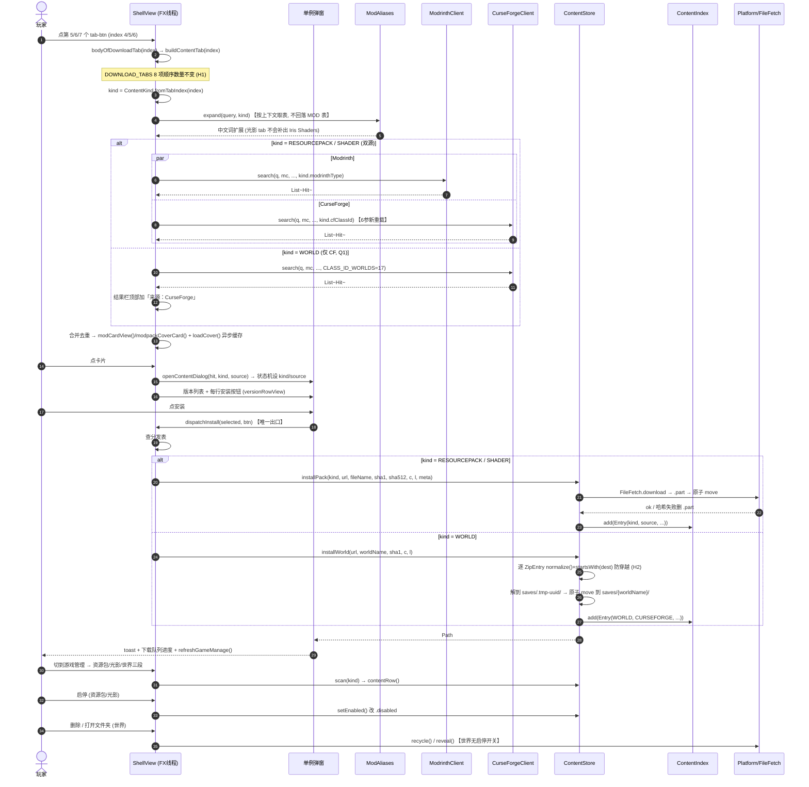
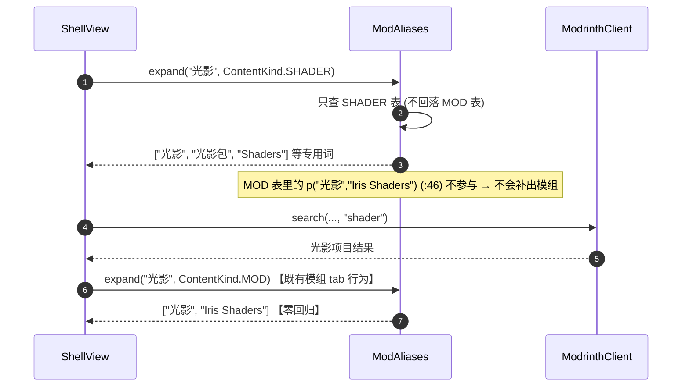
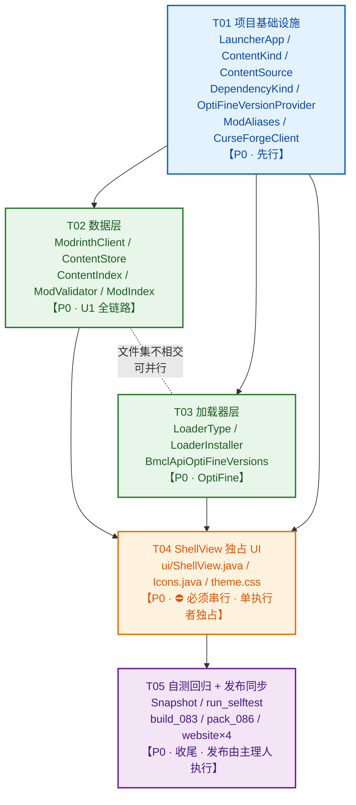

# GBL 0.8.7「内容补全」增量系统架构设计 + 任务分解

| 项 | 内容 |
|---|---|
| 文档类型 | 最终增量架构设计（Architect 定稿）+ 有序任务分解 |
| 上游输入 | `docs/PRD-0.8.7-content.md`（已定稿）、`docs/HMCL-MOD-REFERENCE.md`、`docs/ARCH-0.7.0-mod.md`、`docs/GBL-0.8.7-现状调研报告.md`（A–G 只读调研，全文另存 `C:/Temp/`） |
| 撰写 | 高见远（Architect） |
| 目标版本 | 0.8.6 → **0.8.7** |
| 本轮产物 | **仅本文档 + 两张版本化 Mermaid 图**；不改 `src/`、`website/`、`ui/Snapshot.java`、`tools/run_selftest.py` |
| 技术栈 | JavaFX 21 + 纯 Java 服务层（JDK 自带 `HttpClient` / `java.util.zip` / `MessageDigest` + 自研 `Json.java`），**不新增任何第三方依赖** |
| 版本 | **v1.13**（按 `software-engineer-1` 任务 #57 实证 + T-10 补测 + 十轮补报 + **#66/#69/#71/#72/#73 已落地代码只读复核 + `impl-shellview` H10 规格回传 + `impl-selftest` 断言可执行性回传裁决**，见 §0.4 E1–E40 / §0.5「实现一致性核对（已通过）」；新增 H7/H8/H9/**H10** 四条 P0 硬约束。沿革：v1.5 = E22 哨兵 / E23 断言收窄 / E24 `.part` 修正 / E25 #66 裁决；v1.6 = E26 老版无内嵌 launchwrapper 的干净失败分支；v1.7 = E27 sha1/size 动态算（禁止硬编码定值）、E28「内嵌闭环」仅限新版 installer、E29 `staleVersion()` 隐藏坑、E30 1.20.1 完整 jar 未本地复核；v1.8 = #72 的 E31 `cleanPartResidue()` 主动清 `*.part` / E32 干净失败清临时 jar（零落盘零残留）；v1.9 = #70 跨 13 个 MC 版本实证 + #73 落地：E33 内嵌版本分档 2.1/2.2/2.3（动态生成、去 2.3 兜底）、E34 边界锁定 1.13.2→1.14.4 并限定候选 A 适用范围（H10）、E35 判据只能扫 zip 条目、E36 CDN 截断重试且 E30 关闭；v1.10 = E37 采纳 `impl-shellview` 规格回传，修订 H10 的 UI 口径：删除「UI 按 `mc>=1.14.4` 硬编码阈值提前提示」（与 E33/E35「服务层动态扫 zip、不硬编码边界」矛盾、制造双真相源），改为「阈值无关中性预提示 + 服务层 toast 并存、友好预提示非硬拦截、不改安装逻辑不碰服务层」；E38 记录 Q6 第二入口（安装新游戏弹窗）源码仍「暂不支持」属阶段 B 独立待办 + ShellView 行号漂移说明；E39 收录 4 端点跨档断言与 `of_*.jar` glob 漏 1.20.1 的坑；#73 状态更正为 completed；**v1.11 = E40 采纳 `impl-selftest` 断言可执行性回传：把 `OPTIFINE_OLD_MC_UI_HINT` 从「一条混合断言」拆成三层（Snapshot 场景图只验「节点存在 + 文字无版本阈值字样」｜QA 静态检查验「源码无阈值比较 / 不 disable / 服务层未改」｜服务层测试验「toast 路径不变」），并明确两入口不同屏、`onScreen()` 只数到 1 个是设计预期 —— 断言须分别切到各自入口再验、或对这条不做可见性过滤**；**v1.12 = E41 采纳 `impl-shellview` + `impl-selftest` 三条定稿回执：① 样式类定稿 `.optifine-scope-hint`（复用既有 `page-desc` 视觉、theme.css 零新增）；② 两入口分属两项独立派工（入口1 加载器 tab 属 H10、入口2 安装弹窗属 E38）、可能分批 ⇒ §11 拆成两条独立用例、不写死「必须有 2 处」、按当前实际已落地入口验；③ 两项均「软观测起步、待各自派工落地后升级硬断言」、禁止 P1 建议项在 UI 未实现时卡住 P0 门禁；**v1.13 = E42 采纳 `impl-shellview` 命名锁死 + `impl-selftest` CASES 批次/骨架机制回传：① 类名锁死单一 `.optifine-scope-hint`、⛔ 不加 `-dialog`/`-tab` 后缀（JavaFX 样式类精确字符串匹配、非前缀，带后缀会让 `find` 一个都匹配不到）；② CASES 另起按批次清单、⛔ 不混入 `run_selftest.py:147 CASES_087`、汇总输出也分开；③ 「实际文案」同步时点后移——类名与「无后缀」现在即定稿，两句确切文案并入派工后「节点就位」消息一次性带齐；④ 「连 CASES 骨架都不提前写」升为可证机制（`report_087_cases():167-187` 遍历清单逐条找结果行，找不到即打印假 `[FAIL]` 污染汇总），骨架与断言一次落地、不留中间态**） |

> **本文所有 `文件:行号` 均为 0.8.6 现状实证**，工程师按行号定位即可，无需再全文检索。

### 0.4 实证修订记录（v1.13，来源：`software-engineer-1` 任务 #57 实证复核 + T-10 只读补测 + **#70 跨 13 版本补测** + 十轮补报 + #66/#69/#71/#72/#73 代码复核 + `impl-optifine` 实证回传 + **`impl-shellview` H10 规格回传 / 样式类定稿 / 命名锁死** + **`impl-selftest` 断言可执行性 / 分批派工依赖 / CASES 批次与骨架机制回传与架构裁决**）

> 本节只修订**实现层事实**，**不改动** §0.1/§0.2 主理人已拍板的 Q/U 决策。以下均为真实 HTTP 实测结论，工程师按此施工，不必再自行试探。

| # | 实证结论 | 对本文的影响 |
|---|---|---|
| **E1** | `GET /v2/project/{id}` 实测 38 字段、**无 `dependencies`**（U1 实锤）；依赖在 `Version.dependencies[]`，4 字段 `version_id / project_id / file_name / dependency_type`，四种枚举跨 50 热门 mod / 29411 条全部实测到（required 9832 / optional 18943 / embedded 105 / incompatible 531） | U1 修通方案不变；**§3.1** 补字段可空性统计 |
| **E2** | 29411 条中 `file_name` **100% null**、`version_id` **90.6% null**、`project_id` **恒非空** | **§3.1**：外部依赖分支仅作防御保留；P0 不能靠 `version_id` 精确锁定（与 Q4 一致）；名称反查只能靠 `project_id` |
| **E3** | `GET /v2/projects?ids=[...]` 200 一次可 N 个，但**返回顺序不保证与请求一致**（10-id 实测顺序不同、集合相同） | **§3.1 / §3.9.4 / §5.1**：必须**按 id 建 Map**，禁止按返回下标对齐 |
| **E4** | CF `data[].dependencies[]` 实测**只有 `modId` + `relationType`，无 `fileId`**（原调研报告里的 `fileId` 需删除）；relationType 实测 1=10 / 2=1109 / 3=1492 / 4=22，`0/5/6` 样本内未出现；名称需 `POST /v1/mods {"modIds":[...]}` → 200，图标在 `logo.url` / `logo.thumbnailUrl`，**无 `iconUrl`** | **§3.4 / §9 S2**：P1 映射按实测值修正；名称/图标取法固定 |
| **E5** | `/v1/categories?gameId=432` → 200 / 148 条，`isClass:true` 的 **9 个顶级类**：6 Mods、4471 Modpacks、12 Resource Packs、17 Worlds、6552 Shaders、6945 Data Packs、4559 Addons、5 Bukkit Plugins、4546 Customization；逐个 `/v1/mods/search?classId=N` 全 200 且首条类型正确 | Q1 固化的 12/6552/17 **全部实证通过**，常量不变 |
| **E6** | ⚠️ 两个坑：① 顶级类自身 `classId` 字段为 **null**（`classId` 是子分类指向父级的字段，顶级类的 **`id`** 才是被 search 引用的 classId）；② `Addons(4559)` 下还有**同名** `Worlds(id=4560)` / `Resource Packs(id=4561)` | **§3.3 / §9 S7**：**禁止误用 4560/4561**，世界/资源包一律用顶级 id 17/12 |
| **E7** | `GET /v2/tag/project_type` → 200 权威枚举 **7 值** `["mod","modpack","resourcepack","shader","plugin","datapack","minecraft_java_server"]`，**无 world**；`project_type:world` 返回 **200 + `total_hits:0`**（非 400、无错误体）；`datapack`/`plugin` facet 虽合法但 hits **全是 `project_type:mod`**；`minecraft_java_server` 的 hit 值与该值、详情写 `modpack` 不一致 | **§9 S7**：内容类型页**只以 mod/modpack/resourcepack/shader 四类为稳定基线**；WORLD 仍只走 CF（Q1 不变） |
| **E8** | BMCLAPI `GET /optifine/<mc>` → 200 JSON 数组，字段 `__v,_id,filename,forge,mcversion,patch,type`（**无 url**）；下载拼 `/optifine/{mc}/{type}/{patch}` → **206 `application/java-archive`**；optifine.net 有 `adloadx?f=` token 反爬 | **§3.8**：版本来源字段**由 TODO 转为已实证**；下载 URL 拼接规则固定；`FileFetch` 需容忍 206 |
| **E9** | OptiFine installer 产出的 version.json **真实形状已读出**（独立 profile、`inheritsFrom` 指向原版、`mainClass=net.minecraft.launchwrapper.Launch`、libraries 两条、`arguments.game` 带 `--tweakClass optifine.OptiFineTweaker`、`jar` 为 null） | **§3.8 / §5.3**：安装链改为「按实证形状自写派生 profile」，见下 E10 |
| **E10** | ⚠️ **`--installClient <mcDir>` 对 OptiFine 无效**（那是 Forge/NeoForge installer 参数）：jar 内扫不到该字符串，`java -Djava.awt.headless=true -jar <jar> --installClient <dir>` → **exit 1 `HeadlessException`、目录零产出**。可用 `java -cp <jar> optifine.Installer`，但其 **main 忽略 argv**，`Utils.getWorkingDirectory()` 基于 `user.home` 写死到 `%APPDATA%/.minecraft`，便携模式需 `-Duser.home` 重定向 / 反射 `doInstall(File)` / GBL 自写 version.json | **§3.8 / §5.3 / §6 T-4 重大修订**：原「复用 `LoaderInstaller.java:578 --installClient` 口径」**作废**；改为自写 profile（Q6「复用安装器型分支」决策不变，仅替换「跑 installer」这一步） |
| **E11** | Forge + OptiFine 组合的 priority 顺序**本轮未实测** | **§6 T-9**：保留为待验证项；因 Q6/U5 已定 P0 禁止自动组合，**不阻塞 P0** |
| **E12**（架构自查补充，非外部实证） | 实证 OptiFine profile 的两条 library **只有 `name`、无 `downloads.artifact`**；而 `LibFetcher.missing():223-232` 与 `GameLauncher.addToClasspath():1605-1623` 都只认 `downloads.artifact.{path,url}` → 裸条目被双双跳过，**不下载、不进 classpath、启动必崩** | **新增 H7 + §3.8「库形状归一」+ §5.3 图 3 + §11 `OPTIFINE_LIB_ARTIFACT` 断言**：`writeOptiFineProfile()` 必须把两条 library 归一为完整形状；v1.0「缺库走 `LibFetcher.missing()` 回落」一句**作废** |
| **E13**（架构自查补充，v1.2，**P0 阻塞**） | `VersionJson.resolveInheritance():428-434` 对 `arguments` 是**整键子覆盖父**（只 `libraries` 做数组合并）；`GameLauncher:361/:368` 只展开 `meta.jvmArgs()/gameArgs()`，不自行补 `--username`/`--assetsDir`/`--uuid`/`--accessToken`。实证 OptiFine profile 是 463 字节增量式，`arguments.game` 仅一条 `--tweakClass` → 照抄会顶掉原版**全部** jvm/game 参数（Forge 能跑仅因其 installer profile 自带完整参数） | **新增 H8 + §3.8「参数继承」+ §5.3 图 3 + §11 `OPTIFINE_ARGS_INHERITED` 断言**：`writeOptiFineProfile()` 必须以 `VersionJson.raw(<mc>)` 完整父 JSON 为基底并复用 `appendTweakClass():1225`；**禁止新建只有 game 的 `arguments`** |
| **E14**（v1.2，`software-engineer-1` T-10 实测） | ① 库落点 = 标准 Maven `group/artifact/version/artifact-version.jar`，两条精确 `path`/`size`/`sha1` 已测；② **BMCLAPI 直链给的是 installer jar（7,113,653 / `c44bd276…`），不是纯 mod jar（6,607,941 / `f572669b…`）** —— installer 靠 `installOptiFineLibrary()` 从自身 zip 过滤剥出纯 mod jar；③ `optifine:launchwrapper-of:2.3` **随 installer jar 内嵌附带**（`launchwrapper-of-2.3.jar` 15,930 / `073b25f1…` + `launchwrapper-of.txt` 内容 `'2.3'`），字节级验证 `zipfile.read() == 落盘文件` → **True**，**无需任何外部 URL**（**E28 修订：此为 1.20.1 新版 installer 结论，非全版本成立；1.7.10 老版零内嵌条目 → 走 E26 明确失败，见 §6 T-12**）；④ `path`/`url` 必须都非空 String，`sha1` 必须填对 | **§3.8 归一取值表固化为实测值**；T-10 ①②③ **关闭**；新增「A 方案（原样复制 installer jar）」与「launchwrapper 从 jar 解包」施工规格；`OPTIFINE_LIB_ARTIFACT` 断言补 sha1 校验 |
| **E15**（v1.2，T-10 ③ 实测） | `-Duser.home` / `-Duser.dir` 重定向**均无效**（Windows 分支读 `APPDATA` 环境变量）；`APPDATA=<便携根>` **有效**且端到端产出正确，但**进程不自行退出**（90s 超时，AWT 线程挂住）。`javap` 实测 `public static void doInstall(File)` / `doExtract(File)` / `getOptiFineZipFile()` / `Utils.getWorkingDirectory()` 全部可直接调用，`main(String[])` 忽略 argv | 备选 C 由「需实证」升级为**可行**：进程内反射 `Class.forName("optifine.Installer").getMethod("doInstall", File.class).invoke(null, mcDir)` 一次解决 argv/重定向/不退出三个问题；**P0 仍走 A**（Q6/U5 拍板不变），C 列 P1 备选与 A 失败时的回退路径 |
| **E16**（v1.2，T-10 ④ 静态线索） | OptiFine installer MANIFEST 有 `TweakClass: optifine.OptiFineForgeTweaker` / `TweakOrder: -1000`，jar 含 `META-INF/mods.toml` 与 `ITransformationService`；而自写 profile 用 `--tweakClass optifine.OptiFineTweaker` | **T-9 补充静态线索**（Forge+OptiFine priority 本轮仍未实测、不推测）；因 P0 禁止自动组合，**不阻塞 P0** |
| **E17**（v1.3，`software-engineer-1` 补报） | installer 除 profile/两个库外，还会**改写 `%APPDATA%/.minecraft/launcher_profiles.json`**（新增 `OptiFine` custom profile 一条，共 3 条）；本机默认 `.minecraft` 有 4 项测试残留（含该条），隔离目录 `C:/Temp/of_portable/.minecraft` 已清理 52.7MB | **P0 候选 A 不跑 installer → 不产生该副作用**，环境干净度断言不受影响；但若 T-11 失败回退**候选 C（反射 `doInstall`）**，须把「不污染 `launcher_profiles.json`」列为回退验收项。测试残留由 team-lead 决定是否清理，架构侧无依赖 |
| **E18**（v1.3 提出 / v1.5 E24 字面修正，`software-engineer-1` 补报 + 架构复查，**P0 阻塞**） | 目标 `path` 上可能**已存在合法但 sha1 不同**的文件（本机为纯 mod jar `f572669b…`，A 方案期望 `c44bd276…`）；`verifyExisting():288-300` 判坏 → `missing():255-259` 触发重下 → `GameLauncher.prepare():227-241` 每次启动都会执行 → 占位 `url` 被请求。⚠️ **v1.5 修正原措辞**：7MB **不会覆盖正式文件** —— `downloadFrom():389` 只写 `target + ".part"`，`:399-403` sha1 不符即 `return false`，`:404 Files.move(part, target, REPLACE_EXISTING)` **不执行**；但 `return false` **之前未删 `.part`** → 残留 7MB 垃圾文件，`fetch():340-347` 仍把该 lib 计入 `failed` → `prepare()` 抛 `Blocked`。**失败链结论不变** | **新增 H9 + §3.8 第 6 步 + §11 `OPTIFINE_LIB_ARTIFACT_SHA_MATCH` / `OPTIFINE_NO_REFRESH` 断言**：显式断言「落盘 sha1 == profile 声明 sha1」，不能只看文件存在/ZipFile 可打开；并加断言「目标 path 同级**无 `*.part` 残留**」——正式文件可能看起来完全正常，恰恰会掩盖「占位 url 已被请求」这一事实。这正是 T-11 的**环境干扰点**，QA 真机冒烟前须先清干净目标 path |
| **E19**（v1.4，架构只读核对 #66 已落地代码，**P0 阻塞**） | `LoaderInstaller.writeOptiFineProfile():467-483` 用 `new LinkedHashMap<>()` 全新构造、`arguments` **只放一条 `--tweakClass`**，未以 `VersionJson.raw(<mc>)` 父 JSON 为基底、未继承 `arguments.jvm/game` 全数组 → 经 `GameLauncher.prepare():180` 的 `loadResolved()` + `resolveInheritance():428-434` 整键覆盖后，原版全部 `--username`/`--assetsDir`/`--uuid`/`--accessToken` 等丢失 → **启动必崩**（H8 未落地） | **#66 需返工**：按 H8/§3.8 第 4 步改为父 JSON 深拷贝 + `appendTweakClass():1225`；见 §0.5 核对表 |
| **E20**（v1.4，架构只读核对，**需澄清**） | `#66` 的 `optifineLaunchwrapperUrl():521-523` 用 `net.minecraft:launchwrapper:1.12`（BMCLAPI maven）替代 `optifine:launchwrapper-of:2.3`，注释称「三个 BMCLAPI 候选路径实测全 404」；与 T-10 **E14 实证「随 installer jar 内嵌、字节级一致、无需外部 URL」**冲突。`optiFineLibrary():505` 还把 `sha1` 写成**空串**（与 H7/E18「sha1 必须填对」冲突，且 `verifyExisting()` 空串会跳过校验，掩盖残留旧文件） | 以 E14 为准：改 `ZipFile` 内嵌解包、sha1 填 `073b25f1…`；若工程师确有 404 实证，请回传证据再裁决。**禁止**用 1.12 等价库替代（OptiFine 定制构建缺类风险）。见 §0.5 |
| **E21**（v1.4，架构自查更正） | 本文 v1.2 §3.8 第 5 步原写「派生 `<id>.jar` 可省略」是**错的**：`GameScanner.scan():77` → `hasJar():86-89` 要求版本目录存在任意 `*.jar` 才列为「已装游戏」；`#66` 的 `LoaderInstaller.java:434-444` 从父版本复制一份作存在标记是**正确实现** | §3.8 第 5 步已更正为「必须复制」；「启动链不需要」≠「扫描不需要」；**§9 S9 的同类旧措辞 v1.5 一并修正** |
| **E22**（v1.5，`software-engineer-1` 建议 + 架构裁决） | 归一表两条 `url` 原填的是**真实可下载**的 BMCLAPI installer 直链（仅为满足 `LibFetcher.java:227-232` 非空校验）。既然 H9 已定性「语义上永不请求」，真实直链在防线被破坏时会真下 7MB 并触发 `Mirror.rewrite()` / `originUrl()` 回落 | **采纳**：两条 `url` 统一改成**格式合法但明确不可达的哨兵** `http://127.0.0.1:1/gbl-no-download/<coord>`（无 DNS、连接即刻 refused、不在 `Mirror.RULES` 内 → `rewrite()` 恒等 → 单轮尝试、无回落）。`probe():500-516` 失败返回 `-1` → `copyInto():478` 连接失败时**尚未创建 `.part`**（`Files.newByteChannel` 在 `:488`、send 之后）→ 哨兵既无 7MB 下载也无 `.part` 残留，快速失败。`optifineDownloadUrl()` **保留**供安装期 `FileFetch` 真实下载，**只改写入 profile 的 `artifact.url`** |
| **E23**（v1.5，`impl-optifine` 提出 + 架构裁决） | §11 `OPTIFINE_NO_INSTALLCLIENT` 原写「源码与运行日志中不出现 `--installClient`」**过宽**：`runInstallerJar()` 里 `command.add("--installClient")` 是 Forge/NeoForge installer 的真实必需参数，删掉会破坏既有加载器（主理人明确不重构）；全源码文本扫描必然命中该行 | **采纳收窄**为 `OPTIFINE_NO_INSTALLER_PATH`：只断言 **OptiFine 安装路径不调用 `runInstallerJar()`**（`installInstaller()` 对 OPTIFINE early return）、OptiFine 运行日志不含该串、且 `runInstallerJar()` 内保留 `if (type == OPTIFINE) throw` 防御；**Forge/NeoForge 那一行属合法豁免**，不作失败判据 |
| **E24**（v1.5，`software-engineer-1` 字面澄清 + 架构复查） | ① E18/H9 原写「7MB 写进 15KB path」不精确，实为停在 `.part`（见 E18 已修正）；② 原补报称「`downloadOne()` 回落会再试一次 → 最多两次 7MB」亦需澄清：`Mirror.RULES`（`Mirror.java:48-58`）**只匹配 Mojang 官方域**，原占位 url 主机是 `bmclapi2.bangbang93.com` → `rewrite()` 恒等 → `lib.url() == lib.originUrl()` → `:378` 条件为 false → **只下 1 次**；只有把 url 换成会被 rewrite 的官方域名才可能出现两次 | E18/H9/§3.8 第 6 步/§11 `OPTIFINE_NO_REFRESH` 措辞全部按此收敛；**失败链（`fetch()` failed → `Blocked`）结论不变**；换成哨兵（E22）后连一次有效下载都不会发生 |
| **E25**（v1.5，`impl-optifine` #66 实证回传 + 架构裁决） | 回传三项：① `optifine:launchwrapper-of:2.3` 在 BMCLAPI `/maven/`、`/libraries/`、`/optifine/` 三路径全 404，改用 `net.minecraft:launchwrapper:1.12`（200、含 `Launch.class`）；② 1.7.10 `HD_U/D3` jar 实证 `Main-Class=optifine.InstallerFrame`、含 `OptiFineTweaker.class`、全类扫 `--installClient` 命中 0 → 印证候选 A / E10；③ `GameScanner` 可见性（已由 E21 收录）；另提 `mainClass` 对 1.13+ 兼容性存疑 | **① 不采纳「1.12 替代」，但采纳其「版本可能随构建变化」的合理关切**：E14/T-10 ② 是 `ZipFile` 字节级实证「**`.jar` 内嵌条目 + `launchwrapper-of.txt` 给版本号 → 无需外部源**」，工程师找的是**远端**路径、方向不对；「外层 jar 不含 launchwrapper 类」也不等于「内嵌 `.jar` 条目不存在」。规格升级为**按 `launchwrapper-of.txt` 动态取版本 + 解包内嵌 `.jar`**；若某构建确无内嵌条目，**禁止**在 `launchwrapper-of:2.3` 坐标/path 下塞入 1.12 的内容（坐标/path/sha1/size 必须描述**同一份字节**），改为明确失败或回退候选 C。② 采纳为 E10 补强。③ 见 E21。④ **降级告警**：E9 实证 profile 的 `id` 就是 `1.20.1-OptiFine_HD_U_I5`（现代版本）且由真实 installer 产出，`launchwrapper.Launch` + `optifine:launchwrapper-of` 是 OptiFine 自带的现代机制、非 1.7 遗留 → **无需按 MC 版本分叉**，仍以 T-11 真机冒烟兜底；若失败，改动收口在 `writeOptiFineProfile()` 一处 |
| **E26**（v1.6，任务 **#69** 执行者实证，**改变实现分支**） | `1.7.10 HD_U/D3` 老版 installer jar **确实不含内嵌 `launchwrapper-of-*.jar` 条目** → E25 的动态解包路径在该构建上**必然失败**。这把 E25 里「若某构建确无内嵌条目」从假设变成**已实证的真实分支**，也解释了 `impl-optifine` 当初去找 BMCLAPI 远端 1.12 的动机（其 404 实证方向虽不对，但「老版没有内嵌」这个观察成立） | **把「解不出时明确失败 + 手动指引」升格为 P0 必实现分支**：`installOptiFine()` 读不到内嵌条目时抛可读 `IOException`（沿用 `optiFineManualHint` 口径），**不生成 profile、不落坏版本、不静默改用 1.12**（E25 已禁止坐标/path/sha1/size 与实际字节不一致）。1.20.1 `HD_U_I5` 走 E14 内嵌解包主路径、1.7.10 `HD_U/D3` 走明确失败分支，**两条都要进 T-11 冒烟用例**。老版本 OptiFine 的完整支持（候选 C 反射 `doInstall(File)` / 纯 mod jar 过滤）列 **P1**，本轮 P0 只需「干净失败」；§3.8 第 2 步、§0.5 第 11 行、§11 `OPTIFINE_NO_EMBEDDED_LW_FAILS_CLEANLY`、§6 T-11 均已同步 |
| **E27**（v1.7，`impl-optifine` #69/#71 落地实现 + 架构采纳，**修正本文断言表述**） | 已落地的 `optiFineLibrary():528-529` 用 `sha1Hex(jar)` + `Files.size(jar)` **动态计算落盘真实值**，未写死 `c44bd276…`/`7113653`/`073b25f1…`/`15930`。**这是对的**：那四个值是 1.20.1 `HD_U_I5` 单版本定值，写死会让其它任意 mc/patch 在 `verifyExisting():299` 判 sha1 不符 → 每次启动 `fetch()` 哨兵 url → 正是 H9 要防的场景 | **§11 `OPTIFINE_LIB_ARTIFACT` 与 §8 T03 交付判据改为「落盘实际 sha1/size == profile 声明值」，删除「== §3.8 实测值」硬编码口径**；§3.8 第 3 步 JSON 片段保留作 **1.20.1 `HD_U_I5` 实测示例**，但注明「值为示例、实现须动态算」。`OPTIFINE_LIB_ARTIFACT_SHA_MATCH` / `OPTIFINE_NO_REFRESH` 天然满足（sha1 就是从该落盘文件算的） |
| **E28**（v1.7，`impl-optifine` 实测反例，**修正 E14 表述**） | E14/T-10 ② 的「`launchwrapper-of` 随 installer jar 内嵌、无需外部 URL」**不是全版本成立**：实测 `1.7.10 HD_U/D3` installer jar **1,193,719 B / 1919 条目，零嵌入 `.jar`、零 launchwrapper 条目**，MANIFEST 只有 `Main-Class=InstallerFrame` / `TweakClass=OptiFineForgeTweaker`。即**内嵌库是新版 installer 才有** | **§3.8 第 2 步 / E14 补边界**：「内嵌解包仅限新版 installer，老版走 E26 明确失败」；§6 新增 **T-12 实测反例行**（已闭环、非待办）；`extractLaunchwrapper():575-614`（动态扫 zip 条目 → 找不到即 `optiFineManualHint`）与本裁决一致。任务 **#70** 正由 `software-engineer-1` 做版本边界只读补测，结果只影响 P1 老版支持、不动 P0 |
| **E29**（v1.7，`impl-optifine` 自查 + 架构复核） | installer jar 的 MANIFEST **无 `Implementation-Version`** → `LibFetcher.jarVersion():171-180` 返回 null → `staleVersion():154-157` 的 `have != null` 为 false → **恒 false**，不会把自定义 `optifine/...` path 误判「过期」而在启动期触发重下 | **§11 增参考说明**：这是哨兵 url / H9 之外的一道天然保险，但**不能依赖它**——H9 的 sha1 幂等覆盖仍是硬要求（`verifyExisting():299` 是另一条独立判坏路径）。`versionInPath():166-167` 对 `1.20.1_HD_U_I5` / `2.3` 都能识别出非 null 版本段，只是 `have` 为 null 才放行 |
| **E30**（v1.7 提出 / **v1.9 E36 关闭**，`impl-optifine` 报备 → `software-engineer-1` 零网络复核） | v1.7：1.20.1 完整 installer jar 在本机 **302 签名后多次传输被中止（WinError 10053）**，内嵌条目确切路径未本地复核。**v1.9 关闭**：`software-engineer-1` 本机 `C:/Temp/optifine_installer_test.jar` 是**完整可解析 zip**（7,113,653 B / sha1 `c44bd276…` / 6483 条目，patch/ 前缀 4884），零网络复核到内嵌条目在 **zip 根目录**、确切名 `launchwrapper-of-2.3.jar`（15,930 B / `073b25f…`），同级 `launchwrapper-of.txt`（3 B，内容 `2.3`），MANIFEST 含 `Automatic-Module-Name: optifine` | 「**确切路径未本地复核**」这条**划掉、E30 关闭**，不必等 T-11 顺带确认；jar 保留在 `C:/Temp/` 供 QA 取用。代码仍用 `ZipFile` **动态扫描条目**（不写死确切名）→ installer 结构微调也能自适应。**注意**：这只是坐实单样本、供 QA 断言用，**不改回硬编码**（各 MC 版本内嵌文件名不同，见 E33）；T-11「installer jar 原样当库是否类冲突」仍归 QA 统一编译后真机跑 |
| **E31**（v1.8，任务 **#72** `impl-optifine` 落地 + 架构按 1777 行只读复核） | `placeBytes():663-668` 在 `deleteQuietly(target)` 之后、`Files.write` 之前调 `cleanPartResidue(target)`；`cleanPartResidue():671-683` 用 `Files.newDirectoryStream(dir, "*.part")` 删目标同级 `*.part`（对齐 `LibFetcher.java:389` 的 `<target>.part` 命名），best-effort、扫不动只忽略不盖住真实安装错误 | **E24 补强**：原结论只覆盖「安装本身走 `Files.write` 直写、不经 `.part` → 不产生**新** `.part`」；#72 补上「主动清**预置 / 历史遗留**的 `.part`」，`OPTIFINE_NO_PART_RESIDUE` 从「天然不产生」升级为「主动清除」。⚠️ **边界（执行者自述，架构采纳）**：服务层约束只改两个文件、不能动 `LibFetcher`，故**启动期** `.part` 生命周期仍归 `LibFetcher.java:386-405`（sha1 不符 `return false` 前不删）；但 E22 哨兵使正常安装不触发 `downloadFrom()`、H9 幂等覆盖使 `verifyExisting()` 不判坏 → 启动期不会产生新 `.part`，两道防线叠加已闭环 |
| **E32**（v1.8，任务 **#72** 落地 + 架构只读复核） | `installOptiFine():420-426` 给 `extractLaunchwrapper(tmpOf, baseId)` 包 try/catch，catch 内 `deleteQuietly(tmpOf)` 清掉 `.gbl-tmp` 里 7MB 临时 jar 再抛 `optiFineManualHint`；下载失败 `:405`、非有效 jar `:409` 同样先删临时文件再抛。失败点 `:422` **严格早于** `placeJar():434` / `placeBytes():435` / `writeOptiFineProfile():438` / 复制派生 `<id>.jar` `:434-444` 全部落盘动作 | **E26 干净失败口径细化**：由「抛异常 + 不落坏版本」扩为「抛异常 + **零落盘 + 零临时残留**」——`versions/<derived>/` 不创建、两个 library path 不写入、无 version.json / 无 `gblLoader`、游戏列表不出现该版本，**且 `.gbl-tmp` 不留 7MB 临时 jar**。§11 `OPTIFINE_NO_EMBEDDED_LW_FAILS_CLEANLY` 补一条「临时 jar 已清理」断言 |
| **E33**（v1.9，任务 **#70** `software-engineer-1` 跨 13 版本实测 + **#73** 落地，**改变规格：定值 → 动态分档**） | 内嵌 `launchwrapper-of` **版本随 MC 变**：`1.14.4`→`2.1`（15,638 B / `a1b86cd7…`）、`1.15.2`/`1.16.5`/`1.17.1`→`2.2`（15,900 B / `48d08d4b…`）、`1.18.1` 起→`2.3`（15,930 B / `073b25f…`），三种 sha1 各不同。**13 个样本里 `launchwrapper-of.txt` 内容与内嵌 jar 文件名版本 100% 一致**。→ **`2.3` 只是 §3.8 样例的 1.18.1+ 单档示例，不是定值**：坐标 `optifine:launchwrapper-of:<ver>`、`path` `optifine/launchwrapper-of/<ver>/launchwrapper-of-<ver>.jar`、library `name` 三处**全部随 txt 动态生成**；H7/H9「两个目标 path 幂等覆盖」的第二条 path 也随版本变，不能写死 `.../2.3/...` | **#73 已移除「兜底常量 2.3」**：`extractLaunchwrapper():601-649` 版本号优先读 `launchwrapper-of.txt`、读不到用 `versionFromJarName():659-668` 从内嵌 jar 名解析、**两者都认不出即抛 `IOException`（绝不兜底 2.3）**；兜底 2.3 会让 2.1/2.2 构建的「坐标/path」与「落盘字节」描述不同版本。§3.8 第 2 步 / E14 / §9 S9 / §11 `OPTIFINE_LAUNCHWRAPPER_EMBEDDED` 全部补「动态」；**新增 §11 `OPTIFINE_LAUNCHWRAPPER_VERSION_DYNAMIC` 跨版本断言**（用 1.14.4 或 1.16.5 装一次，断言坐标/path 含 `2.1`/`2.2`、不被写成 `2.3`），与 E27 `OPTIFINE_DYNAMIC_SHA1` 同属「抓硬编码回归」 |
| **E34**（v1.9，任务 **#70** 跨 13 版本实测，**改变规格：单样本 → 边界区间 + 适用范围**） | 内嵌库版本边界锁定 **1.13.2 → 1.14.4**：无内嵌 = `1.7.10`/`1.8.9`/`1.12.2`/**`1.13.2`**（零 `.jar`、零 launchwrapper 条目、无 txt）；有内嵌 = **`1.14.4`**/`1.15.2`/`1.16.5`/`1.17.1`/`1.18.1`/`1.18.2`/`1.19.2`/`1.20.1`/`1.21.4`。E28 原「1.7.10 单样本反例」升级为**区间结论**。→ **候选 A（GBL 自写 profile + ZipFile 提取内嵌库）只适用于 MC ≥ 1.14.4**；≤ 1.13.2 必须走 E26/E32 干净失败 + 手动运行 installer 指引，**老版 profile 的 libraries 形状本轮未实测、不推测** | **新增硬约束 H10 + §3.8 适用范围 + UI 提前提示**：安装入口按 `mc >= 1.14.4` 提示候选 A 适用范围（`buildLoaderTab():4348` / 安装新游戏弹窗），避免老版用户「装完起不来却没有前置说明」；老版完整支持（候选 C / 纯 mod jar 过滤）仍列 P1。§6 T-12 从单点升级为区间；T-11 冒烟用例补充跨档验证。⚠️ **这是 UI 侧增量**（Q6 已定入口），归 T04 `ShellView.java` 单执行者，架构侧只给规格不改 src |
| **E35**（v1.9，任务 **#70** 实测，**固化判据口径**） | **判「有无内嵌库」只能扫 zip 条目，不能用 MANIFEST 当信号**：`Automatic-Module-Name: optifine` 与内嵌库**不同步**（1.14.4~1.17.1 有内嵌库却无该字段，1.18.1 起才有）；`Main-Class: optifine.InstallerFrame` / `TweakClass` / `TweakOrder=-1000` **所有版本都有**，均不具判别力 | #73 `extractLaunchwrapper():601-649` 用 `ZipFile` 遍历条目（找名字含 `launchwrapper-of` 的内嵌 `.jar`、否则唯一内嵌 `.jar`；顺带读 `launchwrapper-of.txt`），**与 E35 一致、方向正确**；§3.8 第 2 步注明「MANIFEST 不可作判据」。E29 的 `jarVersion()`/`staleVersion()` 天然保险与 E35 无关、仍成立 |
| **E36**（v1.9，任务 **#70** 实测 + **#73** 落地） | **BMCLAPI 偶发 CDN 截断**：`1.16.5` 首次只拿到 `1,179,648 B`（非 zip），重试第 1 次即成功。`FileFetch.download()` 传空 sha1/sha512、内部重试认不出「HTTP 200 但流半截」，会把半截文件 `move` 成目标返回 `true` → 半截 jar 会进归一流程。**另**：各版本 installer jar 从 `1,193,719 B` 到 `7,423,659 B`、sha1 全不同 | **#73 已落地**：`installOptiFine():408-421` 把「`FileFetch.download()` + `isValidJar(tmpOf)`」作为整体**最多 2 次尝试**，失败即 `deleteQuietly(tmpOf)` + 手动指引，半截 jar 绝不进安装流程。§3.8 安装链第 1 步前置补「下载后 `isValidJar()` 校验 / 重试」；§11 新增 `OPTIFINE_DOWNLOAD_RETRY` 断言。E27「sha1/size 必须动态」再获佐证（跨版本 installer jar 大小/sha1 全不同）。**E30 证据缺口同步关闭**（见 E30 行） |
| **E37**（v1.10，`impl-shellview` H10 规格回传 + 架构裁决，**改变 UI 规格：硬阈值 → 中性文案**） | v1.9 的 H10 存在**内在矛盾**：E33/E35 要求服务层「动态扫 zip 条目判有无内嵌库、**不硬编码边界**」（`extractLaunchwrapper():601-649` 完全不含 MC 版本阈值），但 H10 同时要求 UI「按 `mc >= 1.14.4` 提前提示适用范围」→ 在 `ShellView` 引入**第二份会漂移的真相源**：OptiFine 日后调整边界，服务层自动适应而 UI 文案反向误导。另经架构只读核实 `ShellView.java`：加载器 tab 的 `onLoaderAction():5076` 取 `modCenterGameId:228`（**游戏 id**，可能是 `1.20.1-fabric-…` 派生 id 或 `null`），**不是纯 MC 版本号**；`loaderCard():4950` 卡上无逐卡 MC 版本字段；只有安装新游戏弹窗的 `installMcVersion:551` 是干净 base 版本 ⇒ 按 `mc>=1.14.4` 比较**还需未定义的版本归一化 + null 处理**。`impl-shellview` 另确认：服务层 toast **已存在且权威**（组合互斥/老版无内嵌/下载失败/版本列表失败四类共用一条 `catch(IOException)`，message 自带「手动运行 installer 并选 GBL/.minecraft」指引），管「点之后失败」；H10 该补的只是「点之前建立预期」 | **采纳，H10 UI 口径改写**：① **UI 前置提示 + 服务层 toast 并存**（非二选一）；② 提示采用**不含版本阈值的中性文案**（如「部分旧版 MC 需手动运行 OptiFine 安装器；若无法自动安装会给出指引」），**零服务层变更、永不失真**，两入口 mc 上下文差异随之消失；③ **友好预提示、非硬拦截**——不得 disable 安装按钮、不改安装逻辑、不碰服务层（写死进 §3.9.7 / §8 T04 / §11）；④ 若日后必须点名版本，须由服务层暴露只读 `supportsAutoInstall(versionId, type)` 与真实裁决同源（**属服务层改动、需单独派工 `impl-optifine`，P1 备选，P0 不做**）；⑤ §11 `OPTIFINE_OLD_MC_UI_HINT` 断言随之改写为「两入口有中性提示 + 无版本阈值 + 不拦截 + toast 路径不变」；⑥ 文案/样式类名定稿后由 `impl-shellview` 同步 `impl-selftest`（持有 `Snapshot.java`） |
| **E38**（v1.10，架构只读核实 `ShellView.java`，**状态事实、非设计变更**） | Q6 拍板的 OptiFine **第二入口「安装新游戏弹窗」尚未落地**：`installCompCard("optifine", "OptiFine", "暂不支持", null, false, true, null)`（`ShellView.java:4018`）仍是「暂不支持」；`INSTALL_LOADERS:553-554` = `List.of(FABRIC, QUILT, FORGE, NEOFORGE)` **硬编码、不含 OPTIFINE、不遍历 enum**。而第一入口「下载→加载器 tab」因 `buildLoaderTab():4940` 遍历 `LoaderType.values()` 已自动出卡（team-lead 实证）。⚠️ 另：本文所有 `文件:行号` 为 **0.8.6 基线**（`:529-530`/`:3426`/`:4348`），阶段 A（#61/#67）后 `ShellView.java` 已扩到 8500+ 行，实际行号整体后移（`:553-554`/`:4018`/`:4940`/`:4950`/`:5076`）——**工程师按方法名定位，不按本文旧行号硬找** | **不改 src、不动本轮 H10**：第二入口「`INSTALL_LOADERS` 加 OPTIFINE + `installCompCard` 从『暂不支持』改可选卡」原已列在 §3.9.7 / §8 T04 主要改动⑥，**属阶段 B 独立待办**（`impl-shellview` 明确「阶段 A 已交付且全树编译零错误，不动 ShellView，等 team-lead 明确派工」）→ 由 team-lead 单独派工，**不可与 H10 中性提示混为一谈**；本条仅把状态与行号漂移写进文档，避免 QA 误判「Q6 第二入口已完成」 |
| **E39**（v1.10，`software-engineer-1` 转 `impl-optifine` 的断言请求 + 架构复核，**QA 执行口径细化**） | 跨档验证端点建议取 **4 个、恰好覆盖三类内嵌版本 + 干净失败边界**：`1.14.4`→`2.1` / `1.16.5`→`2.2` / `1.20.1`→`2.3` / `1.13.2`→零内嵌走 E26 干净失败（抓「恒写 2.3」由 2.1/2.2 两档报红、抓「有内嵌却误走干净失败」由 2.3 档报红）。⚠️ **glob 陷阱**：`C:/Temp/of_<mc>.jar` 只读坐实**只有 12 个样本**，`1.20.1` 是独立文件名 `C:/Temp/optifine_installer_test.jar`、**不在该 glob 内**（12+1=13 全部有效 zip）；若断言/自测用 glob 收集样本，会**静默漏掉恰好是 T-11/E30 目标版本**的 1.20.1 | §6 T-11 与 §11 `OPTIFINE_LAUNCHWRAPPER_VERSION_DYNAMIC` / `OPTIFINE_LAUNCHWRAPPER_EMBEDDED` 补「**显式列出 4 端点**、不得用 `of_*.jar` glob 收集」，1.20.1 显式指向 `C:/Temp/optifine_installer_test.jar`。架构侧只读采纳，无需改 src |
| **E40**（v1.11，`impl-selftest` 断言可执行性回传 + 架构只读核实，**改变 QA 断言规格：混合断言 → 三层拆分 + 两入口不同屏**） | `impl-selftest` 指出 v1.10 `OPTIFINE_OLD_MC_UI_HINT` 把源码级/服务级/场景图级三类判据塞进一条 Snapshot 断言，有三处不可执行：① **两入口不同屏** —— 架构只读核实：`buildInstallDialog():3984`（「安装新游戏」弹窗，`installCompCard("optifine"):4018`）与 `buildLoaderTab():4940`（下载页加载器 tab，`loaderCard():4950`）**分属不同页面/弹窗、不会同时可见**；`Snapshot.onScreen():2660-2667` 沿 parent 链逐级 `isVisible()` 判定 → 一条 `find(styleClass, root)` + `onScreen()` 只会数到 1 个 → **误报「缺一个」**。② **Snapshot 是场景图断言，只能看节点与文字**（`find():2669` / `collect():2675`）：「源码无 `1.14.4`/`mc>=` 比较」「非硬拦截（按钮未 disable）」「服务层 toast 路径不变」三条**验不到**；③ `Snapshot.SEQUENCE:147` 注释已固化「新 Task 只追加末尾、不插 INVENTORY、不重排既有步骤」（免 `[inspect]` 分页错位），`run_selftest.py:147 CASES_087` 清单需同步新用例名 | **采纳并拆三层**（§11 `OPTIFINE_OLD_MC_UI_HINT` 重写、§8 T04 判据、§3.9.7、§6 T-8）：**L1 Snapshot 场景图**（`impl-selftest`）：两个入口**分别切到各自入口再验**（每个入口内断言「存在中性提示 Label + 文字不含版本阈值字样」），**或对这条不做可见性过滤**；只认新样式类（建议 `.optifine-scope-hint`）、不动既有类名（U6）、不写死阈值字符串；**L2 QA 静态检查**（`software-qa-engineer`）：源码不含 `1.14.4`/`mc>=`/版本比较、安装按钮未 disable、服务层未改；**L3 服务层测试**：四类失败共用 `catch(IOException)` 的 toast 路径不变。定稿时由 `impl-shellview` 把**两个 Label 的实际文案 / 样式类 / 是否带可区分后缀**同步 `impl-selftest`，后者据此定断言节点与中文用例名并追加 `CASES_087`。架构侧只读裁决、不改 src。**⚠️ 本行是 v1.11 当时口径的编年记录，其中「可区分后缀」「追加 `CASES_087`」已被 v1.13 E42 锁死/改写（单一无后缀类名 + 另起批次清单），施工以 §3.9.7 / §11 现行规格与 E42 为准** |
| **E41**（v1.12，`impl-shellview` 样式类定稿 + `impl-selftest` 分批派工依赖回传 + 架构只读核实，**改变 QA 断言规格：单条软硬混合 → 两独立用例、按派工分批、软观测起步**） | 三条回执合计三个新事实：① **样式类定稿** `.optifine-scope-hint`（两入口复用同一类名）；实现时**叠加既有 `page-desc`**（`theme.css:587/1138` 浅/深两套既有规则、`ShellView` 多处复用）作灰字视觉，新类**只作断言定位标记**、**theme.css 零新增**，类名「不动既有类名」（U6）保持。② **两入口分属两项独立派工、可能分批**：架构只读核实 `LoaderType.OPTIFINE:45` 已存在、`isInstaller():107` 含 OPTIFINE ⇒ **入口 1**（下载→加载器 tab 的 OPTIFINE 卡）属 **H10**，因 `buildLoaderTab():4940`/`loaderCard():4950` 遍历 `LoaderType.values()` 自动出卡、派工只需在 `loaderCard()` 对 `type==OPTIFINE` 加 Label；**入口 2**（安装新游戏弹窗的 OptiFine 选项）属 **E38 独立待办**（`INSTALL_LOADERS:553` 仍硬编码不含 OPTIFINE、`installCompCard("optifine"):4018` 仍「暂不支持」）⇒ **只派 H10 不派 E38 时，弹窗根本没有提示节点**。③ **时序/门禁风险**：两项 UI 待办**均未派工、UI 未实现**（`impl-selftest` 复查 TaskList 73 项确认无派工、`Snapshot.java` 里也没有该用例），若把 `OPTIFINE_OLD_MC_UI_HINT` 做成硬失败断言，统一编译后自测必挂，根因是「UI 未实现」而非缺陷 | **采纳，§11 断言再修订**：⛔ **不写死「必须有 2 处」** —— 按「当前实际已落地的入口」验（只派 H10 → 只验 1 处）；**H10 与 E38 拆成两条独立用例**（各自软观测起步），避免 E38 未派工时连带把 H10 判 FAIL、也更易定位；两条均标 **「待各自派工落地后启用：先软观测/观测打印，再升级硬断言」**，**禁止 P1 建议项在 UI 未实现时卡住 P0 门禁**。L2（QA 静态：源码无阈值/不 disable/服务层未改）与 L3（服务层 toast 不变）对「当前未实现」状态天然成立、可先跑，不受分批影响。§3.9.7 / §8 T04 / §9 S9 / §6 T-8 / 两张 Mermaid 同步定稿类名与分批口径。架构侧只读裁决、不改 src |
| **E42**（v1.13，`impl-shellview` 命名锁死 + `impl-selftest` CASES 批次/骨架机制回传 + 架构只读核实 `tools/run_selftest.py`，**改变 QA 交付契约：类名弹性 → 锁死无后缀 / 单一 CASES_087 → 另起批次清单 / 文案定稿时点前移 → 后移 / 「不写断言」→ 连骨架都不写**） | 三条回执带来四处锁死：① **类名不加后缀**：`impl-shellview` 定稿「两个 Label 统一挂**单一 `.optifine-scope-hint`**（叠加既有 `page-desc`）、⛔ **不加 `-dialog`/`-tab` 后缀**」，理由 = **JavaFX 样式类是精确字符串匹配、非前缀**（`impl-selftest` 按 `find(.optifine-scope-hint, root)` 找，若拆成两个带后缀类名会**一个都匹配不到、等于返工**）；两 Label 本就不同屏，靠「分入口切页 + 两条独立中文用例名」区分已足够、**再靠类名区分是冗余**；不加后缀 ⇒ `theme.css` 零新增、U6 保持。**L2 静态层若要区分两个 Label，靠两句文案自带语境词**（如「加载器卡…」/「为新游戏安装 OptiFine 时…」），**不动类名**。② **CASES 另起批次清单**：`run_selftest.py:147 CASES_087` 是 **0.8.7 批次清单**；H10/E38 用例由 `impl-selftest` **另起一份按批次的清单、⛔ 不混进 `CASES_087`、汇总输出也分开**（便于 team-lead/架构定位）；具体命名等派工时再定。③ **「实际文案」同步时点后移**：类名 + 「不加后缀」**现在即定稿可写进文档**，但**两句确切文案**属派工后在 `ShellView.java` 里才产生的实现细节，现在代码一行未写、写死反而对不上 ⇒ 并入既定的**「节点就位」消息一次性给 `impl-selftest` 带齐**：两处方法名 + 统一样式类 + 两句确切文案 + 哪几处已存在 + H10/E38 是否同批（`impl-selftest` 据此定断言节点与中文用例名，不必先按猜测写、无需再对齐一轮）。④ **「连 CASES 骨架都不提前写」是可证机制**：架构只读核实 `run_selftest.py:167-187` `report_087_cases()` **遍历 `CASES_087` 逐条 `find_087_case(outputs, name)`**，`find_087_case():155-164` 在浅/深两趟日志找不到 `0.8.7 用例「<名字>」` 结果行就返回 None → `:173-177` 打印 **`[FAIL] <name>` +「浅/深两趟日志里都没有…结果行」** ⇒ 若现在只把用例名写进清单、而 `Snapshot.java` 无对应 Task，统一编译后跑浅/深两趟会打印**两条假失败**、污染 team-lead 看到的汇总、被误读成缺陷 | **采纳，四处全部写死进 §3.9.7 / §8 T04 / §9 S9 / §11 / §6 T-8 / 两张 Mermaid**：⛔ 删除「可加 `-dialog`/`-tab` 后缀」「是否带可区分后缀」等一切弹性措辞 ⇒ 定稿为**单一 `.optifine-scope-hint`、无后缀、两入口按所在页面分别切验**；`CASES_087` 改为「**另起按批次清单、汇总分开、命名派工时定**」；同步契约改为「类名/无后缀现在定稿、文案随『节点就位』消息一次带齐」；**骨架与断言一起等「派工 + 节点就位」一次落地、不留中间态**（`report_087_cases` 假失败机制）。**`impl-selftest` 追问「分批派工是否已进 L1」→ 已在 v1.12 E41 收录**（§11 已拆 A/B 两独立用例、不写死 2 处、按派工分批启用、软观测起步），本次不再重复改动该部分。架构侧只读裁决、不改 src |

> **⚠️ 时序澄清（v1.8 提出 / v1.9–v1.13 逐轮补充，避免重复返工）**：`impl-optifine` 在 #72 回传中**再次提出**「§11 `OPTIFINE_LIB_ARTIFACT` 仍写死 `c44bd276…`/`7113653`、`073b25f1…`/`15930` 定值，需改成动态口径」—— **该项已在 v1.7 E27 完成**：现 §11 该断言为「落盘文件实际 sha1/size == 该条 `downloads.artifact.sha1`/`size` 声明值」并明令 ⛔ 禁止硬编码 §3.8 定值；§3.8 样例 JSON 也已注明「值仅为 1.20.1 `HD_U_I5` 实测示例、实现须 `sha1Hex(jar)`+`Files.size(jar)` 动态算」。回传引用的是 §11 旧行号 `:1147`，属**跨版本时序滞后**，无需再改、执行者实现（`optiFineLibrary():538` 动态算）与文档一致。本轮 v1.8 只收录 #72 真正新增的 E31/E32。**v1.9 补充**：#70/#73 的三条回传里，「E27 动态 sha1」「E28 内嵌库仅新版」「E30 未本地复核」仍是旧口径复述（分别已在 v1.7 收录、v1.9 由 E34 升级为区间、v1.9 由 E36 关闭）；但**内嵌版本分档 2.1/2.2/2.3 + 边界区间 1.13.2→1.14.4 + 判据口径 + CDN 截断重试**是真正新增实证，已作为 E33–E36 收录并据此升 v1.9。区分标准：**看是否改变规格**（定值→动态、单点→区间、无重试→有重试），而非看消息到达时间。**v1.10 补充**：本轮四条回传里，三条例行确认（#73 已 completed / 1820 vs 1821 是 `splitlines()` 与 `count('\n')+1` 的计数口径差、同一份文件 / 批评接受 / #70 建议升 v1.8 的内容 v1.9 已全收录）属**纯确认或时序滞后**；唯 `impl-shellview` 的 H10 反馈**真的改了 UI 规格**（硬阈值 → 中性文案、并牵出「服务层 toast 已权威」「两入口 mc 上下文不对称」「不得硬拦截」三项新约束），故按 E37 收录并升 v1.10 —— 再次印证判据是「是否改规格」而非消息新旧。**v1.11 补充**：`impl-selftest` 的回执虽以「确认待命」开头，但其附带的**三点断言可执行性反馈真的改了 QA 断言规格**（两入口不同屏导致 `onScreen()` 误报、场景图断言验不到源码级判据、需三层拆分 + `CASES_087` 同步），故按 E40 收录并升 v1.11 —— 判据仍是「是否改规格」。**v1.12 补充**：三条回执里 `impl-shellview` 的「v1.10 采纳确认」是纯确认，但**样式类定稿**（`.optifine-scope-hint` + 复用 `page-desc`、theme.css 零新增）、`impl-selftest` 的**两入口分属 H10/E38 两项独立派工可能分批**、以及**「P1 建议项不得在 UI 未实现时卡住 P0 门禁」的软观测起步**三点真的改了 §11 断言口径（单条混合 → 两独立用例、不写死 2 处、按派工分批启用），故按 E41 收录并升 v1.12。**v1.13 补充**：本轮三条回执里 `impl-selftest`「确认 E40 / 追问分批派工是否已进 L1」属**纯确认**（分批派工已在 E41 收录）；但 `impl-shellview` 的**「不加后缀、单一 `.optifine-scope-hint` 命名锁死 + 实际文案同步时点后移到『节点就位』消息」**与 `impl-selftest` 的**「CASES 另起批次清单、不混 `CASES_087`」+「连骨架都不提前写（`report_087_cases():167-187` 会打印假 `[FAIL]`）」**四处真的改了 QA 交付契约（弹性后缀 → 锁死、单一清单 → 分批次、文案定稿时点、骨架机制），故按 E42 收录并升 v1.13 —— 判据仍是「是否改规格」。

---

### 0.5 实现一致性核对（v1.10，**已通过**，针对任务 #66 / #69 / #71 / #72 / #73 的 `LoaderInstaller.java`）

> **状态（v1.10 更正）**：`#69`（H7/H8/H9 返工）、`#71`（E22 哨兵）、`#72`（安装期清 `.part` + 干净失败清临时 jar）、**`#73`（launchwrapper 版本动态化去 2.3 兜底 + 下载重试）= 全部 completed** —— `TaskList` 只读实证已确认 `#73` 结项（v1.9 写「仍 `in_progress`、建议核对后结项」是旧快照，**作废**）；执行者回报的 `1821 行` 与架构复核的 `1820 行` 是 `count('\n')+1` 与 `splitlines()` 的**计数口径差、同一份文件**（末尾有换行符），非文件变动。架构侧按当前磁盘 `LoaderInstaller.java` 逐条只读复核通过。**v1.6 §0.5 里「`writeOptiFineProfile():480-483` 仍是 H8 必崩形态 / #69 in_progress / 描述钉在 v1.4」的判断早在 v1.7 即作废** —— 那些是对 #66 旧状态的核对。本表为**验收对照表**：16 项全部 ✅、无待改项；v1.8 新增第 12（E31）/ 13（E32），v1.9 新增第 14（E33 版本分档）/ 15（E34+E35 判据与边界）/ 16（E36 下载重试）。**服务层已全部闭环、无待改项**；架构侧不阻塞 QA。**v1.10 新增的两项均为 UI/QA 侧、不属本表服务层复核范围**：① H10 的 UI 中性预提示（E37，归 T04 `ShellView.java`，尚未落地、等 team-lead 派工）；② Q6 第二入口「安装新游戏弹窗」仍「暂不支持」（E38，阶段 B 独立待办）。**唯一剩余的工程门禁是 QA 侧 T-11 真机冒烟**（installer jar 原样当库是否类冲突）。

| # | 规格项 | 当前实现（复核行号） | 判定 |
|---|---|---|---|
| 1 | **H8 参数继承** | `writeOptiFineProfile():475-511`：`VersionJson.raw(baseId)` 取完整父 JSON → `new LinkedHashMap<>(parent)` 顶层深拷贝 → `arguments` 单独深拷贝（`jvm`/`game` 各 `new ArrayList`，避免污染父缓存）→ 仅覆盖 `id`/`inheritsFrom`/`mainClass`/`jar`/`libraries`，保留 `assetIndex`/`javaVersion`/`type`/`time`/`downloads` → `appendTweakClass(profile, "optifine.OptiFineTweaker"):511` | ✅ `OPTIFINE_ARGS_INHERITED` 形状满足 |
| 2 | **E22 哨兵 url** | `optiFineSentinelUrl():554-556` = `http://127.0.0.1:1/gbl-no-download/` + `libraryName.replace(':','/')`；`:505`/`:507` 两条 library 都用它；`optifineDownloadUrl():1078` 本体**保留**且 `:403` 安装期 `FileFetch.download()` 仍调用真实直链 | ✅ `OPTIFINE_URL_SENTINEL` 满足 |
| 3 | **E27 动态 sha1/size** | `optiFineLibrary():528-529` = `sha1Hex(jar)` + `Files.size(jar)`；`sha1Hex():625-643` 小写 hex、64KB 流式，与 `LibFetcher.sha1Of(Path)` 同格式；**未硬编码定值** | ✅ `OPTIFINE_LIB_ARTIFACT` / `_SHA_MATCH` / `OPTIFINE_NO_REFRESH` 天然满足 |
| 4 | **E25/E28/E33 launchwrapper 动态解包（v1.9 去兜底）** | `extractLaunchwrapper():601-649`：`ZipFile` 遍历条目 → 优先名字含 `launchwrapper-of` 的内嵌 `.jar`，否则唯一内嵌 `.jar` → 版本优先读 `launchwrapper-of.txt`、认不出用 `versionFromJarName():659-668` 从 jar 名解析、**两者都认不出即抛 `IOException`（绝不兜底 `2.3`）** → 返回 `Launchwrapper(version, bytes)` 字节直写；`optifineLaunchwrapperUrl()` / 1.12 外部替代**已删除**；坐标/path/name 全随 `<ver>` 动态生成 | ✅ `OPTIFINE_LAUNCHWRAPPER_EMBEDDED` / `OPTIFINE_LAUNCHWRAPPER_VERSION_DYNAMIC` 满足 |
| 5 | **E26 老版干净失败** | `:604-607` 找不到内嵌条目 → `optiFineManualHint("…安装包里没有内嵌的 launchwrapper-of 库…", baseId)`；不生成 profile、不写 `gblLoader`、不落坏版本、不静默改用 1.12 | ✅ `OPTIFINE_NO_EMBEDDED_LW_FAILS_CLEANLY` 满足 |
| 6 | **H9 幂等覆盖** | `placeBytes():646-650` 先 `deleteQuietly(target)` 再 `Files.write`；`placeJar():653-656` 也走它；两个目标 path 无条件覆盖、`isRegularFile` 守卫已删。直接写目标、不经 `.part` → 安装后同级无 `*.part` | ✅ `OPTIFINE_LIB_ARTIFACT_SHA_MATCH` / `OPTIFINE_NO_PART_RESIDUE` 满足 |
| 7 | **E23 断言收窄** | `installInstaller():248-250` 对 `OPTIFINE` early return；`runInstallerJar():1185-1188` 有 `if (type == OPTIFINE) throw` 防御；`:1197` Forge/NeoForge 的 `command.add("--installClient")` **合法保留** | ✅ `OPTIFINE_NO_INSTALLER_PATH` 满足（该断言已 **scoped**，不做源码全文 grep） |
| 8 | **E21 派生 jar 标记 / E10 / Q6** | `:434-444` 从父版本复制 `<id>.jar` 作 `GameScanner.hasJar()` 存在标记、`version.json` 里 `jar=null`；`backupBaseClientJar()` / `isValidJar()` / 206 容忍 / `gblLoader` marker / 运行时拉 jar 不打包全部在位 | ✅ 符合 |
| 9 | **E29 `staleVersion()` 天然保险** | installer jar MANIFEST 无 `Implementation-Version` → `jarVersion():171-180` 返回 null → `staleVersion():154-157` 恒 false，自定义 path 不会被误判过期而启动期重下 | ✅ 参考项（**不替代 H9**） |
| 10 | **E30 证据缺口（v1.9 E36 已关闭）** | `software-engineer-1` 本机 `C:/Temp/optifine_installer_test.jar` 完整可解析 zip（7,113,653 B / 6483 条目），零网络复核到内嵌条目在 zip 根目录、确切名 `launchwrapper-of-2.3.jar`（15,930 / `073b25f…`）+ 同级 `launchwrapper-of.txt`（内容 `2.3`）；代码仍动态扫 zip 条目、不写死确切名 | ✅ **E30 关闭**（不必等 T-11 顺带确认）；jar 保留供 QA 取用；这只是坐实单样本、**不改回硬编码**（各版本内嵌名不同，E33） |
| 11 | **E34 版本边界（v1.9 单样本→区间）** | #70 跨 13 版本实测：无内嵌 = `1.7.10`/`1.8.9`/`1.12.2`/`1.13.2`；有内嵌 = `1.14.4` 起；**边界锁定 `1.13.2 → 1.14.4`**。1.7.10 `HD_U/D3`（1,193,719 B / 1919 条目）只是无内嵌档的实证样本之一 | ✅ 已闭环（§6 T-12 升级为区间 / H10）；候选 A 适用范围 MC≥1.14.4；老版完整支持仍列 P1 |
| 12 | **E31 安装期主动清 `*.part`**（#72 新增） | `placeBytes():663-668` 在删旧目标后调 `cleanPartResidue(target)`；`cleanPartResidue():671-683` 用 `Files.newDirectoryStream(dir,"*.part")` best-effort 删同级残留（对齐 `LibFetcher.java:389` 命名）；安装本身 `Files.write` 直写不经 `.part` | ✅ `OPTIFINE_NO_PART_RESIDUE` 由「天然不产生」升级为「主动清预置/历史残留 + 安装期不产生」双保险；边界：启动期 `.part` 生命周期仍归 `LibFetcher`（约束只改两文件，不动它） |
| 13 | **E32 干净失败清临时 jar + 零落盘**（#72 新增） | `installOptiFine():420-426` try/catch 内 `deleteQuietly(tmpOf)` 清 `.gbl-tmp` 7MB 临时 jar 再抛 `optiFineManualHint`；失败点早于 `placeJar`/`placeBytes`/`writeOptiFineProfile`/复制派生 jar 全部落盘 | ✅ `OPTIFINE_NO_EMBEDDED_LW_FAILS_CLEANLY` 全口径满足：`versions/<derived>/` 不创建、library path 不写入、无 version.json / 无 `gblLoader`、游戏列表不出现、`.gbl-tmp` 无残留 |
| 14 | **E33 版本分档 + 去 2.3 兜底**（#73 新增） | `extractLaunchwrapper():601-649` 优先读 `launchwrapper-of.txt` → 认不出用 `versionFromJarName():659-668` 解析内嵌 jar 名 → 都认不出抛 `IOException`，**源码中无 `2.3` 兜底常量**；`:437-438` `lwPath` 用 `lw.version()` 拼 `optifine/launchwrapper-of/<ver>/launchwrapper-of-<ver>.jar`；library `name`/`path`/坐标三处全动态 | ✅ `OPTIFINE_LAUNCHWRAPPER_VERSION_DYNAMIC` 满足：1.14.4→2.1 / 1.16.5→2.2 / 1.20.1→2.3 三档可被正确解析 |
| 15 | **E34+H10 适用范围 / E35 判据**（#73 新增） | `extractLaunchwrapper():601-649` 只扫 zip 条目（`endsWith(".jar")` / `launchwrapper-of.txt`），**不读 MANIFEST 判有无内嵌库**；老版无内嵌 → `optiFineManualHint` 干净失败（E26/E32 分支不变） | ✅ H10「候选 A 仅 MC≥1.14.4」、E35「MANIFEST 不可作判据」满足；**服务层不硬编码任何 MC 版本阈值**（E37 前提）；UI 侧改为「阈值无关中性预提示 + 服务层 toast 并存、非硬拦截」（E37），归 T04 `ShellView.java`，架构侧只给规格 |
| 16 | **E36 CDN 截断重试**（#73 新增） | `installOptiFine():408-417` 把「`FileFetch.download()` + `isValidJar(tmpOf)`」作为整体 `for(attempt=1..2)` 最多 2 次，失败 `deleteQuietly(tmpOf)`；`:418-420` 两次都失败才 `optiFineManualHint` | ✅ `OPTIFINE_DOWNLOAD_RETRY` 满足：半截 jar（1,179,648 B 非 zip）不进归一流程、重试第 2 次可成功 |

> **结论（v1.10）**：v1.6 §0.5 的 11 行返工项 **全部已落地**，#72 补强 E31/E32（13 项），**#73 又补 E33/E34/E35/E36 → 16 项经架构侧只读复核全部通过、服务层无待改项**（`LoaderInstaller.java` 现 1820/1821 行，计数口径差见上）。执行者自查「两文件花括号净差 0、方法定义/调用配对完整、无残留旧引用（`net.minecraft:launchwrapper` / `launchwrapper-1.12` / `optifineLaunchwrapperUrl` / `2.3` 兜底常量全无）、自包含、import 齐备」，并用 `C:/Temp/of_<mc>.jar` 的 12 个样本 + 独立的 `C:/Temp/optifine_installer_test.jar`（1.20.1，E39）只读验证「边界两侧分别走干净失败 / 解出 2.1、2.2、2.3」全部正确；`installOptiFine()` 顺序正确（下载重试 → `extractLaunchwrapper` 读 `tmpOf` → `placeJar` 删 `tmpOf`，失败点在全部落盘之前）；按约束**未跑编译脚本、未写 `target/classes`**，待主理人统一编译。**剩余门禁**：`software-qa-engineer` 统一编译 → §11 断言集 → **T-11 真机冒烟**（显式 4 端点，E39：1.14.4→2.1 / 1.16.5→2.2 / 1.20.1→2.3 进主菜单 / 1.13.2 干净失败；另 1.7.10 `HD_U/D3` 干净失败），重点确认「installer jar 原样当库」无类冲突。**另**：① #72 回传重提的 §11 sha1 定值冲突已于 v1.7 E27 解决（时序滞后），见 §0.4 时序澄清，无需返工；② **`#73` 已 completed**（TaskList 实证，v1.9「仍 in_progress」作废）；③ **v1.10 E37：H10 的 UI 规格已由「按 `mc>=1.14.4` 硬阈值提前提示」改为「阈值无关中性预提示 + 服务层 toast 并存、非硬拦截」**，归 T04 `ShellView.java` 单执行者、尚未落地、等 team-lead 派工（架构侧不改 src）；④ **v1.10 E38：Q6 第二入口「安装新游戏弹窗」源码仍「暂不支持」、属阶段 B 独立待办**，需 team-lead 单独派工，勿与 H10 中性提示混淆；⑤ **v1.11 E40：`OPTIFINE_OLD_MC_UI_HINT` 断言按 `impl-selftest` 反馈拆成 Snapshot / QA 静态 / 服务层三层，且两入口不同屏须分别切页验**（只影响 QA 与自测口径，服务层与上述 16 项复核无关、`#73` 及全部服务层任务仍 completed）。

---

## 0. 决策基线（主理人齐活林已拍板，全部为硬约束，不再列为待确认）

### 0.1 Q1–Q8

| # | 决策 | 落地约束 |
|---|---|---|
| **Q1** | 数据源不对称，接受；CF 三个 classId 已由主理人真实 API 实证（HTTP 200 + 真实项目名） | 资源包 = Modrinth `resourcepack` + CF `classId=12`（10000+）；光影 = Modrinth `shader` + CF `classId=6552`（855）；世界 = **仅 CF `classId=17`**（6520），结果栏标注「来源：CurseForge」；Modrinth `resourcepack` 38028 / `shader` 1093 / **`world` 返回 0 且 `/v2/tag/project_type` 无此值** → 常量直接固化，不再实证。游戏管理「世界」项管本地 `saves/`，与远端源无关 |
| **Q2** | 方案 A | 「前置依赖」区保留在详情弹窗**版本列表上方**，改为随选中版本联动；不在 243 行内重复渲染 |
| **Q3** | 标注冲突，不静默阻断 | `incompatible` → 红字警告条；本地已装冲突项时点安装二次确认；**不混进**必需/选装列表 |
| **Q4** | 保留逐项安装并扩到三分类 | **不做**递归依赖、**不加**「一键安装全部必需」（递归/一键列 P1） |
| **Q5** | 沿用单一 `.minecraft` 全局目录 | 世界**无启停**，只给「打开文件夹 / 删除 / 本地导入」；资源包/光影启停 = `.disabled` 改名，UI 注明「游戏内仍需在选项里勾选」 |
| **Q6** | OptiFine 独立加载器 / 独立版本 | 复用 `LoaderInstaller` **安装器型分支**；与 Fabric/Quilt/LegacyFabric 明确不兼容并推荐 Iris+Sodium；与 Forge 只给版本匹配提示、**P0 禁止自动组合**；入口 = 下载→加载器 tab + 安装新游戏弹窗；**安装前必须备份 base 客户端 jar**；**运行时拉取 OptiFine jar，绝不打包进分发包** |
| **Q7** | 本轮发 Gitee + 更新官网 | `ModAliases` 补三类内容**专用**中文词表，**必须按 tab 上下文取表**，禁止光影 tab 搜「光影」补出 `Iris Shaders` |
| **Q8** | CF 依赖三分类列 **P1** | P0 依赖提示**只覆盖 Modrinth 源**；架构须留双源同口径扩展点（`DependencyKind.fromCurseForge(int)`） |

### 0.2 U1–U8 裁决

| # | 裁决 | 对设计的硬性影响 |
|---|---|---|
| **U1** | **P0 必修** | 根因：`ModrinthClient.java:269` 从 `/v2/project/{id}` 读 `dependencies` 恒 null → `Project.dependencies()` 恒空 → `ShellView.populateDeps():6015` 与 `ModValidator.requiredOf():160` 双双失效。必须**连索引采集点一起**修通 `ModrinthClient → populateDeps → ModIndex.requires → ModValidator.requiredOf` 全链路 |
| **U2** | 已实测，直接固化 classId | HMCL 源码不必补抓，OptiFine 走公开机制 + 接口化 |
| **U3** | **新建 `ContentStore`** | **不要改** `ModrinthClient.install():403` / `CurseForgeClient.install():368` 现有签名（避免模组安装回归）；新增三个独立安装方法；提供 `resourcepacksDir()` / `shaderpacksDir()` / `savesDir()`，参照 `ModStore.java:51/61/121`；**世界 zip 解压必须校验路径穿越**（PRD R5） |
| **U4** | **不新建弹窗实例** | `buildModDetailDialog()` 全局单例（`:602` 装配）加「当前内容类型」状态字段，安装回调按类型分发到 `ContentStore`；`installVersionFile():6222` 与 `cfVersionRow():5208` 都必须走这个分发 → 必须给出**明确状态机与分发表**（本文 §3.9） |
| **U5** | 复用安装器型分支，P0 做 | **P0 禁止与 Forge 组合**（`LoaderInstaller.java:258` 两个安装器型都写 `gblLoader` 会互相覆盖，GBL 无 HMCL `priority` patch 系统）；安装前备份 base 客户端 jar（E-5 风险 2） |
| **U6** | 允许同步改断言 | 三个占位 tab 变实页后 `Snapshot.java:1336` 的 `page-blank-title` 用例失效 → 同步改 `Snapshot.java` 与 `tools/run_selftest.py`，但**保留 `nav-*` / `page-title` / `page-blank-title` 类名**，避免连锁崩 |
| **U7** | 构建脚本文件名保留 | `build_083.py` / `pack_086.py` 文件名不改，只改内部 `APP_VER` / `OUT`（注释说明版本） |
| **U8** | 占位不实产出 | macOS `.dmg` / Linux `.AppImage` 继续「即将推出」占位，只改版本号文本 |

### 0.3 全局硬约束（写进每个任务的验收）

| # | 约束 | 依据 |
|---|---|---|
| **H1** | `DOWNLOAD_TABS`（`ShellView.java:1217-1218`）**8 项顺序与数量绝对不动**（自测按 tab index 点击） | PRD R3 / `Snapshot` `TAB_SWITCH` |
| **H2** | 世界 zip 解压到 `saves/` **必须校验路径穿越**（拒绝 `../`、绝对路径、盘符），先解到临时目录再原子移动，失败清临时目录与 `.part` | PRD R5 / U3 |
| **H3** | **任何 `src/` 改动必须完整跑 `build_083.py` 重 jpackage**（`jar uf` 对 `--module` 模式无效，jlink 只解析主模块依赖链，`runtime/lib/modules` 是模块镜像） | `build_083.py:109-114, :171-180, :242-269` |
| **H4** | 构建脚本**步骤 4.5 的 TwelveMonkeys 395 个 class 注入不能丢**（`--module` 模式下额外自动模块不会自动进 runtime，必须按包路径注入 `MODROOT`） | `build_083.py:133-161, :255, :263-265` |
| **H5** | 不引第三方依赖、不改 `Net.java` 直连口径、不改便携目录结构 | PRD §3 Out |
| **H6** | 服务层一律 daemon 线程异步，回调 `Platform.runLater` 回 FX 线程；封面继续 `loadCover` 异步 + 磁盘缓存 + 限流 | 0.8.6 修复口径 / PRD R4 |
| **H7**（v1.1 E12 / v1.2 E14 实测固化） | **OptiFine 派生 profile 的每条 library 必须写成带 `downloads.artifact.{path,url,sha1,size}` 的完整形状，禁止照抄实证 profile 里「只有 `name`」的裸条目**：`LibFetcher.missing():223-232` 与 `GameLauncher.addToClasspath():1605-1616` 都**只认 `downloads.artifact`**，且 `path`/`url` **必须都是非空 String**（E14 实证补充）；**`url` 按 E22 填 `127.0.0.1:1` 哨兵、不填真实可下地址**；`sha1` **必须由实际落盘字节算出、不得空串**（`verifyExisting():288-300` 会验，空串会跳过校验、填错会触发去请求哨兵 `url` → 快速失败）。`writeOptiFineProfile()` 须先把 jar 落到 `libraries/<mavenPath>`，再把两条 library 归一为完整形状 | `LibFetcher.java:223-248`、`GameLauncher.java:1605-1623` |
| **H8**（v1.2 E13 新增，**P0 阻塞**） | **OptiFine 派生 profile 不得只写 `arguments.game=[--tweakClass, ...]`**：`VersionJson.resolveInheritance():428-434` 对 `arguments` 是**整键「子覆盖父」**，不是数组追加；`GameLauncher:361/:368` 只用 `meta.jvmArgs()` / `meta.gameArgs()` 展开，不自己补 `--username` / `--assetsDir` / `--uuid` / `--accessToken` / `--version` 等。若照抄实证的 463 字节精简 profile（arguments 只有一条 tweakClass），会把父版本原版全部 jvm/game 参数顶掉 → 启动必崩。**`writeOptiFineProfile()` 必须以 `VersionJson.raw(<mc>)` 的完整父 JSON 为基底深拷贝，保留父的 `arguments`（含 `jvm` + `game` 全数组），再复用 `LoaderInstaller.appendTweakClass():1225-1245` 追加 `--tweakClass optifine.OptiFineTweaker`**（该方法已处理「arguments 已存在但缺 game 时不覆盖 jvm 段」），禁止新建只有 game 的 `arguments` | `VersionJson.java:428-434`、`:379-393`、`GameLauncher.java:361-369`、`LoaderInstaller.java:1225-1245` |
| **H9**（v1.3 E17/E18 新增 / **v1.5 E22/E24 修订**，**P0 阻塞**） | **OptiFine 两条 library 必须安装期幂等覆盖、且永不触发 `LibFetcher.fetch()` 重下**：`GameLauncher.prepare():227-241` **每次启动**都跑 `LibFetcher.missing()` → `verifyExisting():299` 验 sha1 不符即 `out.add(want)` → `fetch()` 按 `lib.url()` 重下。⚠️ **v1.5 精确化**：`downloadFrom():389` 只写 `<target>.part`、`:399-403` sha1 不符即 `return false`、**`:404 Files.move` 不执行** → 正式 `launchwrapper-of` 文件内容不变，但 `return false` 前未删 `.part`，会留 7MB 垃圾；`fetch():340-347` 仍计入 `failed` → `Blocked`。`Mirror.RULES`（`Mirror.java:48-58`）不认 BMCLAPI 主机 → `rewrite()` 恒等 → `originUrl()` 相等 → **单轮尝试、无回落**（E24）。本机目标 path 可能已存在**合法但 sha1 不同**的旧文件（如纯 mod jar `f572669b…`）→ 直接触发该分支。**`writeOptiFineProfile()` 必须在写 profile 前，用已下载的 installer jar / 已解出的 launchwrapper jar 强制覆盖两个目标 path（先删后写，幂等）**，保证落盘文件 sha1 == profile 声明值；**两条 `artifact.url` 一律填哨兵 `http://127.0.0.1:1/gbl-no-download/...`（E22，非真实可下地址），`optifineDownloadUrl()` 本体保留供安装期真实下载**；断言里显式校验 sha1 等式**与「同级无 `*.part` 残留」**（不能只看「文件存在 + ZipFile 能打开」，正式文件可能看起来完全正常）；若 `missing()` 仍返回这两条，提示「重新安装 OptiFine」走本地解包，**禁止让通用 `fetch()` 请求哨兵 url** | `GameLauncher.java:227-241`、`LibFetcher.java:255-259`、`:288-300`、`:371-405`、`:500-516`、`Mirror.java:48-58` |
| **H10**（v1.9 E34 新增 / **v1.10 E37 修订 UI 口径**，**P0 适用范围约束**） | **服务层侧（不变）**：候选 A（GBL 自写 profile + `ZipFile` 提取内嵌 launchwrapper-of）**只适用于 MC ≥ 1.14.4** —— #70 跨 13 版本实测内嵌库边界锁定 `1.13.2 → 1.14.4`，`1.7.10`/`1.8.9`/`1.12.2`/`1.13.2` 无内嵌库；`≤ 1.13.2` 必须走 E26/E32 干净失败（明确 `IOException` + 手动运行 installer 指引，**绝不静默装坏**），老版完整支持列 P1。**但「MC ≥ 1.14.4」是实证结论、不是代码里的阈值**：`extractLaunchwrapper():601-649` 靠动态扫 zip 条目裁决、源码**不含任何 MC 版本常量**（E33/E35），边界若变服务层自动适应。① 内嵌版本随 MC 分档（2.1/2.2/2.3），**坐标 / `path` / `name` 三处随 `launchwrapper-of.txt` 动态生成，禁止写死或兜底 `2.3`**（E33）；② 判有无内嵌库**只扫 zip 条目、不用 MANIFEST**（E35）；③ 下载后 `isValidJar()` 校验 + 最多 2 次重试（E36）。<br>**UI 侧（v1.10 E37 改写）**：⛔ **删除「UI 按 `mc >= 1.14.4` 硬编码阈值提前提示」** —— 那会在 `ShellView` 引入第二份会漂移的真相源（与服务层动态裁决矛盾），且加载器 tab 的 `modCenterGameId:228` 是**游戏 id 非纯 MC 版本**（可能为派生 id 或 `null`），硬比较还需未定义的归一化/null 处理。改为：① **UI 中性预提示 + 服务层 toast 并存**（toast 已存在且权威：四类失败共用一条 `catch(IOException)`、message 自带手动指引）；② 提示文案**不含任何版本阈值**（如「部分旧版 MC 需手动运行 OptiFine 安装器；若无法自动安装会给出指引」），零服务层变更、永不失真、两入口 mc 上下文差异消失；③ **友好预提示、非硬拦截**——不 disable 安装按钮、不改安装逻辑、不碰服务层；④ 若日后必须点名版本，须由服务层暴露只读 `supportsAutoInstall(versionId, type)` 与真实裁决同源（**服务层改动、需单独派工 `impl-optifine`，P1 备选**）。归 T04 `ShellView.java` 单执行者，Q6 两入口（`buildLoaderTab()` 加载器卡 + 安装新游戏弹窗）各加一句 Label | E33/E34/E35/E36/E37 / 任务 #70 / #73 `LoaderInstaller.java:408-421, :601-649, :659-668`；UI `ShellView.java:4950 loaderCard` / `:5076 onLoaderAction` / `:228 modCenterGameId` / `:551 installMcVersion` |

---

# Part A：系统设计

## 1. 实现方案 + 选型

### 1.1 难点分析

| 难点 | 本质 | 解法 |
|---|---|---|
| **D1 依赖数据源错位** | 0.8.5 把依赖当「项目级」读，但 Modrinth 官方 `Project` schema 无 `dependencies`，真实依赖在 `Version.dependencies[]`。243 个版本各有自己的依赖 | 依赖下沉到 `Version` record，`allVersions()` 一次解析；弹窗用**单一共享依赖区 + 选中版本联动**（方案 A），避免 243 行重复渲染 |
| **D2 全局单例弹窗的类型污染** | `buildModDetailDialog():5732` 在 `:602` 装配成全局单例，模组/整合包/CF 三类共用；新增三类内容后若不加状态，`installVersionFile():6222` 会把资源包装进 `mods/` | 单例加 `modDetailKind` 状态字段 + **安装分发表**（§3.9 状态机），所有安装回调统一走 `dispatchInstall()`，禁止任何路径直连 `ModrinthClient.install()` |
| **D3 文件集并行派工冲突** | 三个下载 tab、游戏管理三项、依赖弹窗、OptiFine UI **全部改 `ui/ShellView.java`**（8500+ 行单文件） | `ShellView.java` 定为**单文件独占写入点**，全部 `ShellView` 改动收进 **T04 一个任务、一个执行者串行**；T01/T02/T03 只改各自不相交文件集，可并行 |
| **D4 tab 下标与自测耦合** | 自测按「第 n 个 `tab-btn`」点击，`page-blank-title` 是既有断言锚点 | 只替换 `bodyOfDownloadTab():1299-1317` 中 index 4/5/6 的分支返回值，`DOWNLOAD_TABS` 原样；`buildTabEmpty()` 保留不删（其它页仍用），仅同步改 Snapshot 断言 |
| **D5 三类内容落盘形态不同** | 资源包/光影是**单文件** `.zip`，世界是**目录**（zip 需解压） | `ContentStore` 按 `ContentKind` 分发：`installPack()` / `installWorld()`；启停只对单文件有效（`.disabled` 改名），世界只给打开文件夹/删除/本地导入 |
| **D6 OptiFine 版本来源 + 安装链（v1.1 已实证，§0.4 E8/E9/E10）** | BMCLAPI `/optifine/<mc>` 字段已实证但**无 url**；**`--installClient` 对 OptiFine 无效**（exit 1 `HeadlessException`、零产出）；`optifine.Installer` main 忽略 argv 且写死 `%APPDATA%/.minecraft` | `OptiFineVersionProvider` 接口 + BMCLAPI 实现 + 空态降级（字段已定，不再 TODO）；**安装链改为「下载 OptiFine jar（206）→ 按实证形状自写派生 profile version.json → 写 gblLoader」**，不跑 GUI installer；Q6「复用安装器型分支」决策不变，仅替换「跑 installer」这一步；运行时拉取 jar，绝不打包 |
| **D7 OptiFine 与 Forge 组合** | 两者都是安装器型，都会 `merged.put("gblLoader", marker)`（`LoaderInstaller.java:258`）写同一标记，GBL 无 HMCL `priority` patch 系统（`HMCL-MOD-REFERENCE.md:20-23` 明确「扁平模型」） | P0 在 `LoaderInstaller.install()` 入口做**组合前置校验并直接拒绝**，UI 给「需匹配同 MC 版本的兼容构建」提示；不新增 patch 系统 |
| **D8 别名误命中** | 现有 `ModAliases.java:46` `p("光影", "Iris Shaders")` 是**模组向**词条，光影 tab 搜「光影」会补出一个模组 | 别名表按 `ContentKind` **分表隔离**，`expand(String, ContentKind)` 只查对应表，绝不回落到 MOD 表 |
| **D9 依赖名反查 N 次请求** | 现 `populateDeps():6110-6134` 逐条 `project(pid)`，243 版本/多依赖会打爆接口 | 新增 `ModrinthClient.projects(List<String> ids)` → `GET /v2/projects?ids=[...]` 一次批量，拉不到显 ID 不阻塞 |
| **D10 批量反查顺序不保证（v1.1 E3）** | `GET /v2/projects?ids=[...]` 实测 10-id 请求**返回顺序与请求不同**（集合相同） | `projects()` 返回 `Map<String, ProjectBrief>` 按 `id` 建键；UI 回填**按 id 查 Map**，严禁按返回数组下标对齐请求顺序 |
| **D11 依赖字段可空性（v1.1 E2）** | `file_name` 100% null、`version_id` 90.6% null、`project_id` 恒非空 | 名称反查**只能靠 `project_id`**；`file_name` 外部依赖分支仅作防御性保留（实际不触发）；不做 `version_id` 精确锁定（与 Q4 一致） |

### 1.2 框架与库选型

| 层次 | 选型 | 理由 |
|---|---|---|
| UI | JavaFX 21（沿用），不引组件库 | PRD §3 Out「不引入新的第三方依赖」 |
| 网络 | JDK `java.net.http.HttpClient` + 现有 `Net.java` / `Json.java` | 沿用，不改直连口径（H5） |
| 压缩 | JDK `java.util.zip.ZipInputStream` / `ZipFile` | 世界 zip 解压；路径穿越校验用 `Path.normalize()` + `startsWith()` |
| 校验 | JDK `MessageDigest`（SHA-1 / SHA-512）+ 现有 `FileFetch.download()`（`FileFetch.java:64` 已支持 `sha1` / `sha512` 双参） | 复用，不重写下载层 |
| 本地存储 | 现有 `Json.java` + JSON 登记簿（`~/.gbl/cache/...`） | 对齐 `ModIndex.java:28-29` / `ModpackRegistry` 口径 |
| 封面 | 现有 `CoverCodecs`（TwelveMonkeys WebP）+ `loadCover()` 磁盘缓存 | PRD P0-3；**不重复下载、不阻塞 FX 线程**（H6） |
| 架构模式 | **MVC 变体**：Model = 服务层纯 Java（`*Client` / `*Store` / `*Index` / `*Installer`）；View = `ui/ShellView.java`；Controller 逻辑内联在 View 的事件回调（沿用现状，不做大规模 MVVM 重构） | 最小变更、与 8500 行现状一致 |
| 扩展点 | 策略接口 `OptiFineVersionProvider` + 枚举映射 `DependencyKind.fromCurseForge()` | 双源同口径（Q8 P1）、版本来源可替换（D6） |

### 1.3 模块划分与职责边界

```
┌── ui/ShellView.java （T04 独占写入；View + 事件回调）
│     依赖提示联动 / 三类 tab / 三段管理项 / OptiFine UI / 单例弹窗分发状态机
│           │ 只调用 ↓ 服务层，不自己拼 URL、不自己解压、不自己写索引
├── 服务层（T01/T02/T03 不相交文件集）
│     ModrinthClient        远端 Modrinth：search / project / allVersions / projects(批量) / install
│     CurseForgeClient      远端 CF：search(classId 可参数化) / files / downloadUrl / install
│     ContentStore          本地三类内容：目录常量 / 扫描 / 启停 / 删除 / 安装（含世界解压防穿越）
│     ContentIndex          三类内容登记簿（来源 / 项目 id / 版本 id / 文件名）
│     ModIndex / ModValidator   模组依赖索引 + 启动前对账（U1 修通链路末端）
│     LoaderType / LoaderInstaller / OptiFineVersionProvider   加载器体系（含 OptiFine）
│     ContentKind / DependencyKind / ContentSource / ModAliases   共享枚举与上下文词表
└── Platform / FileFetch / CoverCodecs / VersionJson   既有基础设施，零改动或仅复用
```

**边界规则**：`ShellView` 不出现任何 `Files.*` / `ZipInputStream` / 直拼 API URL；服务层不出现任何 `javafx.*` 类型（除既有 `Platform.runLater` 约定由 View 侧转）。

---

## 2. 文件列表（相对 `src/main/java/com/mclauncher/`）

| # | 文件 | 状态 | 归属任务 | 职责 |
|---|---|---|---|---|
| 1 | `LauncherApp.java` | 改 | T01 | `VERSION` → `0.8.7` |
| 2 | `ContentKind.java` | **新增** | T01 | 内容类型枚举（含双源 classId / 目录名 / 别名表 key / 来源标注 / 启停能力） |
| 3 | `ContentSource.java` | **新增** | T01 | 来源枚举 `MODRINTH / CURSEFORGE / LOCAL` |
| 4 | `DependencyKind.java` | **新增** | T01 | 依赖三分类 + incompatible 枚举，含双源映射（P1 留口） |
| 5 | `OptiFineVersionProvider.java` | **新增** | T01 | 接口 + 降级策略 + `OptiFineVersion` record；**字段 v1.1 E8 已实证固化**（不再 TODO） |
| 6 | `ModAliases.java` | 改 | T01 | 新增按 `ContentKind` 分表隔离的上下文词表 + `expand(String, ContentKind)` |
| 7 | `CurseForgeClient.java` | 改 | T01 | 固化 4 个 classId 常量 + `search()` 的 `classId` 参数化（新重载，旧签名不变） |
| 8 | `ModrinthClient.java` | 改 | T02 | `Version.dependencies` / `allVersions()` 解析 / `project()` 项目级解析废弃 / `projects()` 批量反查 / `install()` 新增重载 |
| 9 | `ContentStore.java` | **新增** | T02 | 三类目录 / 扫描 / 启停 / 删除 / 单文件安装 / 世界 zip 解压防穿越 / 本地导入 |
| 10 | `ContentIndex.java` | **新增** | T02 | 三类内容登记簿（复用 `ModIndex.Entry` 形态，独立索引文件） |
| 11 | `ModValidator.java` | 改 | T02 | `requiredOf(List<Dependency>)` 新重载；旧 `requiredOf(Project)` 标废弃 |
| 12 | `ModIndex.java` | 改 | T02 | `requires` 采集口径注释 + `requiresOf()` 便捷查询（结构不动） |
| 13 | `LoaderType.java` | 改 | T03 | 加 `OPTIFINE`；`isInstaller()` / `fromDepKey()` 同步 |
| 14 | `LoaderInstaller.java` | 改 | T03 | `versions()` 分支 / installer URL / `findDerivedProfile()` 命名 / `gblLoader.type` 映射 / base jar 备份 / 组合校验 |
| 15 | `BmclApiOptiFineVersions.java` | **新增** | T03 | `OptiFineVersionProvider` 的 BMCLAPI 实现 + 手动输入降级；字段已实证、下载容忍 206 |
| 16 | `ui/ShellView.java` | 改 | **T04 独占** | 全部 UI：依赖联动 / 三 tab / 三段管理项 / OptiFine UI / 单例弹窗状态机 |
| 17 | `ui/Icons.java` | 改 | T04 | 新增 `RESOURCEPACK` / `SHADER` / `WORLD` 三个 SVG path 常量 |
| 18 | `src/main/resources/com/mclauncher/theme.css` | 改 | T04 | 依赖三分类徽章 / 警告条 / 内容卡 / 来源标注 / 加载器卡样式 |
| 19 | `ui/Snapshot.java` | 改 | T05 | U6 断言同步（**保留类名**）+ 新增 P0-1~P0-5 用例 |
| 20 | `tools/run_selftest.py` | 改 | T05 | 新增用例注册，浅色/深色两趟保持 |
| 21 | `build_083.py`（`C:/Temp/`） | 改 | T05/发布 | `APP_VER` / 指纹 / DONE 文案；**文件名保留** |
| 22 | `pack_086.py`（`C:/Temp/`） | 改 | T05/发布 | `OUT` / DONE 文案；**文件名保留** |
| 23–26 | `website/index.html` / `features.html` / `docs.html` / `download.html` | 改 | T05/发布 | 15 处版本串 + 直链 + sha256 + 文案 + 资产名 |
| 27 | `docs/class-diagram-0.8.7.mermaid` | **新增** | 本文档 | 类图附件（不覆盖 0.7.0 的 `class-diagram.mermaid`） |
| 28 | `docs/sequence-diagram-0.8.7.mermaid` | **新增** | 本文档 | 时序图附件（不覆盖 0.7.0 的 `sequence-diagram.mermaid`） |

> **零改动**：`VersionJson.java`、`LibFetcher.java`、`GameLauncher.java`、`GameDownloader.java`、`Net.java`、`Platform.java`、`FileFetch.java`、`CoverCodecs.java`、`ModpackRegistry.java`、`ModStore.java`、`tools/` 其它脚本、`docs/HMCL-MOD-REFERENCE.md`。

---

## 3. 最小变更清单（逐文件 `行号 → 改动`，精确到方法名）

> 本表是工程师的施工图。**行号基于 0.8.6 现状**，改前请先 `Read` 该区段确认。

### 3.1 `ModrinthClient.java`（T02，U1 全链路起点）

| 行号 | 现状 | 改动 |
|---|---|---|
| `:105-106` | `record File(url, filename, sha1, size, primary)` | 不动 |
| `:109-110` | `record Dependency(projectId, versionId, type)` | **扩展为** `record Dependency(String projectId, String versionId, String fileName, String type)`（补 `file_name`，PRD §5.1 外部依赖要用；字段均可 null）。**v1.1 实证**：跨 29411 条 `project_id` 恒非空、`version_id` 90.6% null、`file_name` 100% null → 四个字段仍全保留，但 UI/索引**只以 `projectId` 为准** |
| `:113-116` | `record Project(..., List<Dependency> dependencies)` | **字段保留但恒空占位**（不改 record 签名，避免波及详情弹窗/封面等多处调用）；加注释「依赖在 Version 级，见 allVersions()」。**实证**：`GET /v2/project/{id}` 响应 38 字段、确无 `dependencies` |
| `:119-122` | `record Version(id, name, versionNumber, versionType, gameVersions, loaders, datePublished, primaryFile)` | **加第 9 个字段** `List<Dependency> dependencies` |
| `:248-285` `project()` | `:269-281` 从 `m.get("dependencies")` 解析 `project_id`/`version_id`/`dependency_type` | **删除该解析块**（`deps = new ArrayList<>()` 空占位），标注 `@Deprecated` 语义注释；`project()` 仍保留供标题/描述/封面/分类/外链使用 |
| `:288-340` `allVersions()` | `:336-337` `out.add(new Version(..., primary))` | **在构造前解析 `m.get("dependencies")`**：逐项取 `version_id` / `project_id` / `file_name` / `dependency_type`；`projectId==null && fileName!=null` 保留为外部依赖（**v1.1：仅防御性分支，实测不触发**）；四种 `dependency_type` 均需保留（实测 required 9832 / optional 18943 / embedded 105 / incompatible 531）；`out.add(new Version(..., primary, deps))` |
| `:403-442` `install(File,String,AtomicBoolean,ProgressListener)` | 4 参签名；`:429-433` `cdnIdentity()` + `ModValidator.requiredOf(project(identity[0]))` | **4 参签名保持不变**（U3），内部改为委托到新 5 参重载：`return install(file, versionId, null, cancelled, listener);` |
| 新增重载 | — | **`install(File file, String versionId, List<Dependency> versionDeps, AtomicBoolean cancelled, ProgressListener listener)`**：下载/落盘逻辑完全复用原 4 参主体；仅 `:433` 改为 `List<String> requires = versionDeps == null ? List.of() : ModValidator.requiredOf(versionDeps);` → `:438` `ModIndex.add(versionId, new Entry(..., requires))`。**不再打 `project()` 接口** |
| 新增方法 | — | **`projects(List<String> ids)`** → `GET /v2/projects?ids=<Json.write(ids)>`（URL 编码），一次批量拿 **`Map<String, ProjectBrief>` 按 `id` 建键**（`record ProjectBrief(String title, String iconUrl)`）；**v1.1 E3：返回顺序不保证与请求一致，必须按 id 建 Map，禁止按下标对齐**；异常/缺项返回已解析部分，拉不到显 ID 不阻塞；单次可 N 个（实测 200） |

> **关键**：`install()` 4 参不删、不改签名 → 整合包导入、自动补前置等既有调用点零回归；新 5 参重载只由 `ShellView.installVersionFile()` 调用，把**所选版本**的 `v.dependencies()` 传进来，实现 U1「索引采集点基于所选 version」。
>
> **v1.1 实证补充（§0.4 E1/E2/E3）**：① `Project` 无 `dependencies` 已实锤，U1 全链路修通方向不变；② `file_name` 恒 null / `version_id` 90.6% null → **不做依赖版本精确锁定**（与 Q4「不递归、按最新兼容版」一致），名称一律靠 `project_id` 批量反查；③ 批量反查返回乱序 → UI 回填必须 `map.get(pid)`，不能 `list.get(i)`。

### 3.2 `ModValidator.java` / `ModIndex.java`（T02，U1 链路末端）

| 文件:行号 | 改动 |
|---|---|
| `ModValidator.java:160-171` `requiredOf(Project)` | 保留但标 `@Deprecated`，内部委托 `requiredOf(p.dependencies())`；**新增** `static List<String> requiredOf(List<ModrinthClient.Dependency> deps)`：只挑 `type=="required" && projectId!=null`，去重保序 |
| `ModValidator.java:62-80` `validate()` | **结构零改动**（读 `ModIndex.Entry.requires()` 的逻辑不变），只在 `:62` 注释补「requires 现来自所选版本」 |
| `ModIndex.java:31-34` `record Entry(..., List<String> requires)` | **结构零改动**；`:31` 注释更新采集口径；新增便捷查询 `requiresOf(String versionId, String filename)` 供 UI 回显 |

### 3.3 `CurseForgeClient.java`（T01，Q1 固化 + 双源前置）

| 行号 | 现状 | 改动 |
|---|---|---|
| `:54` | `GAME_ID = 432` | 不动 |
| `:56-57` | 注释「modpacks=4471」+ `CLASS_ID_MODS = 6` | **固化 5 个常量并注释实测量**：`CLASS_ID_MODS=6`、`CLASS_ID_MODPACKS=4471`、`CLASS_ID_RESOURCE_PACKS=12`（10000+）、`CLASS_ID_SHADERS=6552`（855）、`CLASS_ID_WORLDS=17`（6520）。**v1.1 E5 已由 `/v1/categories?gameId=432` 实证全部通过** |
| `:205-212` `search(query, mcVersion, sort, categoryIds, limit)` | `:209` 硬编码 `&classId=CLASS_ID_MODS` | **5 参签名保持不变**，内部委托到新 6 参重载 `search(..., int classId)`；新重载把 `:209` 换成 `&classId=<入参>`。旧调用点（模组 tab / 弹窗）行为完全不变 |
| `:291-314` `files()` | 不解析 `dependencies` | **P0 不动**（Q8：CF 依赖三分类列 P1）；仅在 `:309` 上方加 `TODO(P1-1)` 注释预留 `dependencyKind` 扩展位 |
| `:368` `install()` | 现有签名 | **不动**（U3） |

> **v1.1 实证两个坑（§0.4 E5/E6，务必写进常量注释）**：
> 1. `GET /v1/categories?gameId=432` 返回 148 条、`isClass:true` 的**9 个顶级类**为 `6 Mods / 4471 Modpacks / 12 Resource Packs(slug texture-packs) / 17 Worlds / 6552 Shaders / 6945 Data Packs / 4559 Addons / 5 Bukkit Plugins / 4546 Customization`。**顶级类自身的 `classId` 字段是 null**，`classId` 是子分类指向父级的字段，被引用的分类 id 是顶级类的 **`id`** —— 不要拿 `category.classId` 去拼 URL。
> 2. `Addons(4559)` 下存在**同名子分类** `Worlds(id=4560)` / `Resource Packs(id=4561)`。**世界/资源包一律用顶级 id `17` / `12`，严禁用 4560 / 4561**（会搜到 Addons 内容而非目标类型）。
>
> **Modrinth 侧（v1.1 E7）**：`GET /v2/tag/project_type` 权威枚举 7 值 `["mod","modpack","resourcepack","shader","plugin","datapack","minecraft_java_server"]`，**无 world**；`project_type:world` 返回 **200 + `total_hits:0`**（不是 400，无错误体）。`datapack`/`plugin` facet 虽合法但 hits **全是 `project_type:mod`**；`minecraft_java_server` 的 hit 值与该值、详情写 `modpack` 不一致 → **内容类型页只以 `mod`/`modpack`/`resourcepack`/`shader` 四类为稳定基线**，不要按 `hits[].project_type` 做二次分流。Q1「WORLD 只走 CF」不变。

### 3.4 新增 `ContentKind.java` / `ContentSource.java` / `DependencyKind.java`（T01）

| 类 | 定义 |
|---|---|
| `ContentKind` | `MOD, MODPACK, RESOURCEPACK, SHADER, WORLD`；每值带 `String modrinthType`（`WORLD`→`null`）、`int cfClassId`（`MOD`→6 / `MODPACK`→4471 / `RESOURCEPACK`→12 / `SHADER`→6552 / `WORLD`→17）、`String dirName`（`mods` / `resourcepacks` / `shaderpacks` / `saves`）、`String aliasTableKey`、`String label`、`boolean hasEnableToggle`（`WORLD`→false）、`String sourceLabel`（`WORLD`→`"来源：CurseForge"`，其余 `""`）；静态 `fromTabIndex(int)`（4→RESOURCEPACK / 5→SHADER / 6→WORLD）、`fromDepKey(String)` |
| `ContentSource` | `MODRINTH, CURSEFORGE, LOCAL` |
| `DependencyKind`（v1.1 E4 修订） | `REQUIRED("必须安装", installable=true)`, `EMBEDDED("作者已打包，无需安装", installable=false)`, `OPTIONAL("可选安装", installable=true)`, `INCOMPATIBLE("冲突", installable=false, needsConfirmIfInstalled=true)`；`fromModrinth(String dependencyType)`（默认 `REQUIRED`，四种实测值全覆盖）；**`fromCurseForge(int relationType)`** 留 P1 双源同口径扩展点，映射按 **v1.1 E4 实测**：`1 EmbeddedLibrary`→EMBEDDED、`2 OptionalDependency`→OPTIONAL、`3 RequiredDependency`→REQUIRED、`4 Tool`→忽略 null、`5 Incompatible`→INCOMPATIBLE、`6 Include`→EMBEDDED、`0 None`→null；60 热门 mod 样本实测 `1`=10 / `2`=1109 / `3`=1492 / `4`=22，`0/5/6` 样本内未出现（按文档值保留映射，不臆造分布） |

> **v1.1 E4 — CF 依赖对象字段纠正（P1-1 施工前必读）**：CF `data[].dependencies[]` 实测**只有 `modId` + `relationType` 两个字段，没有 `fileId`**（原 A–G 调研报告里列的 `fileId` 作废）。实测片段 `[{"modId":1700987,"relationType":2},{"modId":1689768,"relationType":3}]`。
> - 因此 P1 的 CF 依赖 DTO 应定义为 `record FileDependency(long modId, int relationType)`，**不要声明 fileId**；定位依赖文件靠 `GET /v1/mods/{modId}/files` 按 MC 版本挑最新，而非 fileId 直取。
> - 依赖名称反查走 **`POST /v1/mods` body `{"modIds":[...]}` → 200**（不是 GET）；图标取 `logo.url` / `logo.thumbnailUrl`，**CF 响应无 `iconUrl` 字段**（印证 0.8.6 D2 修复）。
> - P0 不实现 CF 依赖提示（Q8），此处仅留扩展位。

### 3.5 新增 `ContentStore.java`（T02，U3 / Q5 / R5）

| 方法 | 语义 |
|---|---|
| `static Path resourcepacksDir()` / `shaderpacksDir()` / `savesDir()` | 基于 `Platform.minecraftDir():43` 拼 `.minecraft/<dirName>`；`Files.createDirectories` 幂等。**单一全局目录，不按版本隔离**（Q5） |
| `static List<ContentItem> scan(ContentKind kind)` | 扫目录；资源包/光影列 `.zip`（含 `.zip.disabled`），世界列目录；读 `pack.mcmeta` 的 `pack.description` 作显示名，读不到用文件名；返回 `record ContentItem(Path path, String fileName, String displayName, long sizeBytes, boolean enabled, String source, String mcVersion)`；**空目录返回空列表不抛** |
| `static void setEnabled(Path file, boolean enabled)` | `.disabled` 改名法，完全对齐 `ModStore.java:121` / `stripDisabled():222` / `resolve():236`；`WORLD` 调用直接抛 `UnsupportedOperationException`（Q5） |
| `static boolean remove(Path path)` | 走 `Platform.recycle():95`（Windows 回收站 / 软回收站），**不用 `Files.delete`**（PRD P0-4 验收③） |
| `static void reveal(Path path)` | 转 `Platform.reveal():61` |
| `static Path installPack(ContentKind kind, String url, String fileName, String sha1, String sha512, AtomicBoolean cancelled, FileFetch.ProgressListener l, ContentIndex.Entry meta)` | 下载到 `resourcepacks/` / `shaderpacks/`；**先写 `.part` 再原子 move**；哈希失败删 `.part` 不留半成品；成功后 `ContentIndex.add()` |
| `static Path installWorld(String url, String worldName, String sha1, AtomicBoolean cancelled, ...)` | **H2 路径穿越校验**：逐 `ZipEntry` 取 `entry.getName()` → `Path target = dest.resolve(name).normalize()` → 必须 `target.startsWith(dest)` 且名称不含 `..` / 不以 `/` 开头 / 无盘符 `:`；解到 `saves/.tmp-<uuid>/` 成功后原子 `Files.move` 到 `saves/<worldName>/`；**任何异常清 `saves/.tmp-*` 与 `.part`**；同名已存在则拒绝并 toast |
| `static Path importLocal(ContentKind kind, Path src)` | 本地导入：单文件复制到对应目录并登记；世界 zip 走 `installWorld()` 同一套防穿越逻辑 |

> **绝不修改** `ModrinthClient.install():403` / `CurseForgeClient.install():368`（U3）；三类内容的安装是 `ContentStore` 的**独立方法**，由 `ShellView.dispatchInstall()` 按 `ContentKind` 分发。

### 3.6 新增 `ContentIndex.java`（T02）

`record Entry(String kind, String source, String projectId, String versionId, String fileName, String sha1, String installedAt)`；`static List<Entry> all()` / `add(Entry)` / `remove(String fileName)` / `indexOf(String fileName)`；落盘 `~/.gbl/cache/content/index.json`（对齐 `ModIndex.java:28-29`），`SCHEMA_VERSION=1`，读不懂当空列表不抛。用于游戏管理三段显示「来源 / 适配 MC 版本 / 项目 id」。

### 3.7 `ModAliases.java`（T01，Q7 上下文隔离）

| 行号 | 改动 |
|---|---|
| `:34` `ALIASES` 单表 | **拆成 `Map<ContentKind, Map<String,String[]>> TABLES`**：`MOD`/`MODPACK` 沿用现有 `:37-129` 全部词条（**含 `:44-46` 的「高清修复/光影→Iris Shaders」**，保证模组 tab 行为零回归）；新增 `RESOURCEPACK` / `SHADER` / `WORLD` 三张**独立**内置表（例：材质包/高清材质/纹理包；光影包/光影材质/着色器；存档/地图/生存存档） |
| `:173-196` `expand(String raw)` | **签名保留**（现有 `ShellView.java:5532`/`:6781` 调用零回归），内部委托 `expand(raw, ContentKind.MOD)` |
| 新增 | **`static List<String> expand(String raw, ContentKind kind)`**：只从 `TABLES.get(kind)` 取表，**绝不回落到 MOD 表** → 光影 tab 搜「光影」不会补出 `Iris Shaders`（Q7） |
| `:213-219` `hint(String raw)` | 保留并委托 `hint(raw, MOD)`；新增 `hint(String raw, ContentKind kind)` |
| `:221-226` `normalize()` | 按 kind 调整停用词：MOD 沿用「模组/mod/插件/附属/版」；三类内容额外去「包/材质/光影/存档」等后缀，避免短词误命中 |
| `:140-167` `loadUserAliases()` | 用户表 `~/.gbl/mod-aliases.txt` **只并入 MOD 表**；三类内容可选 `~/.gbl/content-aliases.txt` 独立并入，不污染 |

### 3.8 `LoaderType.java` / `LoaderInstaller.java` / `OptiFineVersionProvider`（T03，Q6 / U5）

| 文件:行号 | 改动 |
|---|---|
| `LoaderType.java:17-30` | **加 `OPTIFINE("OptiFine","optifine","optifine", null, "https://optifine.net/", "optifine")`**（`metaBase=null` → 安装器型）；`:86-89` `isInstaller()` 加入 `OPTIFINE`；`:106-117` `fromDepKey()` 自动覆盖；`:81-84` `isMeta()` 不动 |
| `LoaderInstaller.java:89-97` `versions()` | 加 `if (type == LoaderType.OPTIFINE) return OptiFineVersionProvider.get().versions(mcVersion)` 分支（返回 `List<LoaderVersion>`，字段映射由 provider 负责） |
| `LoaderInstaller.java:153-155` `install()` | **入口加组合前置校验**（U5）：`if (type==OPTIFINE && 目标版本已装 FORGE/NEOFORGE) throw new IOException("P0 暂不支持 OptiFine 与 Forge/NeoForge 自动组合…")`；反向（装 Forge 时已装 OptiFine）同样拒绝。`status():110` 复用判据 |
| `LoaderInstaller.java:177` 前置 | **安装前备份 base 客户端 jar**：`Files.copy(baseJar, baseJar.resolveSibling(id + ".vanilla.jar"))`（幂等，已存在跳过）；卸载/失败回滚按备份还原（U5 / E-5 风险 2） |
| `LoaderInstaller.java:190-205` jar URL | 加 `OPTIFINE` 分支：`OptiFineVersionProvider.get().downloadUrl(lv)`（按 `/optifine/{mc}/{type}/{patch}` 拼，运行时拉取、**绝不打包**）；下载走 `:206-208` `FileFetch` 镜像→官方回落，**需容忍 206 Partial Content** |
| **`LoaderInstaller.java:225-231` 新增** | **替换原「无头跑 installer」**：新增 `writeOptiFineProfile(...)`，**以 `VersionJson.raw(<mc>)` 完整父 JSON 为基底深拷贝**自写派生 profile version.json → 交给 `:243-259` 写 `gblLoader`。**不得调用 `--installClient`**（E10 实测 exit 1）；**H7/E14**：两条 library 归一为带 `downloads.artifact` 的完整形状（实测 path/url/sha1/size 见 §3.8），主库原样复制 installer jar、`launchwrapper-of` 从 jar 内嵌解包；**H8/E13**：保留父完整 `arguments.jvm`+`game`，只用 `appendTweakClass():1225` 追加 `--tweakClass`，禁止新建只有 game 的 `arguments` |
| `LoaderInstaller.java:243-259` 写标记 | `gblLoader.type` 写 `optifine`；`VersionJson.raw(resolved):246` / `save():259` 复用不动 |
| `LoaderInstaller.java:276-295` `findDerivedProfile()` | `:291/:295` 现按 FORGE/NEOFORGE 硬编码，加 `OPTIFINE` → `<mc>-optifine-<v>` 命名规则 |
| `LoaderInstaller.java:110-137` `status()` | `:127/:132` 现只回落查 FORGE/NEOFORGE 派生 profile，加 `OPTIFINE` 分支，否则游戏管理显示「原版」 |
| `LoaderInstaller.java:322-338` `uninstall()` | 安装器型删派生 profile 逻辑扩到 OPTIFINE；**额外还原 `.vanilla.jar` 备份** |
| `LoaderInstaller.java:1045` `gblLoader.type → 枚举` | 加 `"optifine" -> LoaderType.OPTIFINE`，否则 `status()` 认不出 |
| **新增 `OptiFineVersionProvider.java`（T01）** | `interface OptiFineVersionProvider { List<OptiFineVersion> versions(String mcVersion) throws IOException; String downloadUrl(OptiFineVersion v) throws IOException; }`；`record OptiFineVersion(String id, String mcVersion, String type, String patch, String filename, String forge, String displayName)`（**字段按 v1.1 E8 实证固化**：`_id` / `mcversion` / `type` / `patch` / `filename` / `forge` / `__v`，**列表无 url**）；`static OptiFineVersionProvider get()` 返回当前实现；**内置 `EmptyOptiFineVersionProvider`（返回空列表 + 允许手动输入版本串）作为降级** |
| **新增 `BmclApiOptiFineVersions.java`（T03）** | 实现 `OptiFineVersionProvider`：`GET https://bmclapi2.bangbang93.com/optifine/<mcVersion>` → 200 JSON 数组，**字段已实证（不再 TODO）**；`downloadUrl(v)` 按 `/optifine/{mcVersion}/{type}/{patch}` 拼接 → **206 `application/java-archive`**（`FileFetch` 需容忍 206，不能只认 200）；超时/非 2xx/解析失败统一降级空态 + 手动输入，不抛到 UI。`optifine.net/downloads` 有 `adloadx?f=` token 反爬（不带 32 位 hex 返回 `Invalid request.`）→ **P0 不作为源** |

> #### v1.5 重大修订：OptiFine 安装链（§0.4 E8/E9/E10/E12/E13/E14/E15/E17/E18/E22/E23/E24/E25）
>
> **原方案作废**：`LoaderInstaller.java:578` 的 `java -Djava.awt.headless=true -jar <jar> --installClient <mcDir>` **对 OptiFine 无效** —— 那是 Forge/NeoForge installer 参数；实证 jar 内扫不到该字符串，实跑 **exit 1 `HeadlessException`、目录零产出**。Q6「复用安装器型分支」的**决策不变**（仍走 `isInstaller()` → `installInstaller()` 骨架：备份 base jar → 取 jar → 产出派生 profile → 写 `gblLoader`），**只替换「跑 installer」这一步**。
>
> **installer 产出的 version.json 真实形状（实证读出，顶层 8 字段、`jar` 为 null、独立 profile）**：
> ```json
> {"id":"1.20.1-OptiFine_HD_U_I5","type":"release","inheritsFrom":"1.20.1",
>  "mainClass":"net.minecraft.launchwrapper.Launch",
>  "libraries":[{"name":"optifine:OptiFine:1.20.1_HD_U_I5"},
>               {"name":"optifine:launchwrapper-of:2.3"}],
>  "arguments":{"game":["--tweakClass","optifine.OptiFineTweaker"]},
>  "releaseTime":"...","time":"..."}
> ```
> 注意：**`inheritsFrom` 指向原版、是独立 profile，不合并进原版 JSON**；因此 `jar` 为 null、不改写原版客户端 jar（U5 的 `<id>.vanilla.jar` 备份仍保留作防御）。
>
> **三个候选路径（P0 选 A）**：
>
> | 候选 | 做法 | 评价 |
> |---|---|---|
> | **A（推荐，P0，Q6/U5 拍板不变）** | **GBL 以 `VersionJson.raw(<mc>)` 的完整父 JSON 为基底深拷贝**自写派生 profile（**不是照抄 463 字节实证增量**）：改 `id=<mc>-OptiFine_<type>_<patch>`、`type=release`、`mainClass=net.minecraft.launchwrapper.Launch`、`jar=null`；**保留父的完整 `arguments`（jvm+game）再用 `appendTweakClass():1225` 追加 `--tweakClass optifine.OptiFineTweaker`**（H8）；`inheritsFrom=<mc>` 可保留（父库按 `name` 去重合并、子覆盖父）；**`libraries` 两条按 H7 归一为带 `downloads.artifact` 的完整形状**；随后 `merged.put("gblLoader", marker)` → `VersionJson.save(resolved, merged)`（复用 `:243-259`） | **零 GUI、零 `user.home`/`APPDATA` 依赖、完全落在便携目录**；完整参数继承保证能进游戏；形状已实证、最可控 |
> | B（备选，v1.2 E15 已证伪重定向） | `java -Duser.home=<便携根> -Duser.dir=… -cp <jar> optifine.Installer` | **`-Duser.home` / `-Duser.dir` 实测均无效**（Windows 分支读 `APPDATA` 环境变量）；只有 `APPDATA=<便携根>` 有效，但**进程不自行退出**（90s 超时、AWT 线程挂住）→ **不推荐**，需子进程超时 + 强杀 |
> | C（备选，v1.2 E15 升级为可行，列 P1 / A 的回退） | **进程内反射** `Class.forName("optifine.Installer").getMethod("doInstall", File.class).invoke(null, mcDir)` | `javap` 实测 `doInstall(File)` / `doExtract(File)` / `getOptiFineZipFile()` / `Utils.getWorkingDirectory()` 全为 `public static`，`main` 忽略 argv；反射一次解决「argv 无效 + APPDATA 重定向 + 子进程不退出」三个问题。但仍依赖内部实现、版本间易碎，且会把 `Utils.getWorkingDirectory()` 写向全局 `.minecraft`（Q5 单一目录虽一致，但污染用户既有游戏目录）→ **P0 不用，作为 A 真机冒烟失败时的回退** |
>
> #### ⛔ 库形状归一（v1.1 E12，**P0 阻塞项，照抄实证形状必崩**）
>
> 实证 installer 产出的两条 library 是**裸 `name` 条目**：`{"name":"optifine:OptiFine:1.20.1_HD_U_I5"}` / `{"name":"optifine:launchwrapper-of:2.3"}`，**没有 `downloads.artifact`**。但 GBL 现有链路两处都只认 `downloads.artifact`：
> - `LibFetcher.missing():223-232`：`downloads` / `artifact` / `path` / `url` 任一缺失或非 String 即 `continue` → **不生成下载任务**；
> - `GameLauncher.addToClasspath():1605-1623`：`downloads` / `artifact` / `path` 任一缺失即 `continue` → **不进 classpath**。
>
> 结果：`mainClass=net.minecraft.launchwrapper.Launch` 找不到，装完点启动必崩。**v1.0 文档写的「缺库走 `LibFetcher.missing()` 现有回落逻辑处理」不成立，此句作废。**
>
> **`writeOptiFineProfile()` 必须执行六步（v1.3，值全部来自 T-10 实测 + E17/E18 补报，不再臆造）**：
> 1. **落主库**：BMCLAPI 直链下载到的是 **installer jar（1.20.1 `HD_U_I5` 实测 7,113,653 / sha1 `c44bd276edd10fa910d929a4e7f6b8c7ffe6c23f`；其它版本大小/sha1 全不同，见 E36）**，不是纯 mod jar。**⛔ v1.9 E36 前置：下载后必须 `isValidJar()` 校验 + 最多 2 次重试** —— BMCLAPI 偶发 CDN 截断（1.16.5 首次 `1,179,648 B` 非 zip），`FileFetch.download()` 传空 sha1/sha512 会把半截流 `move` 成目标返回 `true`；把「download + 有效 zip 校验」作为整体最多 2 次，失败即 `deleteQuietly(tmpOf)` + 手动指引，半截 jar 绝不进安装流程（`installOptiFine():408-421`）。**P0 走最简 A 方案：不做 zip 过滤，把 installer jar 原样复制**到 `libraries/optifine/OptiFine/<ver>/OptiFine-<ver>.jar`（`<ver>` 随所选 OptiFine 版本动态生成）。installer jar 内含 `optifine/OptiFineTweaker.class` 与全部 `patch/` 运行时资源，classpath 所需类齐全；`Main-Class: InstallerFrame` 不影响当库加载。代价多 ~500KB 安装器类，**需真机冒烟确认无类冲突**（T-10 只做到静态 + 落盘验证，未启动游戏，不推测）。
> 2. **解出 launchwrapper（v1.7 动态版本 → v1.9 E33/E34/E35 分档 + 区间 + 判据）**：⛔ **H10/E34 边界（#70 跨 13 版本实测）：内嵌库边界锁定 `1.13.2 → 1.14.4`** —— 无内嵌 = `1.7.10`/`1.8.9`/`1.12.2`/`1.13.2`（零 `.jar`、零 launchwrapper 条目、无 txt，其中 `1.7.10 HD_U/D3` 为 `1,193,719 B / 1919 条目` 实证样本）；有内嵌 = `1.14.4` 起。**候选 A 只适用于 MC ≥ 1.14.4**，≤ 1.13.2 走末尾 **E26/E32 干净失败 + 手动 installer 指引**（服务层以 zip 扫描动态裁决、源码不含 MC 版本阈值）；**UI 侧按 v1.10 E37 改为「阈值无关中性预提示 + 服务层 toast 并存、非硬拦截」，不再按 `mc >= 1.14.4` 硬比较**（详见 §3.9.7 / H10）。⛔ **E35 判据**：只能扫 zip 条目判有无内嵌库，**不能用 MANIFEST 当信号** —— `Automatic-Module-Name: optifine` 与内嵌库不同步（1.14.4~1.17.1 有内嵌却无该字段，1.18.1 起才有），`Main-Class` / `TweakClass` / `TweakOrder` 全版本都有、无判别力。新版下 `optifine:launchwrapper-of:<ver>` **无需任何外部 URL** —— 用 `ZipFile` 读 installer jar 内嵌 `launchwrapper-of.txt` 得 `<ver>`（该文件内容与内嵌 jar 名版本在 13 样本中 100% 一致；读不到则用 `versionFromJarName()` 从内嵌 jar 名解析，**两者都认不出即抛 `IOException`、绝不兜底 2.3**），据此拼出 `launchwrapper-of-<ver>.jar` 并把该条目字节**直接写**到 `libraries/optifine/launchwrapper-of/<ver>/launchwrapper-of-<ver>.jar`。⚠️ **E33 版本分档（定值 → 动态）**：`<ver>` 随 MC 变 —— `1.14.4`→`2.1`（15,638 / `a1b86cd7…`）、`1.15.2`/`1.16.5`/`1.17.1`→`2.2`（15,900 / `48d08d4b…`）、`1.18.1 起`→`2.3`（15,930 / `073b25f1667904d481b10f706288c95ea9656f0c`），三种 sha1 各不同；**坐标 `optifine:launchwrapper-of:<ver>`、`path`、library `name` 三处全部随 txt 动态生成**，下面样例里的 `2.3` 只是 1.20.1 `HD_U_I5`（1.18.1+ 档）单档示例、不是定值。字节级已验证 `zipfile.read() == 落盘文件` → **True**，T-10 ② 闭环（**仅限新版 installer**）。**动态取版本**是为兼容「不同 OptiFine 构建内嵌版本可能不同」的合理关切（E25：`impl-optifine` 用 1.7.10 `HD_U/D3` 实证，其「外层 jar 不含 launchwrapper 类」**不等于**「内嵌 `.jar` 条目不存在」；工程师找的是 BMCLAPI 远端路径，方向不对）。**⛔ 禁止把 `net.minecraft:launchwrapper:1.12` 的内容塞进 `launchwrapper-of:2.3` 的坐标/path**：OptiFine 的 `launchwrapper-of` 是定制构建（`OptiFineTweaker` 依赖其中的类），且**坐标 / path / sha1 / size 必须描述同一份字节**；若某构建确无内嵌条目，明确报错或回退候选 C，不要静默替代。该 path 同样须执行第 6 步的**幂等覆盖**（`LoaderInstaller.java:414` 现有 `if (!Files.isRegularFile(lwJar))` 守卫会跳过已存在的残留文件，**必须去掉**）。**⛔ E26（v1.6，#69 实证）：`1.7.10 HD_U/D3` 老版 installer jar 确实不含内嵌 `launchwrapper-of-*.jar` 条目** → 动态解包在这类构建上必然解不出。此时**必须明确失败**：抛可读 `IOException` + 手动指引（沿用 `optiFineManualHint`），**不生成 profile、不写 `gblLoader`、不落坏版本、不静默改用 `net.minecraft:launchwrapper:1.12`**；绝不能让「装上了但启动必崩」的版本进入游戏列表。1.20.1 `HD_U_I5` 走内嵌解包主路径，1.7.10 `HD_U/D3` 走干净失败分支，**两条都要进 T-11 冒烟用例**；老版完整支持（候选 C 反射 `doInstall(File)` / 纯 mod jar 过滤）列 **P1**，本轮 P0 只需「干净失败」。
> 3. **归一两条 library**（可直接抄，值全为实测；`url` 为 **v1.5 E22 哨兵**）：
> ```json
> [
>  {"name":"optifine:OptiFine:1.20.1_HD_U_I5",
>   "downloads":{"artifact":{
>     "path":"optifine/OptiFine/1.20.1_HD_U_I5/OptiFine-1.20.1_HD_U_I5.jar",
>     "url":"http://127.0.0.1:1/gbl-no-download/optifine/OptiFine/1.20.1_HD_U_I5",
>     "sha1":"c44bd276edd10fa910d929a4e7f6b8c7ffe6c23f","size":7113653}}},
>  {"name":"optifine:launchwrapper-of:2.3",
>   "downloads":{"artifact":{
>     "path":"optifine/launchwrapper-of/2.3/launchwrapper-of-2.3.jar",
>     "url":"http://127.0.0.1:1/gbl-no-download/optifine/launchwrapper-of/2.3",
>     "sha1":"073b25f1667904d481b10f706288c95ea9656f0c","size":15930}}}
> ]
> ```
> **📌 上表是 1.20.1 `HD_U_I5`（即 1.18.1+ 的 `2.3` 档）单版本实测示例，四条数值 + 第二条 library 的坐标/`path`/`name` 全部要动态生成，禁止照抄**：① `sha1`/`size` 按 E27 用 `sha1Hex(jar)` + `Files.size(jar)` 动态算，写死会让其它 mc/patch 在 `verifyExisting():299` 判坏并在每次启动触发 `fetch()` 哨兵 url（H9 要防的场景）；② **`optifine:launchwrapper-of:2.3` / `optifine/launchwrapper-of/2.3/...` / `073b25f…` / `15930` 按 E33 随 `launchwrapper-of.txt` 动态生成** —— 1.14.4 应为 `2.1`（`a1b86cd7…`/15638）、1.15.2~1.17.1 应为 `2.2`（`48d08d4b…`/15900），只有 1.18.1+ 才是 `2.3`；③ 主库 `path` 里的 `1.20.1_HD_U_I5` 与 `sha1`/`size` 同样随所选 OptiFine 版本变（各版本 installer jar 从 1,193,719 B 到 7,423,659 B、sha1 全不同，E36）。**§11 `OPTIFINE_LAUNCHWRAPPER_VERSION_DYNAMIC` 就是抓「把 2.3 写成定值」的回归**。
> **两条 `url` 都必须非 blank**（`LibFetcher.java:227-232` 强校验），但**一律填哨兵、不填真实可下地址**：非 blank 只为让 `missing()` 认得这两条；文件已预置 + sha1 正确 → `verifyExisting()` 直接通过、**永不请求**。哨兵取 `http://127.0.0.1:1/gbl-no-download/<coord>`：格式合法、无 DNS、连接即刻 refused、不在 `Mirror.RULES` 内 → `rewrite()` 恒等 → `originUrl()` 相等 → **单轮失败、无回落**；`probe():500-516` 返回 `-1` 后 `copyInto():478` 在连接失败时**还没创建 `.part`**（`Files.newByteChannel` 在 `:488`），所以防线万一被破坏也只快速失败、不留 7MB 垃圾。**`optifineDownloadUrl()` 本体保留**（安装期 `FileFetch.download()` 仍需真实直链），只改写入 profile 的值。**`sha1` 必须填对且由实际落盘字节算出**（`verifyExisting():299` 会验）；若将来复刻 zip 过滤走「纯 mod jar」路线，第一条 `sha1`/`size` 换成 `f572669b54bf21e2d3b1b1ad04a2f2685da2c652` / `6607941`。
>
> **⛔ 哨兵 `url` 的边界（v1.5 H9 / E18 / E24）**：两条 url 只是为通过 `LibFetcher.java:227-232` 的非空校验而存在，**语义上永不请求**。一旦 `verifyExisting()` 因任何原因判坏（sha1 不符 / 文件损坏 / 目标 path 残留旧版纯 mod jar），`GameLauncher.prepare():227-241` 会 fetch 它。⚠️ **精确后果（v1.5 字面修正）**：若 url 是**真实**直链，`downloadFrom():389` 把 7MB 写进 `<target>.part`，`:399-403` sha1 不符即 `return false`、`:404` 的 `Files.move(part,target,REPLACE_EXISTING)` **不执行** → **正式 `launchwrapper-of-2.3.jar` 内容不变**，但 `return false` 前没删 `.part`，会留下 7MB 垃圾文件；`fetch():340-347` 仍计入 `failed` → `prepare()` 抛 `Blocked`。且因 `Mirror.RULES`（`Mirror.java:48-58`）只认 Mojang 官方域、BMCLAPI 主机 `rewrite()` 恒等 → `lib.url() == lib.originUrl()` → `:378` 不回落 → **只下 1 次（不是 2 次）**。换成哨兵后连这次下载都不会发生。**第 6 步的幂等覆盖仍是硬要求，不是优化项**；QA 另须断言「目标 path 同级无 `*.part` 残留」。
> 4. **参数继承（H8）**：以 `VersionJson.raw(<mc>)` 完整父 JSON 为基底深拷贝 → **保留 `arguments.jvm` 与 `arguments.game` 全数组** → 调 `appendTweakClass(merged, "optifine.OptiFineTweaker")`（`:1225`）在 game 末尾追加。禁止新建只有 `--tweakClass` 的 `arguments`。同时父 JSON 的 `assetIndex` / `javaVersion` / `type` / `time` 等一并保留，仅覆盖 `id` / `mainClass` / `libraries` / `jar`。
> 5. **派生 `<id>.jar` 必须复制一份作「已装」标记（v1.4 更正，原 v1.2 写「可省略」是错的）**：实证 installer 生成的 `versions/<id>/<id>.jar` 是**原版 client jar 的副本**（23,028,853 字节，与原版同大小），不是 OptiFine jar —— 所以**启动链**确实不读它（`GameLauncher:201` 仅在 `inheritsFrom==null` 时要求自身 jar）。但 **`GameScanner.scan():77` → `hasJar():86-89` 要求版本目录里存在任意 `*.jar` 才会把该目录列为「已装游戏」**，否则派生版本在游戏列表里根本不出现。故 `installOptiFine()` 须从父版本复制 `baseId + ".jar"` 到 `versions/<resolved>/<resolved>.jar` 作存在标记（`LoaderInstaller.java:434-444` 已正确实现）；`version.json` 的 `jar` 字段仍写 `null`（满足 QA 形状断言）。**「启动不需要」≠「扫描不需要」**，勿省略。
> 6. **安装期幂等覆盖（H9，P0 阻塞）**：写 profile **之前**，对两个目标 `path` 执行「若已存在则先删、再写入本次已下载/已解出的正确文件」，保证**落盘文件 sha1 == profile 里声明的 sha1**。理由：目标 path 可能残留**合法但 sha1 不同**的旧文件（本机就是纯 mod jar `f572669b…`），`verifyExisting():299` 会判坏并在每次启动时触发 `fetch()` 重下；若 `url` 误填真实直链，7MB 只停在 `.part`、正式文件虽不被覆盖但仍会 `Blocked` 并留垃圾（E24），换成哨兵后则即刻快速失败。覆盖完成后 `verifyExisting()` 直接通过，`LibFetcher.missing()` 不返回这两条。若环境被破坏导致 `missing()` 仍返回它们，**提示「重新安装 OptiFine」走本方法从本地缓存解包**，禁止让通用 `fetch()` 请求哨兵 url（v1.5：哨兵会即刻失败，但仍应清掉同级 `*.part` 并断言其不存在，避免「正式文件看起来正常」掩盖被请求过的事实）。**v1.8 E31/E32（#72 已落地）**：`placeBytes():663-668` 在覆盖写入前调 `cleanPartResidue(target)` 主动清目标同级的**预置 / 历史 `*.part` 残留**（`Files.newDirectoryStream(dir,"*.part")`，best-effort）；且 `extractLaunchwrapper()` 解包失败 / 下载失败 / 非有效 jar 三条失败路径均 `deleteQuietly(tmpOf)` 清掉 `.gbl-tmp` 里 7MB 临时 jar，失败点 `:422` 严格早于 `placeJar()/placeBytes()/writeOptiFineProfile()/复制派生 jar` 全部落盘 —— 干净失败做到「零落盘 + 零临时残留」。见 §0.5 第 12/13 行。
>
> **翻写成可执行断言**（§11）：`OPTIFINE_LIB_ARTIFACT`（含 sha1 校验）、**`OPTIFINE_LIB_ARTIFACT_SHA_MATCH`**（落盘 sha1 == profile 声明 sha1）、**`OPTIFINE_NO_REFRESH`**（启动期 `LibFetcher.missing()` 不返回这两条）、**`OPTIFINE_NO_PART_RESIDUE`**（同级无 `*.part`）、**`OPTIFINE_URL_SENTINEL`**（两条 url 均为 `127.0.0.1:1` 哨兵、非真实可下地址）、**`OPTIFINE_NO_INSTALLER_PATH`**（E23 收窄后的断言）、`OPTIFINE_ARGS_INHERITED`、`OPTIFINE_LAUNCHWRAPPER_EMBEDDED`、**`OPTIFINE_NO_EMBEDDED_LW_FAILS_CLEANLY`**（E26 老版无内嵌条目时干净失败）、**`OPTIFINE_DYNAMIC_SHA1`**（E27 换 mc/patch 时 sha1/size 必须动态算、抓硬编码回归）、`OPTIFINE_INSTALLER_JAR_AS_LIB`（真机冒烟确认无类冲突）。
>
> **T-10 状态**：①②③ 已由 `software-engineer-1` 实证关闭（见 §0.4 E14/E15/E16）；④ 与「A 方案真机冒烟无类冲突」列入 §6 T-9 / T-11，**不阻塞开工**（`writeOptiFineProfile()` 已可按上表直接实现）。profile 实证原文 463 字节 / 8 字段：`id` / `inheritsFrom` / `time` / `releaseTime` / `type` / `libraries` / `mainClass` / `arguments{"game":[...]}`。
>
> **Q6 组合策略不变**：Fabric/Quilt/LegacyFabric → 不兼容 + 推荐 Iris+Sodium；Forge → 版本匹配提示 + **P0 禁止自动组合**（`assertCombinationAllowed()`）。Forge+OptiFine 的 priority 顺序本轮未实测（E11）→ 列 §6 T-9 待验证，不阻塞 P0。
>
> **OptiFine 组合关系提示（UI 侧，T04）**：`installCompCard("optifine", ...)`（`ShellView.java:3426`，**0.8.6 基线行号**）从「暂不支持」改为可选卡片；`INSTALL_LOADERS`（`:529-530`）加入 `LoaderType.OPTIFINE` 使 `:3552`/`:3591` 两个遍历自动生成版本下拉；`buildLoaderTab():4351` / `refreshLoaderTab():4397` 因遍历 `LoaderType.values()` **自动出卡，无需改动**（最小变更点）。⚠️ **v1.10 E38 状态核实**：阶段 A 后当前磁盘上这三项**仍未落地**（`installCompCard("optifine", …)` 在 `:4018` 仍「暂不支持」、`INSTALL_LOADERS:553-554` 仍 4 项硬编码无 OPTIFINE），属**阶段 B 独立待办**，需 team-lead 单独派工；**与 H10 中性预提示是两件事**，勿混。行号以**方法名定位**为准（本文为 0.8.6 基线）。<br>**v1.10 E37 新增（H10 口径）**：在两个入口各加一句**不含版本阈值的中性 Label**（如「部分旧版 MC 需手动运行 OptiFine 安装器；若无法自动安装会给出指引」）——`loaderCard()`（`:4950`）内 `type==OPTIFINE` 分支、安装新游戏弹窗 OptiFine 卡；**只加 Label、不 disable 按钮、不改安装逻辑、不碰服务层**，服务层 `catch(IOException)` 的 toast 保持权威失败路径。**样式类已定稿：单一 `.optifine-scope-hint`、⛔ 不加后缀**（v1.13 E42，JavaFX 精确字符串匹配）；两句确切文案待派工后随「节点就位」消息由 `impl-shellview` 一次同步 `impl-selftest`（`Snapshot.java`），现在代码未写不臆造。详见 §3.9.7 / §8 T04 / §11 `OPTIFINE_OLD_MC_UI_HINT`。

### 3.9 `ui/ShellView.java`（T04 独占）—— 详情弹窗分发状态机与分发表（U4 核心）

#### 3.9.1 状态定义

在单例弹窗字段区（`:264` 附近）新增：

```java
/** 当前详情弹窗正在展示的内容类型；决定安装回调分发到哪个 Store。 */
private ContentKind modDetailKind = ContentKind.MOD;          // 默认 MOD，保持既有行为
private ContentSource modDetailSource = ContentSource.MODRINTH;
private ModrinthClient.Version modDetailSelectedVersion = null; // 方案 A 联动锚点
private Object modDetailSelectedFile = null;                   // CF File / Modrinth Version 的当前选中项
```

#### 3.9.2 状态机（迁移表）

| 事件 | 前置状态 | 迁移动作 | 后置状态 |
|---|---|---|---|
| `openModDialog(hit)` `:5853` | 任意 | `kind=MOD; source=MODRINTH; selectedVersion=null; selectedFile=null` | MOD |
| `openCfDialog(hit)` `:5076` | 任意 | `kind=MOD; source=CURSEFORGE; ...` | MOD/CF |
| `openModpackDialog(hit)` `:6820` | 任意 | `kind=MODPACK; source=MODRINTH` | MODPACK |
| **`openContentDialog(hit, kind, source)`**（新增） | 任意 | `kind=<RESOURCEPACK\|SHADER\|WORLD>; source=<入参>` | 三类之一 |
| **版本行选中/展开**（新增，方案 A） | 任意 | `selectedVersion=v; populateDeps(v.dependencies(), ...)`，**只刷共享依赖区** | kind 不变 |
| 弹窗关闭 / `hide` | 任意 | **重置 `kind=MOD; source=MODRINTH; selectedVersion=null`**（防止残留污染下次打开） | MOD |
| 切 tab / 换游戏 | 任意 | 同上重置 | MOD |

> **切版本不残留**：`populateDeps()` 首行必须 `modDetailDeps.getChildren().clear()`（现 `:6016` 已有，保留）+ 清空 `nameLabels` + 取消在飞的 `gbl-dep-names` 反查线程结果（`selectedVersion` 令牌校验，过期结果丢弃）。

#### 3.9.3 安装分发表（**唯一出口**）

**新增** `private void dispatchInstall(Object selected, Button btn)`，所有安装回调**必须**经它，禁止任何路径直连 `ModrinthClient.install()` / `CurseForgeClient.install()`：

| `modDetailKind` | `source` | 分发目标 | 落盘 |
|---|---|---|---|
| `MOD` | MODRINTH | `ModrinthClient.install(f, gameId, v.dependencies(), cancel, l)` **5 参新重载** | `mods/` |
| `MOD` | CURSEFORGE | 既有 `CurseForgeClient.install()` 链（`:368`，`downloadUrl():321` 取临时直链） | `mods/` |
| `MODPACK` | MODRINTH | 既有 `installModpackVersion()` / `.mrpack` 导入链（`:6214`） | 独立实例 |
| `RESOURCEPACK` | 任一 | `ContentStore.installPack(RESOURCEPACK, ...)` | `resourcepacks/` |
| `SHADER` | 任一 | `ContentStore.installPack(SHADER, ...)` | `shaderpacks/` |
| `WORLD` | CURSEFORGE | `ContentStore.installWorld(...)`（含 H2 防穿越） | `saves/<worldName>/` |
| 其它组合 | — | 拒绝 + toast「该来源不支持此内容类型」 | — |

**改造点**：
- `installVersionFile():6222`：`:6236` 由 `ModrinthClient.install(f, gameId, cancel, null)` 改为 `dispatchInstall(v, btn)`（内部走 5 参重载传 `v.dependencies()`）—— **U1 索引采集基于所选版本在此闭环**
- `cfVersionRow():5208` → `versionRowView():5210` 的 `onInstall` 回调：改为 `dispatchInstall(f, btn)`
- `versionRow():6190` 的 `onInstall`（`:6212-6217`）：改为 `dispatchInstall(v, btn)`（整合包分支仍走 `installModpackVersion`）
- `installDependency():6138`：保持逐项安装（Q4），但按 `modDetailKind` 分流——三类内容 tab 下不显示该按钮（PRD 三类内容无前置概念）；`incompatible` 已装时先弹二次确认（Q3）
- `installModpackVersion()` 保持原样

#### 3.9.4 依赖三分类渲染（方案 A，`populateDeps():6015` 改签名）

`private void populateDeps(ModrinthClient.Project p)` → **`private void populateDeps(List<ModrinthClient.Dependency> deps, ContentKind kind, ContentSource source)`**

| `DependencyKind` | 渲染 | 安装按钮 |
|---|---|---|
| `REQUIRED` | 「必须安装」+ 行尾「安装」；`isModInstalled(pid)` 为真 → 「✓ 已安装」 | ✅ 仅缺失时 |
| `EMBEDDED` | 「作者已打包，无需安装」灰字、可折叠 | ❌ **无** |
| `OPTIONAL` | 「可选安装」；已装打勾 | ✅ 仅未装时 |
| `INCOMPATIBLE` | 红色警告条（`mod-dep-warn`，现 `:6041-6049` 已有）；本地已装时点安装 → 二次确认 | ❌ 且**不混进**必需/选装 |
| `projectId==null && fileName!=null` | 「外部依赖，需自行准备」+ 文件名 | ❌ |
| `deps` 为空 | `modDetailDeps.setVisible(false)` **连同标题整块隐藏** | — |

- **名称反查**：`:6110-6134` 逐条 `project(pid)` 改为**一次** `ModrinthClient.projects(ids)` 批量拿 `ProjectBrief(title, iconUrl)`，后台 daemon 线程 + `Platform.runLater` 回填；拉不到显 ID、不阻塞（D9）。**v1.1 E3/E2**：返回 `Map<String,ProjectBrief>` **按 id 建键**，回填一律 `map.get(pid)`，**禁止 `list.get(i)` 按下标对齐**（实测返回顺序与请求不一致）；`version_id`/`file_name` 多数为 null，展示键只用 `project_id`
- **Q8**：`source==CURSEFORGE` 时 P0 **整块隐藏**（沿用 0.8.6 口径），`DependencyKind.fromCurseForge()` 留 P1 扩展位
- **调用点**：`:5957` `populateDeps(p)` → `populateDeps(modDetailSelectedVersion.dependencies(), modDetailKind, modDetailSource)`；若 `selectedVersion==null`，取「当前游戏版本推荐版本」的依赖（方案 A 默认）；整合包弹窗同样复用

#### 3.9.5 三个下载 tab（`bodyOfDownloadTab():1299-1317`）

| 行号 | 改动 |
|---|---|
| `:1217-1218` `DOWNLOAD_TABS` | **绝对不动**（H1） |
| `:1299-1317` | 在 `:1307` 的 `index>=1 && <=3` 分支**之后**、`:1316` `return buildTabEmpty(...)` **之前**插入 `if (index >= 4 && index <= 6) return buildContentTab(index);`（`:1316` 保留作兜底，其它页仍用） |
| 新增 `buildContentTab(int index)` | 复制 `buildModTab():4578` 骨架：`ContentKind kind = ContentKind.fromTabIndex(index)`；搜索框 + 排序 + 分类胶囊（`FlowPane`，`:4632` 口径）+ 结果容器 + `refreshContentTab(kind)`；**卡片复用** `modCardView():6423` / `modpackCoverCard():6810` / `loadCover():5266`；**搜索调用** `ModrinthClient.search(..., kind.modrinthType)` 与 `CurseForgeClient.search(..., kind.cfClassId)` 双源合并；`ModAliases.expand(q, kind)` **按上下文取表**；`WORLD` 只走 CF 且结果栏顶部加 `Label("来源：CurseForge")`（Q1） |
| 新增 `refreshContentTab(ContentKind)` | 平行 `refreshModTab():5515` / `refreshModpackTab():6769`；`WORLD` 跳过 Modrinth 分支 |
| 新增 `openContentDialog(hit, kind, source)` | 复用单例 `buildModDetailDialog():5732`，先按状态机设 `kind/source`，再 `populateModDialog()` / `populateCfDialog():5112` 填充；版本行统一 `versionRowView():6529` |
| `:1325` `modToolbar()` | index 1–3 共用工具条含「下载源」语义；**index 4–6 不套用 `modToolbar()`**，`buildContentTab()` 自带精简工具条（仅当前游戏 + 搜索），避免「下载源」错配；`:1314` 的 `new VBox(12, modToolbar(), body)` 只对 1–3 生效 |
| `:1744-1764` `buildTabEmpty()` | **保留不删**（其它空态页仍用），`page-blank-title`:1752 类名不动（U6） |

#### 3.9.6 游戏管理三段（`buildGameManagePage():4158` / `refreshGameManage():3815-3910`）

| 行号 | 改动 |
|---|---|
| `:3815-3910` `refreshGameManage()` | 沿用现有「three body 先 clear 再重填」模式（`:3820-3828`）；在 `:3909` 之后追加三段重填：`ContentStore.scan(kind)` → `contentRow(item, kind)`；空态用 `modCenterEmpty()`（`:3834` 口径） |
| `:4158` `buildGameManagePage()` | 在现有三段容器（`:4211` 已装模组段）之后追加三个 `VBox` 容器字段 + 小标题（「资源包 / 光影 / 世界」）；`:4224` `refreshGameManage()` 调用保留 |
| 新增 `contentRow(ContentStore.ContentItem, ContentKind kind)` | 照 `modRow():5617` / `packRow():3944` 复制：封面 + 名称 + 大小 + 来源 + 适配 MC 版本；`kind.hasEnableToggle()` 为真给启停开关（`.disabled`，UI 注明「游戏内仍需在选项里勾选」），`WORLD` **不给开关**、只给「打开文件夹（`Platform.reveal():61`）/ 删除（`Platform.recycle():95`）/ 本地导入（`ContentStore.importLocal()`）」（Q5） |
| 新增 `contentEmpty()` | 空目录引导而非报错（PRD P0-4 验收④） |
| 现有三段 | **零改动**，仅保证 `refreshGameManage()` 追加段落不破坏 `:3841-3851` 的 `currentGameId==null` 提前返回（新三段与当前游戏无关，放在提前返回**之前**重填，参照 `:3829-3840` 管理整合包段） |

#### 3.9.7 OptiFine UI（T04）

> **行号口径（v1.10 E38）**：下表 `:xxxx` 是 **0.8.6 基线**行号；阶段 A（#61/#67）后 `ShellView.java` 已 8500+ 行，当前磁盘实际为 `INSTALL_LOADERS:553-554`、`installCompCard("optifine"):4018`、`buildLoaderTab():4940`、`loaderCard():4950`、`onLoaderAction():5076`、`modCenterGameId:228`、`installMcVersion:551`。**工程师按方法名定位**，不按旧行号硬找。

| 行号（0.8.6 基线） | 改动 | 阶段 |
|---|---|---|
| `:529-530` `INSTALL_LOADERS` | 加 `LoaderType.OPTIFINE` → `:3552`/`:3591` 两处遍历自动出版本下拉（**硬编码 `List.of`、不遍历 enum，须显式加**） | **阶段 B**（E38，Q6 第二入口，尚未落地） |
| `:3426` `installCompCard("optifine", ...)` | 「暂不支持」→ 「可选」+ `() -> selectInstallLoader(LoaderType.OPTIFINE)`；`false/true` 参数按 `installCompCard` 语义调整 | **阶段 B**（E38，尚未落地） |
| `:4348` `buildLoaderTab()` / `:4397` `refreshLoaderTab()` | **零改动**（遍历 `LoaderType.values()` 自动出卡，team-lead 已实证） | 阶段 A 已具备 |
| 新增 `optiFineComboHint(LoaderType selected)` | 组合关系提示：Fabric/Quilt/LegacyFabric → 不兼容 + 推荐 Iris+Sodium；Forge → 版本匹配提示 + P0 不自动组合；在 `selectInstallLoader()` 内调用 | 阶段 B |
| **新增 `optiFineScopeHint()`（v1.10 E37 / v1.12 E41 分批口径）** | **各入口加一句不含版本阈值的中性 Label**（如「部分旧版 MC 需手动运行 OptiFine 安装器；若无法自动安装会给出指引」）：① **入口 1** = `loaderCard()` 内 `type==OPTIFINE` 分支，属 **H10**（`LoaderType.OPTIFINE:45` 已存在、遍历 `values()` 自动出卡，派工只需加 Label）；② **入口 2** = 安装新游戏弹窗 OptiFine 卡，属 **E38 独立待办**（须先把 `installCompCard("optifine"):4018` 从「暂不支持」改可选才有地方挂 Label）。⚠️ **两项独立派工、可能分批** —— 只派 H10 就只做入口 1，⛔ 别假设「两处都要有」。⛔ **不加 `mc>=1.14.4` 判断、不 disable 安装按钮、不改安装逻辑、不碰服务层** —— 只做「点之前建立预期」；「点之后失败」由服务层 `catch(IOException)` 的 toast（自带手动指引）负责，**两者并存**。**样式类定稿：单一 `.optifine-scope-hint`、⛔ 不加后缀**（v1.13 E42 锁死，JavaFX 精确字符串匹配、带后缀会让 `find` 全匹配不到；两入口不同屏靠切页 + 两条独立用例名区分即可），实现时**叠加既有 `page-desc`**（`theme.css:587/1138` 浅/深既有规则）作灰字、**theme.css 零新增**、不动既有类名（U6）；**类名/无后缀现在即定稿**，两句确切文案随派工后「节点就位」消息一次带齐 `impl-selftest`（含两处方法名 + 哪几处已存在 + H10/E38 是否同批），**不提前写 CASES 骨架**（`report_087_cases` 会打印假 `[FAIL]`） | **v1.10 新增 P1 建议 / v1.12 按 A·B 两入口分批**（等 team-lead 各自派工） |
| `:682` 标题 / `:8522` version chip | 引用 `LauncherApp.VERSION`，自动跟随，零改动 | 零改动 |

> **v1.10 裁决要点（E37/E38 不可混淆）**：① **H10 中性预提示**是「加一句 Label」，与两入口的 mc 上下文无关（故不需要读 `modCenterGameId` / `installMcVersion`、不需要版本归一化）；② **Q6 第二入口落地**（`INSTALL_LOADERS` 加枚举 + 卡片改可选）是独立的阶段 B 任务，`impl-shellview` 明确「阶段 A 已交付、全树编译零错误，**不动 ShellView.java 等明确派工**」；③ 若将来要按版本精确提示，须走服务层只读 `supportsAutoInstall(versionId, type)`（P1 备选、单独派工 `impl-optifine`），**P0 禁止**。<br>> **v1.11 E40（断言可执行性）**：两个入口的 Label **分属不同页面、不同屏** —— `buildInstallDialog():3984`（弹窗）vs `buildLoaderTab():4940`（下载页 tab），`Snapshot.onScreen():2660` 会过滤掉不可见节点 ⇒ **自测须分别切到各自入口再验，或对该条不做可见性过滤**；一条 `find(.optifine-scope-hint, root)` 全局数 2 会误报。**v1.12 E41 定稿**：样式类定为 `.optifine-scope-hint`（两入口复用同一类名作定位标记）、**叠加既有 `page-desc`**（`theme.css:587/1138` 浅/深既有规则）、**theme.css 零新增**、U6 保持；断言按 L1/L2/L3 三层分工，见 §11。<br>> **v1.13 E42 锁死（命名/清单/时点/骨架）**：① 类名**不加 `-dialog`/`-tab` 后缀**、单一 `.optifine-scope-hint`（JavaFX 精确字符串匹配，带后缀会让 `impl-selftest` 的 `find` 一个都匹配不到；两入口不同屏靠切页 + 两条独立中文用例名区分，L2 靠文案自带语境词区分、不动类名）；② 同步拆两时点——**类名/无后缀现在即定稿**，两句**确切文案**随派工后「节点就位」消息一次带齐（两处方法名 + 统一样式类 + 两句文案 + 哪几处已存在 + H10/E38 是否同批），现在代码未写、不臆造；③ `run_selftest.py:147 CASES_087` 是 0.8.7 批次清单，H10/E38 **另起按批次清单、⛔ 不混入、汇总分开**，命名派工时定；④ **⛔ 连 CASES 骨架都不提前写**——`report_087_cases():167-187` 遍历清单逐条找结果行，找不到即 `:173-177` 打印假 `[FAIL]`，骨架与断言一起等「派工 + 节点就位」一次落地、不留中间态。<br>> **v1.12 E41（分批派工 + 门禁）**：两入口**分属两项独立待办** —— 入口 1（加载器 tab）属 **H10**、入口 2（安装弹窗）属 **E38**，派工可能分批 ⇒ ⛔ **不写死「必须 2 处」**、按当前实际已落地入口验；**H10/E38 拆两条独立用例**（各自软观测起步），避免 E38 未派工连带把 H10 判 FAIL。⚠️ **两项均未派工、UI 未实现** ⇒ 断言**默认不启用、软观测打印**，**待各自派工落地后升级硬失败**，⛔ **禁止 P1 建议项卡住 P0 门禁**（统一编译后自测不应因「UI 还没写」而挂）。

### 3.10 `ui/Icons.java` / `theme.css`（T04）

`Icons.java` 加 3 个 SVG path 常量（`RESOURCEPACK` / `SHADER` / `WORLD`），风格对齐 `:14-22` 现有常量；`theme.css` 加 `.content-card` / `.content-source-tag` / `.mod-dep-required` / `.mod-dep-embedded`（灰字）/ `.mod-dep-optional` / `.mod-dep-warn`（红字，已存在则复用）/ `.mod-dep-ok` / `.content-row` 样式，浅色+深色两套变量都要给（自测两趟）。

### 3.11 自测与发布文件（T05，本轮只写清单不落地）

见 §8（QA 验收点）与 §9（发布清单）。

---

## 4. 数据结构与接口（Mermaid classDiagram）

> 完整图另存 `docs/class-diagram-0.8.7.mermaid`（不覆盖 0.7.0 版本）。

```mermaid
classDiagram
    direction TB

    class ContentKind {
        <<enumeration>>
        MOD
        MODPACK
        RESOURCEPACK
        SHADER
        WORLD
        +String modrinthType
        +int cfClassId
        +String dirName
        +String aliasTableKey
        +String label
        +String sourceLabel
        +boolean hasEnableToggle
        +static ContentKind fromTabIndex(int index)
        +static ContentKind fromDepKey(String key)
    }
    class ContentSource {
        <<enumeration>>
        MODRINTH
        CURSEFORGE
        LOCAL
    }
    class DependencyKind {
        <<enumeration>>
        REQUIRED
        EMBEDDED
        OPTIONAL
        INCOMPATIBLE
        +String label
        +boolean installable
        +boolean needsConfirmIfInstalled
        +static DependencyKind fromModrinth(String type)
        +static DependencyKind fromCurseForge(int relationType)
    }

    class ModrinthClient {
        <<service>>
        +String API$
        +record Hit(...)$
        +record File(url, filename, sha1, size, primary)$
        +record Dependency(projectId, versionId, fileName, type)$
        +record Project(..., List~Dependency~ dependencies)$
        +record Version(..., List~Dependency~ dependencies)$
        +record ProjectBrief(title, iconUrl)$
        +List~Hit~ search(String q, String mc, LoaderType l, int limit, String sort, List~String~ cats, String projectType)$
        +Project project(String projectId)$
        +Map~String,ProjectBrief~ projects(List~String~ ids)$
        +List~Version~ allVersions(String projectId)$
        +Path install(File f, String versionId, AtomicBoolean c, ProgressListener l)$
        +Path install(File f, String versionId, List~Dependency~ deps, AtomicBoolean c, ProgressListener l)$
    }
    class CurseForgeClient {
        <<service>>
        +String API$
        +int CLASS_ID_MODS$
        +int CLASS_ID_MODPACKS$
        +int CLASS_ID_RESOURCE_PACKS$
        +int CLASS_ID_SHADERS$
        +int CLASS_ID_WORLDS$
        +List~Hit~ search(String q, String mc, String sort, List~Long~ cats, int limit)$
        +List~Hit~ search(String q, String mc, String sort, List~Long~ cats, int limit, int classId)$
        +List~File~ files(long modId)$
        +String downloadUrl(long modId, long fileId)$
        +Path install(long modId, File f, String versionId, AtomicBoolean c)$
    }

    class ContentStore {
        <<service>>
        +Path resourcepacksDir()$
        +Path shaderpacksDir()$
        +Path savesDir()$
        +record ContentItem(path, fileName, displayName, sizeBytes, enabled, source, mcVersion)$
        +List~ContentItem~ scan(ContentKind kind)$
        +void setEnabled(Path file, boolean enabled)$
        +boolean remove(Path path)$
        +void reveal(Path path)$
        +Path installPack(ContentKind kind, String url, String fileName, String sha1, String sha512, AtomicBoolean c, Object l, ContentIndex.Entry meta)$
        +Path installWorld(String url, String worldName, String sha1, AtomicBoolean c, Object l)$
        +Path importLocal(ContentKind kind, Path src)$
        -boolean isSafeZipEntry(Path dest, String entryName)$
    }
    class ContentIndex {
        <<service>>
        +record Entry(kind, source, projectId, versionId, fileName, sha1, installedAt)$
        +List~Entry~ all()$
        +void add(Entry e)$
        +void remove(String fileName)$
        +Entry indexOf(String fileName)$
    }
    class ModIndex {
        <<service>>
        +record Entry(projectId, versionId, filename, sha1, installedAt, List~String~ requires)$
        +List~Entry~ entries(String versionId)$
        +void add(String versionId, Entry e)$
        +List~String~ requiresOf(String versionId, String filename)$
    }
    class ModValidator {
        <<service>>
        +List~String~ validate(String gameId)$
        +List~String~ requiredOf(List~Dependency~ deps)$
        +List~String~ requiredOf(Project p)$
    }
    class ModAliases {
        <<service>>
        -Map~ContentKind,Map~String,String[]~~ TABLES$
        +List~String~ expand(String raw)$
        +List~String~ expand(String raw, ContentKind kind)$
        +String hint(String raw)$
        +String hint(String raw, ContentKind kind)$
    }

    class LoaderType {
        <<enumeration>>
        FABRIC
        QUILT
        LEGACY_FABRIC
        FORGE
        NEOFORGE
        OPTIFINE
        +boolean isMeta()
        +boolean isInstaller()
        +String metaUrl(String mc)
        +static LoaderType fromDepKey(String key)
    }
    class OptiFineVersionProvider {
        <<interface>>
        +List~OptiFineVersion~ versions(String mcVersion)
        +String downloadUrl(OptiFineVersion v)
        +static OptiFineVersionProvider get()$
    }
    class OptiFineVersion {
        <<record>>
        +String id
        +String mcVersion
        +String type
        +String patch
        +String filename
        +String forge
        +String displayName
    }
    class BmclApiOptiFineVersions {
        <<service>>
        +List~OptiFineVersion~ versions(String mcVersion)
        +String downloadUrl(OptiFineVersion v)
    }
    class EmptyOptiFineVersionProvider {
        <<service>>
        +List~OptiFineVersion~ versions(String mcVersion)
        +String downloadUrl(OptiFineVersion v)
    }
    class LoaderInstaller {
        <<service>>
        +List~LoaderVersion~ versions(LoaderType type, String mcVersion)$
        +Status status(String versionId)$
        +String install(String versionId, LoaderType type, String loaderVersion, Listener l)$
        +void uninstall(String versionId, Listener l)$
        +String findDerivedProfile(String baseId, LoaderType type)$
        -Map~String,Object~ merge(...)
        -void assertCombinationAllowed(String versionId, LoaderType type)
        -void backupBaseJar(String versionId)
        -Map~String,Object~ writeOptiFineProfile(String baseId, OptiFineVersion v)
    }
    class VersionJson {
        <<service>>
        +Map~String,Object~ raw(String id)$
        +void save(String id, Map~String,Object~ full)$
    }

    class ShellView {
        <<view>>
        -ContentKind modDetailKind
        -ContentSource modDetailSource
        -Version modDetailSelectedVersion
        -Object modDetailSelectedFile
        -List~String~ DOWNLOAD_TABS$
        -List~LoaderType~ INSTALL_LOADERS
        +Node buildModDetailDialog()
        +void openModDialog(Hit hit)
        +void openCfDialog(Hit hit)
        +void openModpackDialog(Hit hit)
        +void openContentDialog(Object hit, ContentKind kind, ContentSource src)
        +void populateDeps(List~Dependency~ deps, ContentKind kind, ContentSource src)
        +void dispatchInstall(Object selected, Button btn)
        +Node versionRow(Version v, boolean modpack, boolean installed)
        +Node cfVersionRow(long modId, File f)
        +Node bodyOfDownloadTab(int index)
        +Node buildContentTab(int index)
        +void refreshContentTab(ContentKind kind)
        +Node buildGameManagePage()
        +void refreshGameManage()
        +Node contentRow(ContentItem item, ContentKind kind)
        +Node buildLoaderTab()
    }
    class Platform {
        <<service>>
        +Path minecraftDir()$
        +void reveal(Path path)$
        +boolean recycle(Path path)$
    }
    class FileFetch {
        <<service>>
        +boolean download(String url, Path target, String sha1, String sha512, AtomicBoolean c, Object l)$
    }

    ModrinthClient ..> DependencyKind : 解析 type
    ModrinthClient ..> ModValidator : requiredOf(deps)
    ModrinthClient ..> ModIndex : add(requires)
    CurseForgeClient ..> ContentKind : cfClassId
    ContentStore ..> ContentKind : 目录/启停分发
    ContentStore ..> ContentIndex : 登记来源
    ContentStore ..> Platform : recycle / reveal / minecraftDir
    ContentStore ..> FileFetch : 下载+哈希
    ContentStore ..> ContentSource : 标记来源
    ModAliases ..> ContentKind : 分表隔离
    LoaderInstaller ..> LoaderType : isInstaller 分流
    LoaderInstaller ..> OptiFineVersionProvider : versions / downloadUrl
    LoaderInstaller ..> VersionJson : raw / save 写 gblLoader
    BmclApiOptiFineVersions ..|> OptiFineVersionProvider : implements
    EmptyOptiFineVersionProvider ..|> OptiFineVersionProvider : implements
    OptiFineVersionProvider ..> OptiFineVersion : produces
    ShellView ..> ModrinthClient : search / allVersions / projects / install
    ShellView ..> CurseForgeClient : search(classId) / files / downloadUrl
    ShellView ..> ContentStore : dispatchInstall / scan / setEnabled
    ShellView ..> ContentIndex : 回显来源
    ShellView ..> ModAliases : expand(q, kind)
    ShellView ..> ModValidator : requiredOf
    ShellView ..> LoaderType : buildLoaderTab / INSTALL_LOADERS
    ShellView ..> LoaderInstaller : status / install / uninstall
    ShellView ..> DependencyKind : 三分类渲染
    ShellView ..> ContentKind : 状态机 kind
    ShellView ..> ContentSource : 状态机 source
```



---

## 5. 程序调用流程（Mermaid sequenceDiagram）

> 完整图另存 `docs/sequence-diagram-0.8.7.mermaid`（不覆盖 0.7.0 版本）。

### 5.1 版本级依赖三分类提示（U1 全链路 + Q2 方案 A，核心时序）

```mermaid
sequenceDiagram
    autonumber
    actor U as 玩家
    participant SV as ShellView (FX线程)
    participant D as 单例弹窗 buildModDetailDialog
    participant MC as ModrinthClient
    participant API as api.modrinth.com/v2
    participant MA as ModAliases
    participant MV as ModValidator
    participant MI as ModIndex
    participant CS as ContentStore

    U->>SV: 点击模组卡片 (下载→模组 tab)
    SV->>D: openModDialog(hit) 设 kind=MOD, source=MODRINTH
    SV->>MC: project(projectId) 【取标题/封面/分类】
    MC->>API: GET /v2/project/{id}
    API-->>MC: Project (无 dependencies 字段)
    SV->>MC: allVersions(projectId)
    MC->>API: GET /v2/project/{id}/version
    API-->>MC: 243×Version, 每个含 dependencies[]
    MC->>MC: 解析 project_id(可null)/version_id/file_name/dependency_type
    MC-->>SV: List~Version~(含 dependencies)
    SV->>D: populateModDialog(...) 渲染版本列表(共享依赖区在上方)
    SV->>SV: 默认选中「当前游戏版本推荐版本」→ selectedVersion=v0
    SV->>D: populateDeps(v0.dependencies(), MOD, MODRINTH)
    D->>D: clear() + 按 DependencyKind 四分类
    D->>MC: projects(ids) 【一次批量反查, 后台daemon】
    MC->>API: GET /v2/projects?ids=[...]
    API-->>MC: title / icon_url 【返回顺序不保证 (v1.1 E3)】
    MC-->>D: Map~id,ProjectBrief~ 按 id 建键
    D->>D: Platform.runLater 用 map.get(pid) 回填 (禁止按数组下标对齐; 拉不到显ID, 不阻塞)
    Note over D: REQUIRED「必须安装」+按钮 / EMBEDDED「作者已打包」灰字无按钮 / OPTIONAL「可选安装」 / INCOMPATIBLE 红字警告条

    U->>SV: 选中另一个版本 v1 (243 行中的任意一行)
    SV->>D: selectedVersion=v1; populateDeps(v1.dependencies(), ...)
    D->>D: clear() 且丢弃在飞的旧反查结果 (令牌校验)
    D-->>U: 依赖区随版本切换, 无残留

    U->>D: 点「安装前置」(required 缺失项)
    D->>SV: installDependency(projectId, btn) 【Q4 逐项, 不递归】
    SV->>MC: 挑当前游戏版本最新兼容版 → install(f, gameId, v.dependencies(), c, l)
    MC->>MC: requires = ModValidator.requiredOf(versionDeps)
    MC->>MI: add(gameId, Entry(..., requires))
    MC-->>SV: Path
    SV->>D: 该行变「✓ 已安装」

    U->>SV: 点版本行「安装」(主文件)
    SV->>D: dispatchInstall(v, btn)
    D->>D: 查分发表: kind=MOD/source=MODRINTH
    D->>MC: install(f, gameId, v.dependencies(), c, l) 【5参重载, 4参签名不变】
    MC->>MI: add(gameId, Entry(..., requires))
    MC-->>D: Path(mods/)
    D-->>U: toast「装好了」+ refreshGameManage()

    Note over SV,MI: 启动前 ModValidator.validate() 读 ModIndex.requires 对账 —— 链路自 Version.dependencies[] 到启动校验全程贯通 (U1)
```

### 5.2 三个内容 tab 浏览 + 安装分发（U4 状态机 / Q1 数据源不对称）



### 5.3 OptiFine 安装（Q6 / U5 / D6 降级）

```mermaid
sequenceDiagram
    autonumber
    actor U as 玩家
    participant SV as ShellView (FX线程)
    participant LI as LoaderInstaller
    participant LT as LoaderType
    participant OP as OptiFineVersionProvider
    participant BM as BMCLAPI /optifine
    participant VJ as VersionJson
    participant PF as FileFetch/Platform

    U->>SV: 下载→加载器 tab (buildLoaderTab 遍历 values() 自动出 OptiFine 卡)
    SV->>LI: versions(OPTIFINE, mcVersion)
    LI->>OP: get().versions(mcVersion)
    OP->>BM: GET /optifine/{mcVersion}
    alt 200 + 7 字段解析成功 (v1.1 E8 已实证, 不再 TODO)
        BM-->>OP: [{_id,mcversion,type,patch,filename,forge,__v}] 无 url
        OP-->>LI: List~OptiFineVersion~
    else 超时 / 非2xx / 解析失败 (降级)
        BM-->>OP: 不可解析
        OP-->>LI: 空列表
        LI-->>SV: 空态 + 手动输入版本串
    end
    SV-->>U: 版本下拉默认最新稳定版
    Note over OP,BM: optifine.net 有 adloadx token 反爬, P0 不作源

    U->>SV: 选版本 → 安装
    SV->>LI: install(versionId, OPTIFINE, lv, listener)
    LI->>LI: assertCombinationAllowed() 【P0 禁止与 Forge/NeoForge 组合 (U5)】
    alt 已装 Forge/NeoForge
        LI-->>SV: IOException「需匹配同 MC 版本, 0.8.7 不支持自动组合」
        SV-->>U: toast 提示 (不静默装坏)
    else 与 Fabric/Quilt/LegacyFabric 同选
        SV-->>U: 「不兼容, 推荐 Iris Shaders + Sodium」
    else 原版 + OptiFine (主路径, v1.1 E9/E10)
        LI->>PF: backupBaseJar() 复制 {id}.vanilla.jar (U5 防御)
        LI->>OP: downloadUrl(v) 拼 /optifine/{mc}/{type}/{patch}
        OP-->>LI: URL
        LI->>PF: FileFetch.download(installer.jar) 容忍 206 java-archive, 绝不打包
        LI->>LI: 【E36·v1.9/#73】isValidJar() 校验, 半截jar重试最多2次 (CDN截断)
        LI->>PF: 原样复制 installer jar → libraries/optifine/OptiFine/{ver}/... (A方案)
        LI->>LI: ZipFile 扫条目判内嵌库(不用MANIFEST, E35) + 读 txt 动态取 ver + 解包 .jar
        Note over LI: 【E33·v1.9】launchwrapper-of 版本随MC分档: 1.14.4→2.1 / 1.15.2~1.17.1→2.2 / 1.18.1起→2.3<br/>坐标/path/name 三处随 txt 动态生成, 绝不兜底 2.3<br/>【E34/H10·v1.9+E37·v1.10】内嵌库边界 1.13.2→1.14.4, 候选A仅适用于 MC≥1.14.4<br/>≤1.13.2 干净失败; 服务层源码不含MC阈值(动态扫zip裁决)<br/>UI=阈值无关中性预提示 + 服务层toast并存, 不硬编码 mc>=1.14.4 / 不拦截<br/>【E40·v1.11】该提示断言拆三层: L1 Snapshot(两入口不同屏分别验)/L2 QA静态/L3服务层toast<br/>【E41·v1.12】两入口属H10/E38独立派工可能分批→拆两独立用例/不写死2处/按实际落地入口验/软观测起步<br/>【E42·v1.13】类名锁死单一.optifine-scope-hint不加后缀(JavaFX精确匹配)/文案随节点就位消息同步<br/>CASES另起批次清单不混入CASES_087/连骨架都不提前写(report_087_cases假FAIL)/骨架与断言一次落地<br/>【E26·v1.6】1.7.10 HD_U/D3 实证无内嵌条目 → 解不出即抛可读 IOException<br/>不生成profile / 不写gblLoader / 不落坏版本 / 不静默改用 1.12<br/>【E32·v1.8/#72】失败时 deleteQuietly(tmpOf) 清 .gbl-tmp 7MB 临时jar, 失败点早于全部落盘<br/>→ 零落盘+零临时残留; 【E39·v1.10】T-11 显式4端点 1.14.4(2.1)/1.16.5(2.2)/1.20.1(2.3)/1.13.2(干净失败)<br/>1.20.1 用独立文件 optifine_installer_test.jar, 不得用 of_*.jar glob
        LI->>PF: 【H9】幂等覆盖两个 path(先删后写), 落盘sha1==profile声明sha1
        LI->>PF: 【E31·v1.8/#72】cleanPartResidue() 主动清同级 *.part 残留 (best-effort)
        LI->>LI: 【E22】两条 artifact.url 填 127.0.0.1:1 哨兵 (optifineDownloadUrl 本体保留)
        LI->>VJ: raw({mc}) 取完整父 JSON 作基底
        LI->>LI: writeOptiFineProfile() 深拷贝父 JSON + appendTweakClass()
        Note over LI: 【H7】两条 library 写全 downloads.artifact.{path,url,sha1,size}<br/>path/url 非空 · sha1/size 由落盘文件动态算(E27,禁止硬编码) · 裸 name 必崩<br/>【H8】保留父的完整 arguments.jvm+game, 只追加 --tweakClass<br/>整键覆盖会顶掉 --username/--assetsDir/--uuid → 启动必崩<br/>【E22】url 为哨兵永不请求; 【E24】真实url被误请求时 7MB 只停在 .part<br/>(:404 move 不执行, 正式文件不变) 但留垃圾且 fetch 仍 Blocked; QA 断言无 .part<br/>【E23】OptiFine 路径不调用 runInstallerJar (Forge/NeoForge 的 --installClient 豁免)
        LI->>LI: findDerivedProfile() → {mc}-optifine-{v}
        LI->>VJ: raw(resolved) → put("gblLoader", type=optifine) → save()
        LI-->>SV: resolved
        SV-->>U: 生成独立版本, 可启动 / 游戏管理可卸载还原
    end

    U->>SV: 游戏管理卸载 OptiFine
    SV->>LI: uninstall(versionId)
    LI->>LI: 删派生 profile + 还原 .vanilla.jar 备份
    LI-->>U: 还原完成
```

### 5.4 别名上下文隔离（Q7 回归要点）



---

## 6. Anything UNCLEAR（工程实现期需补的实证 / TODO，**不是待确认决策**）

> Q1–Q8 / U1–U8 已由主理人拍板，**不再列为待确认**。下表仅登记实现期的技术 TODO，不阻塞开工。

| # | 事项 | 处理 | 责任 |
|---|---|---|---|
| ~~**T-1**~~ ✅ **已关闭（v1.1 E8）** | ~~BMCLAPI `/optifine/<mc>` 响应字段未经实证~~ | **实证已回**：字段 `_id/mcversion/type/patch/filename/forge/__v`（无 url）、下载拼 `/optifine/{mc}/{type}/{patch}` → 206 java-archive；已固化进 §3.8 `OptiFineVersion` record 与 `BmclApiOptiFineVersions`，**不再是 TODO** | `software-engineer-1` 已交付 |
| **T-2** | CF 世界 zip 的内部目录结构（是否一律含单层顶层目录） | `installWorld()` 按「解到临时目录 → 若仅一个顶层目录则取其子内容」兼容两种形态；异常一律清临时目录 | T02 |
| **T-3** | `GET /v2/projects?ids=[...]` 的 ids 数组需 URL 编码（方括号/引号） | 用现有 `ModrinthClient.encode()` 对 `Json.write(ids)` 整体编码；若 400 则降级逐条 `project()`（不阻塞）。**v1.1 E3 补充**：实测 200 可一次 N 个，但**返回乱序** → 结果按 id 建 `Map`，UI 用 `map.get(pid)` | T02 |
| ~~**T-4**~~ ✅ **已关闭并改写（v1.1 E10 / v1.2 E13 再修订）** | ~~沿用 `--installClient <mcDir>` 口径~~ | **原方案作废**：实证 `--installClient` 对 OptiFine 无效（exit 1 `HeadlessException`、零产出）。改为 §3.8 候选 A「**以 `VersionJson.raw(<mc>)` 完整父 JSON 为基底**自写派生 profile version.json」（v1.2 H8 补充参数继承），Q6 决策不变 | T03 |
| **T-5** | 三个内容 tab 的「分类胶囊」双源分类 id 不同（Modrinth categories vs CF categoryIds） | P0 只做「当前游戏 MC 版本 + 排序 + 搜索」，**分类胶囊沿用 `modToolbar` 现有单选口径但按源分别取**，不做跨源分类合并（避免半成品） | T04 |
| **T-6** | 世界「适配 MC 版本」字段来源 | P0 用 `ContentIndex.Entry` 的来源元数据 + 文件名兜底显示「—」，`level.dat` 解析列 P2-1 | T02/T04 |
| **T-7** | 主理人 Q7 要求「功能页补一段新能力介绍」（`website/features.html`） | 发布清单 §9 已列入；文案由发布执行者按 P0 实际能力写 | 发布执行者 |
| **T-8**（v1.11 E40 细化） | `Snapshot.java` 新增用例的具体控件 id | 沿用既有 `find(styleClass, root)` + `onScreen()` 口径，新增 id 只用新样式类（§3.10），**不动既有类名**（U6）；**⚠️ 两入口不同屏**（`buildInstallDialog():3984` 弹窗 vs `buildLoaderTab():4940` tab）—— 须**分别切到各自入口再验**或对这条不做可见性过滤，⛔ 不可一条 `find + onScreen` 全局数 2（会只数到 1、误报）；新 Task **只追加 `SEQUENCE` 末尾、不插 INVENTORY、不重排既有步骤**（`Snapshot.java:147` 既有口径，免 `[inspect]` 分页错位）；**v1.13 E42**：中文用例名**另起一份按批次清单、⛔ 不混入 `run_selftest.py:147 CASES_087`（那是 0.8.7 批次清单）、汇总输出也分开**，命名派工时定；**⛔ 连骨架都不提前写** —— `report_087_cases():167-187` 遍历清单逐条 `find_087_case()`，浅/深日志无结果行就 `:173-177` 打印假 `[FAIL]`「两趟日志里都没有…结果行」，只写用例名而 `Snapshot.java` 无对应 Task 会污染 team-lead 汇总 → **骨架与断言一起等「派工 + 节点就位」一次落地、不留中间态** | T05 |
| **T-9（v1.1 E11 / v1.2 E16）** | **Forge + OptiFine 组合的 priority 顺序未实测**；静态线索：installer MANIFEST 有 `TweakClass: optifine.OptiFineForgeTweaker` / `TweakOrder: -1000`，jar 含 `META-INF/mods.toml` 与 `ITransformationService`，而自写 profile 用 `--tweakClass optifine.OptiFineTweaker` | 保留为待验证项、不推测；因 Q6/U5 已定 **P0 禁止自动组合**，**不阻塞 P0**；P1 放开组合前需真机验证 tweak 顺序 | P1 |
| ~~**T-10**~~ ✅ **已关闭（v1.2 E14/E15）** | ~~① 库落点坐标 ② `launchwrapper-of` 来源 ③ 重定向/反射签名~~ | **`software-engineer-1` 已全部只读实测交付**：① 标准 Maven 路径 + 两条精确 `path`/`size`/`sha1`；② **随 installer jar 内嵌附带**、字节级验证一致、**无需外部 URL**；③ `-Duser.home`/`-Duser.dir` 无效、`APPDATA` 有效但进程不退出、`doInstall(File)` 等为 `public static` 可反射。取值已固化进 §3.8 归一表，**`writeOptiFineProfile()` 可直接实现** | `software-engineer-1` 已交付 |
| **T-11（新增，v1.2 E14 / v1.3 E17/E18，P0 验收项）** | **A 方案「installer jar 原样当库」需真机冒烟确认无类冲突**：T-10 只做到静态 + 落盘验证，未启动游戏；installer jar 多 ~500KB 安装器类、`Main-Class: InstallerFrame`。**⚠️ 环境干扰点（E18/H9）**：本机目标 `path` 现残留纯 mod jar `f572669b…`（sha1 与 A 方案期望 `c44bd276…` 不同），QA 真机冒烟**前须先清干净这两个 path / `C:/Temp/` 测试残留**，否则会先撞上 `verifyExisting()` 判坏分支、误判为 A 方案缺陷。另 E17：本机默认 `.minecraft` 有 4 项 installer 测试残留（含 `launcher_profiles.json` 新增的 `OptiFine` custom profile），由 team-lead 决定是否清理 | **不阻塞开工**（归一形状已定），但列为 P0 验收门禁：清洁环境 → 真机装 OptiFine → 启动进 MC 主菜单；若出现类冲突，回退 §3.8 候选 C（反射 `doInstall(File)`，E15 已证可行）**且须验收「不污染 `launcher_profiles.json`」**，或复刻 zip 过滤生成纯 mod jar（`f572669b…` / `6607941`）。**v1.5 补**：① 冒烟前另按 `OPTIFINE_NO_PART_RESIDUE` 清掉两个 path 同级的 `*.part`；② E25 已降级 `mainClass=launchwrapper.Launch` 的「1.13+ 兼容性」告警（E9 实证 profile 本就是 1.20.1 现代版本、由真实 installer 产出，无需按 MC 版本分叉），**但仍以真机进主菜单为唯一兜底**，若失败改动收口在 `writeOptiFineProfile()` 一处；**③ v1.6 E26：T-11 须覆盖两个构建类**——1.20.1 `HD_U_I5`（有内嵌 launchwrapper）走主路径并进主菜单，1.7.10 `HD_U/D3`（实证无内嵌）走 `OPTIFINE_NO_EMBEDDED_LW_FAILS_CLEANLY` 干净失败，**不得把「老版失败」误判为 A 方案缺陷**，老版完整支持列 P1。**④ v1.9 E33/E34 扩展为四类 / v1.10 E39 定为显式 4 端点**：`1.14.4`→`2.1`、`1.16.5`→`2.2`、`1.20.1`→`2.3`（三档断言 `OPTIFINE_LAUNCHWRAPPER_VERSION_DYNAMIC`：坐标/path 含对应版本、不被写成 `2.3`，且能进主菜单）、`1.13.2`→边界区间的干净失败；另保留 `1.7.10 HD_U/D3` 干净失败用例。⚠️ **E39 glob 陷阱**：`C:/Temp/of_<mc>.jar` 只有 **12 个**样本，`1.20.1` 是独立文件名 `C:/Temp/optifine_installer_test.jar`、**不在该 glob 内**（12+1=13 全为有效 zip）；断言/自测**必须显式列出 4 端点文件、不得用 `of_*.jar` glob 收集**，否则会静默漏掉恰好是 T-11/E30 目标版本的 1.20.1 | T03 + QA |
| **T-12（v1.7 提出 / v1.9 E33–E36 扩写，实测反例与参考项，✅ 已闭环、非待办）** | **E34（#70 跨 13 版本）**：内嵌库边界从「1.7.10 单样本」升级为**区间 `1.13.2 → 1.14.4`**（无内嵌：`1.7.10`/`1.8.9`/`1.12.2`/`1.13.2`；有内嵌：`1.14.4` 起）→ 候选 A 适用范围 MC≥1.14.4（H10）。**E33**：内嵌版本分档 `2.1`(1.14.4) / `2.2`(1.15.2~1.17.1) / `2.3`(1.18.1 起)，坐标/path/name 随 `launchwrapper-of.txt` 动态生成、去 2.3 兜底。**E35**：判有无内嵌库只能扫 zip 条目，MANIFEST 不可作判据。**E29**：installer jar 无 `Implementation-Version` → `jarVersion()` 返回 null → `staleVersion()` 恒 false（天然保险，不替代 H9）。**E30 已关闭（E36）**：`software-engineer-1` 本机完整 jar 零网络复核到确切条目名 `launchwrapper-of-2.3.jar` 在 zip 根目录，不必等 T-11 顺带确认。**E36**：CDN 偶发截断（1.16.5 首次 1,179,648 B 非 zip）→ 下载 + `isValidJar()` 最多 2 次重试 | 全部**不阻塞 P0**：E34/E35 由 `extractLaunchwrapper():601-649` 动态扫 zip + 干净失败闭环（§0.5 第 5/14/15 行）；E33 由 `versionFromJarName():659-668` 闭环；E36 由 `:408-421` 重试闭环；E29 不替代 H9。**任务 #70 已 completed、#73 已 completed 且代码已落地**；跨档验证并入 T-11 冒烟用例。**v1.10 修订后的 UI 待办（两项、互不混淆）**：① **H10 的「阈值无关中性预提示 + 服务层 toast 并存、非硬拦截」**（E37，取代原「按 `mc>=1.14.4` 硬阈值提前提示」）归 T04 `ShellView.java`，见 §3.9.7 / §8；② **Q6 第二入口「安装新游戏弹窗」仍「暂不支持」**（E38，`INSTALL_LOADERS` 加枚举 + 卡片改可选）属阶段 B 独立待办、需 team-lead 单独派工。两项均**尚未落地**，架构侧不改 src | 已闭环 / QA 参考 |

---

# Part B：任务分解

## 7. Required Packages

**无新增第三方依赖**（PRD §3 Out / H5）。全部使用 JDK 21 自带能力 + 仓库既有自研组件：

```
- java.base: java.net.http.HttpClient / java.util.zip / java.nio.file / java.security.MessageDigest（JDK 内置）
- javafx-21: 现有 JavaFX SDK（build_083.py:100-105 从 app_input_old 拷贝），不升级、不加组件库
- 仓库内既有（零改动，仅复用）: Json.java / Net.java / FileFetch.java / CoverCodecs.java /
  Platform.java / VersionJson.java / ModStore.java / ModpackRegistry.java / LibFetcher.java /
  GameLauncher.java / GameDownloader.java / Mirror.java
- 构建期注入（步骤 4.5，不能丢，H4）: TwelveMonkeys imageio-webp/core/metadata + common-lang/io/image 3.12.0
  共 395 个 com/twelvemonkeys/**/*.class，按包路径注入模块 jar 根（build_083.py:133-161）
```

---

## 8. 任务列表（按「文件集」分组，文件集**互不相交**，便于并行派工）

> **分组原则**：T01/T02/T03 各占一组不相交的服务层文件集，可并行；**`ui/ShellView.java` 是单文件独占写入点**，三个下载 tab + 游戏管理三项 + 依赖弹窗 + OptiFine UI **全部集中在 T04，一个执行者串行改**；T05 收尾（自测 + 发布），依赖全部前置任务。
>
> **优先级**：P0 = 0.8.7 必做；P1 = 紧随增强（仅留扩展点，不实现）。

### T01 — 项目基础设施：版本号 + 共享枚举/常量 + 别名上下文 + CF classId

| 项 | 内容 |
|---|---|
| **优先级** | **P0** |
| **依赖** | 无（**起点，必须先做**：下游 T02/T03/T04 都依赖本任务定义的枚举、常量、接口签名） |
| **源文件（7 个，全部独占）** | `LauncherApp.java`(改)、`ContentKind.java`(新)、`ContentSource.java`(新)、`DependencyKind.java`(新)、`OptiFineVersionProvider.java`(新)、`ModAliases.java`(改)、`CurseForgeClient.java`(改) |
| **主要改动** | ① `LauncherApp.java:12` `VERSION="0.8.7"`；② 三个新枚举按 §3.4 定义（含 `DependencyKind.fromCurseForge()` P1 扩展位）；③ `OptiFineVersionProvider` 接口 + `OptiFineVersion` record + `get()` + `EmptyOptiFineVersionProvider` 降级；④ `ModAliases` 按 `ContentKind` 分表隔离，`expand(String, ContentKind)` / `hint(String, ContentKind)`，**旧单参签名保留**（§3.7）；⑤ `CurseForgeClient.java:56-57` 固化 5 个 classId 常量、`:205-212` 新增 6 参 `search(..., int classId)` 重载，**5 参旧签名不变**（§3.3） |
| **交付判据** | `gbl_compile.py` 秒级编译通过；旧 `expand("光影")` 仍返回含 `Iris Shaders`（模组零回归）、`expand("光影", SHADER)` **不含**；旧 5 参 `CurseForgeClient.search()` 行为不变 |
| **并行性** | **必须先行**（定义共享契约）；完成后 T02 与 T03 **可并行** |

### T02 — 数据层：U1 依赖全链路修复 + `ContentStore` / `ContentIndex`

| 项 | 内容 |
|---|---|
| **优先级** | **P0** |
| **依赖** | **T01**（需 `DependencyKind` / `ContentKind` / `ContentSource` 类型） |
| **源文件（5 个，全部独占）** | `ModrinthClient.java`(改)、`ContentStore.java`(新)、`ContentIndex.java`(新)、`ModValidator.java`(改)、`ModIndex.java`(改) |
| **主要改动** | ① `ModrinthClient` 按 §3.1：`Dependency` 补 `fileName`、`Version` 补 `dependencies`、`project():269-281` 项目级解析废弃、`allVersions():336-337` 解析 `dependencies[]`（`project_id` 可 null）、新增 `projects(ids)` 批量反查、**保留 4 参 `install()` 并新增 5 参重载**；② `ModValidator.requiredOf(List<Dependency>)` 新重载；③ `ContentStore` 按 §3.5 全量（含 **H2 路径穿越校验**）；④ `ContentIndex` 按 §3.6；⑤ `ModIndex` 结构不动、只加 `requiresOf()` 与注释 |
| **交付判据** | 单测：造一个 `dependencies[]` 含 `required/embedded/optional/incompatible/project_id=null` 的 version JSON，`allVersions()` 五类全解析；`requiredOf()` 只返 required 且 projectId 非 null；`installWorld()` 用含 `../evil` 的 zip **必须拒绝且不落盘**；`install()` 4 参签名编译不变 |
| **并行性** | **可与 T03 并行**（文件集不相交）；**不碰 `ShellView.java`** |

### T03 — 加载器层：OptiFine 接入（安装器型复用 + 组合校验 + 版本来源接口化）

| 项 | 内容 |
|---|---|
| **优先级** | **P0** |
| **依赖** | **T01**（需 `OptiFineVersionProvider` 接口） |
| **源文件（3 个，全部独占）** | `LoaderType.java`(改)、`LoaderInstaller.java`(改)、`BmclApiOptiFineVersions.java`(新) |
| **主要改动** | 按 §3.8（**v1.5 实证定值**）：`LoaderType` 加 `OPTIFINE` + `isInstaller()` + `fromDepKey()`；`LoaderInstaller` 的 `versions():89-97` 分支、`install():153-155` **组合前置校验（P0 禁止与 Forge/NeoForge 组合）**、`:177` **base jar 备份**、`:190-205` `downloadUrl()`（按 `/optifine/{mc}/{type}/{patch}` 拼、容忍 206）、**新增 `writeOptiFineProfile()` 以 `VersionJson.raw(<mc>)` 完整父 JSON 为基底深拷贝 + `appendTweakClass():1225`（H8）**、**H7/E14 库形状归一（两条 library 写全 `downloads.artifact`，主库=installer jar 原样复制、`launchwrapper-of` 按 `launchwrapper-of.txt` **动态取版本**后从 jar 内嵌条目解包；两条 `url` 填 `127.0.0.1:1` 哨兵而 `optifineDownloadUrl()` 本体保留；`sha1` 由实际落盘字节算出、不得空串）**、`:276-295` 派生 profile 命名、`:110-137` status 回落、`:322-338` 卸载还原、`:1045` type 映射；`BmclApiOptiFineVersions` 实现 provider，**字段已实证固化** + 空态降级 |
| **交付判据** | `LoaderType.values()` 含 OPTIFINE 且 `isInstaller()==true`；已装 Forge 的版本调 `install(OPTIFINE)` 抛明确 IOException；安装前 `.vanilla.jar` 备份存在、卸载后还原；**仓库与构建产物中不含任何 OptiFine jar**；**OptiFine 安装路径不调用 `runInstallerJar()`、其运行日志不含 `--installClient`（E10 实测无效；E23 已收窄断言，Forge/NeoForge 那一行属合法豁免）**；派生 profile **保留父完整 `arguments` 且仅追加 `--tweakClass`（H8 / `OPTIFINE_ARGS_INHERITED`）**；**两条 library 均含非 blank 的 `downloads.artifact.{path,url}`、sha1/size 由落盘文件动态计算且与声明一致（E27，禁止硬编码定值）、jar 真实存在、能进 classpath（H7 / `OPTIFINE_LIB_ARTIFACT`）**；**落盘文件 sha1 == profile 声明 sha1、安装期幂等覆盖旧文件（H9 / `OPTIFINE_LIB_ARTIFACT_SHA_MATCH`）**；**启动期 `LibFetcher.missing()` 不返回这两条、不请求哨兵 url（`OPTIFINE_NO_REFRESH`）**；**两条 `artifact.url` 为 `127.0.0.1:1` 哨兵、非真实可下地址（`OPTIFINE_URL_SENTINEL`）**；**两个目标 path 同级无 `*.part` 残留（`OPTIFINE_NO_PART_RESIDUE`）**；`launchwrapper-of` 无外部请求（`OPTIFINE_LAUNCHWRAPPER_EMBEDDED`）；**无内嵌条目的老版构建抛明确 IOException 且不落坏版本（`OPTIFINE_NO_EMBEDDED_LW_FAILS_CLEANLY`，E26；v1.9 扩为边界区间 1.13.2→1.14.4）**；**v1.9 E33：`launchwrapper-of` 版本随 MC 分档 2.1/2.2/2.3，坐标/path/name 随 txt 动态生成、源码无 2.3 兜底常量，1.14.4/1.16.5 跨档装一次断言不被写成 2.3（`OPTIFINE_LAUNCHWRAPPER_VERSION_DYNAMIC`）**；**v1.9 E35：判有无内嵌库只扫 zip 条目、不读 MANIFEST**；**v1.9 E36：下载后 `isValidJar()` 校验 + 最多 2 次重试，半截 jar 不进归一流程（`OPTIFINE_DOWNLOAD_RETRY`）**；**清洁环境真机能进 MC 主菜单（T-11 门禁，v1.9 扩为四类构建：1.20.1(2.3)/1.16.5(2.2)/1.13.2/1.7.10）** |
| **并行性** | **可与 T02 并行**（文件集不相交）；**不碰 `ShellView.java`** |

### T04 — `ShellView.java` 独占 UI 集成（**必须串行、单一执行者**）

| 项 | 内容 |
|---|---|
| **优先级** | **P0** |
| **依赖** | **T01 + T02 + T03**（依赖全部新服务层 API 定稿） |
| **源文件（3 个，全部独占）** | `ui/ShellView.java`(改)、`ui/Icons.java`(改)、`src/main/resources/com/mclauncher/theme.css`(改) |
| **主要改动** | ① **§3.9.1–3.9.2 状态机**（单例弹窗 `modDetailKind/modDetailSource/selectedVersion` + 迁移表 + 关闭重置）；② **§3.9.3 安装分发表**：新增 `dispatchInstall()` 唯一出口，`installVersionFile():6222` / `cfVersionRow():5208` / `versionRow():6190` 三处回调全部改走它；③ **§3.9.4 依赖三分类**：`populateDeps()` 改签名、四分类文案、embedded 无按钮、批量反查、无依赖整块隐藏、切版本不残留；④ **§3.9.5 三个下载 tab**：`bodyOfDownloadTab():1299-1317` 插入 4/5/6 分支 → `buildContentTab()` / `refreshContentTab()` / `openContentDialog()`，`DOWNLOAD_TABS` **绝对不动**（H1），`modToolbar()` 不套 4–6，`WORLD` 结果栏标注来源；⑤ **§3.9.6 游戏管理三段**；⑥ **§3.9.7 OptiFine UI / Q6 第二入口**（`INSTALL_LOADERS:529-530` 加 OPTIFINE、`:3426` 卡「暂不支持」→「可选」、组合提示）—— ⚠️ **v1.10 E38：属阶段 B 独立待办、当前源码仍未落地，需 team-lead 单独派工**；**⑧ v1.10 E37 修订（取代 v1.9「按 `mc>=1.14.4` 硬阈值」）：H10 OptiFine 中性预提示** —— 在「下载→加载器 tab」`loaderCard()` 的 `type==OPTIFINE` 分支与安装新游戏弹窗各加一句**不含版本阈值的中性 Label**（如「部分旧版 MC 需手动运行 OptiFine 安装器；若无法自动安装会给出指引」）；⛔ **不做 `mc>=1.14.4` 判断、不 disable 按钮、不改安装逻辑、不碰服务层**（服务层 `catch(IOException)` toast 是权威失败路径，两者并存）；理由见 §0.3 H10 / §0.4 E37 —— 硬编码阈值会与服务层动态 zip 裁决形成双真相源，且 `modCenterGameId` 是游戏 id 非纯 MC 版本。样式类新增、不动既有类名（U6），类名定稿后同步 `impl-selftest`。⚠️ 这是 **UI 侧 P1 建议、尚未落地、等 team-lead 派工**；⑦ Icons 3 常量 + theme.css 浅/深两套样式 |
| **交付判据** | 全文检索 `ModrinthClient.install(` 在 `ShellView` 中**只剩 `dispatchInstall()` 内一处**；`DOWNLOAD_TABS` 8 项与 0.8.6 逐字一致；`gbl_compile.py` 编译通过；**`OPTIFINE_OLD_MC_UI_HINT`（v1.12 E41，见 §11 —— ⚠️ P1 建议、默认不启用）：拆两条独立用例按派工分批、⛔ 不写死「必须 2 处」**：用例 A 加载器 tab 提示属 H10（`loaderCard():4950` OPTIFINE 卡）、用例 B 安装弹窗提示属 E38（`buildInstallDialog():3984`，需 E38 先把「暂不支持」改可选才有节点）；两条均**软观测起步、待各自派工落地后升级硬断言**，⛔ 禁止 UI 未实现时卡住 P0 门禁。L1 Snapshot 两入口不同屏须分别切页验（⛔ 不可一条 `find+onScreen` 全局数 2）、样式类**定稿单一 `.optifine-scope-hint`、⛔ 不加后缀**（叠加既有 `page-desc`、theme.css 零新增、U6 保持；JavaFX 精确字符串匹配）；L2 QA 静态源码无 `1.14.4`/`mc>=`/版本比较且按钮未 disable（两个 Label 靠文案语境词区分、不动类名）；L3 服务层 toast 不变；**v1.13 E42 同步契约**：类名/无后缀现在定稿，两句确切文案随派工后「节点就位」消息一次带齐 `impl-selftest`，用例**另起按批次清单、⛔ 不混入 `CASES_087`、汇总分开**，且**⛔ 不提前写 CASES 骨架**（`report_087_cases` 会打印假 `[FAIL]`、骨架与断言一次落地）；⚠️ **Q6 第二入口本体（E38，阶段 B）单独验收**：`INSTALL_LOADERS` 含 OPTIFINE 且弹窗卡从「暂不支持」变可选 —— 与本判据分开，勿因中性提示已加就误判第二入口完成 |
| **并行性** | ⛔ **必须串行、一个执行者独占写入**。`ShellView.java` 8500+ 行，三 tab / 三管理项 / 依赖弹窗 / OptiFine UI 都改它，**严禁多人同时改**；T01/T02/T03 的服务层 API 必须先定稿。T04 完成后才交 T05 |

### T05 — 自测回归 + 版本/发布同步（收尾，主理人执行发布）

| 项 | 内容 |
|---|---|
| **优先级** | **P0** |
| **依赖** | **T04**（所有 UI 定稿后才能写断言） |
| **源文件（8 个，全部独占）** | `ui/Snapshot.java`(改)、`tools/run_selftest.py`(改)、`C:/Temp/build_083.py`(改)、`C:/Temp/pack_086.py`(改)、`website/index.html` / `features.html` / `docs.html` / `download.html`(改) |
| **主要改动** | ① U6：`Snapshot.java:1336` `page-blank-title` 断言改为实页断言，**保留 `nav-*` / `page-title` / `page-blank-title` 类名**；新增 P0-1~P0-5 用例（§8 QA）；② `run_selftest.py` 注册新用例，浅色/深色两趟保持；③ 版本号/指纹/输出名/官网 15 处（§9 发布清单）；④ **完整跑 `build_083.py` 重 jpackage**（H3）、确认 TwelveMonkeys 395 class 注入未丢（H4）、`pack_086.py` 95MB / 排除 `.minecraft` / 正斜杠 / `jre/bin/java.exe` 全过；⑤ **Gitee 新建 `v0.8.7` release**（非编辑 v0.8.6）+ 官网同步 |
| **交付判据** | `tools/run_selftest.py` 两趟全绿、既有用例 0 失败；标题栏 `v0.8.7`；Gitee 资产与官网 sha256 一致；真机启动冒烟（含封面 + 三个新 tab） |
| **并行性** | ⛔ **必须串行收尾**，依赖 T01–T04 全部完成；发布动作由**主理人齐活林执行**（本轮架构文档只给清单） |

### 任务汇总表

| 任务 | 名称 | 文件数 | 依赖 | 优先级 | 并行性 |
|---|---|---|---|---|---|
| **T01** | 基础设施（版本号/枚举/常量/别名/CF classId） | 7 | — | P0 | **先行**，其后 T02∥T03 |
| **T02** | 数据层（U1 依赖链 + ContentStore/ContentIndex） | 5 | T01 | P0 | ✅ **可与 T03 并行** |
| **T03** | 加载器层（OptiFine） | 3 | T01 | P0 | ✅ **可与 T02 并行** |
| **T04** | `ShellView.java` 独占 UI 集成 | 3 | T01+T02+T03 | P0 | ⛔ **必须串行、单执行者独占** |
| **T05** | 自测回归 + 发布同步 | 8 | T04 | P0 | ⛔ **收尾串行**（发布由主理人执行） |

> **不超过 5 个任务**；每任务 ≥3 个相关文件；按功能模块/文件集分组；T01 为项目基础设施；文件集**两两不相交**（除 `ContentKind`/`DependencyKind` 等作为 T01 定义、被下游仅引用而不修改）。

---

## 9. Shared Knowledge（跨文件共享约定，工程师必读）

| # | 约定 | 说明 |
|---|---|---|
| **S1 内容类型枚举命名** | `ContentKind { MOD, MODPACK, RESOURCEPACK, SHADER, WORLD }`，配套 `ContentSource { MODRINTH, CURSEFORGE, LOCAL }` | 所有服务层方法用枚举传类型，**禁止**用 `int tabIndex` 或字符串 `"shader"` 在服务层里传；`fromTabIndex()` 只在 `ShellView` 边界调一次 |
| **S2 三分类枚举命名** | `DependencyKind { REQUIRED, EMBEDDED, OPTIONAL, INCOMPATIBLE }` | 文案固定：REQUIRED「必须安装」/ EMBEDDED「作者已打包，无需安装」/ OPTIONAL「可选安装」/ INCOMPATIBLE 红字警告；`fromModrinth()` 用（四值实测全覆盖）；`fromCurseForge()` 留 P1（Q8），映射按 v1.1 E4（CF 依赖只有 `modId`+`relationType`，**无 `fileId`**；名称走 `POST /v1/mods`，图标 `logo.url`，无 `iconUrl`）。**依赖展示键只用 `project_id`**（`version_id`/`file_name` 多数 null）；批量反查按 id 建 Map |
| **S3 ContentStore 目录口径** | 单一 `Platform.minecraftDir()` = `GBL/.minecraft`（Q5，**不按版本隔离**）；`resourcepacks/` / `shaderpacks/` / `saves/` | 资源包/光影 = 单文件 `.zip`，启停用 `.disabled` 改名（`ModStore.java:121/222/236` 同款）；世界 = **目录**，无启停，删除走 `Platform.recycle():95`、打开走 `reveal():61` |
| **S4 详情弹窗分发状态机** | 单例 `buildModDetailDialog():5732`；状态 = `(modDetailKind, modDetailSource, modDetailSelectedVersion, modDetailSelectedFile)`；**关闭/切 tab/换游戏必须重置为 (MOD, MODRINTH, null, null)** | 安装**唯一出口** `dispatchInstall()`（§3.9.3 分发表）；任何回调直连 `*.install()` 视为缺陷；切版本前 `clear()` + 丢弃在飞反查结果（令牌校验） |
| **S5 世界 zip 防穿越（H2）** | 逐 entry `dest.resolve(name).normalize().startsWith(dest)`；拒绝 `..` / 绝对路径 / 盘符；解到 `saves/.tmp-<uuid>/` 再原子 move | 任何失败清 `.tmp-*` 与 `.part`；同名已存在直接拒绝 |
| **S6 别名上下文（Q7）** | `ModAliases.expand(String, ContentKind)` **只查对应表，不回落 MOD 表**；旧单参 `expand(String)` == `expand(raw, MOD)` | 用户 `~/.gbl/mod-aliases.txt` 只并入 MOD 表；三类内容用独立表/独立文件，避免光影 tab 补出 `Iris Shaders` |
| **S7 双源数据源矩阵（Q1，v1.1 E5/E6/E7 实证固化）** | `RESOURCEPACK`→ MR `resourcepack` + CF `12`；`SHADER`→ MR `shader` + CF `6552`；`WORLD`→ **仅 CF `17`** + 结果栏「来源：CurseForge」；`MOD`→ MR `mod` + CF `6`；`MODPACK`→ MR `modpack` + CF `4471` | Modrinth 权威 `project_type` 7 值**无 world**（`project_type:world` 返回 200+`total_hits:0`，非 400），禁止用别的项目类型冒充；**内容类型页只以 mod/modpack/resourcepack/shader 四类为稳定基线**，`datapack`/`plugin` facet 的 hits 实为 mod、不要按 `hits[].project_type` 二次分流。CF **顶级类用 `id` 而非 `classId`（后者为 null）**，世界/资源包一律顶级 id `17`/`12`，**严禁 Addons 下同名子分类 4560/4561**。游戏管理「世界」管本地 `saves/`，与远端源无关 |
| **S8 依赖全链路（U1）** | `Version.dependencies[]` → `populateDeps()` → `install(5参)` → `ModIndex.requires` → `ModValidator.validate()` | `install()` **4 参签名保留**（其它调用点零回归），5 参重载才传 `v.dependencies()`；`project()` 不再被安装链调用 |
| **S9 OptiFine（v1.2 E8–E16 修订）** | `LoaderType.OPTIFINE` 属 `isInstaller()`；`gblLoader.type="optifine"`；派生 profile `<mc>-optifine-<v>`；**P0 禁止与 FORGE/NEOFORGE 组合**；与 Fabric/Quilt/LegacyFabric 提示不兼容 + 推荐 Iris+Sodium | **运行时拉取 jar（206 java-archive），绝不打包**；版本来源 `OptiFineVersionProvider` 字段**已实证固化**（`_id/mcversion/type/patch/filename/forge/__v`，无 url），`/optifine/{mc}/{type}/{patch}` 拼下载 URL；**禁用 `--installClient`**（实测无效）。`writeOptiFineProfile()` **以 `VersionJson.raw(<mc>)` 完整父 JSON 为基底深拷贝**（不是照抄 463 字节实证增量）：改 `id`/`mainClass=launchwrapper.Launch`/`jar=null`，**保留父完整 `arguments` 再 `appendTweakClass()`**（H8）；**⛔ H7/E12/E14：两条 library 归一为带 `downloads.artifact.{path,url,sha1,size}` 的完整形状**，`path`/`url` 均非空、`sha1` 填实测值；主库 = **installer jar 原样复制**（`c44bd276…`/`7113653`），`launchwrapper-of` **从 installer jar 内嵌条目解包**（`073b25f1…`/`15930`）、无外部 URL（E14）；派生 `<id>.jar` **必须复制一份作「已装」标记**（E21 / `GameScanner.hasJar():86-89`；本文 v1.2 曾误写「可省略」，v1.5 一并订正），`version.json` 的 `jar` 字段仍为 null；安装前备份 `<id>.vanilla.jar` 作防御；`optifine.net` 有 token 反爬，P0 不作源；**⛔ H9/E18：写 profile 前须对两个目标 path 幂等覆盖（先删后写），保证落盘 sha1 == profile 声明 sha1**；两条 `url` 一律填**哨兵** `http://127.0.0.1:1/gbl-no-download/<coord>`（E22）、语义上永不请求；若 url 误填真实直链且 `verifyExisting():299` 判坏触发 `fetch()`，7MB 只停在 `<target>.part`（`:404 Files.move` 不执行、正式文件不被覆盖），但留 7MB 垃圾且 `fetch()` 仍 `Blocked`（E24 字面修正）；环境被破坏时提示重装而非静默重下，并断言同级无 `*.part`。**A 方案真机冒烟无类冲突为 P0 门禁（T-11）**，QA 冒烟前须清干净目标 path 残留（`f572669b…`）；失败回退候选 C（反射 `doInstall(File)`，E15 已证可行）**且验收不污染 `launcher_profiles.json`（E17）**；**E23：`OPTIFINE_NO_INSTALLCLIENT` 已收窄为「OptiFine 安装路径不调用 `runInstallerJar()`」，Forge/NeoForge 的 `--installClient` 属合法豁免**；**E25：E9 实证 profile 就是 1.20.1 现代版本由真实 installer 产出，`launchwrapper.Launch` 是 OptiFine 自带机制、无需按 MC 版本分叉**，真机冒烟兜底、失败时改动收口在 `writeOptiFineProfile()`；**E26（v1.6）：1.7.10 `HD_U/D3` 实证无内嵌 `launchwrapper-of-*.jar` → 解不出时必须抛可读 IOException + 手动指引、不生成 profile / 不落坏版本 / 不静默改用 1.12**，老版完整支持列 P1、`OPTIFINE_NO_EMBEDDED_LW_FAILS_CLEANLY` 为 P0 断言；**E27（v1.7）：`sha1`/`size` 一律由落盘文件动态算（`sha1Hex(jar)` + `Files.size(jar)`），§3.8 那四个数只是 1.20.1 单版本实测示例、禁止硬编码**，否则换 mc/patch 会在 `verifyExisting():299` 判坏并每次启动重下；**E28：E14「内嵌闭环」仅限新版 installer**（1.7.10 `HD_U/D3` 1,193,719 B / 1919 条目、零嵌入 `.jar` 为实测反例，见 §6 T-12）；**E29：installer jar 无 `Implementation-Version` → `staleVersion()` 恒 false，是天然保险但不替代 H9**；**E30（v1.9 已关闭）：本机完整 jar 零网络复核到确切条目名 `launchwrapper-of-2.3.jar` 在 zip 根目录 + 同级 `launchwrapper-of.txt`（内容 `2.3`），代码仍动态扫 zip 条目、不写死确切名**；**E31（v1.8/#72）：`placeBytes()` 覆盖写前调 `cleanPartResidue(target)` 主动清目标同级预置/历史 `*.part`（best-effort），`OPTIFINE_NO_PART_RESIDUE` 由「天然不产生」升级为「主动清除」，但启动期 `.part` 生命周期仍归 `LibFetcher`（约束只改 2 文件）**；**E32（v1.8/#72）：`extractLaunchwrapper()` 解包失败 / 下载失败 / 无效 jar 三条路径均 `deleteQuietly(tmpOf)` 清 `.gbl-tmp` 7MB 临时 jar，失败点早于全部落盘 → E26 干净失败细化为「零落盘 + 零临时残留」**；**E33（v1.9/#73）：`launchwrapper-of` 版本随 MC 分档 2.1(1.14.4)/2.2(1.15.2~1.17.1)/2.3(1.18.1 起)，坐标 `optifine:launchwrapper-of:<ver>` / `path` / library `name` 三处全随 `launchwrapper-of.txt` 动态生成、禁止写死或兜底 `2.3`**；**E34/H10（v1.9/#70 + v1.10 E37 改写）：内嵌库边界 `1.13.2 → 1.14.4`，候选 A 只适用于 MC≥1.14.4，≤1.13.2 干净失败 + 手动指引；服务层源码不含任何 MC 版本阈值（靠 zip 扫描动态裁决），UI 也禁止硬编码 `mc>=1.14.4`（会形成双真相源漂移），改为「阈值无关中性预提示 + 服务层 toast 并存、友好预提示非硬拦截、不改安装逻辑不碰服务层」**；**E35（v1.9/#70）：判有无内嵌库只能扫 zip 条目，MANIFEST（`Automatic-Module-Name` / `Main-Class` / `TweakClass` / `TweakOrder`）不具判别力**；**E36（v1.9/#73）：BMCLAPI 偶发 CDN 截断，下载后必须 `isValidJar()` 校验 + 最多 2 次重试，半截 jar 不进归一流程**；**E38（v1.10）：Q6 第二入口「安装新游戏弹窗」源码仍「暂不支持」、属阶段 B 独立待办；`ShellView.java` 行号以方法名定位（本文为 0.8.6 基线）**；**E39（v1.10）：跨档断言显式 4 端点（1.14.4/1.16.5/1.20.1/1.13.2），1.20.1 用独立文件名 `C:/Temp/optifine_installer_test.jar`，不得用 `of_*.jar` glob 收集**；**E40（v1.11）：`OPTIFINE_OLD_MC_UI_HINT` 拆三层（L1 Snapshot 场景图只验「节点存在 + 文字无版本阈值字样」/ L2 QA 静态检查「源码无阈值比较 + 不 disable + 服务层未改」/ L3 服务层测试「toast 路径不变」），两个入口不同屏（弹窗 vs 下载页 tab）须分别切页再验、不可一条 `find+onScreen` 全局数 2；定稿时 `impl-shellview` 把「实际文案 / 样式类 / 后缀」同步 `impl-selftest` 追加 `CASES_087`**（← v1.11 历史口径，「后缀」「`CASES_087`」两点已由下列 E42 锁死/改写，施工以现行规格为准）；**E41（v1.12）：两入口分属 H10 / E38 两项独立派工、可能分批 ⇒ 断言拆两条独立用例、⛔ 不写死「必须有 2 处」、按实际已落地入口验、软观测起步（P1 建议项不得卡住 P0 门禁）**；**E42（v1.13）：样式类锁死单一 `.optifine-scope-hint`、⛔ 不加 `-dialog`/`-tab` 后缀（JavaFX 精确字符串匹配，带后缀 `find` 全匹配不到），两入口靠切页 + 独立用例名区分、L2 靠文案语境词区分；类名/无后缀现在即定稿、两句确切文案随派工后「节点就位」消息一次带齐；用例另起按批次清单、⛔ 不混入 `CASES_087`、汇总分开；⛔ 连 CASES 骨架都不提前写（`report_087_cases():167-187` 找不到结果行会打印假 `[FAIL]`），骨架与断言一次落地不留中间态** |
| **S10 线程 / UA / 半成品 / 日志** | 服务层 daemon 线程异步，回调 `Platform.runLater` 回 FX；UA 一律 `GameDownloader.AGENT`（`:70`，引用 `VERSION` 自动跟随）；下载先 `.part` 再原子 move，失败清理；网络失败回落官方源一次；日志前缀沿用 `[modrinth]` / `[loader]` / `[alias]`，新增 `[content]` / `[optifine]` | 沿用 0.7.0/0.8.6 口径，不改 `Net.java` |
| **S11 版本 JSON / gblLoader** | 安装器型走 `VersionJson.raw(resolved)` → `put("gblLoader", marker)` → `VersionJson.save()`（`LoaderInstaller.java:243-259`）；元数据型走 `.vanilla.json` 备份 + `merge()` | `LibFetcher` / `GameLauncher` **零改动** |
| **S12 构建（H3/H4）** | 任何 `src/` 改动必须完整 `build_083.py` 重 jpackage；`gbl_compile.py` 只做秒级语法校验，**不能代替发布构建**；步骤 4.5 TwelveMonkeys 395 个 class 注入不能丢 | `jar uf` 对 `--module` 模式无效；指纹硬校验 `build_083.py:263-269` |
| **S13 自测类名（U6）** | `nav-gamemgmt` / `page-title` / `page-blank-title` / `content-scroll` / `tab-btn` / `version-row` / `game-empty` **类名保留**；`DOWNLOAD_TABS` 8 项顺序数量不动 | `TAB_SWITCH` 查找范围收窄到下载页子树；新增用例只用新样式类 |

---

## 10. 任务依赖图（Mermaid graph）



**并行派工建议**：T01 定稿后，把 **T02** 与 **T03** 同时派给两名工程师（文件集零交集）；两人交付后再把 **T04** 交给**一名**工程师串行改 `ShellView.java`（切勿拆分给多人）；最后 **T05** 由 QA + 主理人收尾。

---

## 11. QA 验收点（PRD P0-1~P0-7 → 可执行断言）

> 本轮**不改** `Snapshot.java` / `tools/run_selftest.py`，下表是 T05 的施工图。

| PRD | 可执行断言（建议用例名） | 判据 |
|---|---|---|
| **P0-1 版本级依赖三分类** | `DEP_VERSION_SWITCH` | 打开含 ≥2 个版本且依赖不同的项目详情，选中 v0/v1 两次，`modDetailDeps` 子节点文案**不同**且随版本切换；切回 v0 无 v1 残留 |
| | `DEP_THREE_KINDS` | 造含 `required`/`embedded`/`optional`/`incompatible` 各 1 的 version → 四个分区标题齐全 |
| | `DEP_EMBEDDED_NO_BUTTON` | embedded 行内 `Button` 数 == 0 |
| | `DEP_REQUIRED_STATE` | required 未装 → 含「必须安装」+「安装」按钮；`ModIndex` 造已装 → 显示「✓ 已安装」且无按钮 |
| | `DEP_EMPTY_HIDDEN` | `dependencies=[]` 时 `modDetailDeps.isVisible()==false` 且标题一并隐藏 |
| | `DEP_REQUIRES_FROM_VERSION` | 安装所选版本后 `ModIndex.entries(gameId)` 中该 Entry 的 `requires` == 该版本 `required` 依赖的 `projectId` 集合（**U1 闭环**） |
| | `DEP_NO_RECURSION` | 依赖的依赖不展开；无「一键安装全部必需」按钮（Q4） |
| | `DEP_INCOMPATIBLE_CONFIRM` | incompatible 显示 `mod-dep-warn` 红条；本地已装时点安装弹二次确认，不静默阻断、不混进必需/选装（Q3） |
| | `DEP_NAME_FALLBACK` | `projects()` 返回缺项时行内显示 `projectId`，不抛异常、不阻塞 |
| | `DEP_NAME_MAP_BY_ID`（v1.1 E3） | 构造「请求 ids 顺序 ≠ 返回顺序」的 `projects()` 响应，断言每条依赖显示的是**自身 pid 对应的标题**（不是按数组下标错位）；`version_id`/`file_name` 为 null 时仍正常显示 |
| | `PROJECT_HAS_NO_DEPS`（v1.1 E1） | 断言 `project()` 返回的 `dependencies()` 为空（恒空占位），且安装链不再调用 `requiredOf(Project)` |
| **P0-2 三个下载 tab** | `TAB_COUNT_8` | `DOWNLOAD_TABS.size()==8` 且 8 个文案逐字 == 0.8.6（H1） |
| | `CONTENT_TAB_NOT_EMPTY_4_5_6` | 点 index 4/5/6 后子树**不含** `page-blank-title`，含 ≥1 个卡片节点 |
| | `CONTENT_TAB_SEARCH_SORT_DIALOG` | 每 tab 有搜索框 + 排序 + 详情弹窗「版本列表 · 共 N 个 · 按 Minecraft 版本分组」+ 每行安装按钮 |
| | `CONTENT_INSTALL_PATH` | 资源包→`resourcepacks/`、光影→`shaderpacks/`、世界→`saves/<name>/`（**目录**）；哈希失败有 toast 且目录无 `.part` / `.tmp-*` 残留 |
| | `WORLD_SOURCE_LABEL` | 世界 tab 结果栏含「来源：CurseForge」，且**无** Modrinth 请求（Q1） |
| | `QUEUE_PROGRESS` | 安装时 `buildQueueTab():1778` 出现进度行 |
| **P0-3 中英文搜索 + 高清封面** | `ALIAS_CONTENT_3` | 搜「材质包」「光影」「存档」均有结果；英文原名同样有结果 |
| | `ALIAS_NO_CROSS_HIT` | 光影 tab 搜「光影」→ 扩展词**不含** `Iris Shaders`（Q7 回归） |
| | `ALIAS_MOD_ZERO_REGRESSION` | 模组 tab 搜「光影」→ 仍含 `Iris Shaders`（0.8.6 行为保持） |
| | `COVER_WEBP_AND_CACHE` | WebP 图标非占位图；第二次进页封面命中磁盘缓存（无新增网络请求）；批量加载时 FX 线程响应不超时 |
| **P0-4 游戏管理三个管理项** | `MGMT_THREE_SECTIONS` | 三段能列出 `ContentStore.scan()` 的真实内容，字段齐全（名称/文件名/大小/来源/适配 MC） |
| | `MGMT_TOGGLE_PERSIST` | 资源包/光影启停后磁盘文件名含/不含 `.disabled`，`refreshGameManage()` 后状态保持；UI 含「游戏内仍需在选项里勾选」提示 |
| | `MGMT_WORLD_NO_TOGGLE` | 世界段**无**启停开关，有「打开文件夹 / 删除 / 本地导入」 |
| | `MGMT_DELETE_RECYCLE` | 删除走 `Platform.recycle()`（不是 `Files.delete`） |
| | `MGMT_EMPTY_STATE` | 空目录显示空态引导不报错；现有三段功能不回归 |
| **P0-5 OptiFine** | `OPTIFINE_CARD_VISIBLE` | 加载器 tab 与安装新游戏弹窗都可见 OptiFine 卡 + 版本下拉（默认最新稳定版） |
| | `OPTIFINE_INSTALL_LAUNCH` | 装完生成独立版本（`<mc>-optifine-<v>`）且能启动 |
| | `OPTIFINE_INCOMPAT_HINT` | 与 Fabric/Quilt/LegacyFabric 同选 → 「不兼容」+ 「Iris Shaders + Sodium」建议 |
| | `OPTIFINE_FORGE_BLOCKED` | 与 Forge 组合 → 版本匹配提示且**不触发安装**（P0 禁止自动组合） |
| | `OPTIFINE_JAR_BACKUP` | 安装前 `<id>.vanilla.jar` 备份存在；卸载后 base jar 与备份逐字节一致 |
| | `OPTIFINE_NO_BUNDLED_JAR` | 构建产物 / 仓库中**不含**任何 OptiFine jar |
| | `OPTIFINE_PROVIDER_FALLBACK` | 版本接口超时/非 2xx/解析失败时显示空态 + 手动输入框，不抛异常 |
| | `OPTIFINE_NO_INSTALLER_PATH`（**v1.5 E23 收窄**，替代原 `OPTIFINE_NO_INSTALLCLIENT`） | **OptiFine 安装路径不调用 `runInstallerJar()`**（`installInstaller()` 对 OPTIFINE early return）；OptiFine 安装运行日志中不含 `--installClient`；`runInstallerJar()` 内保留 `if (type == OPTIFINE) throw` 防御。**⚠️ 合法豁免**：`runInstallerJar()` 里 Forge/NeoForge 的 `command.add("--installClient")` 是真实必需参数（主理人明确不重构），全源码文本扫描命中该行**不判失败**；原断言「源码中不出现该串」过宽，**已作废** |
| | `OPTIFINE_PROFILE_SHAPE`（v1.1 E9） | 断言生成的派生 version.json 含 `inheritsFrom=<mc>`、`mainClass=net.minecraft.launchwrapper.Launch`、`libraries` 两条（`OptiFine` / `launchwrapper-of`）、`arguments.game` 含 `--tweakClass optifine.OptiFineTweaker`、`jar` 为 null、`gblLoader.type=optifine` |
| | `OPTIFINE_LIB_ARTIFACT`（**v1.1 E12 / H7，P0 阻塞**） | 断言两条 library **都含 `downloads.artifact.{path,url}` 且 `path`/`url` 非 blank**（裸 `name` 条目判失败）；`libraries/<path>` 下 jar 真实存在且 **「落盘文件实际 sha1/size == 该条 `downloads.artifact.sha1`/`size` 声明值」**；**⛔ E27：禁止硬编码 §3.8 的 1.20.1 `HD_U_I5` 定值**（`c44bd276…`/`7113653`、`073b25f1…`/`15930`）——它们只是单版本实测示例，写死会让其它 mc/patch 在 `verifyExisting():299` 判 sha1 不符、每次启动触发重下；实现须 `sha1Hex(jar)` + `Files.size(jar)` 动态算；**`sha1` 空串或填错判失败**（`LibFetcher.verifyExisting():288-300` 空串会跳过校验、填错会触发请求哨兵 url）；`LibFetcher.missing()` 不返回这两条；**`GameLauncher.addToClasspath()` 能把两条加入 classpath** |
| | `OPTIFINE_LIB_ARTIFACT_SHA_MATCH`（**v1.3 E18 / H9，P0 阻塞**） | **显式断言「落盘文件的实际 sha1 == 该条 `downloads.artifact.sha1` 声明值」**，两条分别校验。**不能只判「文件存在 + `ZipFile` 能打开」**——目标 path 可能残留合法但 sha1 不同的旧文件（如纯 mod jar `f572669b…`），那样会漏掉 `verifyExisting():299` 判坏分支。另测**幂等覆盖**：预置一个 sha1 不同的文件后再执行安装，断言被覆盖为正确 sha1 |
| | `OPTIFINE_NO_REFRESH`（**v1.3 E18 / H9，v1.5 E22/E24 修订，P0 阻塞**） | 安装完成后的**启动期** `GameLauncher.prepare():227-241` 中，`LibFetcher.missing()` **不返回**这两条 OptiFine library；网络层断言**未请求**哨兵 `url`（可用离线/拦截验证）。若返回，说明环境被破坏 → 应给「重新安装 OptiFine」提示，禁止静默 `fetch()`。**v1.5 补**：正式 `path` 上的文件内容可能看起来完全正常（7MB 只停在 `.part`、`:404 Files.move` 不执行），故不能只凭「文件存在且 sha1 正确」就判定没被请求过，必须配合下一条 `.part` 断言；`Mirror.RULES` 不认 BMCLAPI 主机 → `rewrite()` 恒等 → **单轮尝试、无 `originUrl()` 回落** |
| | `OPTIFINE_NO_PART_RESIDUE`（**v1.5 E18/E24，P0 阻塞**） | 两个目标 `path` **同级目录无 `*.part` 残留**（`downloadFrom():389` 会写 `<target>.part`，`:399-403` sha1 不符 `return false` 前**不删除**）。断言覆盖：正常安装后无 `.part`；故意预置一个 sha1 不符的旧文件触发一次失败后，`fetch()` 报 `Blocked` 且**清理掉** `.part`。这条用来抓「占位 url 已被请求」——正式文件内容可能毫无变化。**v1.5 补充（`software-engineer-1` 确认）**：换成哨兵 url（E22）后，防线完好时该断言**天然成立**（`copyInto():478` 连接失败时尚未执行 `:488` 的 `Files.newByteChannel`，连 `.part` 都不会创建）；但**仍须保留**作「防线是否被破坏」的检测——若日后有人把 `artifact.url` 改回真实可下地址，这条会第一时间抓到，**不得因「当前恒成立」而删掉**。**v1.8 E31（#72）新增验证点**：主动预置一个 `*.part` 到两个目标 `path` 同级目录后执行安装，断言 `cleanPartResidue(target)` 把它清掉（安装期主动清除，而非仅「不产生」）；边界仍成立——启动期 `.part` 生命周期归 `LibFetcher`，服务层不改它 |
| | `OPTIFINE_URL_SENTINEL`（**v1.5 E22**） | 断言两条 `downloads.artifact.url` **非 blank**（满足 `LibFetcher.java:227-232`）且均为 `http://127.0.0.1:1/gbl-no-download/...` 哨兵，**不含任何真实可下载域名**（尤其不得是 `bmclapi2.bangbang93.com`）。另断言 `optifineDownloadUrl()` **本体仍在**且安装期 `FileFetch.download()` 用的是真实直链——「安装期真实 URL」与「profile 里哨兵 URL」是两回事，勿误删 |
| | `OPTIFINE_ARGS_INHERITED`（**v1.2 E13 / H8，P0 阻塞**） | 断言派生 profile 的 `arguments.jvm` 与 `arguments.game` **等于父版本全数组**（含 `--username`/`--assetsDir`/`--uuid`/`--accessToken`/`--version` 等 game 项与 `-Djava.library.path` 等 jvm 项），且 game 末尾**仅追加** `--tweakClass optifine.OptiFineTweaker`；**「只有一条 tweakClass」判失败**；`VersionJson.loadResolved()` 返回的 `Meta.gameArgs()` / `jvmArgs()` 非空且含父参数 |
| | `OPTIFINE_LAUNCHWRAPPER_EMBEDDED`（v1.2 E14 / v1.6 E26 / **v1.9 E33/E35 修订**） | 断言 `launchwrapper-of-<ver>.jar` 从 installer jar 内嵌条目解出（版本号读 `launchwrapper-of.txt`、认不出用 `versionFromJarName()` 从 jar 名解析、**绝不兜底 2.3**）、字节与落盘文件一致、sha1 与 profile 声明一致；**安装过程不发起任何外部 `launchwrapper-of` 请求**；**v1.9**：断言判「有无内嵌库」是扫 zip 条目、不读 MANIFEST；坐标/path/name 三处 `<ver>` 与 txt 一致；**v1.10 E39**：跨档样本显式取 4 端点（1.14.4/1.16.5/1.20.1/1.13.2），1.20.1 用独立文件 `C:/Temp/optifine_installer_test.jar`、不得用 `of_*.jar` glob |
| | `OPTIFINE_NO_EMBEDDED_LW_FAILS_CLEANLY`（**v1.6 E26，P0 阻塞**） | 用**不含内嵌条目的老版 installer**（实证样本 1.7.10 `HD_U/D3`）执行安装：断言抛可读 `IOException` + 手动指引，**且** `versions/<derived>/` 不存在、无 `version.json`、无 `gblLoader`、两个 library path 未被写入、游戏列表不出现该版本；**断言源码中不含把 `net.minecraft:launchwrapper:1.12` 塞进 `launchwrapper-of:2.3` 坐标的回退**。对照用例：1.20.1 `HD_U_I5` 走内嵌解包主路径并成功。**v1.8 E32（#72）新增验证点**：失败后断言 `.gbl-tmp/` 里**无 7MB 临时 jar 残留**（`deleteQuietly(tmpOf)` 已清），并断言失败点早于全部落盘（`versions/<derived>/` 未创建、两个 library path 未被写入）；下载失败 / 非有效 jar 两条路径同样不残留临时文件（零落盘 + 零临时残留）。**v1.9 E34/H10 扩展**：断言边界区间 —— `1.7.10`/`1.8.9`/`1.12.2`/**`1.13.2`** 全部干净失败，`1.14.4` 起走主路径；**不得把「老版（≤1.13.2）失败」误判为 A 方案缺陷**，老版完整支持列 P1 |
| | `OPTIFINE_DYNAMIC_SHA1`（**v1.7 E27，P0 阻塞**） | **换一个 mc/patch 再装一次**，断言两条 library 的 `sha1`/`size` **不等于** §3.8 里 1.20.1 `HD_U_I5` 的四个定值，且始终等于各自落盘文件的实际值 → 抓「硬编码定值」回归；同时断言 `size == Files.size(jar)`、sha1 为 40 位小写 hex。1.20.1 单版本用例则允许等于示例值 |
| | `OPTIFINE_LAUNCHWRAPPER_VERSION_DYNAMIC`（**v1.9 E33 / v1.10 E39，P0 阻塞**） | **v1.10 E39 定为显式 4 端点**（不得用 `C:/Temp/of_<mc>.jar` glob 收集 —— 只有 12 个、会漏掉独立文件名的 1.20.1）：① `1.14.4` 装一次，断言第二条 library 的坐标 `optifine:launchwrapper-of:2.1`、`path` `optifine/launchwrapper-of/2.1/...`、`name` 三处含 **`2.1`**、不被写成 `2.3`，sha1/size 与该档实测值一致（`a1b86cd7…`/15638）；② `1.16.5` 同理断言 **`2.2`**（`48d08d4b…`/15900）；③ `1.20.1`（**显式指向 `C:/Temp/optifine_installer_test.jar`**）断言 `2.3`（`073b25f…`/15930）且**不被误判为「有内嵌却走干净失败」**；④ `1.13.2` 断言走 `OPTIFINE_NO_EMBEDDED_LW_FAILS_CLEANLY` 干净失败。抓「恒写 2.3」由 ①②报红、抓「有内嵌误走干净失败」由 ③报红。断言源码中**无 `2.3` 兜底常量**。与 `OPTIFINE_DYNAMIC_SHA1` 同属「抓硬编码回归」，但针对**版本段** |
| | `OPTIFINE_DOWNLOAD_RETRY`（**v1.9 E36，P0 阻塞**） | 模拟首次下载返回**半截 jar**（如 `1,179,648 B` 非 zip / HTTP 200 但流中断）：断言 `isValidJar()` 判否 → 重试第 2 次成功完成安装；两次都失败时断言抛手动指引、**`.gbl-tmp/` 无半截文件残留**、且半截 jar **未进入归一流程**（两个 library path / version.json 均未被写入）。与 `OPTIFINE_NO_EMBEDDED_LW_FAILS_CLEANLY` 的零落盘口径一致 |
| | `OPTIFINE_OLD_MC_UI_HINT`（**v1.10 E37 改写 / v1.11 E40 拆三层 / v1.12 E41 拆两独立用例 + 软观测，P1 建议**） | ⛔ **不再断言「`mc < 1.14.4` 显示适用范围提示」**（硬编码阈值会与服务层动态裁决形成双真相源漂移），也**不再把源码级/服务级判据压进一条 Snapshot 断言**（E40）。⚠️ **v1.12 E41 默认不启用**：两项 UI 待办**均未派工、UI 未实现**，本条按 **「软观测 / 观测打印」** 起步，**待各自派工落地后才升级为硬失败断言**，⛔ **禁止 P1 建议项在 UI 未实现时卡住 P0 门禁**（否则统一编译后自测必挂、根因是「UI 还没写」而非缺陷）。<br>**拆两条独立用例（按派工分批，⛔ 不写死「必须有 2 处」）**：<br>· **用例 A · 加载器 tab 提示**（属 **H10**）：入口 = `buildLoaderTab():4940` → `loaderCard():4950` 的 `type==OPTIFINE` 卡（`LoaderType.OPTIFINE:45` 已存在、遍历 `values()` 自动出卡）；派工后在该卡加 `.optifine-scope-hint` Label。**只派 H10 未派 E38 时，仅启用本用例**。<br>· **用例 B · 安装弹窗提示**（属 **E38 独立待办**）：入口 = `buildInstallDialog():3984` 的 OptiFine 选项；⚠️ 该弹窗需 E38 先把 `installCompCard("optifine"):4018` 从「暂不支持」改可选、`INSTALL_LOADERS:553` 加 OPTIFINE，**才有地方挂 Label** ⇒ **不单独派 E38 就不存在提示节点、用例 B 不启用**。<br>**L1 · Snapshot 场景图**（`impl-selftest`，松断言）：两入口**不同页面、不同屏**（`onScreen():2660` 沿 parent 链 `isVisible()`）⇒ **各自切成独立 Task、分别导航到该入口再验**（⛔ 不可一条 `find(.optifine-scope-hint, root)+onScreen` 全局数 2，会只数到 1、误报缺一个）；每条只断言「该入口存在 1 个中性提示 Label、文字不含版本阈值字样」（不写死 `1.14.4` 字符串、只查无版本号形态）。**样式类定稿：单一 `.optifine-scope-hint`、⛔ 不加 `-dialog`/`-tab` 后缀**（v1.13 E42 锁死）——JavaFX 样式类是**精确字符串匹配、非前缀**，若拆成两个带后缀类名，`find(.optifine-scope-hint, root)` 会**一个都匹配不到**；两入口本就不同屏，靠「分入口切页 + 两条独立中文用例名」区分已足够，**类名区分是冗余**。实现时**叠加既有 `page-desc`**（`theme.css:587/1138` 浅/深既有规则）作灰字、**theme.css 零新增**；只认该新类作定位标记、**不动既有类名**（U6）。**L2 静态层若要区分两个 Label，靠两句文案自带语境词**（如「加载器卡…」/「为新游戏安装 OptiFine 时…」），**不动类名**。<br>**L2 · QA 静态检查**（`software-qa-engineer`）：源码不含 `1.14.4` / `mc>=` / 任何 MC 版本比较逻辑；安装按钮未 disable、安装逻辑未改、服务层未动（**友好预提示非硬拦截**）—— 对「当前 UI 未实现」状态天然成立、可先跑。<br>**L3 · 服务层测试**：四类失败共用一条 `catch(IOException)` 的 **toast 路径不变**（message 自带手动指引），与 UI 预提示**并存** —— 不受分批影响。<br>⚠️ **此项归 T04 `ShellView.java` 单执行者、当前尚未落地、等 team-lead 派工**；若本轮不派工，至少保证 `OPTIFINE_NO_EMBEDDED_LW_FAILS_CLEANLY` 的手动指引里说明「部分旧版需手动运行 installer」。架构侧只给规格、不改 src。**定稿同步契约（v1.13 E42 收敛）**：① **现在即定稿**、可先写进文档 —— 单一类名 `.optifine-scope-hint`、⛔ 无后缀、叠加 `page-desc`、theme.css 零新增；② **派工后才产生、随「节点就位」消息一次性给 `impl-selftest` 带齐** —— 两处方法名 + 统一样式类 + **两句确切文案** + 哪几处已存在 + H10/E38 是否同批（文案属实现细节，现在代码一行未写、写死反而对不上）；`impl-selftest` 据此定断言节点与中文用例名。**③ CASES 另起批次清单**：`run_selftest.py:147 CASES_087` 是 0.8.7 批次清单，H10/E38 用例**另起一份按批次清单、⛔ 不混进 `CASES_087`、汇总输出也分开**，具体命名等派工时再定；新 Task 只追加 `SEQUENCE` 末尾、不插 INVENTORY、不重排既有步骤。**④ ⛔ 连 CASES 骨架都不提前写**：核实 `report_087_cases():167-187` 遍历 `CASES_087` 逐条 `find_087_case()`，浅/深日志找不到结果行就 `:173-177` 打印假 `[FAIL] <name>`「两趟日志里都没有…结果行」→ 只写用例名而 `Snapshot.java` 无对应 Task 会污染汇总、被误读成缺陷；**骨架与断言一起等「派工 + 节点就位」一次落地、不留中间态**。**另**：Q6 第二入口本体（E38：`INSTALL_LOADERS` 含 OPTIFINE + 卡改可选）仍是阶段 B 单独验收项，**不得因中性提示已加就误判其完成** |
| | `OPTIFINE_NO_STALE_FALSE_POSITIVE`（**v1.7 E29，参考项**） | installer jar MANIFEST 无 `Implementation-Version` → `jarVersion():171-180` 返回 null → `staleVersion():154-157` 恒 false，自定义 `optifine/...` path 不会因「版本段与 path 不符」被误判过期而在启动期触发重下。**这是天然保险，不能作为 H9 的替代**：`verifyExisting():299` 是另一条独立判坏路径，H9 幂等覆盖必须照做 |
| | `OPTIFINE_INSTALLER_JAR_AS_LIB`（**v1.2 T-11，P0 门禁**） | 真机装 OptiFine 后**启动进 MC 主菜单**，确认「installer jar 原样当库」无类冲突；若失败则回退候选 C / 纯 mod jar 方案 |
| | `OPTIFINE_DOWNLOAD_206`（v1.1 E8） | 模拟 `/optifine/{mc}/{type}/{patch}` 返回 **206**，断言下载成功（不能只认 200）；列表 7 字段全部可解析、无 url 不报错 |
| | `OPTIFINE_NO_BUNDLED_SOURCE` | 源码不含 `optifine.net/downloads` 直链（token 反爬），BMCLAPI 优先 |
| | `CF_CLASSID_TOPCLASS`（v1.1 E5/E6） | 断言内容 tab 的请求 `classId` 为 `12`/`6552`/`17`（**不是 4560/4561**）；Modrinth 侧 `project_type` 只用 `resourcepack`/`shader`，WORLD tab 不发 Modrinth 请求 |
| | `WORLD_ZIP_TRAVERSAL` | 含 `../evil` 的 zip 被拒绝且 `saves/` 下无任何落盘（H2） |
| **P0-6 版本号 + 发布** | `VERSION_TITLE_087` | 标题栏含 `v0.8.7`；源码无残留 `0.8.6` 硬编码版本串（`LauncherApp.java:12` 外全为引用） |
| | `RELEASE_HASH_MATCH` | Gitee 资产 sha256 == `website/download.html:59` |
| | `SMOKE_REAL_MACHINE` | 便携包真机启动冒烟（含 WebP 封面 + 三个新 tab） |
| **P0-7 自测与回归** | `SELFTEST_TWO_RUNS` | `tools/run_selftest.py` 浅色 + 深色两趟全绿，既有用例 0 失败 |
| | `CLASS_NAMES_PRESERVED` | `nav-*` / `page-title` / `page-blank-title` / `tab-btn` / `version-row` / `game-empty` 样式类仍存在（U6） |

### `Snapshot.java` / `tools/run_selftest.py` 改动清单（T05）

| 文件:行号 | 改动 |
|---|---|
| `ui/Snapshot.java:1254` `fire(..., "nav-gamemgmt", ...)` | **不动**（类名保留，S13） |
| `ui/Snapshot.java:1261` `find("page-title", ...)` + `onScreen()` | **不动** |
| `ui/Snapshot.java:1336` `page-blank-title` 用例 | **改断言**：3 个占位 tab 已变实页 → 改为断言「index 4/5/6 子树含内容卡且不含 `page-blank-title`」；**类名本身保留**（其它用例/其它页仍用） |
| `ui/Snapshot.java` `TAB_SWITCH` | 查找范围**收窄到下载页子树**；新增 index 4/5/6 三个点击用例（下标不变） |
| `ui/Snapshot.java` 新增用例 | 上表 P0-1~P0-5 所有断言；只用 §3.10 新样式类做锚点，不动既有类名 |
| `tools/run_selftest.py` `RUNS` | **保持** `[("light",...), ("dark",...)]` 两趟；注册新增用例；不改既有用例断言 |
| `tools/run_selftest.py` 构建前置 | **完整跑 `build_083.py` 重 jpackage**（H3），不能用 `gbl_compile.py` 代替；校验 TwelveMonkeys 395 class 注入（H4） |

---

## 12. 发布清单（供主理人齐活林执行，T05）

> **本轮架构阶段不执行、不落地**；仅给出逐项行号清单。**Gitee 必须新建 `v0.8.7` release，不是编辑 `v0.8.6`**（0.8.6 曾「同版本重发」，本次是新版本）。

### 12.1 源码常量（唯一真源）

| 文件:行号 | 现值 | 改为 |
|---|---|---|
| `LauncherApp.java:12` | `VERSION = "0.8.6"` | `VERSION = "0.8.7"` |
| `LauncherApp.java:30` / `ShellView.java:682` / `:8522` / `GameLauncher.java:1948` / `GameDownloader.java:70` / `MicrosoftAuth.java:121-122` / `VersionManifest.java:210` | 引用 `VERSION` / `AGENT` | **零改动，自动跟随**（0.7.0 已收口） |

### 12.2 构建脚本（**文件名保留不改**，U7）

| 文件:行号 | 改为 |
|---|---|
| `C:/Temp/build_083.py:24` | `APP_VER = "0.8.7"` |
| `build_083.py:174` | `"--app-version", APP_VER` 自动跟随 |
| `build_083.py:247` | `("版本号0.8.7", b"0.8.7")` —— 否则指纹打印 `MISS`（该列表仅打印；硬校验在 `:263-269`） |
| `build_083.py:281` / `:3` | DONE 文案 / docstring 改 0.8.7 注释说明 |
| `build_083.py:133-161` | **步骤 4.5 TwelveMonkeys 395 个 class 注入逻辑一字不改**（H4） |
| `C:/Temp/pack_086.py:12` | `OUT = ".../0.8.7-portable.zip"` |
| `pack_086.py:63` / `:3` | DONE 文案 / docstring |
| `pack_086.py:40-46` / `:28` / `:31-34` / `:18-22` | 95MB 阈值 / 排除 `.minecraft` / zip 正斜杠 / 必须含 `GBL/jre/bin/java.exe` —— **全部不改** |

### 12.3 官网 `website/` 4 页（共 **15 处**含 `0.8.6`）

| 文件:行号 | 处理 |
|---|---|
| `index.html:27`、`:45` | `下载 0.8.6` / `当前版本 0.8.6` → `0.8.7` |
| `features.html:26` | `下载 0.8.6` → `0.8.7`；**另补一段 0.8.7 新能力介绍**（Q7 / P0-6：依赖三分类、资源包/光影/世界三 tab、OptiFine、中文搜索） |
| `docs.html:26` | `下载 0.8.6` → `0.8.7` |
| `download.html:7` meta description、`:26` 按钮、`:35` H1 | → `0.8.7` |
| `download.html:40` | **整段文案重写**：删除「0.8.6 修订包（2026-11）：版本号保持 0.8.6，但下载包已重新构建」同版本重发说明，改为 0.8.7 新版本说明 |
| `download.html:46` | **重写**「已下载过 0.8.6 旧包的用户请重新下载」→ 新版本升级引导 |
| `download.html:57` | Gitee 直链 → `https://gitee.com/abc0384821-dot/gbl/releases/download/v0.8.7/0.8.7-portable.zip`；按钮文案 `下载 0.8.7-portable.zip` |
| `download.html:59` | `sha256: d1165fa0…` → **`pack_086.py:38/:61` 打印的新包实测值**（必须换，R9） |
| `download.html:70` | `GBL-0.8.6.dmg` → `GBL-0.8.7.dmg`；`:71` **继续「即将推出」占位**（U8） |
| `download.html:82` | `GBL-0.8.6.AppImage` → `GBL-0.8.7.AppImage`；`:83` 继续占位（U8） |
| `download.html:92` | 备用直链 → 同 `:57` 的 `v0.8.7/0.8.7-portable.zip` |
| `download.html:114` | 校验说明「比对 sha256 与上方一致」不动 |

### 12.4 发布动作顺序

1. T01–T04 全部交付 → **`gbl_compile.py` 秒级语法校验**（只抓编译错，**不是发布构建**）
2. **完整跑 `build_083.py` 重 jpackage**（H3）：javac → 资源 → **4.5 注入 395 个 TwelveMonkeys class**（H4）→ jar → jpackage → 完整游戏 JRE → 部署（`:223-224` 跳过 `.minecraft`）→ 指纹校验（`:263-269` 硬失败项）
3. 跑 `pack_086.py`：校验 ≤95MB / `GBL/jre/bin/java.exe` 在 / `.minecraft` 不在 / zip 正斜杠 → 取 `sha256`
4. **Gitee 新建 tag `v0.8.7` + Release**（**新版本新建，非编辑 `v0.8.6`**），上传 `0.8.7-portable.zip`
5. 官网 4 页 15 处 + `:40`/`:46` 文案 + `:57`/`:92` 直链 + `:59` sha256 + `:70`/`:82` 资产名同步
6. 真机启动冒烟（含 WebP 封面、三个新 tab、OptiFine 卡）+ `tools/run_selftest.py` 浅/深两趟全绿

---

## 13. 交付物索引

| 文件 | 说明 |
|---|---|
| `docs/ARCH-0.8.7-content.md` | **本文**（最终增量架构设计 + 任务分解） |
| `docs/class-diagram-0.8.7.mermaid` | §4 类图独立文件（版本化命名，**不覆盖** 0.7.0 的 `class-diagram.mermaid`） |
| `docs/sequence-diagram-0.8.7.mermaid` | §5 四张时序图独立文件（版本化命名，**不覆盖** 0.7.0 的 `sequence-diagram.mermaid`） |
| `docs/PRD-0.8.7-content.md` | 上游 PRD（已定稿，本轮不改） |
| `C:/Temp/GBL-0.8.7-现状调研报告.md` | A–G 只读调研（上一轮产物，本轮不改） |

> **本轮严格遵守**：只写上述 3 个 `docs/` 设计文件；**未修改** `src/`、`website/`、`ui/Snapshot.java`、`tools/run_selftest.py`、任何构建脚本。
