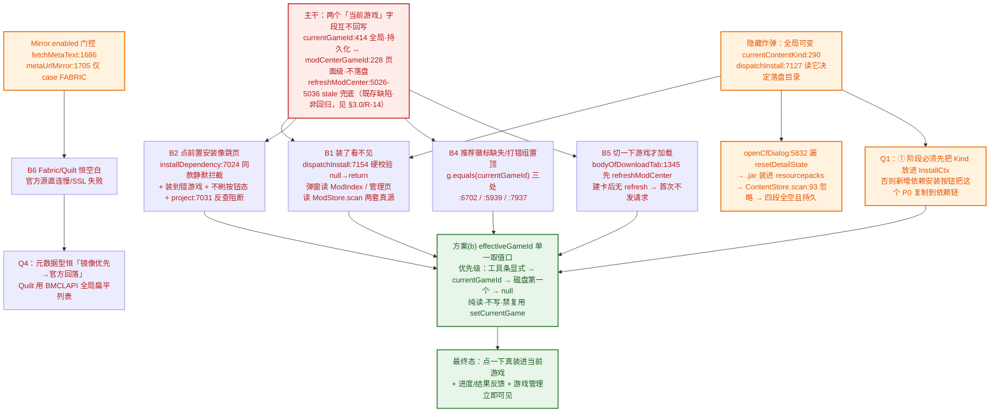
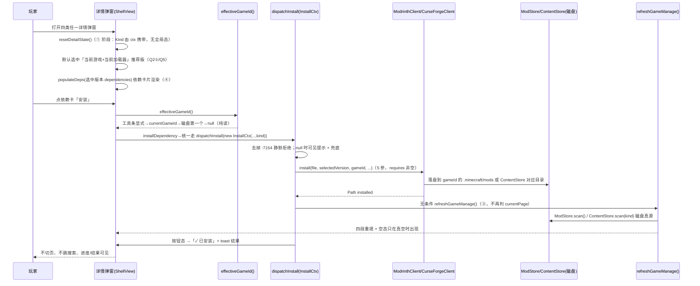
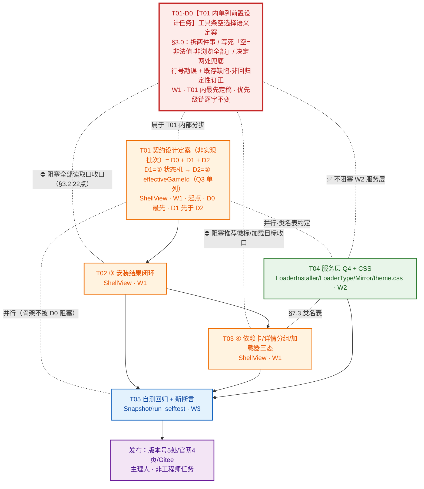

# GBL 0.8.8「装完看得见 · 前置跳页自选 · 详情与加载器对齐 HMCL」增量系统架构设计 + 任务分解

> ★★ **2026-11-07 用户当面澄清（优先级高于本文所有早期 R-03 / B2 / §9 断言）**：用户原话「我要点那个前置模组的安装，不是立马下载，而是跳转到那个前置模组的页面，让用户自己选」。**跳页是期望行为，不是 bug**；早期把它读成「要改成一点即装」是误读，**R-03「直装·不跳页」全链路作废**。最终实现：依赖卡按钮文案「查看」→ `openDependencyPage()`（关弹窗 → `showPage(Page.DOWNLOAD)` → `showDownloadTab(2)` → `modSearchField.setText()` → `searchMods()` → toast），CF 依赖切「两者合并」源，后台只补真实名称；**依赖卡路径 0 处 install 调用、下载队列 0 新增**。原文中 `installDependency` / `installCfDependency` 两个一键直装方法已整段删除。本文下方若仍有「直装 / 不跳页 / 一点即装」残留字样，一律以本注记为准。0.8.8 已按此发布。

> **本文件是 0.8.8 发布门禁的实现契约**。工程师严格按本文的接口签名、行号、任务顺序与文件归属并行施工；签名一个字不得含糊，顺序不得调换。凡本文与主理人拍板冲突，以本文 §0 抄录的拍板为准；凡本文未覆盖的实现细节，沿用 `docs/ARCH-0.8.7-content.md` 的既定口径。

| 项 | 内容 |
|---|---|
| 文档类型 | 增量系统架构设计 + 任务分解（实现契约） |
| 基线版本 | 0.8.7（已发布、已验收） |
| 目标版本 | **0.8.8** |
| 上游输入 | `docs/PRD-0.8.8-content.md`（许清楚，R-01~R-10，P0 9 条 + P1 1 条）、`docs/HMCL-MOD-REFERENCE.md`、`docs/ARCH-0.8.7-content.md` |
| 决策来源 | 主理人综合 4 路独立探针（`#75/#76/#77/#78`）+ 真机视频 + 磁盘实证后的**定案根因与拍板**（本文 §0 全量抄录，不再自行调研） |
| 行号基准 | `src/main/java/com/mclauncher/ui/ShellView.java`（9000+ 行）等源码，**已逐行核对**，核对差异见 §0.6 |
| 技术栈 | JavaFX 21 + 纯 Java 服务层；**零新增第三方依赖** |
| 撰写 | 高见远（Architect） |
| 状态 | 待派工；**只写本文档，不改任何源码 / 官网 / 构建脚本 / 自测文件** |
| 修订 | **v1.1**（本轮主理人补充输入）：新增 §3.0「工具条空选择语义」写死口径 + §6 单列阻塞性设计任务 D0 + §8 既存缺陷定性订正 + §0.6 行号勘误；**其余拍板 / 修复顺序 ①②③④ / 并行边界一律不变** |

---

## 0. 决策基线（主理人拍板，全部硬约束，不得自行更改）

### 0.1 一条主干 + 六个分支（定案根因）

> **主干：两个「当前游戏」字段互不回写。**
> - `currentGameId`（字段 `ShellView.java:414`）：**全局当前游戏**，首页 Hero / 启动目标、**持久化**。写入口仅 `:2604`（启动初始化 `currentGameId = settings.currentGame()`）与 `setCurrentGame():2748`（写入行 `:2753`）。
> - `modCenterGameId`（字段 `ShellView.java:228`）：**下载页浏览与安装目标**，页面级、**不落盘**。写入口仅 `modGameBox` handler `:4824` 与 `refreshModCenter():5049`。
> - 唯一耦合是 `refreshModCenter():5026-5036` 的 **stale 兜底**（`modCenterGameId` 为 null/失效时取 `currentGameId`，再兜磁盘第一个；`:5043` `setValue` + `:5049` 回写）。工具条选 B 时 `currentGameId` 仍是 A/null。**行号按 v1.1 勘误精确化**；该兜底 + `bodyOfDownloadTab():1345`「切 tab 必调」造成的「清空 → 切 tab → 被拉回」是**现行代码既存缺陷、非修复回归**（主理人定性订正，见 §3.0.3 / §8 订正框 / R-14），其语义口径由 T01-D0 单列定案。
>
> 由此炸出用户上报的绝大多数现象：

| 分支 | 现象 | 定案根因（已核对） |
|---|---|---|
| **B1 装了看不见** | 详情弹窗装完，游戏管理页看不到 | `dispatchInstall:7154` 硬校验 `currentGameId==null` → toast 后 `return`，磁盘零写入；弹窗「✓已安装」读 `ModIndex` 索引、游戏管理页 `refreshGameManage:4551` 读 `ModStore.scan()` 磁盘，**两套真源**（两张截图自相矛盾的真相）。磁盘实证：`~/.gbl/cache/mods/26.3/index.json` 有 Sodium（11-02 装）、11-06 21:38 被重写，但全盘无 21:00 后新增 `.jar/.zip` |
| **B2 点前置「安装」像跳页** | 感觉没反应 / 跳走了 | 源码**已是后台直装**（`installDependency:7023`，触发点 `depRow:6894`），**不跳页**；真相是同款静默拦截 + 装到错游戏 + 装完不刷新按钮态。另有 `project()` 反查（`:7031`）失败被 `catch(IOException):7063` 吞成整链中断 |
| **B3 HMCL 有 GBL 没有** | 前置依赖缺失/板块整体隐藏 | 依赖只取「当前选中版本」，而默认选中**排序第一版**（`:6728-6729`）非当前游戏推荐版；该版无依赖时整块隐藏（`:6789-6792`）；`openCfDialog` 的 `populateCfDialog:5921-5922` **整块隐藏依赖区**（但 `CurseForgeClient.File.dependencies` 已在 `:107` 定义、`files():370` 已解析）；反查不到 projectId 的依赖被静默丢弃 |
| **B4 没有推荐游戏版本** | 推荐徽标缺失 / 打错组并置顶 | 分组算法 `g.equals(currentGameId)`（`:6702-6713` / `:5939-5948` / `:7937-7946`）；null 时恒 false 无徽章，**错值时把「推荐」打在错误的 A 组并置顶**（比不显示更具误导性，探针专门勘误） |
| **B5 切一下游戏版本才加载** | 加载器 tab 首次恒空白 | `bodyOfDownloadTab():1322` `setAll` 重建 + `:1345` **先**跑 `refreshModCenter()`，此时 `modLoaderBoxes` 为空被 `refreshLoaderTab:5157` 守卫跳过；`buildLoaderTab():5104` 建完卡后**再无 refresh** → 首次进页根本没发请求；`loaderCard:5127` 只 `add("加载中…")` 没 `setValue` 且 `:5128` disable → 永远空白块；切 `modGameBox` 是唯一解锁路径。另有 `modVersionsLoading.remove()` 写在 FX lambda 内（`:5209/:5228`），非 `IOException` 异常会**永久卡死 guard**；`switchDownloadSource():5087` 换源不重拉 |
| **B6 Fabric/Quilt 恒空白** | 官方源下只有 Forge/NeoForge 出来 | `Mirror.enabled()` 门控（`fetchMetaText:1686`）→ 官方源下元数据型直连官方 meta。实测：Fabric 官方 4.23s / BMCLAPI `fabric-meta/v2/versions/loader/<mc>` 0.58s；Quilt 官方带 mc 路径 SSL 握手失败 5.38s、`meta.quiltmc.org/v3/versions/loader` 全局 2.94s；**BMCLAPI 有 Quilt 镜像** `quilt-meta/v3/versions/loader` 200/0.34s（**仅不带 mc 的全局列表**，带 mc 的 404），返回**扁平结构** `[{separator,build,maven,version}]`，与按 mc 查询的嵌套 `{loader:{maven...}}` **不同，解析器必须兼容两种**；LegacyFabric 无镜像，官方对 1.12.2/1.7.10 返回 200、对 1.20.1/26.3 返回 400+`[]`（不支持该 MC 版本属正常）。Forge/NeoForge 是 maven 型恒走 BMCLAPI 有主备回落，所以视频 4 秒时恰好只有这俩出来 |

> **分派串味（隐藏炸弹，Q1/Q3 必修）**：`dispatchInstall:7126` 用**全局可变** `currentContentKind`（字段 `:290`，`:7127` 读取）决定落盘目录；`openCfDialog():5832` **漏了 `resetDetailState()`**（`openModDialog:6581` / `openContentDialog:2170` 都有）。看过内容弹窗再开 CF 模组弹窗 → 残留 Kind → 模组 `.jar` 被装进 `resourcepacks/shaderpacks`，而 `ContentStore.scan():93-100` 只认 `.zip` 和目录 → `.jar` 被忽略 → 四段全空且**持久**。差异化证据：内容分支 `:7129-7142` **无** `currentGameId` 校验、模组/整合包分支 `:7154` **有** → 精确解释「用户只抱怨模组，没抱怨内容类」。
>
> **刷新缺口**：`installContentBytes:2300` 成功回调 `:2323-2334` 完全无 `refreshGameManage()`；模组/整合包只在 `currentPage==GAMEMGMT` 才刷（`:7186`/`:7217`）；无事件/回调总线。
>
> **三类内容详情界面**：`populateContentDialogMr:2214` / `populateContentDialogCf:2229` 平铺「版本列表·共 N 个」，缺 `groupHeader():7621` 分组与推荐徽标；但 `Version.gameVersions` / `File.gameVersions` **服务层已齐全且已被内容弹窗取到**（`:2199-2203`）→ 本块**服务层与 theme.css 零改动**，纯 UI 约 +50 行、1 文件 2 方法。风险：光影/资源包常把兼容性写在 `loaders`（iris/optifine）而非 `game_versions`，照抄分组算法会**静默丢版本**，必须加「未标注 Minecraft 版本」兜底组。
>
> **依赖卡片**：`depRow():6865` 纯文本 `HBox`、无 `ImageView`、字号 12.5px（CSS `.mod-dep-required:2052`）；四类弹窗共用 `buildModDetailDialog():6454` 单例与共享 `modDetailDeps`（字段 `:280`），都拿到了含 dependencies 的数据却隐藏（内容 `:2185`、整合包 `:7919-7920`）。

### 0.2 Q1–Q6 拍板结论（写死，不得自行改）

| # | 结论 |
|---|---|
| **Q1 结果口径** | **不要求用户复现「跳页」**。最终态必须「点一下就真装进当前游戏 + 进度/结果反馈 + 游戏管理立即可见」；同时修 `project()` 反查失败阻断、装完不刷新按钮态、**4 参 install 记空 requires** |
| **Q2 依赖口径** | Modrinth `Version.dependencies[]` / CF `File.dependencies[]` 为**唯一真源**（项目级 `Project` 无此字段）；**以用户选中的版本为准**（不合并全版本噪音，对齐 HMCL），但必须：① 打开弹窗默认选中「当前游戏 + 当前加载器」的**推荐版**而非排序第一版；② 切换版本行**立即重建依赖区**；③ **CF 弹窗必须显示依赖区**；④ 反查失败按 `projectId/versionId/fileName` 兜底显示，**绝不隐藏整个板块**；⑤ `required/optional/embedded/incompatible` 四分类齐全，**embedded 不给安装按钮** |
| **Q3（已修订，务必按此）** | **已装判定统一以磁盘扫描为准**（`ModStore.scan()` / `ContentStore.scan()`），`ModIndex` 只做封面/元数据/卸载辅助，**不得再当「已装」真源**。**语义明确分离**：全局当前游戏（首页 Hero / 启动目标，持久化）vs 下载页浏览与安装目标（页面级，不落盘）。**禁止复用 `setCurrentGame()`**（它有 `resetDetailState()` + `settings.save()` + `refreshGames()` + 通知首页 4 个副作用，且 `refreshGames():2730` 在 `currentGameId==null` 时把磁盘第一个游戏强制上位，与下拉「不选/浏览」语义冲突）。改为**方案 (b)**：新增单一取值入口 **`effectiveGameId()`**，优先级 = 工具条显式选中值 → `currentGameId` → 磁盘第一个游戏 → null；**所有读取点统一改调它**。**`refreshGameManage()` 也必须读它**，否则「装进 B、却去 A 的管理页看，当然看不见」。去掉 `:7154`/`:7024` 的静默拒绝（改为可见提示 + 兜底游戏）。**此项单列为设计契约（本文 §3），不要塞进实现批次顺手改** |
| **Q4 两者都做** | ① 把加载器版本拉取**收口到服务层单方法**（`LoaderInstaller.versions(type, mcVersion)`），「加载器 tab」与「安装新游戏弹窗」**共用**，消除两套口径；② 元数据型（Fabric/Quilt/LegacyFabric）的 meta 拉取**不受 `Mirror.enabled()` 门控**，恒走「镜像优先 → 官方回落」（理由：下载源开关语义是「Mojang 资源下载源」，不该决定加载器 meta 域）。Quilt 用 BMCLAPI 全局列表并兼容扁平/嵌套双结构；LegacyFabric 无镜像，官方 + 超时 + 可见提示；不支持的 MC 版本显示「暂无兼容版本」而非空白。失败必须**常驻可见错误 + 重试按钮**，单卡失败不拖累其他 4 张卡 |
| **Q5 与模组/整合包完全同款** | 按 `effectiveGameId()` 打「推荐」徽标并置顶；一个版本适配多 MC 版本 → **在每组都出现**；`gameVersions` 为空但 `loaders` 有值的版本归「未标注 Minecraft 版本」兜底组，**绝不静默丢弃** |
| **Q6** | **R-04 升 P0、算 0.8.8 门禁必过**（用户明确要求「整合包和别的也要整」，四类弹窗共用同一渲染器顺带就做）；**N1 阈值 = 官方源首次无缓存 ≤3s、镜像源 ≤2s**，测量环境 = **本机真机冷启动（不是自测）** |

### 0.3 修复顺序硬约束（写进任务分解，工程师不得调换）

```
① 先补 openCfDialog:5832 的 resetDetailState() + 把 ContentStore.Kind 放进 InstallCtx 随请求传递、
   废弃全局可变 currentContentKind
      ↓
② effectiveGameId() 语义定案与全部读取口收口
      ↓
③ 装完无条件 refreshGameManage() + 依赖区/按钮态同步刷新
      ↓
④ 最后才动弹窗依赖区 UI 与三类内容详情分组
```

> **理由（不得违反）**：不先做 ①，新增的依赖「安装」按钮会在 Kind 残留时把 `.jar` 装进 ContentStore 目录并被 `scan()` 忽略，等于把这个 P0 复制到依赖链上。

### 0.4 并行边界与写入者编号

| 编号 | 独占文件集 | 承担内容 | 可否并行 |
|---|---|---|---|
| **W1** | `src/main/java/com/mclauncher/ui/ShellView.java`（9000+ 行，**唯一写入者**） | 修复顺序 ①②③④ + 依赖卡片 + 三类内容详情分组 + 加载器 tab 三态 + `effectiveGameId()` + 全部读取口收口 | ⛔ **单文件串行，严禁两人同时改** |
| **W2** | `LoaderInstaller.java` / `LoaderType.java` / `Mirror.java`（可加 `CurseForgeClient.java` 的 type 口径）+ `src/main/resources/com/mclauncher/theme.css` | Q4 服务层 URL 策略 / 双结构解析 / 门控改造 + 依赖卡片样式（**类名必须与 W1 约定一致，见 §7.3**） | ✅ 与 W1 并行（文件集零交集） |
| **W3** | `src/main/java/com/mclauncher/ui/Snapshot.java` + `tools/run_selftest.py` | 0.8.8 新断言（映射 R-01~R-10），浅色/深色两趟 | ✅ 与 W1/W2 并行，**禁止碰生产源码** |

> `theme.css` 归 **W2**（不设第四写入者）；W1 只按 §7.3 类名表 `getStyleClass().add(...)`，不写 CSS。

### 0.5 全局硬约束 + 明确不改项

- ⛔ **禁止任何人跑全局编译 / jpackage / 打包 / 发布**；所有改动只改源码，由主理人统一 `C:/Temp/gbl_compile.py` 做 javac 校验、统一 `C:/Temp/build_083.py` 重打包。
- ⛔ **版本号五处同改**（`LauncherApp.VERSION` / `GameDownloader.AGENT` / `VersionManifest` UA / `MicrosoftAuth` UA / `C:/Temp/build_083.py` 的 `APP_VER`）、**官网 4 页**、**Gitee 发布**全部由主理人做，**不写进工程师任务**（仅 §10 列归属）。
- ⛔ 不改 0.8.7 已验收项（PRD §1.2：皮肤 3D / 账号 / 下载队列 / WebP 封面 / 中文别名 / Modrinth-CF 搜索主流程 / 整合包导入 / OptiFine / Forge-NeoForge 安装器）；不引第三方依赖；不改包名。
- ⛔ 不改 `DOWNLOAD_TABS` **8 tab 顺序与数量**（`ShellView.java:1251-1252`，Snapshot 按 index 点击）；不改既有 `nav-*` / `page-title` / `page-blank-title` / `content-scroll` / `tab-btn` / `version-row` / `game-empty` 类名。
- ⛔ 便携模式基准 `Platform.minecraftDir()` 不改。**放大因素必须写明**：多份 `GBL.exe` 各有独立 `.minecraft`（每个 jpackage 便携包自带一份目录），故「装进 A 的 `.minecraft`、却在 B 的 `.minecraft` 里看」在同一台机器上可跨包复现；`effectiveGameId()` 只读不写、不跨包共享任何状态（见 §8 回归 R-09）。
- ✅ 复用现有 `card` / `Icons` / `coverPlaceholder():6037` / `groupHeader():7621` / `versionRowView():7523` / toast 组件，不造第二套反馈组件。

### 0.6 行号核对说明（定义行 vs 调用行，本文已逐行核对）

> 主理人给的行号绝大多数精确到行，以下几处是**调用/写入行**而非方法定义行，契约按「定义行 + 写入行」双标注，避免工程师改错位置：

| 主理人给的行号 | 核对结果 |
|---|---|
| `refreshGames():2604`（**行号勘误**） | `currentGameId = settings.currentGame()`（`:2604`）位于 **`buildGameListPage()` 构建末尾、在 `:2605` `refreshGames()` 之前**，是启动初始化赋值，**不是「`refreshGames` 里 2604 重读字段」**。`refreshGames()` **定义在 `:2722-2741`**，内部对该字段的分工：`:2724-2726` 配置里那条磁盘已没了就清 null → `:2730-2731`「null 且磁盘非空 → `setCurrentGame(games.get(0).id())` 自动兜底」→ `:2734` 重画列表 → `:2740` `setCurrentVersion` 通知首页 |
| `refreshModCenter():5026-5036` / `:5043` / `:5049` | `refreshModCenter()` **定义在 `:5020`**；`:5026-5036` 是 **stale 兜底**（`previous==null` 或磁盘无 previous → `keep=currentGameId`，再兜 `games.get(0).id()`）；`:5043` `modGameBox.setValue(keep)`、`:5049` `modCenterGameId = keep`。**`bodyOfDownloadTab():1345` 切任一相关 tab 必调 `refreshModCenter()`** ⇒ 用户清空工具条选择后切一次 tab 即被自动拉回（**现行代码既存缺陷、非修复回归**，定性订正见 §3.0 / §8 R-14） |
| `dispatchInstall:7154` | `dispatchInstall()` **定义在 `:7126`**（`InstallCtx` record 在 `:7107`、`CfRef` 在 `:7111`）；`:7154` 是硬校验行 |
| `installDependency:6894/:7024` | `installDependency()` **定义在 `:7023`**；`:6894` 是 `depRow()` 内的 `setOnAction` 触发行、`:7024` 是硬校验行 |
| `ensureLoaderVersions:5200` | `ensureLoaderVersions()` **定义在 `:5196`**；`:5200` 是 `String game = modCenterGameId` |
| `refreshGameManage:4499-4523` | `refreshGameManage()` **定义在 `:4457`**；`:4499-4523` 是判空 + 状态文案段，`ModStore.scan()` 在 `:4551` |
| `onLoaderAction:5241` | `onLoaderAction()` **定义在 `:5240`**；`:5241` 是取 game 行 |
| `switchDownloadSource:5087` | 定义在 `:5087`，全文 7 行，仅切设置 + toast，**确无重拉** |
| `installContentBytes:2323-2334` | `installContentBytes()` **定义在 `:2300`**；`:2323-2334` 是成功回调段 |
| `CurseForgeClient.File.dependencies:107 / files():370` | `File` record 在 `:105-107`（`FileDependency` record `:129`）；`files()` **定义在 `:349`**，`:370` 是解析 `dependencies(...)` 的行 |
| `populateContentDialogMr:2214 / Cf:2229` | 均为定义行 ✓ |
| `ModIndex.add` 写入侧 `:7176/:7207/:7049/:4408` | 这 4 处是 `ModrinthClient.install(...)` / `CurseForgeClient.install(...)` 的**调用行**（`versionId` 实参），真正 `ModIndex.add()` 在 **`ModrinthClient.doInstall:595`**（服务层，W1 不碰，只统一传参）；另有 `:4408` 是 `installApiIfNeeded` 的 4 参 install |
| `WEBSITE_URL:152` | 当前实际在 **`:162`** 且已为 `https://gbl-website.pages.dev/`（0.8 已改），0.8.8 **无需改动**，仅登记 |

**核对新增事实（影响契约，务必注意）**：
1. `LoaderInstaller.versions(LoaderType, String)` **已存在于 `:93`**，且 `ensureLoaderVersions:5207` 与「安装新游戏」弹窗 `loadInstallLoaderVersions:4265` **都已调用它**。→ Q4① 的「收口到服务层单方法」是**确认并固化既有签名**，消除的是 **UI 层两套后台线程封装 + 服务层门控差异**，**不是新建方法**；新建会造成重复真源。
2. `versionsMeta():1029-1061` 的解析器 **已兼容嵌套/扁平两种结构**（`:1047` `entry.get("loader") instanceof Map ? loader : entry`）。Q4 的「兼容两种」是**保留并补强**（扁平结构无 `stable` 字段，需补默认值），不是新写解析器。
3. `metaUrlMirror():1705-1712` 当前 `switch` **只 `case FABRIC`，`default -> null`**（Quilt/LegacyFabric 注释「BMCLAPI 未稳定镜像，走官方」）——这正是 B6 的服务层根因，Q4 必须推翻。
4. `Mirror.enabled()` 全项目仅 **4 处调用**：`LoaderInstaller.java:268`（Forge installer jar）、`:277`（NeoForge installer jar）、`:1544`（fabric maven）、`:1686`（**`fetchMetaText`，Q4 唯一要拆的门控**）。前 3 处**不动**（安装器型/库下载属既有验收口径）。
5. `refreshGameManage:4551` **已用 `ModStore.scan()`（磁盘）** 列 mods，`:4554` 用 `ModIndex.entries()` 仅取封面 `projectId`。坏点在 `isModInstalled():6736-6746`（`:6740` 用 `ModIndex.entries` 判「已装」）——Q3 要修的是**弹窗侧真源**，不是把管理页改成索引。

---

## 1. 变更总览与根因图

### 1.1 变更总览（按修复顺序）

| 阶段 | 目标 | 主文件 | 写入者 | 对应需求 |
|---|---|---|---|---|
| ① | 状态机加固：`InstallCtx` 携带 `Kind`、废弃 `currentContentKind`、补 `resetDetailState()` | ShellView | W1 | Q1 / R-01 / R-03 / R-04 |
| ② | `effectiveGameId()` 单一取值口 + 全部读取点收口 | ShellView | W1 | Q3 / R-01 / R-03 / R-05 / R-06 / R-07 |
| ③ | 装完无条件 `refreshGameManage()` + 依赖区/按钮态同步 + 反查失败不阻断 + 5 参 install | ShellView | W1 | Q1 / R-01 / R-03 |
| ④ | 依赖卡片化（四类弹窗统一渲染器）+ CF 依赖区 + 三类内容详情分组 + 推荐徽标 + 兜底组 | ShellView + theme.css | W1 + W2(样式) | R-02 / R-04 / R-05 / R-06 |
| ④' | 加载器 tab 进入即加载 + 失败三态状态机 | ShellView | W1 | R-07 / R-08 |
| S | 服务层 URL 策略 / 双结构 / 门控改造 | LoaderInstaller / LoaderType / Mirror | W2 | R-07 / R-08 |
| T | Snapshot 新断言 | Snapshot / run_selftest.py | W3 | R-10 |

### 1.2 根因图（Mermaid）



### 1.3 安装链路调用时序（契约，Mermaid）



---

## 2. 精确改动点契约（文件:行号 + 方法签名）

> 全部位于 `src/main/java/com/mclauncher/ui/ShellView.java`（除标注服务层外）。**签名逐字抄录，不得改写**。

### 2.1 阶段 ① — 状态机加固 + `InstallCtx` 携带 `Kind`（W1）

| # | 位置 | 改动 | 精确签名 / 代码契约 |
|---|---|---|---|
| 1.1 | `:7107-7108` | `InstallCtx` record **加第 5 字段** | `private record InstallCtx(ModrinthClient.Version mrVersion, CfRef cfRef, boolean modpack, String displayName, ContentStore.Kind kind) {}`<br/>`kind == null` = 模组/整合包（落 `mods/`）；非 null = 内容（落 ContentStore） |
| 1.2 | `:7111` | `CfRef` 不变 | `private record CfRef(long modId, CurseForgeClient.File file) {}` |
| 1.3 | `:7126-7127` | `dispatchInstall` 改分派真源 | `private void dispatchInstall(InstallCtx ctx, Button btn) {` 内 `ContentStore.Kind kind = currentContentKind;` → **`final ContentStore.Kind kind = ctx.kind();`**；`:7141` `dispatchContentInstall(ctx, btn, kind)` 保持按参传递 |
| 1.4 | `:7236` | `dispatchContentInstall` 签名保持 | `private void dispatchContentInstall(InstallCtx ctx, Button btn, ContentStore.Kind kind)`；内部 `:7243`/`:7247` 调 `installContentBytes(..., kind)` 不变 |
| 1.5 | `:290` | **删除字段** `private ContentStore.Kind currentContentKind;` | 全文检索 `currentContentKind` 归零（除 `:2361` 一并清） |
| 1.6 | `:2361-2364` | `resetDetailState()` 保留但缩职责 | `private void resetDetailState() { selectedVersion = null; }`（**只清选中版本令牌**，不再清 Kind；Kind 随 ctx 走） |
| 1.7 | `:2166-2171` | `openContentDialog` 不再设全局态 | 删 `currentContentKind = kind;`（`:2171`）；`resetDetailState()`（`:2170`）保留 |
| 1.8 | `:5832` | **`openCfDialog` 补 `resetDetailState()`**（① 的第一颗钉子） | `private void openCfDialog(CurseForgeClient.Hit hit) { if (modLayer == null) return; resetDetailState(); loadCover(...); ... }` |
| 1.9 | 所有 `new InstallCtx(...)` 调用点 | **全部补第 5 参** | `:2267`（Mr 内容行）、`:2279-2280`（CF 内容行）、`:5972`（CF 模组行）、`:7098`（Mr 模组/整合包行）、`:5966` 附近（CF 版本行）、`:7091` 附近——逐一登记 `kind`：内容弹窗传当前 `Kind`，模组/整合包弹窗传 `null`。**漏一处即编译失败或分派错**，W1 交付前全文检索 `new InstallCtx(` 逐个核对 |
| 1.10 | `:2185` / `:5921-5922` / `:7919-7920` / `:6594` / `:6683` / `:7830` | 依赖区可见性 | ① 阶段**不删**这些 `setVisible(false)`（属 ④）；但必须保证 `resetDetailState()` 已在每个 open* 入口调用，避免残留 |

> **① 的验收硬断言**：全文 `currentContentKind` 出现次数 = 0；`new InstallCtx(` 每个调用点第 5 参齐全；`openCfDialog` 首行有 `resetDetailState()`。

### 2.2 阶段 ② — `effectiveGameId()` 单一取值口（W1，设计契约见 §3）

> ⛔ **前置门槛（v1.1）**：本阶段 ② 动手前，必须先完成 **T01-D0 工具条空选择语义定案**（§3.0）。D0 是纯设计定案、**不占修复顺序 ①②③④ 编号、不改变其顺序**；D0 未定稿，2.1–2.4 与 §3.2 任一读取点收口均不得开工（阻塞关系见 §3.0.5 / §6.2）。`effectiveGameId()` 优先级链由 Q3 拍板**逐字不变**。

| # | 位置 | 改动 |
|---|---|---|
| 2.1 | 新增（建议插在 `:2748` `setCurrentGame` 之前） | `private String effectiveGameId()`，**纯读**，完整语义见 §3.1、**空选择口径见 §3.0（D0 先定）** |
| 2.2 | §3.2 全部读取点清单（**D0 定稿后**） | 逐点把 `currentGameId` / `modCenterGameId` 读改为 `effectiveGameId()`，**禁止**改 `setCurrentGame()` 任何一行；第 12 项按 §3.0.3 改写（**不是「不改」**） |
| 2.3 | `:7154` / `:7024` | 删除 `if (currentGameId == null) { toast("先去…"); return; }` 静默拒绝；改为 `String game = effectiveGameId(); if (game == null) { toast(含兜底引导的可见提示); return; }` |
| 2.4 | `:6736-6746` | `isModInstalled` 改磁盘真源（见 §3.3） |

### 2.3 阶段 ③ — 安装结果闭环（W1）

| # | 位置 | 改动 | 契约 |
|---|---|---|---|
| 3.1 | `:7186-7188` / `:7217-7219` | 去掉 `if (currentPage == Page.GAMEMGMT)` 包裹 | 成功回调内**无条件** `refreshGameManage();`（方法自身 `:4458` 有 `gameMgmtStatus==null` 守卫，切页未建也不炸） |
| 3.2 | `:7059-7061` | 同上（依赖安装分支） | 无条件 `refreshGameManage();` |
| 3.3 | `:2323-2334` | `installContentBytes` 成功回调补刷新 | 内容安装成功后 `refreshGameManage();`（内容三段 `:4493-4498` 全局可管，刷新即重填） |
| 3.4 | `:7031` | `project()` 反查失败**不阻断整链** | `ModrinthClient.Project dep = ModrinthClient.project(projectId)` 包 `try/catch(IOException)`，**失败时用 `projectId` 兜底显示名继续装**，不 `return`；找不到适配版本才按 US-3④ 提示（含模组名 + MC 版本）、按钮恢复可点 |
| 3.5 | `:7049` | 4 参 install → **5 参**（Q1「4 参 install 记空 requires」） | `ModrinthClient.install(pick, selectedVersion, game, cancelled, listener)` 或改用 `allVersions()` + `dependenciesOf()` 取到选中 `Version` 再传；`requires` 必须来自该版本 `dependencies[]` 的 `required` 项（对齐 `collectRequires():609`） |
| 3.6 | 依赖卡按钮 | 装完按钮态同步 | 成功回调把该卡片 `Button` 文案置「✓ 已安装」并 disable（复用 `.mod-dep-ok`）；`installDependency` 增加**回调参数**把结果回传 `depRow`（不改 `installDependency(String, Button)` 语义见 §2.4） |

### 2.4 阶段 ④ — 四类详情弹窗统一渲染器（W1 + W2 样式）

| # | 位置 | 改动 | 精确签名 |
|---|---|---|---|
| 4.1 | `:6865` | `depRow` 升级为**依赖卡** | `private Node depRow(ModrinthClient.Dependency d, List<DepLabel> depLabels)`（**签名不变**，只换内部节点）；最小高度 ≥64px，含 `ImageView` 图标 + 名称 + 分类标签 + 状态/动作区，类名见 §7.3 |
| 4.2 | 新增 | 统一依赖区渲染器（四类弹窗共用） | `private void populateDepsFor(List<?> deps, ContentStore.Kind kind)`；或保留 `populateDeps(List<ModrinthClient.Dependency>):6765` 并新增 `populateCfDeps(List<CurseForgeClient.FileDependency>)`，**二者共用同一 `depCard(...)` 节点构造器**，保证 US-4②「四类结构一致」 |
| 4.3 | `:5921-5922` | **CF 弹窗必须显示依赖区** | 删「CF 接口不提供，保持隐藏」；改为 `populateCfDeps(选中文件.dependencies())`（`File.dependencies` 已在 `:107`），四分类 `relationType` 映射见 §7.2 |
| 4.4 | `:2185` / `:7919-7920` | 内容 / 整合包弹窗依赖区 | 有依赖数据则渲染；**无依赖数据的类型不显示空板块**（US-4③），不报错 |
| 4.5 | `:6728-6729` | 默认选中**推荐版** | `selectModVersion(rowVersions.get(0), versionRows.get(0))` → `selectModVersion(recommendedVersion, recommendedRow)`；选取规则见 §5.4 |
| 4.6 | `:2214-2226` / `:2229-2241` | 三类内容详情**分组渲染** | `populateContentDialogMr/Cf` 复用 `groupHeader(String mc, boolean recommend, int count):7621`；改「版本列表 · 共 N 个」为分组头 + 推荐徽标 + 版本数；兜底组见 §5.3 |
| 4.7 | `:2256` / `:2271` | 版本行保留 `versionRowView(VersionRowSpec)` | `private Node contentVersionRowMr(ContentHit hit, ModrinthClient.Version v)` / `private Node contentVersionRowCf(ContentHit hit, CurseForgeClient.File f)` 签名不变，安装回调仍走 `dispatchInstall(new InstallCtx(..., kind), btn)` |
| 4.8 | `:7008-7009` | 切版本**立即重建依赖区** | `selectModVersion` 已调 `populateDeps(...)`；CF / 内容 / 整合包版本行需补「选中版本」联动（新增 `onVersionSelected` 钩子），切行即重建，`selectedVersion` 令牌校验（`:6951`）保持 |

### 2.5 加载器 tab 三态（W1，R-07 / R-08 UI 侧）

| # | 位置 | 改动 | 契约 |
|---|---|---|---|
| 5.1 | `:1345-1351` | **进入即加载**（修 B5） | `bodyOfDownloadTab(int index)` 在 `case 1 -> buildLoaderTab()` **建完卡之后**补一次 `refreshLoaderTab()`（或 `buildLoaderTab()` 末尾自行调），保证首次进页发起请求；`refreshModCenter()` 仍在前面，**不调换顺序**，只补「建卡后再刷一次」 |
| 5.2 | `:5114-5148` | `loaderCard` 三态组件 | 保留 `modLoaderBoxes/modLoaderStates/modLoaderButtons` 三张字段表；新增 `modLoaderErrors`（`Map<LoaderType, Label>`）与 `modLoaderRetries`（`Map<LoaderType, Button>`），类名见 §7.3；下拉初始「正在拉取版本…」（可见文案，非空白） |
| 5.3 | `:5196-5237` | `ensureLoaderVersions` 改造 | `private void ensureLoaderVersions(LoaderType type, ComboBox<String> box)` 签名不变；`String game = modCenterGameId`（`:5200`）→ **`effectiveGameId()`**；**`modVersionsLoading.remove(type)` 移入 `finally`**（修 B5 的「非 IOException 异常永久卡死 guard」，`catch` 改 `catch (Exception)`）；失败态写卡内 `Label` 常驻 + 显示「重试」`Button`，单卡失败不 return 全局 |
| 5.4 | 新增 | 重试入口 | `private void retryLoaderVersions(LoaderType type)`：清 `modLoaderVersions` 该 key、清 `modVersionsLoading` 该 key、置回「正在拉取版本…」、重调 `ensureLoaderVersions(type, box)` |
| 5.5 | `:5240-5259` | `onLoaderAction` | `String game = modCenterGameId`（`:5241`）→ `effectiveGameId()` |
| 5.6 | `:5087-5094` | `switchDownloadSource` 换源重拉 | 切源后 `modLoaderVersions.clear(); modVersionsLoading.clear();` 并 `refreshLoaderTab();`（当前仅切设置 + toast） |
| 5.7 | `:4256` | 「安装新游戏」弹窗共用 | `loadInstallLoaderVersions(LoaderType type, ComboBox<String> box)` 的 `game` 用 **`installMcVersion`**（不是 `effectiveGameId()`，弹窗语义是「将要新建的 MC 版本」），但**服务层方法与 W1 加载器 tab 完全同一个** `LoaderInstaller.versions(type, game)`；失败三态文案与加载器 tab 口径一致 |

### 2.6 服务层（W2，Q4）

| # | 文件:行号 | 改动 | 精确签名 |
|---|---|---|---|
| S1 | `LoaderInstaller.java:93-108` | **固化**统一入口 | `public static List<LoaderVersion> versions(LoaderType type, String mcVersion) throws IOException`（**签名不变**）；`LoaderVersion` record `:60` `public record LoaderVersion(String version, boolean stable) {}` 不变 |
| S2 | `LoaderInstaller.java:1682-1698` | `fetchMetaText` **拆门控** | `private static String fetchMetaText(LoaderType type, String mcVersion, String loaderVersion) throws IOException`：元数据型（`type.isMeta()`）**恒走**「镜像优先 → 官方回落」，**移除** `Mirror.enabled() ? ... : null`（`:1686`）；单版本元信息（`loaderVersion != null`）**按 type 分派**：FABRIC 镜像优先（≤3s 短超时）+ 官方带 mc 回落、QUILT / LEGACY_FABRIC 保持官方带 mc，见 **v1.2 修订后的 §4.2**（原「一律官方」一刀切会删掉 0.8.7 已有的 Fabric 单版本镜像，已撤回） |
| S3 | `LoaderInstaller.java:1705-1712` | `metaUrlMirror` 重写为**三类 URL 策略表** | `private static String metaUrlMirror(LoaderType type, String mcVersion, String loaderVersion)`，返回主源 URL；详表见 §4.2。**`default -> null` 必须删** |
| S4 | `LoaderInstaller.java:1029-1061` | `versionsMeta` **补强双结构** | `private static List<LoaderVersion> versionsMeta(LoaderType type, String mcVersion) throws IOException`：保留 `:1047` 嵌套/扁平兼容；扁平结构（Quilt BMCLAPI 全局列表）无 `stable` 字段 → `stable` 默认 `true`（否则 `ensureLoaderVersions:5217-5223` 找不到 stable 就选 index 0，语义不一致）；不支持的 MC 版本（HTTP 400 / `[]`）返回**空列表 + 明确标志**，UI 显示「暂无兼容版本」而非「加载失败」 |
| S5 | `LoaderInstaller.java:1650-1669` / `:46` | 超时收紧 | `private static final Duration TIMEOUT = Duration.ofSeconds(20)`（`:46`）、`connectTimeout(Duration.ofSeconds(10))`（`:51`）为现状；Q4 要求「LegacyFabric 官方 + 超时 + 可见提示」，新增**元数据型列表专用**超时（建议 ≤6s，镜像 ≤3s，满足 N1 ≤3s/≤2s），不改 `getText()` 通用签名 |
| S6 | `LoaderType.java:28-45` | 补镜像 URL 常量/方法 | `public static final String BMCLAPI = "https://bmclapi2.bangbang93.com"`（`:48` 已有，复用）；新增 `public String metaMirrorBase()` 或在 `metaUrlMirror` 内按 `type` 拼（推荐后者，**枚举零改动更最小**）；`metaUrl(String mcVersion):124` 保持官方 URL 不变 |
| S7 | `Mirror.java:12` / `:78` | **仅改注释 + 门控口径登记** | `Mirror.enabled()`（`:78`）**逻辑不动**（还有 `:268/:277/:1544` 三处合法调用）；类注释第 12 行「加载器 meta API 不走镜像」改为「加载器 meta 恒镜像优先→官方回落，不受下载源开关控制（0.8.8 Q4）」。`RULES` / `rewrite()` 零改动 |
| S8 | `CurseForgeClient.java` | **作废，零改动** | 原计划新增 `REL_REQUIRED=1/REL_OPTIONAL=2/REL_EMBEDDED=3/REL_INCOMPATIBLE=4` 常量，该推定映射已被 `docs/QA-0.8.8-dep-samples.md` 真实 API 实证推翻；`FileDependency:124-129` 的注释本身已是正确枚举（1=Embedded / 2=Optional / 3=Required / 4=Tool / 5=Incompatible / 6=Include），服务层不复制常量以免与 W1 的 UI 分类口径漂移。`File` record `:105-107` / `FileDependency` record `:129` / `files():349` 签名一律不动；**四分类逻辑归 W1（见修订后的 §7.2 定案表）** |

### 2.7 CSS（W2，`src/main/resources/com/mclauncher/theme.css`）

- 新增浅色 + `.dark` 两套样式，类名严格按 §7.3；**不改**既有 `.mod-deps:2046` / `.mod-dep-row:2049` / `.mod-dep-required:2052` / `.mod-dep-ok:2058` / `.mod-dep-warn:2064` / `.mod-group-title:2035` / `.mod-group-head:2446` / `.tag-release:2124` 等定义（可新增类，不改旧类）。
- `.dep-card` 必须 `-fx-min-height: 64px;`（US-2② 断言），图标区 `48~64px`。

---

## 3. `effectiveGameId()` 完整语义定义与全部读取点清单（Q3 设计契约，单列）

### 3.0 Q3 拆两件事 + 工具条空选择语义定案（D0 前置设计项，写死口径）

> **本 §3.0 由主理人 v1.1 补充输入并入**（两路探针交叉复核 + 定性订正）。**Q1–Q6 拍板、修复顺序 ①②③④、并行边界 W1/W2/W3 一律不变**；本节只把 Q3 原先混在一起的「语义口径」与「实现约束」拆成**两件互不混淆的事**，并对前者给出**写死的明确口径**。§3.1 的 `effectiveGameId()` 优先级链**逐字不变**。

#### 3.0.1 Q3 必须拆成两件互不混淆的事

| 件 | 性质 | 内容 | 归属 |
|---|---|---|---|
| **① 先定语义的设计项（单列任务 D0）** | **What / 口径**，先定、写死、**阻塞所有读取口收口的实现任务** | 下载页工具条「允不允许空选择、空选择代表什么」；据此决定 `refreshModCenter():5026-5036` 与 `refreshGames():2730-2731` 自动兜底的保留/改写；口径须与 `effectiveGameId()` 优先级链自洽 | **§6 的 T01-D0 单列设计任务**，未定稿不得动 §3.2 任一读取点 |
| **② 实现约束（不变）** | **How / 编码纪律**，与 ① 结论无关、**不依赖是否新增 `setCurrentGame()` 调用** | `modGameBox` handler（`:4815-4831`）**禁止复用带副作用的 `setCurrentGame()`**（`resetDetailState()` + `settings.withCurrentGame` + `settings.save()` + `refreshGames()` 递归 + 首页通知，共 4 副作用，见 `setCurrentGame():2748-2759`）；只做轻量字段赋值 + 局部刷新 | §3.1 契约 + §8 R-1，**现行代码已满足，保持、禁止回退** |

> **「互不混淆」的判据**：① 是语义定案，回答「空是什么、兜底要不要、往哪兜」；② 是编码纪律，回答「写字段时不允许顺带触发哪些副作用」。② 经核对在 `initModControls():4815-4831` **已经是轻量实现**（仅 `modCenterGameId = keep` + `modLoaderVersions.clear()` + 三个 refresh，**未调 `setCurrentGame()`**），因此本版对 ② **零改动、只固化**；把 ② 误当成「① 定案后才要做的改动」或反过来把 ① 塞进实现批次顺手改，都属越界。

#### 3.0.2 明确口径（写死，工程师不得自行更改）

**定案：下载页工具条「空选择」= 非法值 / 未指定 / 待收敛，不允许「空选择 = 浏览全部 / 不限定游戏」。** 即 §0.2 Q3 的 `方案(b)` + `effectiveGameId()` 优先级链在「空」这一取值上补齐语义：

| 问题 | 写死的答案 |
|---|---|
| 允不允许空选择作为**合法稳态** | ⛔ **不允许**。`modCenterGameId` 在稳态下恒为「磁盘上真实存在的某个具体游戏 id」。`== null` 只允许出现在**两种瞬态**：(a) 首次进页、`refreshModCenter()` 尚未收敛；(b) `GameScanner.scan()` 为空（磁盘无任何游戏） |
| 空选择代表「浏览全部 / 不限定游戏」吗 | ⛔ **不代表**。GBL 的安装动作本质必须落到一个确定的 `.minecraft`（`ModStore.modsDir()` / `ContentStore.installFile()` 都吃 `versionId`），不存在「装到全部」；引入「浏览全部」会连带改 Q5 推荐徽标分组、CF/Mr 版本过滤、加载器 tab 目标，违背最小变更 |
| 空选择代表「非法值需自动兜底」吗 | ✅ **是**。命中上述两种瞬态时，按 `effectiveGameId()` 优先级链**收敛到一个确定游戏**；收敛不到（链走到第 4 项 `null`）时由调用方给**可见提示 + 兜底引导**（§2.3 2.3 / §3.1 第 4 项），**不得静默 return** |

**否决「空 = 浏览全部」的三条理由（含主理人条件句）**：
1. **主理人条件句**：「若定义『空选择=浏览全部』，则优先级链第 1 项为空时不能直接跳到第 2/3 项去当安装目标」——因为用户表达了「不限定」，却把 `currentGameId` / 磁盘第一个游戏悄悄当安装目标，等于制造 B1「装进用户没预期的游戏」的变体。选它就必须**改写 Q3 已拍板、明令不变的优先级链**，与「其余定案一律不变」直接冲突。
2. 选「空 = 非法值」后，优先级链**逐字不动即自洽**：稳态下优先级 1（工具条显式选中值）恒非 null，根本不会「第 1 项为空却跳到第 2/3 项当安装目标」；为 null 只发生在 (a)(b) 两种瞬态，此时按链继续 `currentGameId` → 磁盘第一个 → `null` 是**收敛**而非「把浏览意图当安装目标」。
3. 与 Q1「点一下就真装进当前游戏」、Q3「语义分离」、Q5「按 `effectiveGameId()` 打推荐徽标」全部一致，无需新增任何字段 / 枚举 / UI 概念。

#### 3.0.3 据此决定两处自动兜底的保留 / 改写（写死）

> 主理人已订正定性：`refreshModCenter():5026-5036` 的 stale 兜底 + `bodyOfDownloadTab():1345`「切任一相关 tab 必调 `refreshModCenter()`」⇒ **用户今天清空工具条选择、再切一次 tab，选择就被自动拉回 `currentGameId` 或磁盘第一个游戏**；它与 `refreshGames():2730-2731`「null 且磁盘非空 → `setCurrentGame(games.get(0).id())` 强制上位」是**同一种语义冲突**，且**不依赖是否新增 `setCurrentGame()` 调用——是现行代码既存缺陷，不是修复方案引入的回归**（主理人上一条标成「修复回归风险」，定性作废，以此条为准；已登记 §8 R-14）。

| 处 | 决定（写死） | 契约 |
|---|---|---|
| `refreshModCenter():5026-5036`（**下载页工具条域**） | ✅ **保留兜底方向**（空 = 非法值必须收敛），⛔ **改写其跨域静默行为** | ① 保留 `:5028-5035` 的 stale 判定与 `keep` 收敛骨架，但其序列必须与 `effectiveGameId()` 优先级链**同源同序**（工具条上次有效值 → `currentGameId` → 磁盘第一个 → null），用互相引用的注释固化，**禁止成为第二套独立真源、禁止物理抽公共方法**（`refreshModCenter` 写 `modCenterGameId` / `effectiveGameId()` 读它，抽方法会成环）；② `keep != previous` 的收敛**必须给可见反馈**（状态栏 / toast「已切换到 `<keep>`」），消除「清空→切 tab→静默被拉回」的割裂；③ 工具条**不提供「清空到 null」的合法交互**，`clearSelection():5041` 仅在磁盘真空时出现并给可见提示；④ `:5043` `setValue(keep)` + `:5049` `modCenterGameId = keep` 写入骨架不改；⑤ **不得复用 `setCurrentGame()`**（实现约束 ②） |
| `refreshGames():2730-2731`（**全局当前游戏域**） | ✅ **保留、零改动**（Q3 既有拍板） | 它是**全局 `currentGameId`** 的初始化兜底（首页 Hero / 启动目标需要一个全局当前游戏），属另一语义域；`setCurrentGame():2748` 定义与 `:2730-2731` 强制上位逻辑**零改动**（§8.1 自检项保持）。仅登记为「同一种语义冲突的既存现场」，**明确它不得成为下载页工具条的收敛来源**；`effectiveGameId()` 只读它（优先级 2），绝不通过它回写 |

> **缺陷的本质（供工程师正确定位，避免修错地方）**：不是「兜底」这个动作有错，而是**下载页目标被全局 `currentGameId` 隐式对齐 + 无任何可见反馈 + 两处兜底各写一套可能漂移**，破坏了 Q3「两个当前游戏字段语义分离、互不回写」。修法是「同源同序 + 可见反馈 + 禁空稳态 + 禁跨域回写」，**不是**允许空、也**不是**引入 `setCurrentGame()`。

#### 3.0.4 行号勘误登记（结论不变）

- `currentGameId = settings.currentGame()`（`:2604`）位于 **`buildGameListPage()` 构建末尾、在 `:2605` `refreshGames()` 之前**，是启动初始化赋值；**不是「`refreshGames` 里 2604 重读字段」**。
- `refreshGames():2722-2741` 内部：`:2724-2726`「配置里那条磁盘上没了 → 清 null」+ `:2730-2731`「null 且磁盘非空 → `setCurrentGame(games.get(0).id())` 自动兜底」+ `:2734` 重画列表 + `:2740` `setCurrentVersion` 通知首页。
- `refreshModCenter():5026-5036` stale 兜底 → `:5043` `setValue(keep)` → `:5049` `modCenterGameId = keep`；触发链 `bodyOfDownloadTab():1345`（`index>=1 && index<=3` 切任一相关 tab 必调）。以上均已逐行核对，详见 §0.6。

#### 3.0.5 D0 的阻塞关系（写进 §6 任务列表）

**D0（本 §3.0 语义定案）未定稿前，以下一律不得开工**：§3.2 **全部 22 个读取点收口**（T01-D2）、T02 安装链中 `game = effectiveGameId()` 的改动、T03 推荐徽标 / 加载器目标 / `ensureLoaderVersions` 里 `effectiveGameId()` 的读取点、§2.5 5.3/5.5 的改调。**不阻塞** T04（W2 服务层，不读该字段）与 T05（W3 断言骨架）按原并行边界开工——**并行边界不变**。理由：口径未定就收口，工程师必然把「空 = 浏览全部」与「安装目标」混为一谈，直接复现 B1。

> **v1.2 口径统一（主理人 2026-11-06，消除 22 / 21 歧义）**：§3.2 清单**仍保留 22 行**逐项核对（含本来就「不改」的第 12 / 19 / 20 / 22 项），但**第 8 项 `installApiIfNeeded` 已作废并归入「保留」清单**（见该行修订：它的 `id` 是「将新建的 MC 版本」，改传 `effectiveGameId()` 会打坏 0.8.7 安装链），因此**实际需要改调 `effectiveGameId()` 的收口点是 21 个**。本文及所有派工消息里凡出现「22 个读取点」「D2 判据 22 项逐项打勾」「§3.2 22点」「§3.2 22 点清单」，一律按「**清单 22 行逐项核对、其中 21 项改调、第 8 项零改动**」理解；§11 里「第 22 项」是清单编号，不变。`effectiveGameId()` 优先级链 4 条逐字未动。W1 交付时请同时报告「22 行核对完毕 / 21 项已改调 / 第 8 项保持原样」。

---

### 3.1 语义定义（逐字契约）

```java
/**
 * 下载页「浏览与安装目标」的单一取值入口（0.8.8 Q3 方案 b）。
 * 【纯读】不写任何字段、不调 setCurrentGame()、不 settings.save()、
 *         不 refreshGames()、不发首页通知、不跨 .minecraft 共享状态。
 *
 * 语义分离：
 *   - currentGameId  (:414) = 全局当前游戏 / 首页 Hero / 启动目标，持久化；
 *   - modCenterGameId(:228) = 下载页浏览与安装目标，页面级、不落盘；
 *   - 本方法只回答「这次安装/这次读取该落到哪个游戏」，绝不回写二者。
 *
 * 优先级（严格按序，命中即返回）：
 *   1) 工具条显式选中值 —— modCenterGameId 且为「用户主动选择」产生的值；
 *   2) currentGameId —— 全局当前游戏；
 *   3) 磁盘第一个游戏 —— GameScanner.scan()（已按发行日倒序）不为空取 get(0).id()；
 *   4) null —— 交由调用方给「可见提示 + 兜底引导」，不得静默 return。
 *
 * 注意：禁止复用 setCurrentGame()（4 个副作用 + refreshGames:2730
 *       在 currentGameId==null 时把磁盘第一个强制上位，与「不选/浏览」语义冲突）。
 *
 * 【D0 空选择口径，见 §3.0，本优先级链逐字不变】优先级 1「工具条显式选中值」
 *   为 null = 非法值 / 待收敛（仅「首次进页未收敛」「磁盘真空」两瞬态），
 *   NOT「浏览全部 / 不限定游戏」；稳态下 modCenterGameId 恒为磁盘上真实游戏 id。
 *   故第 1 项为空时按链继续到 2/3 是「收敛」，不是「把浏览意图当安装目标」。
 */
private String effectiveGameId()
```

**实现要点（最小变更，口径以 §3.0 D0 为准）**：`refreshModCenter():5026-5036` 的 stale 兜底**已实现优先级 2、3**（`stale` 时 `keep = currentGameId`，再兜 `games.get(0).id()`），收敛方向与本方法一致、`effectiveGameId()` 的纯读实现（下方代码）**逐字不变**。但**该兜底本身须按 §3.0.3 改写跨域静默行为**（同源同序注释 + 收敛可见反馈 + 禁「清空到 null」交互），属 **T01-D0 前置设计项**，不是「不改」；`effectiveGameId()` 只需：

```java
private String effectiveGameId() {
    if (modCenterGameId != null) return modCenterGameId;      // 优先级 1（含已被 refreshModCenter 兜底过的值，语义等价）
    if (currentGameId != null) return currentGameId;          // 优先级 2
    List<GameEntry> games = GameScanner.scan();               // 优先级 3
    return games.isEmpty() ? null : games.get(0).id();        // 优先级 4
}
```

> ⚠️ **「工具条显式选中值」的判定**：`modGameBox` handler `:4815-4831` 已用 `modGameBoxSyncing` 标志（`:226`）区分「用户改选择」与「程序回填」，故 `modCenterGameId` 非 null 即视为有效目标，**无需新增显式标记字段**——这是最易被工程师过度设计的地方（见 §8 风险 R-1）。

### 3.2 全部读取点清单（**逐点改调 `effectiveGameId()`，一个不漏**）

| # | 文件:行号 | 现状读取 | 改后 | 说明 |
|---|---|---|---|---|
| 1 | `ShellView.java:7154` | `currentGameId == null` 硬校验 | `String game = effectiveGameId();` + 可见提示 | `dispatchInstall`，去掉静默拒绝 |
| 2 | `:7176` | `currentGameId` 作 `ModrinthClient.install` 第 3 参 | `game` | Mr 模组安装（versionId 实参 → `ModIndex.add` 目录） |
| 3 | `:7207` | `currentGameId` 作 `CurseForgeClient.install` 第 3 参 | `game` | CF 模组安装 |
| 4 | `:7024` | `currentGameId == null` 硬校验 | `String game = effectiveGameId();` | `installDependency`，去掉静默拒绝 |
| 5 | `:7034` / `:7045` / `:7049` | `currentGameId`（versions 过滤 / 提示 / install 实参） | `game` | 依赖安装链 |
| 6 | `:6737` / `:6740` | `currentGameId`（`isModInstalled`） | `game = effectiveGameId()` + 磁盘真源 | 见 §3.3 |
| 7 | `:6426-6427` | `currentGameId != null ? ... : modCenterGameId ...` 三元（`uninstallMod:6414`） | `effectiveGameId()` | 卸载目标统一 |
| 8 | `:4379` / `:4397` / `:4403` / `:4408` | ~~`installApiIfNeeded` 的 `id` 实参~~ **契约作废（主理人 2026-11-06 核源码撤回）** | ⛔ **零改动，归入「保留」清单**：`id` 是「安装新游戏」链里**将新建的 MC 版本**（与第 22 项 `installMcVersion` 同语义）—— `:4379` 同一个 `id` 同时喂 `LoaderInstaller.install(id, loader, lv, ...)` / `:4384 finishInstall(finalId)` / `:4417 setCurrentGame(id)`；`:4403` 用 `ModrinthClient.versions(slug, id, loader)` 过滤 fabric-api / qsl 兼容版本。改传 `effectiveGameId()`（可能是另一个已存在的旧游戏版本）会给新游戏补装**错误 MC 版本的 API**，破坏 0.8.7 已验收的安装链 | 本项从收口清单剔除，**收口点由 22 减为 21**；W1 已收到撤回通知，保持四处原样 |
| 9 | `:5200` | `modCenterGameId`（`ensureLoaderVersions`） | `effectiveGameId()` | 首次进页不发请求的连带修复 |
| 10 | `:4499` / `:4514` / `:4519` / `:4521` / `:4523` / `:4543` / `:4554` | `currentGameId`（`refreshGameManage`） | `game = effectiveGameId()` | **含 `:4554` `ModIndex.entries(game)` 封面辅助**；「装进 B 却去 A 看」的必改点 |
| 11 | `:4679` | `runLoaderUninstall(currentGameId, ...)` | `effectiveGameId()` | 管理页卸载加载器 |
| 12 | `:5026-5036` / `:5043` / `:5049` | `refreshModCenter` 的 `keep/previous/fallback` + `setValue` / `modCenterGameId = keep` | **保留兜底方向，按 §3.0.3 改写跨域静默行为**（同源同序注释 + 收敛可见反馈 + 禁「清空到 null」合法交互 + 禁复用 `setCurrentGame()`） | **属 T01-D0 前置设计项，不是「不改」**；写入骨架 `:5043/:5049` 不动；`effectiveGameId()` 优先级链逐字不变；`refreshGames():2730-2731` 全局域零改动。此行**由 D0 定案决定，未定稿不得动** |
| 13 | `:5241` | `modCenterGameId`（`onLoaderAction`） | `effectiveGameId()` | 加载器安装/卸载目标 |
| 14 | `:5262` / `:5296` | `runLoaderInstall/Uninstall(game, ...)` 的 `game` 实参 | 由 `:5241` 传入，已统一 | 无需另改 |
| 15 | `:6702` / `:6705` / `:6713` | `a.equals(currentGameId)` / `g.equals(...)`（Mr 模组分组） | `g.equals(effectiveGameId())` | **推荐徽标**（Q5） |
| 16 | `:5939` / `:5942` / `:5948` | 同上（CF 模组分组） | `g.equals(effectiveGameId())` | Q5 |
| 17 | `:7937` / `:7940` / `:7946` | 同上（整合包分组） | `g.equals(effectiveGameId())` | Q5 |
| 18 | `:2214` / `:2229` 新增分组 | 无 | `g.equals(effectiveGameId())` | Q5 三类内容详情 |
| 19 | `:4923-4924` | `currentGameId`（打开文件夹，全局语义） | **保留 `currentGameId`** | 属「全局当前游戏」语义，不属安装目标，不改 |
| 20 | `:2651` / `:2711` / `:2740` / `:4417` | 游戏列表页选中态 | **保留 `currentGameId`** | 首页/列表语义，不改 |
| 21 | `:8068-8069` | `modCenterGameId`（整合包导入提示） | `effectiveGameId()` | 提示文案目标一致 |
| 22 | `:4257` | `installMcVersion`（安装新游戏弹窗） | **不改** | 语义是「将新建的 MC 版本」，非游戏 id，排除在 `effectiveGameId()` 之外 |

> **判定规则**：凡「这次装到哪 / 这次读哪个游戏的已装 / 这次给谁打推荐徽标」→ 一律 `effectiveGameId()`；凡「首页 Hero / 启动目标 / 游戏列表选中态 / 打开文件夹」→ 保留 `currentGameId`。Q3 的语义分离即此。

### 3.3 已装判定统一磁盘真源（Q3 落地）

- `refreshGameManage():4551` **已经是** `ModStore.scan()` 磁盘真源 → 保持，仅 `:4554` 的 `ModIndex.entries(game)` 继续只做 `filename → projectId` 封面辅助。
- `isModInstalled(String projectId):6736-6746` **改为**：以 `ModStore.scan()`（磁盘文件集合）为准；`ModIndex.entries(effectiveGameId())` 仅用来把 `projectId` 反查成 `filename` 做对账辅助，**不得**因索引无条目就判「未装」，也不得因索引有条目就判「已装」。
- 弹窗「✓ 已安装」（`:6686`、`:6887-6890`）与游戏管理页**同一真源**，消除 B1「两张截图自相矛盾」。
- 内容四类已装 = `ContentStore.scan(kind):79` 磁盘真源，同理。
- `ModIndex` 保留 `add/remove/entries` 全部签名（`ModIndex.java:74/:89/:41`）零改动，仅**降级为辅助**（封面/元数据/卸载），写入侧第 3 参 `versionId` 由 §3.2 清单统一传 `effectiveGameId()`。

---

## 4. 加载器版本拉取统一接口 + URL 策略表 + 失败三态状态机（Q4）

### 4.1 统一接口（服务层，W2）

```java
// 既有签名，0.8.8 固化，两处 UI 共用，禁止新建同名/近名方法
public static List<LoaderInstaller.LoaderVersion> versions(LoaderType type, String mcVersion)
        throws IOException;                                   // LoaderInstaller.java:93
public record LoaderVersion(String version, boolean stable) {} // :60
```

**共用关系（核对结论）**：`ensureLoaderVersions:5207`（加载器 tab）与 `loadInstallLoaderVersions:4265`（安装新游戏弹窗）**都已调用**此签名。Q4①「消除两套口径」的真实改动是：
- UI 层：两处后台封装的**失败三态文案 / 默认选中 / 超时**统一（W1，`§2.5`）；
- 服务层：`fetchMetaText` 去门控 + `metaUrlMirror` 三类策略 + 双结构解析（W2，`§2.6`）。
- ⛔ **不得新建** `versionsForTab()` / `versionsForDialog()` 之类分流方法。

### 4.2 三类 URL 策略表（含主理人实测，逐字抄录）

| 类型 | 主源（镜像优先，**不受 `Mirror.enabled()` 门控**） | 回落（官方） | 响应结构 | 实测 |
|---|---|---|---|---|
| **FABRIC** | `https://bmclapi2.bangbang93.com/fabric-meta/v2/versions/loader/<mc>` | `https://meta.fabricmc.net/v2/versions/loader/<mc>`（`LoaderType.FABRIC.metaBase:29` + `metaUrl():124`） | **嵌套** `[{loader:{maven,version,stable,...}, intermediary, launcherMeta}]` | 官方 4.23s / 镜像 **0.58s** ✅ 现状已支持 |
| **QUILT** | `https://bmclapi2.bangbang93.com/quilt-meta/v3/versions/loader`（**全局，不带 `<mc>`**；带 mc 的 404） | `https://meta.quiltmc.org/v3/versions/loader`（**全局**；带 mc 路径 SSL 握手失败） | **扁平** `[{separator,build,maven,version}]`，与按 mc 查询的**嵌套** `{loader:{maven...}}` **不同** | 官方带 mc 5.38s 失败 / 官方全局 2.94s / **BMCLAPI 全局 200 / 0.34s** |
| **LEGACY_FABRIC** | **无镜像**（`metaUrlMirror` 返回 null，直接走官方） | `https://meta.legacyfabric.net/v2/versions/loader/<mc>`（`LoaderType.LEGACY_FABRIC.metaBase:35`） | 嵌套；对 1.12.2 / 1.7.10 返回 200，对 1.20.1 / 26.3 返回 **400 + `[]`**（不支持该 MC 版本属**正常**） | 官方 + 超时 + 可见提示 |
| **FORGE / NEOFORGE / OPTIFINE** | 恒 BMCLAPI（maven 型，有主备回落） | — | — | **不在 Q4 范围，零改动**（`versionsForge:1088` / `versionsNeoForge:1110` / `versionsOptiFine:1182` 保持） |

**`fetchMetaText` 分派契约（必须区分「列表」与「单版本元信息」）**：

```
if (type.isInstaller())  → 原逻辑（versionsForge/NeoForge/OptiFine），不进 fetchMetaText 的 meta 分支
if (type.isMeta() && loaderVersion == null)  → 版本列表：
      primary  = metaUrlMirror(type, mcVersion, null)   // FABRIC 带 mc / QUILT 全局不带 mc / LEGACY 为 null
      fallback = (type == QUILT) ? "https://meta.quiltmc.org/v3/versions/loader"   // 全局，不带 mc
                                 : type.metaUrl(mcVersion)                          // 官方带 mc
      try primary; catch → fallback；都失败 → IOException（含下一步动作）
if (type.isMeta() && loaderVersion != null)  → 单版本 launcherMeta（安装时用），**按 type 分派**（v1.2 修订）：
      FABRIC          → primary = BMCLAPI + "/fabric-meta/v2/versions/loader/<mc>/<loader>"
                          （实测 HTTP 200 / 0.216s，用 ≤3s 短超时）
                        fallback = type.metaUrl(mcVersion) + "/" + loaderVersion（官方带 mc，实测 3.558s）
      QUILT           → type.metaUrl(mcVersion) + "/" + loaderVersion（官方带 mc；BMCLAPI 带 mc 实测 404）
      LEGACY_FABRIC   → type.metaUrl(mcVersion) + "/" + loaderVersion（官方带 mc；无镜像）
      ⛔ Quilt 的「全局列表」URL 绝不能用于单版本元信息，否则 Quilt 安装直接断
```

> ⚠️ **这是全契约最易错的一处技术点**：Quilt 镜像是「不带 mc 的全局扁平列表」，而 `fetchMetaText(type, mcVersion, loaderVersion)` 现有实现把 `mcVersion` 无脑拼进 URL（`:1684-1685` / `:1706`）。工程师必须按 `loaderVersion == null` + `type` 分派，**列表用全局；单版本按 type 分派（FABRIC 镜像优先 + 官方回落，QUILT / LEGACY_FABRIC 官方带 mc）**，否则「列表能出来但一点安装就失败」。单版本规则以上方伪码与下方 v1.2 修订块为准，⛔ 不再理解为「单版本一律官方」。
>
> ⚠️ **v1.2 修订（主理人 2026-11-06 实测撤回「一律官方」）**：原表把「单版本一律官方带 mc」一刀切套到 FABRIC，会**删除 0.8.7 已有的 Fabric 单版本镜像**（0.8.7 `metaUrlMirror` 本就把 `loaderVersion` 拼进 tail），把 0.8.7 刚修好的「Fabric 一直加载」在**安装期**退化回官方。本机 curl 实测：Fabric 单版本 BMCLAPI **HTTP 200 / 0.216s** vs 官方 **HTTP 200 / 3.558s**（慢 16 倍、GFW 下可挂到 `getText()` 20s 超时）；Quilt 单版本 BMCLAPI **404**。故仅 FABRIC 单版本恢复「镜像优先 + ≤3s 短超时 + 官方回落」，QUILT / LEGACY_FABRIC 保持官方带 mc 不变，R-2 不松动。W2 已收到返工规格，列表分支与 `metaUrlMirror()` 三类策略表不动。

**双结构解析（`versionsMeta:1029-1061` 补强）**：
- 保留 `:1047` `entry.get("loader") instanceof Map ? loader : entry`（已兼容嵌套/扁平）；
- 扁平结构（Quilt BMCLAPI）**无 `stable` 字段** → `:1052` 改为「`stable` 缺失时按 `true`」（或按 `build` 号判稳定），否则 `ensureLoaderVersions:5217-5223` 永远选 index 0，与「默认选中最新稳定版」口径不一致；
- `gameVersions` 为空 / HTTP 400 / `[]` → 返回**空列表**（非异常），由 UI 显示「暂无兼容版本」。

### 4.3 失败三态状态机（W1，`loaderCard` / `ensureLoaderVersions`）

```
        ┌─────────────────────────────────────────────┐
        │ 进入加载器 tab（bodyOfDownloadTab:1345 + 建卡后补刷）│
        └──────────────────────┬──────────────────────┘
                               ▼
                   ┌───────────────────────┐
                   │ LOADING 加载中          │  下拉「正在拉取版本…」（可见文案，非空白）
                   │ modVersionsLoading.add │  重试按钮隐藏，错误 Label 隐藏
                   └───────────┬───────────┘
            ┌──────────────────┼──────────────────┐
            ▼                  ▼                  ▼
   ┌────────────────┐ ┌────────────────┐ ┌────────────────────┐
   │ READY 成功      │ │ EMPTY 无兼容版  │ │ FAILED 失败          │
   │ 版本列表回填     │ │ 「暂无兼容版本」 │ │ 卡内 Label 常驻错误  │
   │ 默认最新稳定版   │ │ （非错误态）     │ │ 「检查网络/换下载源」 │
   │ box 可点        │ │ 可重试           │ │ + 「重试」Button     │
   └────────────────┘ └────────────────┘ └─────────┬──────────┘
                                                     │ 点重试 → retryLoaderVersions
                                                     └──────→ 回 LOADING
```

**硬约束**：
- 5 张卡**独立拉取、互不阻塞**；单卡 `FAILED` 不影响其他 4 张 `READY`（US-8④）。
- `FAILED` **常驻**直到重试成功；不得空白、不得无限「加载中…」、不得只是一闪而过的 toast（US-8③ / N2）。
- `modVersionsLoading.remove(type)` **移入 `finally`**，`catch` 由 `IOException` 扩到 `Exception`（修 B5「永久卡死 guard」）；`:5210` 的 `if (!game.equals(modCenterGameId)) return;` 作废校验改为与 `effectiveGameId()` 比对。
- `EMPTY` 不是 `FAILED`：LegacyFabric 对 1.20.1/26.3 返回 400+`[]` 属**正常**，显示「暂无兼容版本」而非错误文案。
- `retryLoaderVersions(type)` 清该卡缓存 + guard + 重置 UI 后重拉；`switchDownloadSource` 换源清全部缓存并重拉（`§2.5 5.6`）。
- N1 达标口径：官方源首次无缓存 ≤3s、镜像源 ≤2s，**本机真机冷启动**计时（非 Snapshot 自测）。

---

## 5. 四类详情弹窗统一渲染器组件契约（R-02 / R-04 / R-05 / R-06）

> 四类 = **模组（Mr）/ 模组（CF）/ 整合包（Mr）/ 三类内容（Mr+CF：资源包/光影/世界）**，共用 `buildModDetailDialog():6454` 单例 + `modDetailDeps`（`:280`）。US-4② 断言「四类依赖区节点类名/结构一致」。

### 5.1 依赖卡组件（`depCard`，替代 `depRow:6865` 的 12.5px 单行）

```
┌─ .dep-card  (HBox/VBox, -fx-min-height: 64px, 复用 .card 底样式) ────────────┐
│ ┌─ .dep-card-icon ─┐  ┌─ .dep-card-body (VBox) ───────────┐  ┌─ .dep-card-action ─┐ │
│ │ ImageView        │  │ .dep-card-name (card-title 级)      │  │ 已装 → .mod-dep-ok  │ │
│ │ 48~64px          │  │ .dep-card-meta (HBox):             │  │   「✓ 已安装」      │ │
│ │ 占位=coverPlace- │  │   分类标签(.tag + 分类色) + 作者/   │  │ 未装 → .btn-download │ │
│ │ holder(48):6037  │  │   MC版本 / 补充信息                │  │   「安装」→三态     │ │
│ │ 取不到用占位图   │  │                                    │  │ 外部 → .page-desc   │ │
│ └──────────────────┘  └────────────────────────────────────┘  │   灰字「需自行准备」 │ │
│                                                                 │ embedded → 无按钮   │ │
└───────────────────────────────────────────────────────────────────────────────────┘
```

- **图标占位**：复用 `coverPlaceholder(int px):6037`（纯代码生成，`COVER_PLACEHOLDERS:263` 缓存），**绝不因单条图标缺失隐藏整卡 / 整板块**；远程图走 `loadCover():5988` / `loadCoverAsync():6074` 异步。
- **最小高度 ≥64px**（US-2② 硬断言），明显大于现状 12.5px 单行。
- **分类标签文案**（沿用 0.8.7 S2，不改语义）：`required`→「必须安装」/ `optional`→「可选安装」/ `embedded`→「已内置（作者已打包，无需安装）」/ `incompatible`→「不兼容」红字警告条。**embedded 绝不给安装按钮**。
- **三态反馈**：`安装` → `安装中…`（disable）→ `✓ 已安装`（`.mod-dep-ok`）/ 失败恢复可点 + toast，复用现有 toast + 状态行，不造第二套进度组件。
- 分区标题仍在（`.mod-dep-required` / `.mod-group-title` / `.mod-dep-warn`），四类别各一组，**四类皆空才**隐藏整个板块（且必须保留「反查失败兜底卡」，不得因反查失败隐藏板块）。

### 5.2 统一渲染器签名契约

```java
// 四类弹窗共用同一节点构造器（保证 US-4② 结构一致）
private Node depCard(String displayName, String iconUrl, String category,
                     DepState state, String projectIdOrFileId, List<DepLabel> depLabels);
// 枚举（W1 内部 private，不改 0.8.7 的 public 枚举）
private enum DepState { INSTALLED, INSTALLABLE, EXTERNAL, EMBEDDED, INCOMPATIBLE }

// 数据源适配：Mr 与 CF 各一个适配器，都产出同一 List<DepCardSpec> 交给 depCard()
private void populateDeps(List<ModrinthClient.Dependency> deps);        // :6765 保留签名
private void populateCfDeps(List<CurseForgeClient.FileDependency> deps); // 新增
```

- **CF `relationType` 映射**（`CurseForgeClient.FileDependency:129`，0.8.7 S2 已定 P1 扩展位，本版落地）：见 §7.2。反查失败按 `modId/fileId/fileName` 兜底显示，**绝不隐藏整个板块**（Q2④）。
- **切版本立即重建**：四类弹窗版本行均挂「选中版本」联动钩子，切行 → `selectedVersion` 令牌更新（`:7008`）→ 依赖区整份重建，`resolveDepNames:6951` 令牌校验丢弃在飞旧结果。

### 5.3 版本分组 + 推荐徽标 + 兜底组（Q5，三类内容详情 §2.4 4.6）

- **组头组件**：复用 `groupHeader(String mc, boolean recommend, int count):7621` → `.mod-group-head` + `.mod-group-title`（`Minecraft <mc>`）+ `tagChip("推荐","tag-release")`（`recommend=true` 时）+ `statLabel(count + " 个版本")`。
- **推荐判定**：`boolean recommend = g.equals(effectiveGameId())`（Q5，替换三处 `g.equals(currentGameId)` + 新增两处内容详情）。推荐组**置顶**（复用 `:6701-6709` 的 keys.sort，把 `currentGameId` 换 `effectiveGameId()`）。
- **一个版本适配多 MC 版本 → 在每组都出现**：`:6691-6699` / `:5928-5936` / `:7926-7934` 的 `for (String g : games) groups.computeIfAbsent(g,...).add(v)` 已是此语义，**保持**。
- **兜底组（强制）**：新增常量
  ```java
  private static final String FALLBACK_MC_GROUP = "未标注 Minecraft 版本";
  ```
  当 `gameVersions` 为空/全 blank **但** `loaders` 有值时，把该版本加入 `FALLBACK_MC_GROUP` 组，**绝不静默丢弃**（Q5）。⚠️ **这是防御性兜底，不是内容类的常规路径**：`docs/QA-0.8.8-dep-samples.md` S6 实测内容类 `game_versions` **全部非空**（Complementary / BSL / Sildur's 各 **76 项**、Bare Bones 12 项，31 个版本中 empty = 0），`iris` / `optifine` 只是 **`loaders` 的取值**，⛔ 不代表「没有 MC 版本」；正常内容版本必须按各自 `gameVersions` 分组、一个版本适配多 MC 版本在每组都出现，不得因 `loaders` 非 forge/fabric/neoforge 而被过滤或塞进兜底组。兜底组用**同一个** `groupHeader(...)` 渲染（`recommend=false`、排在末尾），不新增样式类（最小变更）。
- **版本行**：`versionRowView(VersionRowSpec):7523` 不变，保留类型标签（Release/Beta/Alpha）、日期、大小、加载器 tags、安装按钮三态反馈；安装回调仍 `dispatchInstall(new InstallCtx(..., kind), btn)`（① 后第 5 参齐全）。

### 5.4 默认选中推荐版（Q2①，替换 `:6728-6729`）

```
推荐版 = 满足以下全部条件的第一条版本行，否则退回「排序第一版」：
  1) 该版本的 gameVersions 含 effectiveGameId()（或归入兜底组且无显式 MC 版本）；
  2) 该版本的 loaders 含「当前游戏已装加载器」（LoaderInstaller.status(game).type().id()，
     未装加载器时跳过此条件）；
  3) versionType 优先 release > beta > alpha。
调用 selectModVersion(recommendedVersion, recommendedRow):7008 → populateDeps(...) 立即重建依赖区。
```

> 该规则同时服务三类内容详情与整合包/模组详情，统一收敛为一个 `private ModrinthClient.Version recommendedVersion(List<...>, List<...>)` 辅助方法，避免四处各写一套。

---

## 6. 有序任务列表（T01…T05，含依赖 / 文件归属 / 写入者 / 验收断言映射）

> **分组原则**：文件集互不相交，便于并行派工；`ShellView.java` 由 W1 **单执行者独占串行**，内部严格按 ①→②→③→④ 顺序（§0.3），**不得调换、不得拆给多人**。
> **优先级**：P0 = 0.8.8 门禁必过（含 R-04 升 P0，Q6）；本版无 P1 实现项。

### T01 — 契约设计定案任务：**D0（空选择语义 · 前置单列设计任务）** + D1（修复顺序 ①）+ D2（修复顺序 ②）（W1 独占 · 起点 · 必须先行）

> **T01 是「设计定案任务」，不是实现批次**（主理人 Q3 硬约束：「此项单列为设计任务，不要塞进实现批次顺手改」）。它只定案**口径 / 签名 / 契约 / 状态机 / 单一取值口**，不改变任何 UI 行为、不发网络请求；真正的 UI 实现批次是 T02（③）与 T03（④）。T01 内部含**三个彼此独立、有先后、各有独立交付判据的设计子项**，工程师**禁止把 D0 / D1 / D2 在同一次编辑里顺手带过**：
>
> - **D0 = 工具条空选择语义定案（本轮 v1.1 补充输入·单列设计任务·最先定稿）**：Q3 拆成「先定语义的设计项」与「实现约束」两件互不混淆的事（§3.0.1）；给出**写死的明确口径**（§3.0.2：空 = 非法值 / 待收敛，**不允许**「浏览全部」）；据此**决定两处自动兜底的保留 / 改写**（§3.0.3）；登记行号勘误与「现行代码既存缺陷、非修复回归」的定性订正（§3.0.4）。**D0 是纯设计定案，不占修复顺序 ①②③④ 的编号、不改变其顺序**。
> - **D1 = 修复顺序 ①**：`InstallCtx` 携带 `Kind` + 废弃全局 `currentContentKind` + `openCfDialog` 补 `resetDetailState()`（契约见 §2.1）。**必须先完成**，否则 D2 之后新增的依赖「安装」按钮会在 Kind 残留时把 `.jar` 装进 ContentStore 目录并被 `scan()` 忽略（§0.3 硬约束）。**D1 与 D0 无依赖**（Kind 状态机与空选择语义无关），可并列推进。
> - **D2 = 修复顺序 ②（Q3 单列设计项）**：`effectiveGameId()` 语义定案 + §3.2 **全部 22 个读取点逐点收口** + `isModInstalled` 磁盘真源。设计契约**单列于 §3**（§3.0 空选择口径 + §3.1 逐字语义 + §3.2 完整清单 + §3.3 真源定义），**不得**并入 T02/T03 的实现改动里顺手改；落地时须「先按 §3.0 定口径 → §3.1 定案签名 → 再拿 §3.2 清单逐点比对收口 → 逐个打勾」，漏一个读取点即复现 B1 主干 bug。
>
> ⛔ **D0 阻塞关系（主理人 v1.1 硬要求，写进依赖图）**：**D0 未定稿，所有「读取口收口」的实现任务一律不得开工**——含 T01-D2（§3.2 全部 22 点）、T02 安装链 `game = effectiveGameId()`、T03 推荐徽标 / `ensureLoaderVersions` / `onLoaderAction` 的 `effectiveGameId()` 读取点（§3.0.5）。**不阻塞** T04（W2 服务层，不读该字段）、T05（W3 断言骨架）——**并行边界不变**。理由：口径未定就收口，工程师必然把「空 = 浏览全部」与「安装目标」混为一谈，直接复现 B1。

| 项 | 内容 |
|---|---|
| **优先级** | **P0** |
| **依赖** | 无（**起点**；W2/W3 可与其并行，但 W1 的 ②③④ 必须等 T01 定稿；**D0 另单独阻塞全部读取口收口**） |
| **写入者** | **W1（唯一）** |
| **源文件** | `ui/ShellView.java`（D0 的口径另落在本文 §3.0，属设计产物） |
| **D0 主要改动（前置单列设计任务）** | 定案并写死 §3.0：拆两件事（§3.0.1）、空选择口径「非法值/待收敛，非浏览全部」（§3.0.2）、决定 `refreshModCenter():5026-5036` 保留兜底方向 + 改写跨域静默行为（同源同序注释 / 收敛可见反馈 / 禁「清空到 null」交互 / 禁复用 `setCurrentGame()`）与 `refreshGames():2730-2731` 全局域零改动（§3.0.3）、行号勘误 + 定性订正（§3.0.4）；对齐 §3.1 契约注释与 §3.2 第 12 项；`effectiveGameId()` 优先级链**逐字不变** |
| **D1 主要改动（顺序 ①）** | `InstallCtx:7107` 加 `ContentStore.Kind kind` 第 5 参；`dispatchInstall:7127` 改读 `ctx.kind()`；删 `currentContentKind:290`；`resetDetailState:2361` 缩职责；`openCfDialog:5832` 补 `resetDetailState()`；全部 `new InstallCtx(` 调用点补齐第 5 参（§2.1 1.1–1.10） |
| **D2 主要改动（顺序 ② · Q3 单列）** | 新增 `effectiveGameId()`（**§3.1 逐字契约**）；§3.2 **22 个读取点**逐点改调；`isModInstalled` 改磁盘真源（§3.3）；去掉 `:7154/:7024` 静默拒绝；语义分离（全局 `currentGameId` vs 页面级 `modCenterGameId`）；**`setCurrentGame()` 零改动** |
| **D0 交付判据** | §3.0.2 明确写死「空 = 非法值 / 待收敛，**不允许浏览全部**」，且论证与优先级链自洽（第 1 项为空时按链收敛 ≠ 把浏览意图当安装目标）；§3.0.3 两处兜底「保留/改写」逐条可核对；§3.0.4 行号勘误与「既存缺陷·非回归」定性登记齐全；§3.1 契约注释 + §3.2 第 12 项已对齐 D0；**`effectiveGameId()` 优先级链 4 条逐字未动** |
| **D1 交付判据** | 全文 `currentContentKind` = 0；`new InstallCtx(` 每个 5 参齐全；`openCfDialog` 首行 `resetDetailState()` |
| **D2 交付判据** | §3.2 清单 22 项**逐项打勾**（含 `:4554` `refreshGameManage`、三处推荐徽标、`:8068-8069`），且第 19/20 项（首页/列表/打开文件夹）**保留** `currentGameId`；第 12 项按 §3.0.3 改写（**不是「不改」**）；全文 `currentGameId` 仅剩这些全局语义点；`setCurrentGame()` 与 `:2730-2731` 零改动 |
| **统一交付判据** | `gbl_compile.py` 由主理人统一跑（工程师不跑）；**D0 最先定稿 → D1 → D2**（D0 阻塞 D2、D1 先于 D2、D0 与 D1 可并列）；三者都定稿后 T02 才可开工 |
| **验收断言映射** | Q1 / Q3 / **R-01**（装进当前游戏）、**R-03**（不跳页·真装）、**R-05**（读取口一致）、**R-06 / R-07**（推荐徽标/加载目标的 `effectiveGameId` 基础）、**R-04**（四类弹窗 Kind 不串味）、**R-14**（空选择既存缺陷处置） |
| **并行性** | W2（T04）、W3（T05）可**同时**开工（D0 不阻塞二者）；W1 内部 D0 最先、① 必须先于 ② |

### T02 — 修复顺序 ③：安装结果闭环（W1 独占 · 串行）

| 项 | 内容 |
|---|---|
| **优先级** | **P0** |
| **依赖** | **T01**（需 `effectiveGameId()` + `InstallCtx.kind`） |
| **写入者** | **W1（唯一）** |
| **源文件** | `ui/ShellView.java` |
| **主要改动** | `:7186/:7217/:7059` 去 `currentPage==GAMEMGMT` 包裹改无条件 `refreshGameManage()`；`:2323-2334` 内容安装成功补刷新；`:7031` `project()` 反查失败不阻断（兜底显示名继续装）；`:7049` 4 参 → 5 参 install（`requires` 非空）；依赖卡按钮装完同步「✓ 已安装」（§2.3） |
| **交付判据** | 全文 `if (currentPage == Page.GAMEMGMT)` 在安装回调中归零；`ModrinthClient.install(` 在 `installDependency` 内为 5 参；反查失败用例下仍能落盘 + 可见提示 |
| **验收断言映射** | Q1 / **R-01**（装完立即可见·四段空态只在真空）、**R-03**（进度/结果反馈·不跳页·失败可重试）、**R-04**（四类一致）、**R-05**（requires 真源） |
| **并行性** | ⛔ 必须等 T01；W1 串行 |

### T03 — 修复顺序 ④ + 加载器 tab 三态（W1 独占 · 串行 · 依赖样式类名表）

| 项 | 内容 |
|---|---|
| **优先级** | **P0** |
| **依赖** | **T02**（③ 未做完不得动 ④；§0.3 硬约束）+ **T04 的 §7.3 类名表定稿**（可与 W2 约定后并行编码，联调前对齐） |
| **写入者** | **W1（唯一）** |
| **源文件** | `ui/ShellView.java` |
| **主要改动** | ④ `depRow:6865` → `depCard`（≥64px + 图标占位）；新增 `populateCfDeps` 统一渲染器；`:5921-5922` CF 弹窗显示依赖区；`:2185/:7919-7920` 内容/整合包依赖区；`:6728-6729` 默认选中推荐版（§5.4）；`:2214/:2229` 三类内容分组 + 兜底组（§5.3）；切版本重建依赖区。④' 加载器 tab：`bodyOfDownloadTab:1345` 建卡后补刷、`loaderCard` 三态组件、`ensureLoaderVersions` finally + `effectiveGameId()` + 重试、`switchDownloadSource` 换源重拉（§2.5） |
| **交付判据** | 四类弹窗依赖区节点类名一致（US-4②）；`dep-card` 节点 `-fx-min-height ≥ 64px`；`FALLBACK_MC_GROUP` 存在且被使用；进入加载器 tab 不碰下拉即触发拉取（US-7②）；单卡失败其余 4 卡仍 READY（US-8④）；`modVersionsLoading.remove` 在 `finally` |
| **验收断言映射** | **R-02**（依赖卡片化）、**R-04**（覆盖整合包/三类内容，Q6 升 P0 门禁）、**R-05**（四分类/兜底不隐藏）、**R-06**（三类内容分组 + 推荐徽标）、**R-07**（进入即加载）、**R-08**（失败三态 UI 侧） |
| **并行性** | ⛔ 必须等 T02；W1 串行；类名与 W2 按 §7.3 对齐 |

### T04 — 服务层 Q4 + 依赖卡片 CSS（W2 · 可与 T01 并行）

| 项 | 内容 |
|---|---|
| **优先级** | **P0** |
| **依赖** | 无（与 T01 **并行**开工；仅与 W1 约定 §7.3 类名表） |
| **写入者** | **W2** |
| **源文件（≥3 个，全部独占）** | `LoaderInstaller.java`、`LoaderType.java`（可选）、`Mirror.java`、`CurseForgeClient.java`（可选）、`src/main/resources/com/mclauncher/theme.css` |
| **主要改动** | `versions():93` 固化；`fetchMetaText:1682` 去 `Mirror.enabled()` 门控 + 列表/单版本分派；`metaUrlMirror:1705` 三类策略表（删 `default -> null`，Quilt 全局扁平 URL、Legacy 无镜像）；`versionsMeta:1029` 双结构 + 扁平 `stable` 默认 + 不支持返回空列表；元数据型列表专用超时；`Mirror.java:12` 注释改口径（`enabled():78` 逻辑不动）；`theme.css` 新增 `.dep-card` 等浅/深两套（§7.3） |
| **交付判据** | 官方源下 `versions(FABRIC, mc)` / `versions(QUILT, mc)` 均非异常且 ≤3s（真机冷启动）；Quilt 镜像扁平结构解析出版本串且 `stable` 有值；`versions(LEGACY_FABRIC, "26.3")` 返回空列表（非 IOException）；全文 `Mirror.enabled()` 在 `fetchMetaText` 中归零、其余 3 处保留；`versions()` 仍只 1 个定义（无新建分流方法）；`.dep-card` 浅/深两套 `-fx-min-height: 64px` |
| **验收断言映射** | **R-07**（服务层共用）、**R-08**（全源可用·快·失败可见）、**R-02**（CSS 卡片尺寸）、N1（≤3s/≤2s 真机） |
| **并行性** | ✅ 与 T01/T05 并行；⛔ **不碰 `ShellView.java` / `Snapshot.java` / `run_selftest.py`** |

### T05 — 自测回归 + 0.8.8 新断言（W3 · 可与 T01 并行 · 收尾）

| 项 | 内容 |
|---|---|
| **优先级** | **P0** |
| **依赖** | 断言骨架可与 T01 并行写，但**最终全绿**依赖 T01–T04 全部定稿；禁止碰生产源码 |
| **写入者** | **W3** |
| **源文件** | `ui/Snapshot.java`、`tools/run_selftest.py` |
| **主要改动** | 按 §9 映射新增 0.8.8 用例（R-01~R-10），沿用 `Snapshot.Task` 枚举（`:328`）与 `CASES` 分批骨架机制（0.8.7 v1.13 E42 口径：⛔ 不提前写空骨架、`report_*_cases` 不打印假 `[FAIL]`）；浅色 + 深色两趟保持；`DOWNLOAD_TABS` 按 index 点击路径不变 |
| **交付判据** | `tools/run_selftest.py` 浅/深两趟全绿、既有用例 0 失败；新增用例覆盖 R-01~R-10 且各自可定位到具体样式类/节点；**不改 `nav-*` / `page-title` / 既有类名** |
| **验收断言映射** | **R-10** + 其余 R-01~R-09 的全部自动断言（§9） |
| **并行性** | ✅ 与 T01/T02/T04 并行（只写自测文件）；⛔ 不碰生产源码、不跑构建 |

### 6.1 任务汇总表

| 任务 | 名称 | 依赖 | 写入者 | 文件集 | 优先级 | 主验收 |
|---|---|---|---|---|---|---|
| **T01-D0** | **【单列前置设计任务】工具条空选择语义定案**（§3.0：拆两件事 / 写死口径 / 决定两处兜底保留·改写 / 行号勘误 / 定性订正） | 无（**最先行**） | W1 | 本文 §3.0 + ShellView | P0 | **阻塞全部读取口收口**；R-01/R-05/R-14 |
| **T01** | **契约设计定案**（非实现批次）：D0 + D1(① 状态机) + D2(② effectiveGameId·Q3 单列设计项) | 无（起点） | W1 | ShellView | P0 | R-01/R-03/R-05/R-06/R-07 |
| **T02** | ③ 安装结果闭环 | T01（含 D0 定稿） | W1 | ShellView | P0 | R-01/R-03/R-04 |
| **T03** | ④ 依赖卡 + 详情分组 + 加载器三态 | T02 + T04 类名表（含 D0 定稿） | W1 | ShellView | P0 | R-02/R-04/R-05/R-06/R-07/R-08 |
| **T04** | 服务层 Q4 + CSS | 无（并行，**不被 D0 阻塞**） | W2 | LoaderInstaller/LoaderType/Mirror/CF/theme.css | P0 | R-08/R-07/R-02 |
| **T05** | 自测回归 + 新断言 | T01–T04（全绿；骨架不被 D0 阻塞） | W3 | Snapshot/run_selftest.py | P0 | R-10 |

> **T01-D0 是 T01 内部单列的第 1 个设计子项，不新增任务编号**（任务总数仍为 T01–T05 共 **5 个**，遵守硬上限与「其余交付要求不变」）。它以「独立编号 + 独立判据 + 独立阻塞关系」达到主理人「单列设计任务」的要求。
> **发布动作（版本号 / 官网 / Gitee）不在以上任何任务**，由主理人执行，见 §10。

### 6.2 任务依赖图（Mermaid）



**派工建议**：**T01-D0 最先定稿**（口径写死后再动任何读取口）；随后 T01（D1→D2）定稿，**W2（T04）与 W3（T05）同时并行**（二者不被 D0 阻塞）；W1 独自按 ①→②→③→④ 串行推进 T01→T02→T03（`ShellView.java` 严禁第二人写入）；三路交付后由主理人统一 `gbl_compile.py` 校验 + `build_083.py` 重打包 + 真机冷启动计时验收。

---

## 7. Shared Knowledge（跨文件共享约定，工程师必读）

### 7.1 跨文件约定（沿用 0.8.7 S1–S13，本版增补）

| # | 约定 | 说明 |
|---|---|---|
| **S14 单一取值口** | `effectiveGameId()` 是**安装/读取目标唯一入口** | 纯读、不写、不调 `setCurrentGame()`；语义分离见 §3.1；§3.2 全部读取点一个不漏 |
| **S15 已装真源** | 磁盘扫描 `ModStore.scan()` / `ContentStore.scan(kind)` 为唯一「已装」真源 | `ModIndex` 降级为封面/元数据/卸载辅助；弹窗与管理页同真源 |
| **S16 Kind 随请求走** | `InstallCtx.kind` 是落盘分派唯一依据 | 废弃全局 `currentContentKind`；四个 open* 入口全部 `resetDetailState()` |
| **S17 服务层单方法** | `LoaderInstaller.versions(type, mcVersion)` 唯一版本拉取入口 | 两处 UI 共用；⛔ 禁止新建分流方法；列表/单版本元信息按 `loaderVersion==null` 分派 |
| **S18 门控语义** | `Mirror.enabled()` 只管「Mojang 资源下载源」 | 元数据型 meta 恒「镜像优先→官方回落」，不受其门控；`:268/:277/:1544` 三处合法调用保留 |
| **S19 依赖真源** | `Version.dependencies[]` / `File.dependencies[]` 唯一 | 以选中版本为准；四分类齐全；embedded 无按钮；反查失败兜底不隐藏板块 |
| **S20 线程/UA/半成品** | 沿用 0.8.7 S10 | 服务层 daemon 线程异步、`Platform.runLater` 回 FX；`modVersionsLoading` 必须 `finally` 清；下载先 `.part` 再原子 move；UA 一律 `GameDownloader.AGENT`；日志前缀沿用 `[modrinth]/[loader]/[content]` |
| **S21 版本分组** | `groupHeader():7621` 唯一组头组件 | 推荐按 `effectiveGameId()`；多 MC 版本重复出现；`FALLBACK_MC_GROUP` 兜底组必存在 |
| **S22 自测类名** | 既有 `nav-*` / `page-title` / `page-blank-title` / `content-scroll` / `tab-btn` / `version-row` / `game-empty` **保留** | `DOWNLOAD_TABS` 8 项顺序数量不动；新增用例只用 §7.3 新类名 |
| **S23 便携放大因素** | `Platform.minecraftDir()` 不改 | **多份 `GBL.exe` 各有独立 `.minecraft`**：跨包同一台机器可复现「装进 A、去 B 看」；`effectiveGameId()` 不跨包共享状态，验收须在**同一份便携包内**完成 |
| **S24（v1.1）空选择口径** | 下载页工具条「空选择」= **非法值 / 待收敛**，⛔ **不允许「浏览全部 / 不限定游戏」**；`modCenterGameId == null` 仅允许「首次进页未收敛」「磁盘真空」两瞬态 | 口径**写死于 §3.0**（T01-D0 单列设计任务，**阻塞全部读取口收口**）；`effectiveGameId()` 优先级链逐字不变；两处自动兜底按 §3.0.3 保留/改写；`modGameBox` handler `:4815-4831` 禁复用 `setCurrentGame()`（现行已满足、零改动只固化） |

### 7.2 CF `relationType` → 四分类映射（W1/W2 共用）

> **0.8.8 定案（主理人 2026-11-06 修正）**：下表原为 0.8.7 S2 的 P1 扩展位**推定值**，已由 `CurseForgeClient.java:126-127` 源码注释与 `docs/QA-0.8.8-dep-samples.md` 真实 API 实证推翻并作废。以本表为准，§2.6 S8 的常量口径同步作废。

| `FileDependency.relationType`（`CurseForgeClient.java:129`） | CF 官方枚举 | 分类 | 是否给安装按钮 |
|---|---|---|---|
| `1` | EmbeddedLibrary | embedded 已内置 | ⛔ 无按钮 |
| `2` | OptionalDependency | optional 可选安装 | ✅ |
| `3` | RequiredDependency | **required 必须安装** | ✅ |
| `4` | Tool | 工具（单列或归入已内置，按兜底显示） | ⛔ 无按钮、**不得丢弃** |
| `5` | Incompatible | incompatible 不兼容（红字警告） | ⛔ 无按钮 |
| `6` | Include | 包含（兜底显示） | ⛔ 无按钮、**不得丢弃** |
| 其它 | — | 保守按 incompatible | ⛔ 无按钮、**不得隐藏板块** |

> **实证**：QA 扫 16 个热门模组 / 800 个文件，`relationType` 实测分布 `{2:68, 3:391, 4:22}`；1/5/6 本次抽样未出现（如实记录，不编造样本）。**按作废表会把 391 条 required 显示成「已内置」并吞掉安装按钮** —— 正是 §8 R-10 风险。
> 分类必须按**每条自身** `relationType` 判定，不得按数组下标对齐（QA S5-a：JEI fileId `9453343` 与 `9394362` 的依赖数组顺序相反）。
> 反查失败按 `modId` / `fileId` / `fileName` 兜底显示名；`projectTitles` 批量反查按返回项自身 id 建 Map 回填（0.8.7 S2），绝不按数组下标对齐。
> 依赖条数 = `dependencies[]` 原始数组长度，不得先过滤 `project_id` / `version_id` 非空再计数（QA S7-d：`project_id=null` + `file_name` 为真实取值，须按文件名兜底显示）。

### 7.3 CSS 类名表（**W1 ↔ W2 契约，必须逐字一致**）

| 类名 | 归属 | 用途 | 状态 |
|---|---|---|---|
| `.dep-card` | W2 定义 / W1 `add` | 依赖卡容器，`-fx-min-height: 64px`，复用 `.card` 底 | **新增**（浅 + `.dark`） |
| `.dep-card-icon` | W2 / W1 | `ImageView` 48~64px 容器 | **新增** |
| `.dep-card-name` | W2 / W1 | 模组显示名（`card-title` 级字号） | **新增** |
| `.dep-card-meta` | W2 / W1 | 分类标签 + 作者/MC 版本副行 | **新增** |
| `.dep-card-action` | W2 / W1 | 状态/动作区容器 | **新增** |
| `.loader-card-error` | W2 / W1 | 卡内**常驻**错误文案 Label | **新增**（浅 + `.dark`） |
| `.loader-card-retry` | W2 / W1 | 「重试」Button | **新增** |
| `.mod-deps` / `.mod-dep-row` / `.mod-dep-required` / `.mod-dep-ok` / `.mod-dep-warn` | 既有 `:2046-2073` | 分区标题 / 已装 / 警告 | **保留不改**（可叠加新类） |
| `.mod-group-head` / `.mod-group-title` | 既有 `:2446` / `:2035` | 版本组头 | **保留不改** |
| `.tag` / `.tag-cat` / `.tag-release` / `.tag-beta` / `.tag-alpha` / `.tag-loader-sm` | 既有 `:2110-2134` | 推荐徽标 / 分类 / 类型标签 | **保留不改** |
| `.card` / `.card-title` / `.page-desc` / `.btn-download` / `.mod-version-row` / `.mod-version-selected` / `.setting-select` / `.loader-card` | 既有 | 底样式 / 版本行 / 下拉 / 加载器卡 | **保留不改** |
| `nav-*` / `page-title` / `page-blank-title` / `content-scroll` / `tab-btn` / `version-row` / `game-empty` | 既有 | Snapshot 点击/断言路径 | **⛔ 绝对不动**（S22） |

---

## 8. 风险与回归清单

> **⚠️ 定性订正（主理人 v1.1，作废此前定性）**：`refreshModCenter():5026-5036` stale 兜底 + `bodyOfDownloadTab():1345`「切任一相关 tab 必调 `refreshModCenter()`」⇒「用户清空工具条选择 → 切一次 tab → 选择被自动拉回 `currentGameId` 或磁盘第一个游戏」，与 `refreshGames():2730-2731`「null 且磁盘非空 → 强制上位第一个游戏」是**同一种语义冲突**。它是 **现行代码既存缺陷**，**不依赖是否新增 `setCurrentGame()` 调用、不是修复方案引入的回归**。此前把它标成「修复回归风险」的定性**作废，以本条为准**（详见 §3.0.3 / R-14）。

| # | 风险 | 影响 | 缓解 / 归属 |
|---|---|---|---|
| **R-1（最高）** | `effectiveGameId()` 被实现成「直接读 `modCenterGameId`」或「复用 `setCurrentGame()`」 | 重新踩中主干 bug：`refreshGames:2730` 强制上位 + 4 副作用，装进错游戏 | §3.1 逐字契约 + §3.2 22 点清单；**`setCurrentGame()` 零改动**；`modGameBoxSyncing:226` 已区分显式/回填，⛔ 不得新增「显式标记」字段过度设计 |
| **R-2（次高）** | Quilt 全局扁平列表 URL 被用于**单版本 launcherMeta** | 列表能出来但一点「安装」Quilt 直接失败 | §4.2 **v1.2** 分派契约：`loaderVersion==null` 用全局；非 null **按 type 分派**（FABRIC 镜像优先 + 官方回落、QUILT / LEGACY_FABRIC 官方带 mc）；⛔ 全局列表 URL 绝不进单版本；T04 交付判据含此用例 |
| **R-3** | ① 阶段 `new InstallCtx(` 调用点漏补第 5 参 | 编译失败，或 Kind 传 null → 内容装进 mods / 模组装进 resourcepacks | §2.1 1.9 逐点登记；W1 交付前全文检索；修复顺序 ① 先于 ③④（§0.3） |
| **R-4** | `modVersionsLoading.remove()` 仍在 FX lambda 内、catch 只接 `IOException` | 非 `IOException` 异常永久卡死 guard → 该卡永远「加载中」 | §2.5 5.3 `finally` + `catch(Exception)`；US-8③ |
| **R-5** | 三类内容详情照抄分组算法，`gameVersions` 空但 `loaders` 有值 | 光影/资源包版本**静默丢失**（Q5 明令禁止） | §5.3 `FALLBACK_MC_GROUP` 兜底组；US-6 |
| **R-6** | 推荐徽标按错值打在 A 组并置顶 | 比不显示更具误导性（探针勘误） | 三处 `g.equals(currentGameId)` + 两处新增全改 `effectiveGameId()`（§3.2 15–18） |
| **R-7** | `isModInstalled` 仍用 `ModIndex.entries` 判已装 | B1「两张截图自相矛盾」复发 | §3.3 磁盘真源；弹窗与管理页同真源 |
| **R-8** | `Mirror.enabled()` 被全局移除 | `:268/:277/:1544` 的 Forge/NeoForge installer jar 与 fabric maven 主备回落失效 | 仅拆 `:1686` 一处；T04 判据「全文 4 处变 3 处」 |
| **R-9（便携放大）** | 多份 `GBL.exe` 各有独立 `.minecraft` | 跨包验收误判为「装了看不见」 | S23：验收须**同一份便携包内**完成；文档明示该放大因素；`Platform.minecraftDir()` 不改 |
| **R-10** | CF 依赖区显示后，`relationType` 映射错误 / embedded 给了安装按钮 | 违反 Q2⑤ / US-2 | §7.2 映射表；US-4② 四类结构一致断言 |
| **R-11** | 0.8.7 已验收项回归（PRD §1.2） | 皮肤 3D / 账号 / 下载队列 / WebP 封面 / 中文别名 / 搜索主流程 / 整合包导入 / OptiFine / Forge-NeoForge 被带坏 | 回归清单见 §9 R-10；T05 浅/深两趟全绿 |
| **R-12** | `DOWNLOAD_TABS` 8 项顺序/数量或既有 `nav-*` 类名被改 | Snapshot 按 index 点击全崩 | S22 绝对不动；T05 判据 |
| **R-13** | N1 用 Snapshot 自测计时替代真机冷启动 | 阈值失真 | Q6：**本机真机冷启动**计时，官方 ≤3s / 镜像 ≤2s；由主理人验收 |
| **R-14（v1.1 新增·定性订正）** | **工具条空选择 stale 兜底是「现行代码既存缺陷」，若被误当成「修复回归」而照旧保留 / 或误当成「浏览全部」去支持** | ① 若照旧「静默拉回」不修：用户清空 → 切 tab 又被拉回、无任何反馈，且 `modCenterGameId` 被 `currentGameId` 隐式对齐，破坏 Q3 语义分离、复现 B1；② 若误选「空 = 浏览全部」：则 `effectiveGameId()` 优先级链第 1 项为空时不能跳 2/3 当安装目标，等于要改写 Q3 已拍板不变的优先级链，牵动 Q5 徽标 / CF-Mr 过滤 / 加载器目标一大片 | **§3.0 写死「空 = 非法值 / 待收敛，非浏览全部」**；§3.0.3 决定 `refreshModCenter():5026-5036` 保留兜底方向 + 改写跨域静默行为（同源同序注释 + 可见反馈 + 禁清空交互 + 禁复用 `setCurrentGame()`），`refreshGames():2730-2731` 全局域零改动；**T01-D0 单列前置设计任务，未定稿不得收口**。**定性：既存缺陷、非修复回归**（见本节顶部订正框） |
| **R-15（v1.1 新增·D0 阻塞）** | D0 口径未定稿就动手收口 §3.2 的 22 个读取点 / 推荐徽标 / 加载目标 | 工程师把「空 = 浏览全部」与「安装目标」混为一谈，或让两处兜底各写一套漂移，直接复现 B1 主干 bug | D0 最先定稿（§3.0.5 阻塞关系 + §6.2 依赖图 D0 节点）；**不阻塞** T04（W2）/ T05（W3）按原并行边界开工；`effectiveGameId()` 优先级链 4 条逐字未动作为验收判据 |
| **R-16（v1.1 新增·实现约束误读）** | 把「实现约束（禁复用 `setCurrentGame()`）」误当成「D0 定案后才要做的改动」，或反过来把 D0 塞进实现批次顺手改 | 前者会去改 `initModControls():4815-4831`（现行已是轻量实现）造成回归；后者口径未定就落地 | §3.0.1 明确两件事互不混淆：**实现约束现行已满足、零改动只固化**；D0 是纯设计定案、单列 T01-D0 |

### 8.1 回归检查清单（工程师交付前自检）

- [ ] 全文 `currentContentKind` = 0；全文 `new InstallCtx(` 第 5 参齐全
- [ ] 全文 `setCurrentGame(` 定义零改动；`:2730-2731` 强制上位逻辑零改动
- [ ] **【v1.1 D0】**§3.0 已写死「空 = 非法值 / 待收敛，**不允许浏览全部**」；`effectiveGameId()` 优先级链 4 条逐字未动
- [ ] **【v1.1 D0】**`refreshModCenter():5026-5036` 按 §3.0.3 改写（同源同序注释 + 收敛可见反馈 + 禁「清空到 null」交互 + 禁复用 `setCurrentGame()`）；`refreshGames():2730-2731` 全局域零改动
- [ ] **【v1.1 D0】**`modGameBox` handler `:4815-4831` 保持轻量实现、未引入 `setCurrentGame()`（实现约束现行已满足、零改动只固化）
- [ ] 全文 `currentGameId` 仅剩 §3.2 第 19/20 项（首页/列表/打开文件夹）语义
- [ ] 安装回调中 `if (currentPage == Page.GAMEMGMT)` 归零
- [ ] 全文 `Mirror.enabled()` = 3 处（`:268/:277/:1544`），`fetchMetaText` 内为 0
- [ ] `versions(LoaderType,String)` 定义数 = 1（无新建分流方法）
- [ ] `FALLBACK_MC_GROUP` 被 `populateContentDialogMr/Cf` 使用
- [ ] `dep-card` 四类弹窗节点类名一致、`-fx-min-height ≥ 64px`
- [ ] `modVersionsLoading.remove` 在 `finally`；`catch` 覆盖 `Exception`
- [ ] `DOWNLOAD_TABS` 8 项逐字不变；`nav-*` / `page-title` 类名零改动
- [ ] 未执行任何全局编译 / jpackage / 打包 / 发布

---

## 9. 验收断言映射（R-01 ~ R-10 → 任务 / 用例）

| 需求 | 优先级 | 交付任务 | 自动断言（W3 落地） | 真机口径（主理人） |
|---|---|---|---|---|
| **R-01** 装完立即可见·四段空态只在真空 | P0 | T01/T02 | 模拟安装回调后 `gameMgmtModsBody` + 三个内容段子节点数 ≥1、空态节点不可见；卸载后回空态 | 装任意 1 模组 + 各 1 内容 → 切游戏管理出现；不重启不手刷（US-1） |
| **R-02** 依赖卡片化 + 图标 | P0 | T03/T04 | `.dep-card` 节点存在、`ImageView` 存在、`-fx-min-height ≥ 64px`、分区标题仍在 | 已装「✓ 已安装」、外部灰字、无空白卡（US-2） |
| **R-03**（2026-11-07 已作废重写）点前置卡跳页自选、绝不自动下载 | P0 | T01/T03 | 点击后**确实切到「模组」tab**、页面标题变化、搜索框写入前置名并触发搜索；下载队列新增 0 条、无「安装中… / ✓ 已安装」自动下载态 | 依赖卡按钮文案「查看」；用户自行打开详情挑版本后才落盘（见顶部澄清注记） |
| **R-04** 覆盖整合包/资源包/光影/世界（**Q6 升 P0 门禁**） | **P0** | T01/T02/T03 | 四类详情弹窗依赖区节点类名/结构一致；无依赖类型不显示空板块 | 整合包 + 三类内容详情均按 US-2/US-3 渲染与直装 |
| **R-05** 依赖数据完整·HMCL 口径 | P0 | T01/T02/T03/T04 | Q2 样本清单逐项比对依赖条数/类型零差异；反查失败兜底卡存在；切版本依赖区重建 | 抽取「HMCL 有 GBL 没有」的模组，对应版本出现前置（US-5） |
| **R-06** 三类内容版本分组 + 推荐徽标 | P0 | T01/T03 | 分组头节点、推荐徽标节点、组内版本行数量 >0，与模组/整合包同一渲染口径；兜底组存在 | 光影/资源包/世界详情「Minecraft 1.20.1 · 推荐 · 共 N 个」非平铺（US-6） |
| **R-07** 加载器 tab 进入即加载 | P0 | T01/T03/T04 | 进入加载器 tab 触发拉取调用次数 ≥1 且不依赖 `modGameBox.onAction`；切游戏按新游戏刷新 | 冷启动→下载→加载器 tab，不碰下拉，5 卡均有版本（US-7） |
| **R-08** 全源可用·快·失败可见 | P0 | T03/T04 | 单卡失败不影响其他 4 卡；重试后成功回填、默认最新稳定版；`EMPTY`≠`FAILED` | 官方源 + BMCLAPI 源各重进一次；断网显示常驻错误 + 重试（US-8）；N1 真机冷启动 ≤3s/≤2s |
| **R-09** 版本号 0.8.8 + 发布物料 | P0 | **主理人**（§10） | 源码检查 `LauncherApp.VERSION="0.8.8"`、窗口标题 `v0.8.8`、Agent/UA 跟随、无 0.8.7 残留 | Gitee release 标签/文件名 + 官网 4 页与源码一致 |
| **R-10** 自测浅/深两趟全绿 + 回归不破 | P0 | T05 | `run_selftest.py` 两趟全绿、既有用例 0 失败；新增用例覆盖上表全部断言 | 1.2 已验收项不破（§8 R-11） |

> **D0 交付判据的归属（v1.1）**：T01-D0「工具条空选择语义定案」是**设计契约 / 文档级交付**（判据见 §6 T01-D0 交付判据 + §8.1 自检清单），**不产生独立的 Snapshot 自动断言**，故不额外占用 R-01~R-10 编号；其正确性由 D0 交付判据 + 工程师 §8.1 逐项自检 + 主理人门禁验收共同保证，其运行时后果（收敛可见反馈、禁空稳态）落在 R-01 / R-05 的既有断言里。

---

## 10. 发布归属（**全部由主理人执行，不写进工程师任务**）

| # | 项 | 归属 | 说明 |
|---|---|---|---|
| 1 | 版本号五处同改 | 主理人 | `LauncherApp.VERSION` / `GameDownloader.AGENT` / `VersionManifest` UA / `MicrosoftAuth` UA / `C:/Temp/build_083.py` 的 `APP_VER`；后 4 处派生自 `VERSION`，实际仅第 1 处为字面量 |
| 2 | 官网 4 页 | 主理人 | 版本号引用 / 更新说明同步 0.8.8，与 Gitee release 一致 |
| 3 | Gitee release | 主理人 | 新建 `v0.8.8` release，标签与便携包文件名含 0.8.8 |
| 4 | 统一编译校验 | 主理人 | `C:/Temp/gbl_compile.py`（javac 秒级语法校验） |
| 5 | 统一重打包 | 主理人 | `C:/Temp/build_083.py`（完整 jpackage）；工程师⛔ 不跑 |
| 6 | 真机冷启动计时验收 | 主理人 | N1：官方源首次无缓存 ≤3s、镜像源 ≤2s（Q6，非自测） |

> `WEBSITE_URL`（`ShellView.java:162`）当前已为 `https://gbl-website.pages.dev/`，0.8.8 **无需改动**，仅登记备查。

---

## 11. Anything UNCLEAR（工程实现期需补实证，**不是待确认决策**）

1. **Quilt BMCLAPI 全局扁平列表的 `version` 字段语义**：`[{separator,build,maven,version}]` 中 `version` 是否即 loader 版本串、需不需要按 `mcVersion` 做二次过滤（全局列表不区分 MC 版本）——T04 联调时用真机 1.20.1 / 26.3 各拉一次确认；若 `version` 为空则按 `maven` 末段兜底。**不影响架构决策**，属实现期实证。
2. ~~**CF `relationType` 实际取值集合**~~ —— **已回收（2026-11-06）**：`docs/QA-0.8.8-dep-samples.md` 真实 API 实证 + `CurseForgeClient.java:126-127` 已确认真值（1=Embedded / 2=Optional / 3=Required / 4=Tool / 5=Incompatible / 6=Include，实测分布 `{2:68,3:391,4:22}`），§7.2 推定表已作废并重写。**本项不再是待确认项，W1 按 §7.2 定案表落地即可**；未定义值保守按兜底显示、不得隐藏板块。
3. **`installMcVersion`（安装新游戏弹窗）与 `effectiveGameId()` 的边界**：§3.2 第 22 项已排除（语义是「将新建的 MC 版本」），但弹窗内若出现「装到当前游戏」文案，需与 `effectiveGameId()` 对齐显示，不写回任何字段。
4. **`LoaderInstaller` 元数据型列表专用超时的具体秒数**：§2.6 S5 建议「镜像 ≤3s / 官方 ≤6s」以留回落余量并满足 N1，最终值由 T04 真机计时微调；`getText()` 通用签名不变。
5. **0.8.7 `OptiFine` / Forge-NeoForge 安装器链路**在本版全程零改动，但 `versions()` 被 Q4  touched 后须跑一次回归（§8 R-11），确认安装器型分支未受 `fetchMetaText` 改动影响。

---

## 12. 交付物索引

| 文件 | 状态 |
|---|---|
| `docs/PRD-0.8.8-content.md` | 已交付（许清楚） |
| **`docs/ARCH-0.8.8-content.md`（本文件）** | **本轮唯一交付物 · v1.1**（并入 Q3 空选择语义 D0 定案 §3.0 / 既存缺陷定性订正 §8 / §0.6 行号勘误 / 任务列表与依赖图 D0 单列） |
| `docs/ARCH-0.8.7-content.md` / `docs/HMCL-MOD-REFERENCE.md` | 只读蓝本 |
| 源码 / 官网 / 构建脚本 / 自测文件 | **本轮零改动**（由 T01–T05 派工后落地） |
