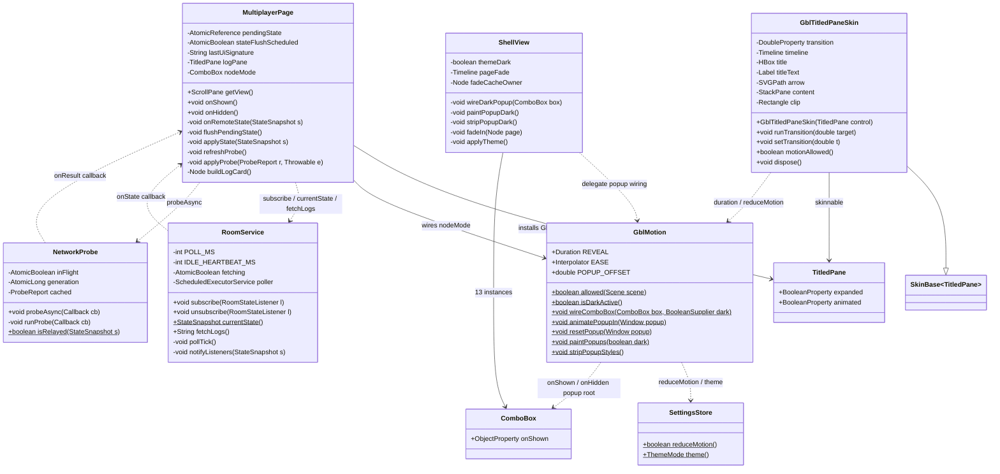
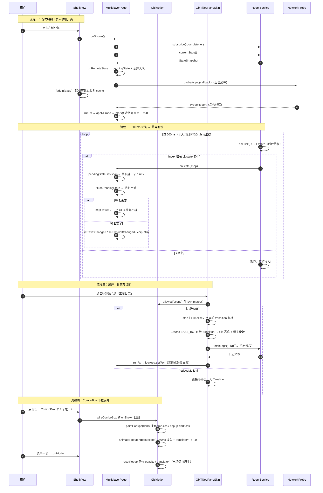
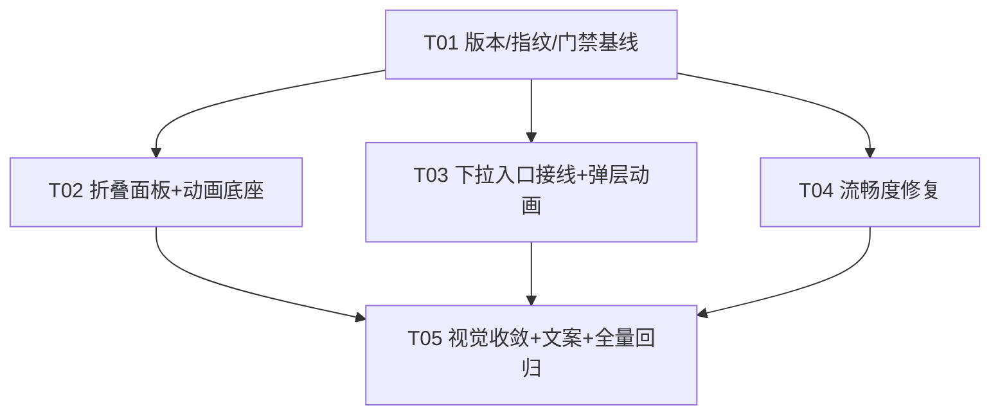

# GBL 1.1.5「界面收敛与流畅度修复」增量架构设计

| 项 | 内容 |
|---|---|
| 文档类型 | **增量架构设计**（只描述相对 1.1.4 的新增 / 修改，旧架构文档不重写） |
| 版本基线 | 1.1.4 → **1.1.5**（`VERSION` / `BUILD` = `1.1.5`，显示 `v1.1.5`） |
| 上游输入 | `docs/prd-1.1.5.md`（许清楚）+ 主理人逐帧录屏核对事实 |
| 技术栈 | JavaFX 21 + 纯 Java 服务层；**不引入任何新 UI 依赖**；不抄 HMCL 的 GPL 代码，只借鉴视觉原则 |
| 撰写 | 高见远（Architect） |
| 输出目标 | 本文 + `docs/class-diagram-1.1.5.mermaid` + `docs/sequence-diagram-1.1.5.mermaid` |

> **【主理人覆盖声明｜优先级高于 PRD 原文】**
> PRD `AC-10` 写的「源码无 `1.1.4` 字样残留」**不成立，本文予以覆盖**：项目铁律是「零历史丢失」。
> - **只升级「当版」标识**：`VERSION` / `BUILD` / 显示版本（`v1.1.5`）/ 当版指纹（`FP_1_1_5`）/ 当版资产名（如 `1.1.5-portable.zip`、`1.1.5-update.zip`）/ 官网当前版本指针 / `TraversalProvider` 的 `User-Agent` → 全部改为 `1.1.5`。
> - **历史痕迹一律逐字不动**：1.1.4 及更早的 `FP_*` 指纹字符串与 `static` 打印、历史发布说明 / 官网历史卡片、门禁脚本里的旧字典（`R114_FINGERPRINTS` 等）、源码历史注释、`MultiplayerConfig`/`Icons.java` 中作为历史描述的 `1.1.4` 字样。
> - QA 判定口径随之调整：**不得**按「源码里 grep 不到 1.1.4」验收；应按「当前版本标识全部为 1.1.5 且历史指纹/历史文案哈希不变」验收。
> - 其余待确认问题由主理人定稿：**Q1** 不引入第三方 UI 库；**Q2** 动画 150ms；**Q3** 左侧导航保持现状；**Q4** 复用已存在的 `SettingsStore.reduceMotion()`（源码对应 `ShellView.settings.reduceMotion()`），所有新动画必须兼容该开关。

---

## 0. 结论速览（先看这张表）

| 决策点 | 结论 | 依据 / 边界 |
|---|---|---|
| 「日志与诊断」白条怎么改 | **保留 `TitledPane` 控件，换自绘皮肤 `GblTitledPaneSkin` + 作用域 CSS `.gbl-disclosure`** | OpenJFX 21 `TitledPaneSkin.TRANSITION_DURATION = Duration(350)` 是 `private static final`，CSS 改不到时长；纯 CSS 只能改配色，达不到 150ms。自绘皮肤保留 `setExpanded()/expandedProperty()` 调用点不变 |
| 动画统一到什么范围 | **14 个 `ComboBox` + 1 个 `TitledPane` + 新增折叠卡片**（如有）；左侧导航切页、ToggleSwitch、Toast 不算「下拉按钮」，不动 | 全项目实测 `new ComboBox` 共 14 处（ShellView 13 + MultiplayerPage 1），`new TitledPane` 1 处 |
| `ComboBox` 弹层动画能改到什么程度 | **入场 150ms 淡入 + 轻微下滑（opacity 0→1 / translateY -6→0）可公开 API 实现；出场保持原生即时隐藏** | JavaFX 弹层由 `PopupWindow`/`ComboBoxListViewSkin` 管，没有公开 duration 属性；强改出场要自绘整个 ComboBox 皮肤，风险高，本次明确不做（见 §5） |
| 卡顿主因 | ① `applyState` 非幂等且无合并（每轮轮询都改约 20 处 UI）② 非联机页仍 500ms HTTP ③ 体检/日志每次点击新建线程、可叠加 ④ 切页临时整页 `setCache(true)` 叠在联机页活跃动画上 | 详见 §3 根因假设表；修复顺序 H1 → H2 → H4 → H3（见 §3.2） |
| 体检配色 | **做最小配色收敛（P0，约 5 行值 + 1 个摘要位）；信息分层折叠延后（P1-2）** | PRD P0-3 要求配色收敛，主理人标注「可延后但需评估」；评估结论：改 `mark()` 映射成本极低且直接解决「杂色」，但新增摘要/详情控件属范围扩张，延后 |
| HMCL 风格落地方式 | **只加作用域类 `.gbl-compact` / `.gbl-disclosure`，改写现有 token 值不动全局 `.card`** | 全局 `.card` 被下载/模组/设置等几十处复用，改动即回归 |
| 不动的东西 | logo 四图、`Icons.java`、左侧导航结构、绿色主色、圆角卡片语言、1.1.4 功能口径、所有历史指纹与历史发布说明 | 硬约束 |

---

# Part A：系统设计

## 1. 实现思路（含方案选型与难点）

### 1.1 核心技术难点

1. **难点一：原生 `TitledPane` 的动画时长不可配置。**
   - 事实（已核对 OpenJFX `TitledPaneSkin` 源码）：`private static final Duration TRANSITION_DURATION = new Duration(350.0)`，`runTransitionAnimation()` 是 `private`，动画作用在一个私有 `transition` 属性上（同时驱动内容裁剪高度与箭头 `-90*(1-transition)` 旋转）。
   - 因此「保留动画但更快」**不能靠 CSS**，也不能靠继承 `TitledPaneSkin` 覆写（私有成员不可访问）。
   - 另外原生 skin 已支持 `TitledPane.isAnimated()` 与 `Scene.getPreferences().isReducedMotion()`，自绘皮肤必须把这俩也接上，否则无障碍开关会失效。

2. **难点二：「所有下拉按钮」不像字面上那么统一。**
   - 折叠面板完全由我们控制（内容高度、clip、箭头、时长）；`ComboBox` 弹层是独立 `PopupControl` 窗口，出现/消失的内部动画没有公开开关。
   - 可行的公开 API 路径只有：在 `ComboBox` 的 `onShown` 回调里拿到弹层 `Window`，对其 `Scene.getRoot()` 播 150ms 淡入/位移；`onHidden` 把状态复位。出场动画保持原生。
   - 不能夸大：若 QA 抽帧发现弹层入场动画与原生淡入叠加产生闪烁，回退方案是弹层只做深色样式、不做入场动画，并把该控件从 AC-2 的抽帧范围中单独标注（需回报主理人确认）。

3. **难点三：卡顿是「主线程堆积」而不是「某一次慢调用」。**
   - `RoomService.pollTick` 在单线程 `ScheduledExecutorService` 上 500ms 跑一次 `GET /state`，本身**不在 FX 线程**；它已有 index/state 去重。
   - 但每次真变化时 `notifyListeners` 直接在轮询线程调 `MultiplayerPage.onRemoteState` → `runFx(applyState)`；`applyState` 每次无条件做 `statusText.setText`、`statusChip` 的 styleClass `removeAll`+`add`、`inviteField.setText`、8 个按钮/区块 `setShown`、`lanBar.getChildren().add` 判重后添加、`NetworkProbe.isRelayed()` 拼串。这些都会触发 CSS 重算 / 布局失效。
   - `onShown` 又补一次 `applyState`；切页 `fadeIn` 对整页 `setCache(true)` 160ms。几股力量叠在 1.1.4 新页上，就是「又开始卡」。

4. **难点四：不能大范围重写。**
   - `theme.css` 3230 行、`ShellView.java` 14197 行且**纯 CRLF**，任何全局选择器或换行符变化都可能引发大面积回归。所有新样式必须作用域化，所有编辑必须按字节保换行。

### 1.2 方案选型表

| 对象 | 候选方案 | 评价 | 采用 |
|---|---|---|---|
| 日志面板 | A. 纯 CSS 主题化 `.titled-pane` | 能去白条，**改不了 350ms**，不满足 G2 | 否 |
| | B. 自绘 `SkinBase<TitledPane>` 皮肤 | 保留 `TitledPane` 的 API / 焦点 / `isAnimated` / `onShown` 调用点；150ms 与 reduceMotion 全可控；约 150–200 行 | **是** |
| | C. 换成全新自绘 `DisclosureCard` 控件 | 可控性最高，但要重写点击/键盘/内容尺寸，且 `logPane.setExpanded(true)` 调用点要改，回归面更大 | 否（作 1.1.6 备选） |
| 弹层动画 | A. 反射改 PopupWindow 内部动画 | 依赖 internal API，模块路径下易失败 | 否 |
| | B. `onShown` 里给 popup scene root 播 150ms 淡入/位移 | 全公开 API，接在现有 `wireDarkPopup` 钩子上，成本最低 | **是（仅入场）** |
| | C. 自绘 `ComboBoxListViewSkin` 控制弹层 show/hide | 能做出场动画，但要接管键盘、焦点、滚动、选中，风险与工作量都大 | 否，列 1.1.6 |
| 卡顿 | A. 只把 500ms 改成 1000ms | 掩盖问题，应用态切换延迟翻倍 | 否 |
| | B. 幂等 + 合并刷新 + 空闲心跳 + 单飞 + 切页缓存收敛 | 针对根因，且可逐项量化验证 | **是** |
| 视觉 | A. 改全局 `.card` / `.chip` | 影响全应用，回归不可控 | 否 |
| | B. 只在联机页根挂 `.gbl-compact`，新增 `.gbl-disclosure` | 影响面锁在联机页与日志面板 | **是** |

### 1.3 架构模式

沿用现有「**薄 View + 纯 Java 服务层 + runFx 回切**」模式，不新增层次：

- `MultiplayerPage` / `ShellView`：只做控件构建与 FX 线程 UI 更新。
- `RoomService` / `NetworkProbe`：后台线程服务，通过 listener/callback 回报；新增**单飞与空闲退避**两个横切能力，仍留在服务层。
- `GblMotion`（新）：纯 UI 工具，统一「时长 / 缓动 / reduceMotion / ComboBox 弹层入场 / 深色判定」五个口径，避免多处各写 150ms。
- `GblTitledPaneSkin`（新）：只在日志面板实例上安装，CSS 全部走 `.gbl-disclosure` 作用域。

---

## 2. 文件清单（相对路径）

### 2.1 新增文件

| 文件 | 作用 |
|---|---|
| `src/main/java/com/mclauncher/ui/GblMotion.java` | 动画与弹层统一工具：`REVEAL=150ms`、`EASE_BOTH`、`allowed(Scene)`、`wireComboBox(...)`、`animatePopupIn(...)`、`isDarkActive()`、`stripPopupStyles()` |
| `src/main/java/com/mclauncher/ui/GblTitledPaneSkin.java` | `SkinBase<TitledPane>` 自绘皮肤：标题条 + SVG 箭头 + 裁剪内容 + 150ms 展开/收起 |
| `tools/derive_115.py` | 从 1.1.4 脚本派生 1.1.5 全套脚本（版本号、指纹字典、R115 校验、官网文案） |
| `tools/build_1.1.5.py` / `tools/pack_1.1.5.py` / `tools/preflight_1.1.5.py` / `tools/check_1.1.5_logic.py` / `tools/verify_live_1.1.5.py` | 构建 / 打包 / 预检 / 逻辑门禁 / 运行验收，均需含 R115 且全保留旧指纹 |
| `tools/publish_1.1.5.py` / `tools/publish_github_1.1.5.py` / `tools/push_site_1.1.5.py` / `tools/_run_with_gh_token_1.1.5.py` / `tools/apply_115_site.py` | 独立 release + 官网 / Gitee / GitHub 三处同步 |
| `docs/architecture-1.1.5.md` / `docs/class-diagram-1.1.5.mermaid` / `docs/sequence-diagram-1.1.5.mermaid` | 本文与两张图 |

### 2.2 修改文件

| 文件 | 改动摘要 | 换行符 |
|---|---|---|
| `src/main/java/com/mclauncher/LauncherApp.java` | `VERSION`/`BUILD`→`1.1.5`；新增 `FP_1_1_5` 与 `static` 打印；旧指纹逐字保留 | LF |
| `src/main/java/com/mclauncher/ui/MultiplayerPage.java` | 装自绘皮肤 + `.gbl-disclosure`；状态刷新幂等/合并；体检 `mark()` 收敛；日志/体检单飞与三段式文案；`nodeMode` 接 `GblMotion.wireComboBox`；根加 `.gbl-compact` | **LF** |
| `src/main/java/com/mclauncher/ui/ShellView.java` | `wireDarkPopup` 改委托 `GblMotion.wireComboBox`；`paintPopupDark`/`stripPopupDark` 委托工具；`fadeIn` 对联机页跳过临时 cache；新增 R115 指纹常量打印 | **纯 CRLF，14197 行** |
| `src/main/java/com/mclauncher/multiplayer/RoomService.java` | 空闲心跳降频（订阅时 500ms、无人订阅 2000ms）、失败退避、进程真实存活判定、单飞日志读取 | LF |
| `src/main/java/com/mclauncher/multiplayer/NetworkProbe.java` | 单飞 + 短 TTL 结果复用 + generation 防旧回调回填 | LF |
| `src/main/java/com/mclauncher/multiplayer/TraversalProvider.java` | `User-Agent` 的 `1.1.4` → `1.1.5`（唯一一处版本型字符串） | LF |
| `src/main/resources/com/mclauncher/theme.css` | 末尾追加 `.gbl-disclosure` / `.gbl-compact` 两段作用域样式；`popup-dark.css` 不改结构 | LF |
| `src/main/resources/com/mclauncher/popup-dark.css` | 弹层圆角/间距微调（不新增选择器类别） | LF |
| `website/{index,download,docs,features}.html` | 顶部新增 1.1.5 更新块 + 当前版本指针改 1.1.5；**历史文案一段不删** | LF |

### 2.3 明确不改

`src/main/resources/com/mclauncher/logo_{24,32,64,256}.png`、`src/main/java/com/mclauncher/ui/Icons.java`、左侧导航结构与 `NAV_*`、`SettingsStore.reduceMotion` 语义、1.1.4 多人联机功能与交互口径、所有历史 `FP_*` 字符串。

---

## 3. 卡顿根因、修复顺序与探针方向

### 3.1 根因假设表（可验证）

| # | 假设 | 验证探针（开发期加临时计数，发布前摘掉或留 debug 开关） | 判定阈值 | 修复 |
|---|---|---|---|---|
| **H1** | `applyState` 非幂等、无合并：轮询 index 每增长一次就重排整个状态卡，且 `runFx` 不合并队列 | 在 `onRemoteState` / `applyState` 加 `AtomicInteger`，每秒 `System.err.println` 一次调用数；静置在联机页 10s 观察 | 状态未变时 `applyState` 仍 >1 次/秒即为真 | §4.1 签名比对 + 单槽「最新值胜出」合并 |
| **H2** | 非联机页仍 500ms HTTP + 状态推送 | 在 `pollTick` 计数 `GET /state`，切到下载页停 10s | 非联机页 >0.5 次/秒即为真 | §4.2 无人订阅降为 2s 心跳；失败退避；真实进程存活判定 |
| **H3** | 切页整页 `setCache(true)` 与联机页活跃动画/日志 TextArea 叠加，造成合成卡 | 录屏逐帧 + `jcmd <pid> Thread.print` 看 FX 线程；在 `fadeIn` 打印 page ordinal 与 cache 状态 | 连点切页时 FX 线程出现 >16ms 帧或整页重绘即为真 | §4.4 联机页跳过临时 cache；其余页维持现状 |
| **H4** | 体检 / 日志抓取每次点击新建线程，可并发叠加，回调挤 FX 队列 | 连点「查看日志」「重新检测」5 次，`jcmd Thread.print | grep gbl-net-probe/gbl-mp-ui-log` | 同名线程 >1 个即为真 | §4.3 单飞 + generation + 短 TTL |
| **H5** | 自绘皮肤动画时长/减少动效未生效（回归风险，非原始卡顿因） | 抽帧 150ms ±30ms；开 reduceMotion 后无中间帧 | 超出区间或仍有动画即为失败 | §4.5 统一走 `GblMotion.allowed()` |

### 3.2 修复顺序（严格按此顺序落地与验证）

1. **H1 状态刷新幂等 + 合并**（收益最大，改动集中在 `MultiplayerPage`，不动服务语义）。
2. **H2 轮询空闲降频 / 失败退避**（去掉后台常驻压力，不牺牲联机页内 500ms 跟手度）。
3. **H4 体检 / 日志单飞**（消除重复点击叠加，同时补三段式文案）。
4. **H3 切页缓存收敛**（最后做，因为它可能与 H1/H2 互相掩盖；做完再跑 AC-5/AC-6）。
5. 视觉与 token 收敛（T05）放在功能修复之后，便于区分「卡」与「丑」两类回归。

### 3.3 状态刷新的具体改法（H1）

在 `MultiplayerPage` 增加三个私有成员：

```java
private final AtomicReference<RoomState.StateSnapshot> pendingState = new AtomicReference<>();
private final AtomicBoolean stateFlushScheduled = new AtomicBoolean(false);
private String lastUiSignature;

private void onRemoteState(RoomState.StateSnapshot snapshot) {
    pendingState.set(snapshot);                     // 最新值胜出，旧快照自然丢弃
    if (stateFlushScheduled.compareAndSet(false, true)) {
        runFx(this::flushPendingState);             // 一轮最多排一个 FX Runnable
    }
}

private void flushPendingState() {
    stateFlushScheduled.set(false);
    RoomState.StateSnapshot snap = pendingState.getAndSet(null);
    if (snap != null) applyState(snap);
}
```

`applyState` 开头算签名：

```java
String sig = s + "|" + str(snap.room()) + "|" + diff + "|" + exceptionType
           + "|" + roomServiceRunningFlag + "|" + relayed;
if (sig.equals(lastUiSignature)) return;            // 完全没变 → 一个属性都不碰
lastUiSignature = sig;
```

签名覆盖所有会被改的 UI 输入；`relayed` 用缓存值，避免每次重算 `isRelayed`。另补三个幂等小工具：

```java
private static void setTextIfChanged(Labeled n, String s) { if (!Objects.equals(n.getText(), s)) n.setText(s); }
private static void setShownIfChanged(Node n, boolean show) { if (n.isVisible() != show || n.isManaged() != show) setShown(n, show); }
private static void setChipStyle(Label chip, String cls) { if (!chip.getStyleClass().contains(cls)) { chip.getStyleClass().removeAll(...); chip.getStyleClass().add(cls); } }
```

注意：`lanBar.getChildren().add(lanHintLabel)` 的 `contains` 判重保留（`ObservableList` 只在 FX 线程改，`applyState` 已由 `runFx` 保证）；`onShown` 的 `applyState(currentState())` 改为走同一个 `onRemoteState` 合并入口。

### 3.4 服务层改法（H2 / H4）

- `RoomService`：
  - 保留 `POLL_MS = 500` 作为**订阅态**间隔；新增 `IDLE_HEARTBEAT_MS = 2000`。调度仍 500ms 一次，但 `pollTick` 开头：`if (listeners.isEmpty() && now - lastHeartbeat < IDLE_HEARTBEAT_MS) return;`（轻量跳过，避免重建 `ScheduledExecutorService`）。
  - 连续失败退避：现有 `MAX_FAILURES` 阈值前增加 `backoffTicks`（3 次后每 3 个 tick 才发一次请求，10 次回到原失败路径），仍以真实 `GET /state` 结果与 `engine` 进程存活为准，**不能只看 `running` 布尔标志**（项目铁律：看门狗不能信布尔标志）。
  - `fetchLogs()` 增加 `AtomicBoolean fetching` 单飞；并发点击直接返回「正在读取」的约定值，UI 侧不另起线程。
- `NetworkProbe`：
  - `probeAsync` 增加 `AtomicBoolean inFlight`；进行中重复调用只保留**最后一次** callback（用 `AtomicLong generation`，回调时比对，过期丢弃）。
  - 成功结果带时间戳缓存 30 秒；`MultiplayerPage.onShown` 的首次体检若命中缓存则直接用缓存回填，不再起 8 线程池。
  - 仍用 daemon 线程 + `Future.get(3s)` 超时，不缩到 <3s（避免弱网误报）。

### 3.5 切页缓存改法（H3）

`ShellView.fadeIn(Node page)` 保持 160ms 与现有的「先停旧 Timeline、复位旧 cache」逻辑，仅把：

```java
page.setCache(true); page.setCacheHint(CacheHint.SPEED);
```

改成条件式：当 `page == all[Page.MULTIPLAYER.ordinal()]`（或页面中含正在动画的 `.gbl-disclosure`）时**不开临时 cache**，只做 opacity 淡入；其他页维持原样。`onFinished` 的 `setCache(false)` 与 `fadeCacheOwner` 复位逻辑不动，避免破坏已有的滚动条缓存铁律。

---

## 4. UI 方案细节

### 4.1 `GblTitledPaneSkin` 接口与行为

| 项 | 设计 |
|---|---|
| 继承 | `SkinBase<TitledPane>`（与 `FloatScrollBarSkin` 同风格，不依赖 `com.sun` internal API） |
| 子节点 | `HBox title`（类名 `gbl-disclosure-title`）+ `Label titleText`（`gbl-disclosure-title-text`）+ `SVGPath arrow`（`gbl-disclosure-arrow`，`M1 1L5 5L9 1`，描边色走 CSS）+ `StackPane content`（`gbl-disclosure-content`，带 `Rectangle clip`） |
| 状态属性 | 复用 `TitledPane.expandedProperty()`；用 `registerChangeListener` 订阅 `expanded` / `content` / `collapsible` / `animated` |
| 动画 | 私有 `DoubleProperty transition` 驱动 `clip.setHeight((h-header)*t)` 与 `arrow.setRotate(-90*(1-t))`；`Timeline` 两帧，`Duration = min(150ms, 上次未播完的剩余时间)`，`Interpolator.EASE_BOTH`；每次开播先 `stop()` 旧 timeline 并从当前 `transition` 起播 → 连点 5 次不叠加、不跳变 |
| 时序 | 展开时 `t>0` 立刻 `content.setVisible(true)`；收起结束 `t==0` 再 `setVisible(false)` |
| 无障碍 | `GblMotion.allowed(getSkinnable().getScene())` 为 false 时直接落终态；同时尊重 `TitledPane.isAnimated()` 与系统 `Scene.getPreferences().isReducedMotion()` |
| 交互 | 标题条左键点击切换（仅 `isCollapsible()`）；控件本身响应空格/回车；焦点环沿用现有主题 |
| 生命周期 | `dispose()` 停 timeline、解绑 rotation、清 clip；不留常驻 cache（与 §3.5 一致） |
| 调用点 | `MultiplayerPage.buildLogCard()`：`pane.getStyleClass().add("gbl-disclosure"); pane.setSkin(new GblTitledPaneSkin(pane));`；`viewLog` 里的 `logPane.setExpanded(true)` 一行不改 |

风险：自绘皮肤的 `computePrefHeight/computeMinHeight` 必须与 `layoutChildren` 用同一套 `headerHeight + contentPrefHeight * transition` 公式，否则折叠时父 `VBox` 高度抖动。工程师务必在展开/收起两端各截一帧比对。

### 4.2 「所有下拉按钮」的准确定义与覆盖清单

| # | 控件 | 代码位置 | 本次动作 |
|---|---|---|---|
| 1 | `nodeMode` 节点配置 | `MultiplayerPage.java:92` | 保持绿色 GBL 外观；接 `GblMotion.wireComboBox` 补深色弹层 + 150ms 入场 |
| 2–14 | 13 个 ShellView `ComboBox`（下载源/排序/筛选/版本/加载器/模组/整合包/主题等） | `ShellView.java:2682, 5836, 5845, 5854, 5863, 5873, 7542, 7575, 7896, 8253, 11337, 12308, 12585` | `wireDarkPopup` 统一委托 `GblMotion.wireComboBox`，一次覆盖全部；不逐个改创建点 |
| 15 | 日志面板 `TitledPane` | `MultiplayerPage.java:433` | 自绘皮肤，150ms 双向动画 |
| — | 左侧导航切页 | `ShellView.fadeIn` | **不在范围内**（主理人 Q3 已定稿保持现状）；仅做 §3.5 的 cache 收敛 |
| — | `ToggleSwitch` 200ms 滑动、Toast 150/320ms、页面 fade 160ms | 各自原位置 | **不动**，避免把非折叠动效也卷进来 |

`GblMotion.wireComboBox` 必须合并原有 `onShown` / `onHidden`，不能覆盖（现有 `wireDarkPopup` 注释明确要求）；`onHidden` 负责把 popup root 的 `opacity/translateY` 复位，防止下次展开残留。

### 4.3 动画统一参数（单一真源）

```java
public static final Duration REVEAL = Duration.millis(150);   // 120–180ms 区间中值
private static final Interpolator EASE = Interpolator.EASE_BOTH;
private static final double POPUP_OFFSET = -6;                // px，轻微下滑，不喧宾夺主
```

- `GblMotion.allowed(Scene)`：`SettingsStore.get().reduceMotion()` 或 `scene.getPreferences().isReducedMotion()` 任一为真 → 直接落终态。
- 深浅判定 `isDarkActive()` 抄 `ShellView.applyTheme()` 口径：`SystemTheme.isForced()` 优先，否则 `ThemeMode.DARK` 或（`SYSTEM` 且 `SystemTheme.isDark()`）。`ShellView` 实例字段 `themeDark` 仍作为 supplier 传入，避免两套判定漂移。
- `FP_094_POPUP_CSS` 等旧指纹字符串与 `static` 打印**原样保留**；只新增 R115 指纹。

### 4.4 HMCL 风格视觉 token（只作用于联机页与折叠面板）

| 用途 | 浅色 | 深色 | 落点 |
|---|---|---|---|
| 页面底 / 卡片 | `#f5f7fa` / `#ffffff` | `#10151c` / `#171d26` | 沿用现有，**不改全局** |
| 折叠标题条 | `#f7f9fc` | `#1c232d`（hover `#232a34`） | `.gbl-disclosure-title` |
| 描边 | `#ebeff5` | `#2f3946` | `.gbl-disclosure` / 内容区 |
| 主文字 / 次文字 | `#101828` / `#667085` | `#e9eef5` / `#b3bfcd` | 沿用现有 token |
| 正常 | `#237a44` on `#e7f6ec` | `#7ee2a0` on `#17351f` | 摘要 chip / 折叠箭头 hover |
| 警告 | `#b45309` on `#fff4e5` | `#f0b45e` on `#3a2f16` | 体检失败项 |
| 异常 | `#b42318` on `#fdeceb` | `#f5a3a0` on `#3d2020` | `relayWarn` 保持 |
| 未知 / 中性 | `#667085` | `#a7b2c0` | 体检 `—` 项，无底色 |
| 圆角 | 控件 10 / 卡片 16 / pill 999 | 同左 | 折叠面板用 12（卡片与控件之间取中） |
| 紧凑间距 | 页面 padding 20→**16**；页内 VBox spacing 16→**12**；卡片 padding 14/20→**12/16**；行距 12→**8** | 同左 | 仅 `.gbl-compact` 作用域内 |

`.gbl-compact` 挂在 `MultiplayerPage` 构造器的根 `VBox page` 上；CSS 写成 `.gbl-compact .card { ... }` / `.dark .gbl-compact .card { ... }`，**绝不写 `.card { ... }`**。

体检区收敛做法：`mark(Label, boolean, String)` 改为 `mark(Label, ProbeState, String)`，五个状态行去掉胶囊底，改成「小圆点 + 文案」，只有卡片标题右侧保留一枚整体状态 chip；`relayWarn` 保持 `chip-error`。这样把 6 个高饱和胶囊降到 1 枚 + 1 个警示条，直接解决「拥挤」，而不需要 P1-2 的摘要/详情两级结构。

### 4.5 三段式文案整改（本次涉及范围）

| 位置 | 现状 | 改为 |
|---|---|---|
| `buildLogCard` 读日志失败 | `"读取日志失败：" + t.getMessage()` | `读取日志失败：<原因>。请检查联机组件后点「查看日志」重试。`（原因映射：超时→等待引擎响应超时；未启动→联机组件尚未启动；其他→读取时发生错误；不输出异常类名/堆栈） |
| `applyProbe` 失败 | 5 行 `检测失败` + `shortError` | `网络体检失败：<原因>。请稍后点「重新检测」重试。`；各行保留 `—` 中性态 |
| `codeError` | `邀请码格式不对` | `邀请码格式不对：应为 U/XXXX-XXXX-XXXX-XXXX。请核对后重新输入。` |
| 进度 toast | `正在尝试下载并启动联机组件…` | 非错误提示，保留 |

---

## 5. 数据结构与接口（Mermaid 类图）



> 类图同时存于 `docs/class-diagram-1.1.5.mermaid`。

---

## 6. 程序调用流程（Mermaid 时序图）



> 时序图同时存于 `docs/sequence-diagram-1.1.5.mermaid`。

---

## 7. 不明确事项与已采用的假设

| # | 问题 | 默认决策 / 假设 | 若判断错的影响 |
|---|---|---|---|
| Q1（主理人已定稿） | 是否引入 HMCL 控件/皮肤库 | **否**，只借鉴视觉原则，沿用 `theme.css` 自绘 | 无新增依赖，符合硬约束 |
| Q2（主理人已定稿） | 动画时长 | **150ms**，区间 120–180ms；`GblMotion.REVEAL` 单一真源 | 改一处即可全量生效 |
| Q3（主理人已定稿） | 左侧导航切页是否统一动画 | **不包含**，保持现状；只做联机页 cache 收敛 | 与 1.1.4 切页观感保持一致 |
| Q4（主理人已定稿） | reduceMotion 开关是否本次要 | **复用已存在的开关**：`SettingsStore.reduceMotion()`（ShellView 中为 `settings.reduceMotion()`），P1-3 新设置项不做；`GblMotion.allowed()` 同时接该开关与 `Scene.getPreferences().isReducedMotion()`，自绘皮肤 / ComboBox 入场动画必须兼容 | 无新设置项，零新增配置面 |
| A1（主理人覆盖 PRD） | AC-10「源码无 1.1.4 残留」 | **该 PRD 措辞被覆盖，不再作为验收口径**。正确口径见文首「主理人覆盖声明」：只升级当版标识到 1.1.5；1.1.4 历史指纹、历史发布/官网卡片、门禁旧字典、历史注释一律逐字保留，零历史丢失 | 若按 PRD 原文 grep 清理 1.1.4，将直接破坏指纹门禁与历史资产，属严重回归 |
| A2 | `ComboBox` 出场动画 | 公开 API 不可控，保持原生；只在设计文档与 QA 清单标注边界 | 若用户明确要求出场也要 150ms，需另立 1.1.6 自绘皮肤任务 |
| A3 | 体检配色「可延后」 | 评估结论：**做最小配色收敛**，不做 P1-2 信息分层 | 若主理人要求连信息分层一起做，T05 需加一个折叠摘要控件并回归 |
| A4 | 指纹语义 | 新增 `R115_FINGERPRINTS` 独立字典，旧字典一个不改；`FP_1_1_5` 必须有 `static` 打印以进常量池 | 门禁扫不到会直接 fail |

---

# Part B：任务分解

## 8. 所需依赖包

**无新增第三方依赖。** 全部使用现有栈：

- `org.openjfx:javafx-controls:21` / `javafx-graphics:21` / `javafx-base:21`（`Timeline` / `Interpolator` / `SkinBase` / `SVGPath` / `Scene.getPreferences()` 均为 JavaFX 21 内置）
- JDK 21 `java.util.concurrent`（`AtomicBoolean` / `AtomicReference` / `AtomicLong`）
- 构建/门禁脚本：Python 3 标准库（`hashlib` / `zipfile` / `re` / `json` / `urllib`），沿用现有脚本风格
- **明确不引入** HMCL 代码、JFoenix、AtlantaFX、ControlsFX 或任何 CSS 框架

## 9. 有序任务列表（5 个任务）

### T01 — 版本、指纹与门禁基线（P0，基础设施）

- **源文件**：`src/main/java/com/mclauncher/LauncherApp.java`、`src/main/java/com/mclauncher/multiplayer/TraversalProvider.java`、`tools/derive_115.py`（新）、`tools/build_1.1.5.py`（新）、`tools/pack_1.1.5.py`（新）、`tools/preflight_1.1.5.py`（新）、`tools/check_1.1.5_logic.py`（新）、`tools/verify_live_1.1.5.py`（新）、`tools/publish_1.1.5.py`（新）、`tools/publish_github_1.1.5.py`（新）、`tools/push_site_1.1.5.py`（新）、`website/index.html`、`website/download.html`、`website/docs.html`、`website/features.html`
- **依赖**：无（先行任务）
- **改法**：
  1. `VERSION`/`BUILD` → `1.1.5`，`DISPLAY_VERSION` 自动变 `v1.1.5`；`TraversalProvider` 的 UA 同步。
  2. 新增 `FP_1_1_5 = "GBL 1.1.5 界面收敛与流畅度修复"` + `static { System.err.println("[app] " + FP_1_1_5); }`，旧 `FP_*` 与打印**逐字保留**。
  3. 用 `derive_115.py` 从 1.1.4 脚本派生全套 1.1.5 脚本；在 build 的 `CHECKS`、pack 的字节搜索、preflight 的 `modules` 校验、check 的 `R115_FINGERPRINTS`、verify_live 的指纹清单中**都加入新指纹**，旧字典全保留。
  4. 官网四个页面顶部插入 1.1.5 更新块、当前版本指针改 1.1.5，**历史说明一段不删**。
- **验收**：`build_1.1.5.py` 编译通过；`preflight` 校验 `app/mc-launcher.jar`、`app/GBL.cfg`、`runtime/lib/modules` 三处均含 R115；`check_1.1.5_logic.py` 全绿；从 `1.1.4-portable.zip` 解出四个 logo 与实际文件 SHA256 一致；启动标题栏/关于页显示 `v1.1.5`；**旧指纹字典与官网历史说明逐字核对无删改（禁止按 PRD 原文 grep 清理 1.1.4）**；当版资产名为 `1.1.5-portable.zip` / `1.1.5-update.zip`。
- **风险**：脚本里旧版本号字符串出现 17–90 次，误替换会破坏历史门禁——必须**追加**而非替换历史段。
- **工程注意**：`LauncherApp.java` 为 LF；改脚本用字节级替换；零删除构建。

### T02 — 深色折叠面板与统一动画底座（P0）

- **源文件**：`src/main/java/com/mclauncher/ui/GblMotion.java`（新）、`src/main/java/com/mclauncher/ui/GblTitledPaneSkin.java`（新）、`src/main/java/com/mclauncher/ui/MultiplayerPage.java`、`src/main/resources/com/mclauncher/theme.css`
- **依赖**：T01
- **改法**：按 §4.1 / §4.3 实现 `GblMotion`（先只用到时长、缓动、`allowed()`）与自绘皮肤；`buildLogCard()` 安装皮肤并加 `.gbl-disclosure`；`theme.css` 末尾追加作用域样式（浅/深两套）。
- **验收**：深色下无白条/原生三角；抽帧展开与收起各 150ms±30ms；连点 5 次无叠加；开启 reduceMotion 后无动画；切页与滚动仍正常；日志面板展开后 `ScrollPane` 可滚动到底。
- **风险**：自绘皮肤 pref/min/layout 公式不一致会导致父容器抖动；CSS 选择器过宽会误伤别的 `TitledPane`。
- **工程注意**：`MultiplayerPage.java` 为 **LF**；`Icons.java` 不改（箭头用内联 `SVGPath`）；FX 线程内改 ObservableList。

### T03 — 全部下拉入口接线与弹层入场动画（P0）

- **源文件**：`src/main/java/com/mclauncher/ui/GblMotion.java`（T02 已建，本任务补 popup 部分）、`src/main/java/com/mclauncher/ui/ShellView.java`、`src/main/java/com/mclauncher/ui/MultiplayerPage.java`、`src/main/resources/com/mclauncher/popup-dark.css`
- **依赖**：T01（与 T02 改不同代码区，可并行设计、顺序落盘）
- **改法**：
  1. `GblMotion` 补 `wireComboBox` / `animatePopupIn` / `resetPopup` / `paintPopups` / `stripPopupStyles`，合并原 `onShown`/`onHidden`。
  2. `ShellView.wireDarkPopup` 改为一行委托；`paintPopupDark` / `stripPopupDark` 委托工具；保留 `FP_094_POPUP_CSS` 与 13 个创建点的 `wireDarkPopup` 调用不变。
  3. `MultiplayerPage` 给 `nodeMode` 加一行 `GblMotion.wireComboBox(nodeMode, GblMotion::isDarkActive)`。
  4. `popup-dark.css` 只微调圆角/内边距，不改选择器结构（弹层根节点匹配链见文件头注释）。
- **验收**：14 个 ComboBox 展开均为深色实底、无白底透出；入场 150ms±30ms；快速开合 5 次无残留位移/半透明；浅→深→浅来回切无深底残留；`nodeMode` 绿色外观不变。
- **风险**：弹层入场与原生动画叠加可能闪；若出现，按 §1.2 回退并回报主理人。
- **工程注意**：**`ShellView.java` 纯 CRLF（14197 行，LF-only=0），必须字节级编辑**；不要整文件重写或 `Write` 覆盖。

### T04 — 流畅度修复：幂等刷新、轮询退避、单飞与切页缓存（P0）

- **源文件**：`src/main/java/com/mclauncher/ui/MultiplayerPage.java`、`src/main/java/com/mclauncher/ui/ShellView.java`、`src/main/java/com/mclauncher/multiplayer/RoomService.java`、`src/main/java/com/mclauncher/multiplayer/NetworkProbe.java`、`tools/PerfProbe.java`（作探针参考，必要时加 debug 计数）
- **依赖**：T01（与 T02/T03 改不同代码区，顺序落盘避免同文件冲突）
- **改法**：按 §3.3 / §3.4 / §3.5 实现；先加临时计数验证 H1–H4，再落地修复；发布前把 debug 打印收进 `-Dgbl.perf` 开关。
- **验收**：AC-5（单击到响应可感 <100ms）、AC-6（轮询+抓日志期间输入/滚动不掉帧）、AC-7（体检期间可切页）、AC-8（代码核对重活不在 FX 线程）；状态不变时 `applyState` 实际调用 0 次/秒；非联机页 `GET /state` ≤0.5 次/秒；连点日志只有 1 个 `gbl-mp-ui-log` 线程。
- **风险**：签名漏字段会导致该刷新时没刷新（尤其是 `room`/`exceptionType`/relay）；轮询降频可能延迟引擎异常发现——用 2s 心跳 + 真实进程存活兜底。
- **工程注意**：所有 `ObservableList` 变更仍在 FX 线程；`runFx` 是唯一回切入口；看门狗不靠布尔标志；`ShellView.java` CRLF。

### T05 — 视觉收敛、三段式文案与全量回归（P0 + P1 延后项确认）

- **源文件**：`src/main/resources/com/mclauncher/theme.css`、`src/main/resources/com/mclauncher/popup-dark.css`、`src/main/java/com/mclauncher/ui/MultiplayerPage.java`、`tools/verify_live_1.1.5.py`
- **依赖**：T02、T03（用它们的类名）；T04（避免与流畅度改动互相掩盖）
- **改法**：按 §4.4 加 `.gbl-compact` 作用域紧凑规则、体检 `mark()` 改「圆点 + 文案 + 1 枚摘要 chip」；按 §4.5 改三段式文案；在 `verify_live_1.1.5.py` 增加 AC-1/AC-2/AC-3/AC-9 的自动核对点。
- **验收**：AC-1/3/4/9 全绿；体检区可见胶囊 ≤2；主界面其它页样式与 1.1.4 截图逐页比对无差异；logo 与四处图标哈希不变。
- **风险**：作用域选择器写宽会波及全应用；收紧 padding 后小窗口（680×460）可能出现截断——需在最小窗口下复测。
- **工程注意**：`theme.css` 现在 3230 行，只在**文件末尾追加**，不改既有规则；本任务不做 P1-2 信息分层。

## 10. 共享知识（工程师必读）

1. **线程**：任何 `ObservableList` 变更必须 FX 线程（`runFx` / `Platform.runLater`）；服务回调一律后台线程，UI 只通过 `MultiplayerPage.runFx` 回切。
2. **换行符**：`ShellView.java` 纯 CRLF；`MultiplayerPage.java` 及其余 Java/CSS 为 LF。改文件用二进制读 + 精确字节替换，先记录 `CRLF/LF` 计数，改后复核。
3. **logo**：`logo_{24,32,64,256}.png` 与 `Icons.java` 逐字节不动；用 SHA256 与 `1.1.4-portable.zip` 比对。
4. **指纹**：新指纹 `GBL 1.1.5 界面收敛与流畅度修复`；必须有 `static` 打印进常量池；build/pack/preflight/check/verify_live 五处都要核验它进入 `runtime/lib/modules`；旧字典与旧打印一字不改。
5. **版本**：只有 `LauncherApp.VERSION`/`BUILD` 是当前版本真源；UA 同步；官网当前版本指针同步；历史 1.1.4 文案保留。
6. **动画单一真源**：任何 150ms 都引用 `GblMotion.REVEAL`，不写魔法数字；`EASE_BOTH`；`allowed()` 同时看设置项与系统偏好。
7. **CSS 作用域**：新规则只挂 `.gbl-disclosure` / `.gbl-compact`；禁止改全局 `.card` / `.chip` / `.frame`。
8. **弹层机制**：`ComboBox` 弹层是 `PopupControl` 不是 `PopupWindow`；`popup-dark.css` 不套 `.dark` 前缀（根节点类不进子节点匹配链）；theme.css 与 popup-dark.css 都靠完整资源 URL 去重挂载。
9. **零删除构建**：不删源码、不删历史指纹、不删官网历史说明；发版新建独立 release，三处同步。
10. **文案**：本次新增/改动提示统一「什么失败 + 为什么 + 下一步」，不输出异常类名与堆栈。

## 11. 本次明确不做（防范围爆炸）

| 项 | 原因 | 去向 |
|---|---|---|
| `ComboBox` **出场** 150ms 动画 | 无公开 API；自绘皮肤需接管键盘/焦点/滚动 | 1.1.6 评估 |
| P1-2 体检信息分层（摘要 + 详情两级） | 要新增折叠控件，回归面大；本次只做配色收敛 | 1.1.6 |
| 浅色模式专项打磨（P2-1） | 非本次目标 | 后续 |
| 左侧导航切页动画统一 | 主理人 Q3 定稿不改 | 保持 1.1.4 |
| `ToggleSwitch` 200ms、Toast 150/320ms 调整 | 不是「下拉按钮」 | 保持 |
| 引入任何 HMCL 代码 / 第三方 UI 库 | 硬约束（GPL 风险 + 零新增依赖） | 永不 |
| logo、四处同源图标、左侧导航结构变更 | 硬约束 | 永不 |

## 12. 任务依赖图



---

## 13. 交付与回传

- 本文落盘 `docs/architecture-1.1.5.md`；类图 / 时序图同步落盘 `docs/class-diagram-1.1.5.mermaid`、`docs/sequence-diagram-1.1.5.mermaid`。
- 下游工程师按 T01 → T02 → T03 → T04 → T05 顺序实施；QA 依据 PRD 第 6 节 AC-1~AC-11 与本文各任务验收项执行。
- 主理人已确认：文首「主理人覆盖声明」优先于 PRD `AC-10` 原文，Q1–Q4 按定稿默认执行；QA 不得按「源码无 1.1.4 字样」验收，须按「当版标识全为 1.1.5 + 历史指纹/历史文案逐字保留」验收。
- 唯一仍待用户/主理人判断的边界：`ComboBox` **出场**动画是否要在 1.1.6 自绘实现；1.1.5 默认保持原生。
